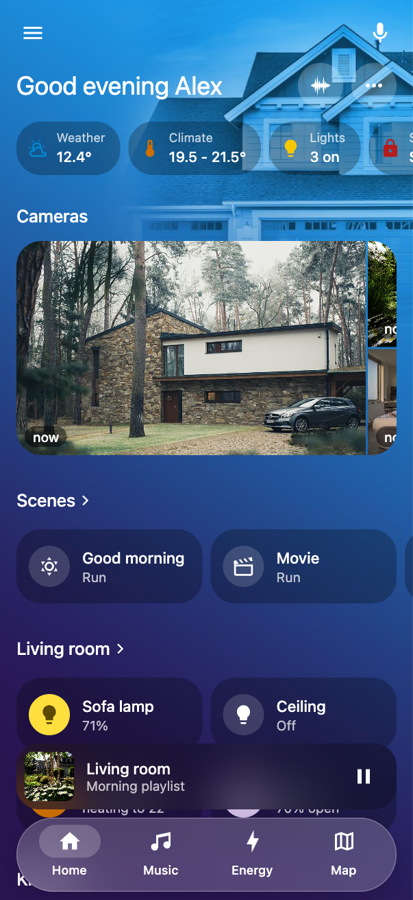
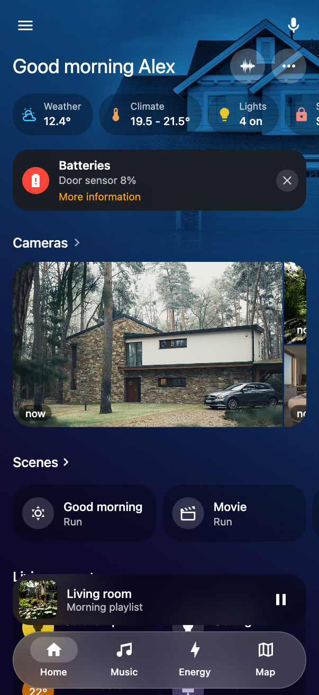
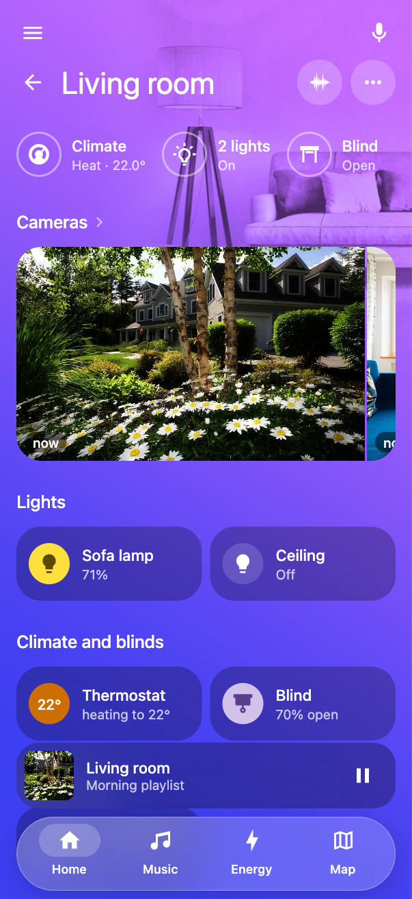
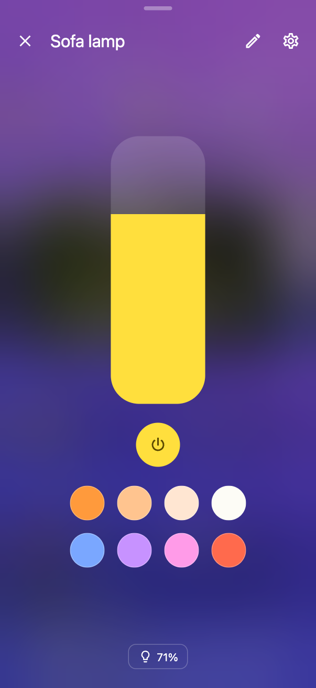
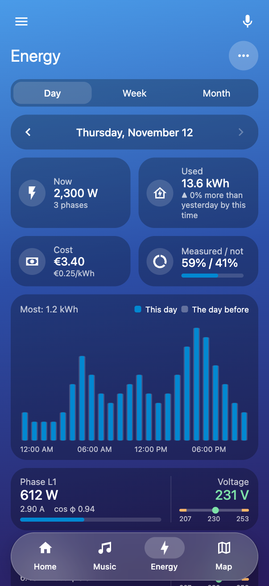
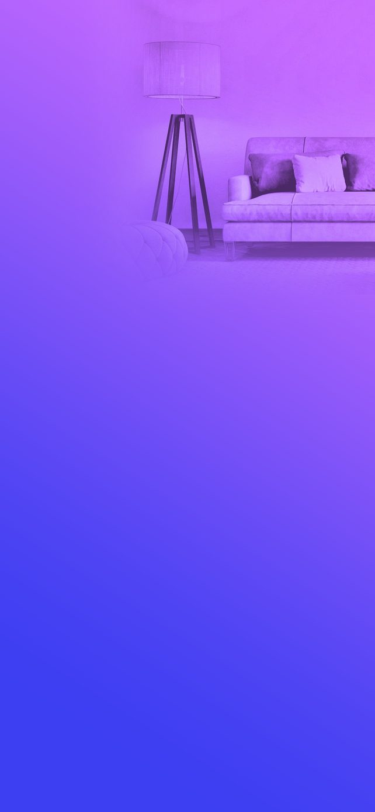
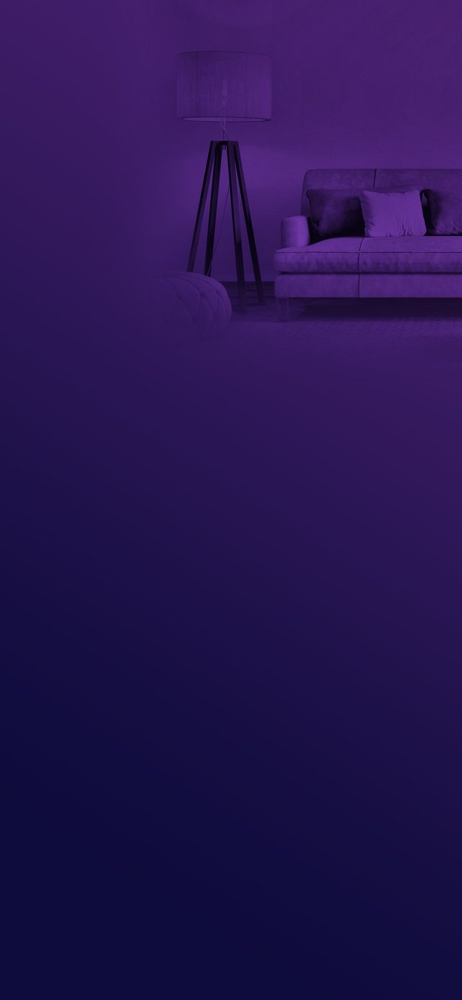

# The Apple Home look from scratch

[Polski](apple-home.pl.md) · [Guide](guide.md)

This guide goes from a fresh installation to the look in the pictures below: every room with a background of its
own, glass buttons in the colour of the room, white writing, a floating bar at the bottom and windows through which
the blurred room shows. The short version in six steps is in the [guide](guide.md#apple-home-step-by-step); here are
the details and the reasons.

| Home | Dark mode | Room | Lamp | Energy |
|---|---|---|---|---|
|  |  |  |  |  |

## 1. What you need

- Home Assistant with Home Dashboard 0.1.6 or newer ([installation](guide.md#1-install)).
- An administrator account: only it sets the look **For everyone**.
- Areas in Home Assistant with their devices. A room of the dashboard is an area, so without areas there are no rooms
  and no backgrounds for them ([what Home Assistant decides](guide.md#2-what-home-assistant-decides)).
- One picture for every room that should have a background of its own, and one for Home. Phone pictures are enough.
- A free image editor to make the backgrounds: [Photopea](https://www.photopea.com) in the browser, or GIMP.

## 2. Rooms in order

The look works best on a tidy dashboard, so before the colours:

1. Check that every room shows what it should. Three dots in a room → **Edit this screen**: add missing tiles,
   arrange sections, take away what is not needed ([rooms](guide.md#3-rooms)).
2. On Home, set the order of rooms and the favorites: three dots → **My layout** → **For everyone**.
3. Add scenes to rooms if you use them: in Apple Home they are a row of glass buttons under the cameras.

## 3. Turn on the Apple Home theme

1. Three dots → **Look**.
2. Tick **For everyone**: from now on you change the look of the whole home, not only yours.
3. **Themes** tab → **Use** next to **Apple Home**.

The page reloads in the new look. What the theme sets:

| Part | Setting | Why |
|---|---|---|
| Background | strength 100%, no veil | the picture shows in full colour |
| Buttons | black at 26%, corners 24, colour on the icon only | neutral glass takes the colour of the background it lies on, so it suits every room |
| Circles under icons | white at 15% (`#ffffff26`) | light glass instead of a grey circle |
| Writing | white titles and headings | readable on a coloured background |
| Blocks at the top | black glass, corners 24 | pills as in Apple Home |
| Bar | floating, white glass at 20% with blur | does not cover the background and floats over the page |
| Windows | black at 22%, blur 40 px | the room the window opened from shows through, blurred |
| Map | dark, with a dark page background | one dark whole instead of a light map on a coloured page |
| Pages without a background | a blue gradient | no page stays white |

Before you add pictures every room has the same blue gradient. That is expected: the colours of rooms come from their
backgrounds.

## 4. Backgrounds: the main part

The Apple Home look is mostly backgrounds. The buttons are see-through, so the background decides the colour of the
whole room.

### What a good background looks like

| Light | Dark |
|---|---|
|  |  |

- **Upright**, 1284 × 2778 pixels (the shape of a phone). A tablet held on its side crops it, so the top part matters.
- **The picture only at the top right**, about the top third. The rest is a smooth gradient: buttons and writing lie
  there, so it has to be calm.
- **A picture without colours of its own**: in shades of grey, melted into the gradient. Only the shapes show: a sofa,
  a lamp, the house. The colour of the room then comes from the gradient alone.
- **A gradient of two colours**, from a lighter one at the top to a darker or different one at the bottom, slightly
  slanted.
- **Two versions**: a light one for the day and a dark one for the night, with the same picture and darker colours.
- **A JPG file**, quality about 85%, 100–200 KB. Bigger files improve nothing and slow the phone down.

The examples from the pictures are in `dev/demo-pictures/backgrounds` in the repository.

### Making a background step by step (Photopea or GIMP)

1. **New image** of 1284 × 2778 px.
2. **Gradient**: linear gradient tool, top colour → bottom colour (palettes below), drag from top to bottom slightly
   slanted to the right (about 170°).
3. **Picture of the room**: paste it as a new layer and move it to the top right corner. It should take about the
   top third and go past the right edge.
4. **No colour**: Image → Adjustments → **Desaturate** (black and white), then raise the contrast a little.
5. **Melting in**: set the blend mode of the picture layer to **Soft Light** or **Overlay**. The picture takes the
   colours of the gradient.
6. **Soft edges**: add a mask to the layer and paint a black gradient on it, so the picture fades to the left and
   downwards. The rectangle of the picture must not show.
7. **Export**: JPG, quality 85%, named e.g. `living_room_light.jpg`.
8. **Dark version**: change the colours of the gradient to their dark counterparts and lower the opacity of the
   picture layer to 60–70%. Export as `living_room_dark.jpg`.

Tip: make the first room, keep the working file (PSD or XCF), and for the next rooms change only the picture and the
colours of the gradient. All backgrounds then look like one family.

### Colour palettes

The colours of the backgrounds in the pictures, to use as they are or as a start. Each room gets a different colour,
so it is clear at once where you are.

| Room | Light: top → bottom | Dark: top → bottom |
|---|---|---|
| Home | `#1aa0f0` → `#2a1452` | `#0c4a80` → `#10082a` |
| Living room | `#c86bff` → `#3d3ff2` | `#47206e` → `#0e0c3c` |
| Bedroom | `#fbd77f` → `#a56bff` | `#5c4614` → `#24104e` |
| Kitchen | `#f4f19a` → `#62a8ec` | `#4f5a1c` → `#0a1e38` |
| Dining room | `#ffc98a` → `#ff8f6b` | `#6a3a1e` → `#200c08` |
| Kids' room | `#f6b3b0` → `#6b6bff` | `#5a2e48` → `#14114a` |
| Office | `#7cc8f8` → `#ff6f91` | `#173f63` → `#3a0d1e` |
| Bathroom | `#9ff0f5` → `#3b7fd6` | `#16525e` → `#071a3a` |
| Hall | `#3b9fe6` → `#2a1f6e` | `#123f6a` → `#0a0826` |
| Laundry | `#c7d6f5` → `#ff8a3d` | `#2a3a5c` → `#3a1606` |
| Balcony | `#7fd6b0` → `#2fae7c` | `#1d5a46` → `#071a14` |
| Garden | `#5fd3f0` → `#2ee59b` | `#14506a` → `#05221a` |
| Garage | `#b8c4d2` → `#55657a` | `#3a4656` → `#0c1016` |
| Storage | `#f7b27c` → `#f4cf6c` | `#5c3a1c` → `#1c1206` |
| Media | `#22c6e8` → `#3a1e8c` | `#0e4f66` → `#120a36` |
| Scenes | `#d07ce0` → `#3fd6a0` | `#4e1f5c` → `#06302a` |

### Uploading and setting a background

For Home and every room:

1. Open the page or the room, three dots → **Background of this screen**.
2. At the top choose **Light**. In the **Picture** field choose the light file: it goes to Home Assistant.
3. Choose **Dark** and upload the dark file.
4. **Part of a picture to keep: Top**, so the picture stays when it is cropped, not the gradient.
5. Tick **For everyone** next to both looks and **Save**.

A tablet on its side can have a background of its own: the **Upright / Wide** switch in the same window. A wide
background is 2778 × 1284 px with the picture on the right. Without it the tablet uses the upright one.

Instead of uploading through the window you can copy the files to `/config/www/backgrounds/` and list them in the
configuration of the dashboard (**Dashboard settings → Edit configuration**):

```yaml
backgrounds:
  home:
    light: /local/backgrounds/home_light.jpg
    dark: /local/backgrounds/home_dark.jpg
    position: top
  living_room:              # id of the room (area)
    light: /local/backgrounds/living_room_light.jpg
    dark: /local/backgrounds/living_room_dark.jpg
    position: top
```

### Scenes, Map and Energy

The Scenes page, the Map and Energy have **Background of this screen** too (keys `scenes`, `map`, `energy`). Apple
Home gives the Map a dark background under the dark map. Energy suits the background of Home or a calm gradient
without a picture.

## 5. Finishing touches

- **Icons** (**Look → Icons**): find a device, then an icon in English, e.g. `led strip`, `ceiling light`,
  `floor lamp`. Good icons make a big difference.
- **Leave the colours of buttons neutral.** A colour for a kind of buttons (**Look → Buttons**) helps for one kind
  at most, e.g. yellow lights. Coloured buttons on a coloured background soon look heavy.
- **Bar** (**Look → Bar**): choose 2 to 5 entries, e.g. Home, Scenes, a favourite room and Menu.
- **Player**: **Paused stays: 0** hides it as soon as you pause, as in Apple Home.
- **Writing hard to read?** Lower **Look → Background → Background strength** to 80–90%. The page lays a light veil
  and the colours stay.
- **Buttons too dark or too light?** **Look → Buttons → Button opacity**: less gives more of the background colour,
  more gives darker glass.

## 6. Phone and tablet

- **Phone**: the Home Assistant Companion app. Make the dashboard the start one in **My layout → Open this dashboard
  at start**. Bounce at the ends (**Look → Background**) gives the soft feel of apps.
- **Wall tablet**: the bar is on the side, and the background lies under it too. For a tablet on its side make wide
  backgrounds (part 4). Going back to Home after a while is set in **Dashboard settings**.
- **Dark mode**: the look follows the system on its own. The **System / Light / Dark** choice for yourself is in
  **Background of this screen**.

## 7. Save and share

1. **Look → Themes → Save the changes into the theme Apple Home**: your version of the theme, with its backgrounds,
   stays in the library. The button with a round arrow goes back to the version that came.
2. **Export to a file**: one `*.home-dashboard-theme.json` file with the look and the pictures of the backgrounds.
3. In another home: **Import a theme**, choose the file, give each background a room or **Leave out**, then **Save for
   everyone**. Own icons come along only for devices with the same `entity_id`.

## 8. When something does not look right

| Symptom | Fix |
|---|---|
| A rectangle shows around the picture of a background | the mask of the picture has sharp edges: blur it or make its gradient longer (step 4.6) |
| A room has the blue background instead of its own | the room has no background yet; add it in its **Background of this screen** |
| A light background shows in dark mode | the dark version is missing; upload it under **Dark** |
| The picture is cropped and only the gradient shows | set **Part of a picture to keep: Top** or make a wide background |
| White writing hard to read on a light background | darker gradient colours, or **Background strength** at 80–90% |
| The theme file takes tens of MB | the backgrounds are too big; save them again as JPG 85% at 1284 × 2778 |
| The window of a device is solid, without the blurred room | the opacity in **Look → Windows** is too high; Apple Home has 22% |
