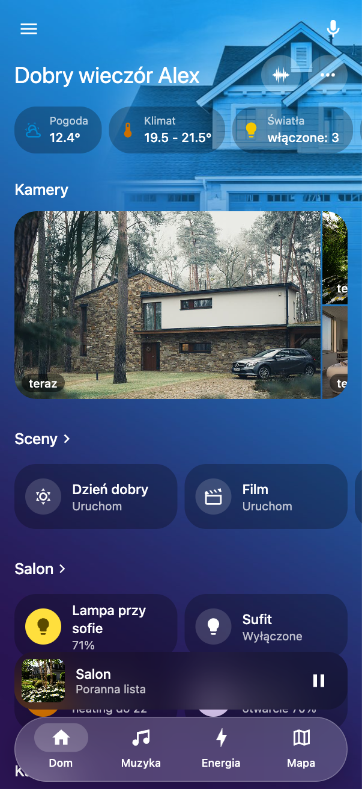
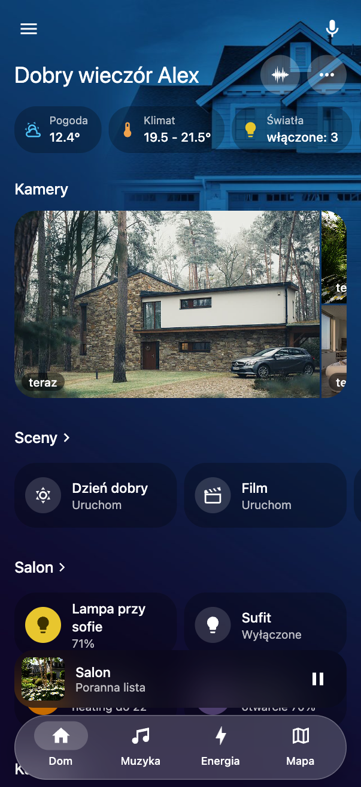
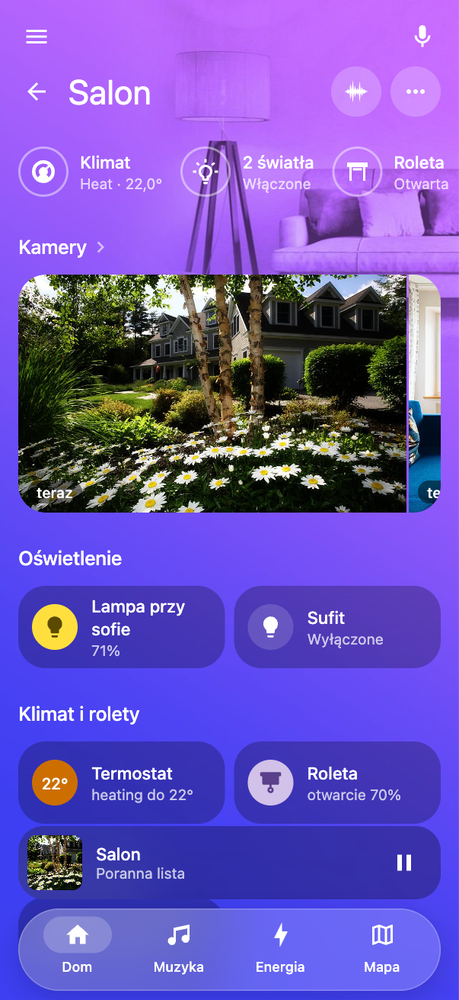
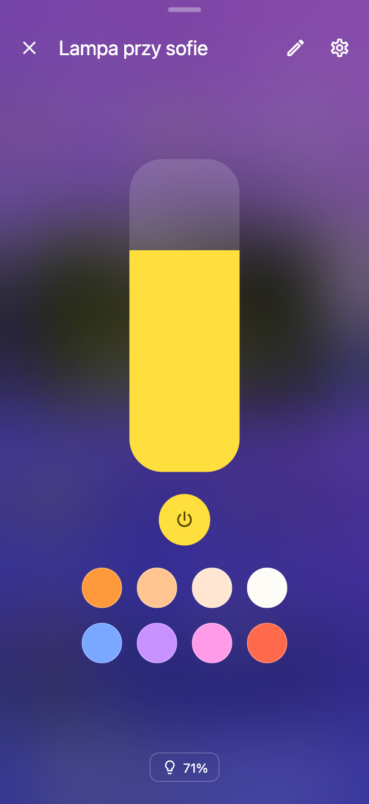
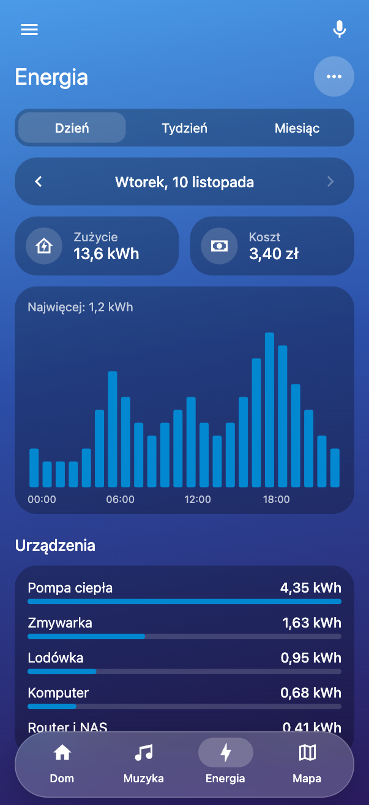
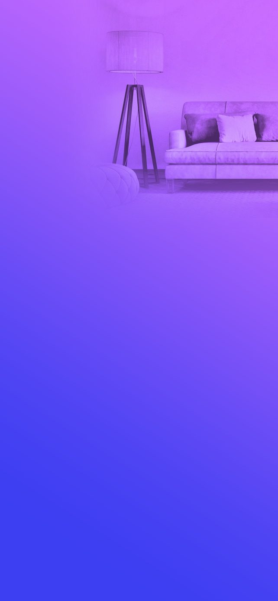
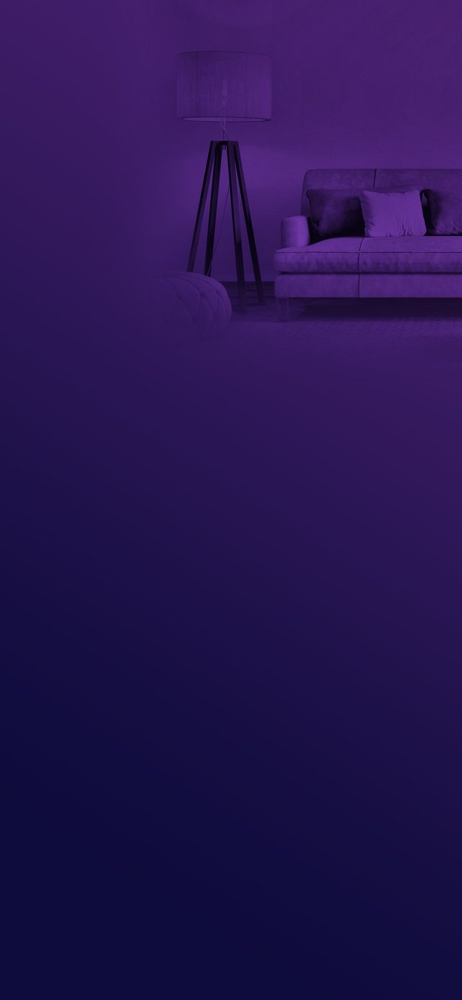

# Wygląd Apple Home od zera

[English](apple-home.md) · [Przewodnik](guide.pl.md)

Ten poradnik prowadzi od świeżej instalacji do wyglądu jak na zrzutach poniżej: każdy pokój z własnym tłem, szklane
przyciski w kolorze pokoju, białe napisy, pływający pasek na dole i okna, przez które widać rozmyty pokój. Krótka
wersja w sześciu krokach jest w [przewodniku](guide.pl.md#apple-home-krok-po-kroku), tutaj są szczegóły i powody.

| Strona główna | Tryb ciemny | Pokój | Lampa | Energia |
|---|---|---|---|---|
|  |  |  |  |  |

## 1. Czego potrzebujesz

- Home Assistant z zainstalowanym Home Dashboard w wersji 0.1.6 lub nowszej ([instalacja](guide.pl.md#1-instalacja)).
- Konto administratora: tylko ono ustawia wygląd **Dla wszystkich**.
- Obszary w Home Assistant z przypisanymi urządzeniami. Pokój w dashboardzie to obszar, więc bez obszarów nie ma
  pokoi ani ich teł ([co decyduje w Home Assistant](guide.pl.md#2-co-decyduje-w-home-assistant)).
- Po jednym zdjęciu na każdy pokój, który ma mieć własne tło, i jedno na stronę główną. Wystarczą zdjęcia z telefonu.
- Do przygotowania teł darmowy edytor obrazów: [Photopea](https://www.photopea.com) w przeglądarce albo GIMP.

## 2. Pokoje w porządku

Wygląd najlepiej działa na uporządkowanym dashboardzie, więc zanim zajmiesz się kolorami:

1. Sprawdź, że każdy pokój pokazuje to, co trzeba. Trzy kropki w pokoju → **Edytuj ten ekran**: dodaj brakujące
   kafelki, ułóż sekcje, usuń zbędne ([pokoje](guide.pl.md#3-pokoje)).
2. Na stronie głównej ułóż kolejność pokoi i ulubione: trzy kropki → **Mój układ** → **Dla wszystkich**.
3. Dodaj sceny do pokoi, jeśli ich używasz: w Apple Home to rząd szklanych przycisków pod kamerami.

## 3. Włącz motyw Apple Home

1. Trzy kropki → **Wygląd**.
2. Zaznacz **Dla wszystkich**: od tej chwili zmieniasz wygląd całego domu, a nie tylko swój.
3. Zakładka **Motywy** → **Użyj** przy **Apple Home**.

Strona przeładuje się w nowym wyglądzie. Co dokładnie ustawia motyw:

| Część | Ustawienie | Dlaczego |
|---|---|---|
| Tło | wyrazistość 100%, bez zasłony | zdjęcie widać w pełnych kolorach |
| Przyciski | czarne z kryciem 26%, zaokrąglenie 24, kolor tylko na ikonie | neutralne szkło bierze kolor tła, na którym leży, więc pasuje do każdego pokoju |
| Kółka pod ikonami | biel 15% (`#ffffff26`) | jasne szkło zamiast szarego koła |
| Napisy | białe tytuły i nagłówki | czytelne na kolorowym tle |
| Górne bloki | czarne szkło, zaokrąglenie 24 | jak pigułki w Apple Home |
| Pasek | pływający, białe szkło 20% z rozmyciem | nie zasłania tła i unosi się nad stroną |
| Okna | czarne 22%, rozmycie 40 px | widać przez nie rozmyty pokój, z którego otwarto okno |
| Mapa | ciemna, z ciemnym tłem strony | jedna ciemna całość zamiast jasnej mapy na kolorowym tle |
| Strony bez tła | niebieski gradient | żadna strona nie zostaje biała |

Zanim dodasz zdjęcia, każdy pokój ma ten sam niebieski gradient. Tak ma być: kolory pokoi dają dopiero ich tła.

## 4. Tła: najważniejsza część

Wygląd Apple Home to w dużej mierze tła. Przyciski są przezroczyste, więc to tło decyduje o kolorze całego pokoju.

### Jak wygląda dobre tło

| Jasne | Ciemne |
|---|---|
|  |  |

- **Pionowe**, 1284 × 2778 pikseli (proporcje telefonu). Na tablecie trzymanym poziomo zdjęcie zostanie przycięte,
  dlatego ważna jest jego górna część.
- **Zdjęcie tylko w prawym górnym rogu**, mniej więcej w górnej jednej trzeciej. Reszta to gładki gradient: tam
  leżą przyciski i napisy, więc musi być spokojnie.
- **Zdjęcie bez własnych kolorów**: w odcieniach szarości, wtopione w gradient. Widać tylko kształty: sofę, lampę,
  dom. Dzięki temu kolor pokoju zależy wyłącznie od gradientu.
- **Gradient z dwóch kolorów**, od jaśniejszego u góry do ciemniejszego lub innego u dołu, lekko po skosie.
- **Dwie wersje**: jasna na dzień i ciemna na noc, z tym samym zdjęciem i ciemniejszymi kolorami.
- **Plik JPG**, jakość około 85%, 100–200 KB. Większe pliki niczego nie poprawiają, a spowalniają telefon.

Przykłady z zrzutów są w `dev/demo-pictures/backgrounds` w repozytorium.

### Przygotowanie tła krok po kroku (Photopea albo GIMP)

1. **Nowy obraz** 1284 × 2778 px.
2. **Gradient**: narzędzie gradientu liniowego, kolor górny → kolor dolny (palety niżej), przeciągnij od góry do dołu
   z lekkim skosem w prawo (około 170°).
3. **Zdjęcie pokoju**: wklej jako nową warstwę i przesuń do prawego górnego rogu. Ma zajmować mniej więcej górną
   jedną trzecią i wychodzić poza prawą krawędź.
4. **Bez koloru**: Obraz → Dopasowania → **Desaturacja** (czarno-białe), potem lekko podnieś kontrast.
5. **Wtopienie**: ustaw warstwie zdjęcia tryb mieszania **Światło łagodne** (Soft Light) albo **Nakładka**
   (Overlay). Zdjęcie przejmie kolory gradientu.
6. **Miękkie brzegi**: dodaj warstwie maskę i namaluj na niej czarny gradient, tak żeby zdjęcie zanikało w lewo i w
   dół. Nie może być widać prostokąta zdjęcia.
7. **Eksport**: JPG, jakość 85%, nazwa np. `salon_jasny.jpg`.
8. **Wersja ciemna**: zmień kolory gradientu na ciemne odpowiedniki, a warstwie zdjęcia zmniejsz krycie do 60–70%.
   Eksportuj jako `salon_ciemny.jpg`.

Wskazówka: przygotuj pierwszy pokój, zapisz plik roboczy (PSD albo XCF) i dla kolejnych pokoi podmieniaj tylko
zdjęcie i kolory gradientu. Wszystkie tła będą wtedy wyglądały jak z jednej rodziny.

### Palety kolorów

Kolory z teł na zrzutach, do użycia albo jako punkt wyjścia. Każdy pokój dostaje inny kolor, dzięki czemu od razu
widać, gdzie jesteś.

| Pokój | Jasne: góra → dół | Ciemne: góra → dół |
|---|---|---|
| Strona główna | `#1aa0f0` → `#2a1452` | `#0c4a80` → `#10082a` |
| Salon | `#c86bff` → `#3d3ff2` | `#47206e` → `#0e0c3c` |
| Sypialnia | `#fbd77f` → `#a56bff` | `#5c4614` → `#24104e` |
| Kuchnia | `#f4f19a` → `#62a8ec` | `#4f5a1c` → `#0a1e38` |
| Jadalnia | `#ffc98a` → `#ff8f6b` | `#6a3a1e` → `#200c08` |
| Pokój dzieci | `#f6b3b0` → `#6b6bff` | `#5a2e48` → `#14114a` |
| Biuro | `#7cc8f8` → `#ff6f91` | `#173f63` → `#3a0d1e` |
| Łazienka | `#9ff0f5` → `#3b7fd6` | `#16525e` → `#071a3a` |
| Korytarz | `#3b9fe6` → `#2a1f6e` | `#123f6a` → `#0a0826` |
| Pralnia | `#c7d6f5` → `#ff8a3d` | `#2a3a5c` → `#3a1606` |
| Balkon | `#7fd6b0` → `#2fae7c` | `#1d5a46` → `#071a14` |
| Ogród | `#5fd3f0` → `#2ee59b` | `#14506a` → `#05221a` |
| Garaż | `#b8c4d2` → `#55657a` | `#3a4656` → `#0c1016` |
| Schowek | `#f7b27c` → `#f4cf6c` | `#5c3a1c` → `#1c1206` |
| Media | `#22c6e8` → `#3a1e8c` | `#0e4f66` → `#120a36` |
| Sceny | `#d07ce0` → `#3fd6a0` | `#4e1f5c` → `#06302a` |

### Wgranie i ustawienie tła

Dla strony głównej i każdego pokoju:

1. Otwórz stronę albo pokój, trzy kropki → **Tło tego ekranu**.
2. Na górze wybierz **Jasny**. W polu **Zdjęcie** wybierz plik jasny: trafi do Home Assistant.
3. Wybierz **Ciemny** i wgraj plik ciemny.
4. **Część zdjęcia, która zostaje: Góra**, żeby po przycięciu zostało zdjęcie, a nie gradient.
5. Zaznacz **Dla wszystkich** przy obu wyglądach i **Zapisz**.

Na tablecie ustawionym poziomo możesz dodać osobne tło: przełącznik **Pionowy / Poziomy** w tym samym oknie. Tło
poziome ma 2778 × 1284 px i zdjęcie po prawej stronie. Bez niego tablet użyje tła pionowego.

Zamiast wgrywać przez okno możesz skopiować pliki do `/config/www/backgrounds/` i wpisać je w konfiguracji
dashboardu (**Ustawienia dashboardu → Edytuj konfigurację**):

```yaml
backgrounds:
  home:
    light: /local/backgrounds/home_light.jpg
    dark: /local/backgrounds/home_dark.jpg
    position: top
  living_room:              # identyfikator pokoju (obszaru)
    light: /local/backgrounds/living_room_light.jpg
    dark: /local/backgrounds/living_room_dark.jpg
    position: top
```

### Sceny, Mapa i Energia

Strona Scen, Mapa i Energia też mają **Tło tego ekranu** (klucze `scenes`, `map`, `energy`). Apple Home daje Mapie
ciemne tło pod ciemną mapę. Energii pasuje tło strony głównej albo spokojny gradient bez zdjęcia.

## 5. Dopracowanie

- **Ikony** (**Wygląd → Ikony**): znajdź urządzenie, potem ikonę po angielsku, np. `led strip`, `ceiling light`,
  `floor lamp`. Dobre ikony robią dużą różnicę.
- **Kolory przycisków zostaw neutralne.** Kolor dla rodzaju przycisków (**Wygląd → Przyciski**) przydaje się
  najwyżej dla jednego rodzaju, np. żółte światła. Kolorowe przyciski na kolorowym tle szybko wyglądają ciężko.
- **Pasek** (**Wygląd → Pasek**): wybierz od 2 do 5 pozycji, np. Dom, Sceny, ulubiony pokój i Menu.
- **Odtwarzacz**: **Wstrzymany zostaje: 0** chowa go od razu po pauzie, jak w Apple Home.
- **Napisy za słabo widoczne?** Zmniejsz **Wygląd → Tło → Wyrazistość tła** do 80–90%. Strona nałoży lekką
  zasłonę, a kolory zostaną.
- **Przyciski za ciemne albo za jasne?** **Wygląd → Przyciski → Krycie przycisków**: mniej daje więcej koloru tła,
  więcej daje ciemniejsze szkło.

## 6. Telefon i tablet

- **Telefon**: aplikacja Home Assistant Companion. Dashboard ustaw jako startowy w **Mój układ → Otwieraj ten
  dashboard przy starcie**. Odbicie przewijania (**Wygląd → Tło**) daje miękkie zachowanie jak w aplikacjach.
- **Tablet ścienny**: pasek jest z boku, a tło leży także pod nim. Dla tabletu poziomego przygotuj tła poziome (krok 4).
  Powrót do strony głównej po bezczynności ustawisz w **Ustawieniach dashboardu**.
- **Tryb ciemny**: wygląd przełącza się sam razem z systemem. Wybór **Systemowy / Jasny / Ciemny** dla siebie jest
  w **Tło tego ekranu**.

## 7. Zapisz i podziel się

1. **Wygląd → Motywy → Zapisz zmiany w motywie Apple Home**: Twoja wersja motywu, razem z tłami, zostaje w
   bibliotece. Przycisk z okrągłą strzałką wraca do wersji wbudowanej.
2. **Eksportuj do pliku**: jeden plik `*.home-dashboard-theme.json` z wyglądem i zdjęciami teł.
3. W innym domu: **Importuj motyw**, wybierz plik, przypisz każde tło do pokoju albo **Pomiń** i **Zapisz dla
   wszystkich**. Własne ikony przechodzą tylko dla urządzeń o tym samym `entity_id`.

## 8. Gdy coś nie wygląda dobrze

| Objaw | Rozwiązanie |
|---|---|
| Na zdjęciu tła widać prostokąt | maska zdjęcia ma za ostre brzegi: rozmyj ją albo wydłuż gradient maski (krok 4.6) |
| Pokój ma niebieskie tło zamiast swojego | pokój nie ma jeszcze tła; dodaj je w **Tło tego ekranu** tego pokoju |
| W trybie ciemnym widać jasne tło | brakuje wersji ciemnej; wgraj ją przy **Ciemny** |
| Zdjęcie przycięte, widać sam gradient | ustaw **Część zdjęcia: Góra** albo przygotuj tło poziome |
| Białe napisy nieczytelne na jasnym tle | ciemniejsze kolory gradientu albo **Wyrazistość tła** 80–90% |
| Plik motywu ma kilkadziesiąt MB | tła są za duże; zapisz je ponownie jako JPG 85% w rozmiarze 1284 × 2778 |
| Okno urządzenia jest jednolite, bez rozmytego pokoju | w **Wygląd → Okna** krycie jest za wysokie; Apple Home ma 22% |
