# The dashboard editor: from zero to a finished dashboard

[Polski](editor.pl.md) · [README](../README.md) · [Guide](guide.md) · [Configuration reference](configuration.md)

The <b class="ui">Dashboard editor</b> builds and changes the Home Dashboard on a computer. You see the whole dashboard as a tree
on the left, the real dashboard of an iPhone and an iPad in the middle, and a form for whatever you chose on the
right. Every change shows in the preview at once. **Nothing changes on the phones and tablets of the home until you
publish.** You do not need YAML, but it is always there beside each form if you want it.

This document goes step by step from an empty Home Assistant to a dashboard like the one in the screenshots: rooms
with their devices, a Home page, blocks for machines, a look of your own, a status bar for a wall tablet, a menu and
rules for who sees what. Read it in order the first time; later each chapter stands on its own.

The screenshots show a made-up home (`dev/demo.js`), never a real one.

## Contents {#contents}

1. [Before you start](#before-you-start)
2. [Opening the editor](#opening-the-editor)
3. [The first dashboard and its rooms](#the-first-dashboard-and-its-rooms)
4. [A tour of the screen](#a-tour-of-the-screen)
5. [The preview](#the-preview)
6. [Rooms](#rooms)
7. [Sections and tiles](#sections-and-tiles)
8. [The Home page](#the-home-page)
9. [Blocks: machines, appliances, screens of their own](#blocks-machines-appliances-screens-of-their)
10. [Look, themes and backgrounds](#look-themes-and-backgrounds)
11. [The status bar of a tablet and the calendars](#the-status-bar-of-a-tablet)
12. [Menu and bar of pages](#menu-and-bar-of-pages)
13. [Cameras, energy, intercom and the other settings](#cameras-energy-intercom-and-the-other)
14. [Who sees what](#who-sees-what)
15. [Saving, publishing and history](#saving-publishing-and-history)
16. [Editor settings: your own phones and tablets](#editor-settings-your-own-phones-and)
17. [A whole dashboard in ten steps](#a-whole-dashboard-in-ten-steps)
18. [Tips and problems](#tips-and-problems)

## 1. Before you start {#before-you-start}

You need:

- **Home Assistant** with the **Home Dashboard** integration installed and added (see
  [Installation in the README](../README.md#installation)). After it is added, Home Assistant needs one restart.
- **An administrator account.** The editor is for administrators only; other people only use the dashboard.
- **A computer** with a recent browser (Chrome, Safari, Edge, Firefox). A window at least 1400 px wide is
  comfortable; on a smaller one drag the side columns narrower.
- **Areas in Home Assistant** (Settings → Areas, labels & zones) with your devices in them. The editor builds rooms
  from areas, so time spent here saves time later. A device without an area is still reachable, but it has to be
  added by hand.

Good to know before the first click:

- The editor keeps a **draft** on the server. You can close the browser and come back, on another computer too.
- **The preview never switches anything.** Tapping a lamp in the preview chooses it in the tree; it never calls a
  service. You can click around without fear.
- **Undo** and **Redo** (⌘Z and ⇧⌘Z, or Ctrl+Z and Ctrl+Shift+Z) take back any step, even a big one such as making
  all rooms at once.
- **Esc** closes what is open, one thing at a time, the innermost first: a picture shown big, the window of pictures,
  the list of tiles to add, a dialog (as its ✕: nothing is saved or published).

## 2. Opening the editor {#opening-the-editor}

<b class="ui">Dashboard editor</b> sits in the sidebar of Home Assistant (only administrators see it). If you would rather keep
the sidebar short, open Settings → Devices & services → Home Dashboard → **Configure** and turn off *Show the editor in
the sidebar*; the editor then opens at the address `/home-dashboard-editor`.

The editor has its own light and dark look. By default it follows Home Assistant; the button with the half sun in
the top bar switches between Auto, Light and Dark, and the browser remembers it. The dashboard in the preview has a
choice of its own (chapter 5).

## 3. The first dashboard and its rooms {#the-first-dashboard-and-its-rooms}

### No dashboard yet {#no-dashboard-yet}

On the very first start the editor finds no dashboard that uses Home Dashboard and offers to make one:

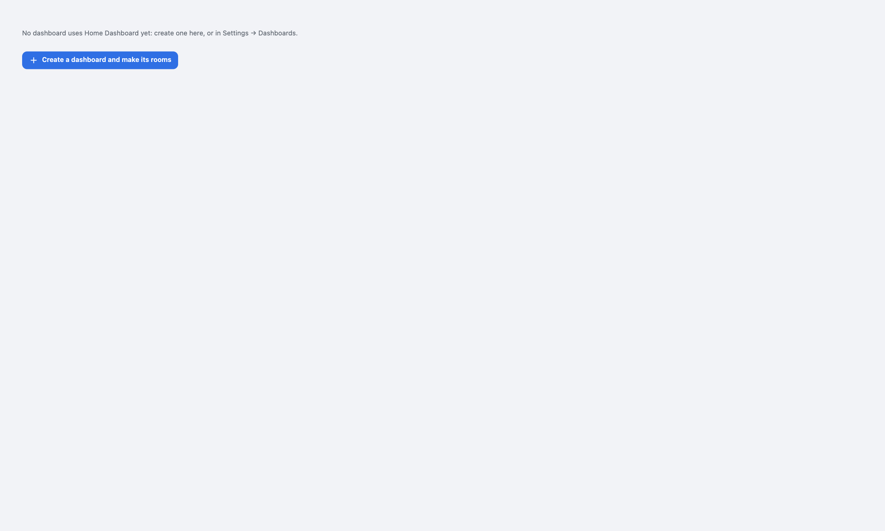

<b class="ui">Create a dashboard and make its rooms</b> adds a dashboard called *Home Dashboard* to Settings → Dashboards and opens it in
the editor. (You can also make it by hand in Settings → Dashboards and paste `strategy: {type: custom:home-dashboard}`
into its raw configuration; the editor then finds it.)

### Rooms from areas {#rooms-from-areas}

A new dashboard has no rooms. The tree shows <b class="ui">Make the rooms from the areas</b>; it opens this window:

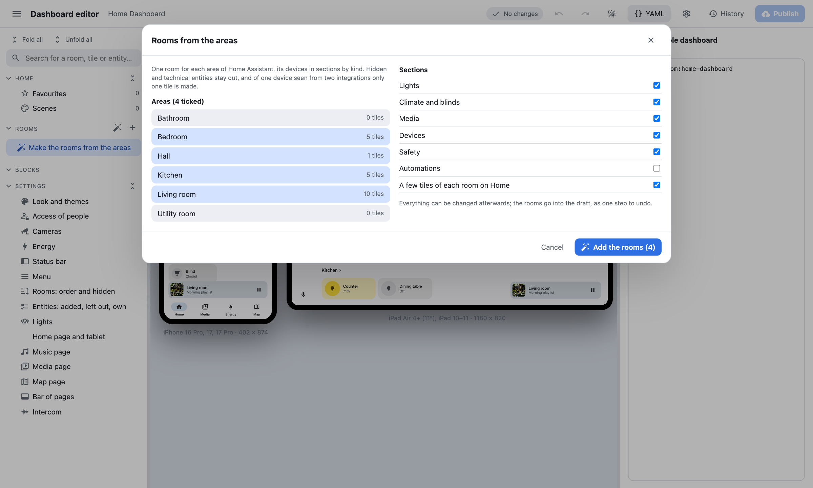

- <b class="ui">Areas</b> on the left: one room for each area you tick. The number says how many tiles that room will get. Areas
  with no tiles are not ticked.
- <b class="ui">Sections</b> on the right: in what groups the devices of a room are put, by kind: *Lights*, *Climate and blinds*,
  *Media*, *Devices*, *Safety*, and *Automations* if you tick it.
- <b class="ui">A few tiles of each room on Home</b> puts the main lights, the thermostat and the blinds of every room on the Home
  page too.
- Hidden, configuration and diagnostic entities stay out. A device that two integrations show (for example a
  thermostat seen by Netatmo and by HomeKit) becomes one tile, not two.

What you tick appears in the preview before you add it. **Add the rooms** puts them into the draft as one step, so one
**Undo** takes all of them back. Later, when you add a new area in Home Assistant, the same window opens from the
wand ✨ beside *Rooms* and offers only the areas that have no room yet.

> Starting with rooms from areas is the fastest way. You can still change everything: rename rooms, merge two areas
> into one room, move tiles, remove what you do not need.

## 4. A tour of the screen {#a-tour-of-the-screen}

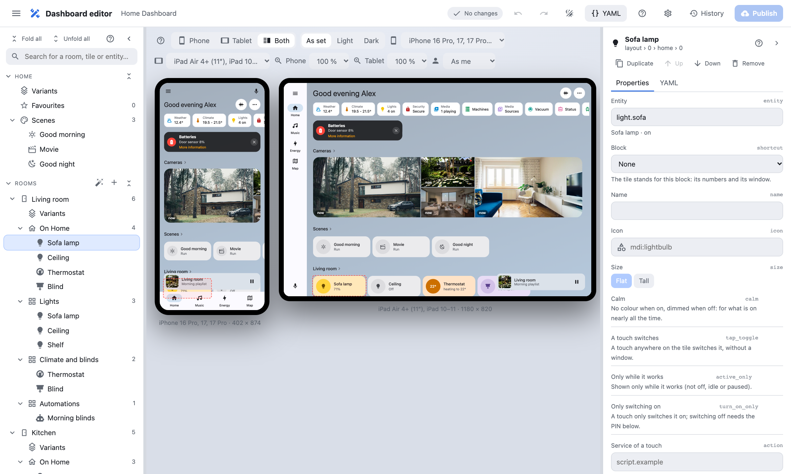

**The top bar**, from the left:

| Element | What it does |
|---|---|
| ☰ | opens the menu of Home Assistant, to leave the editor |
| *Dashboard editor · Home Dashboard* | which dashboard you edit (with several, a list to choose) |
| *No changes* / *Draft saved* | whether there is a draft; it is saved by itself a moment after each change |
| ↶ ↷ | Undo and Redo |
| *Throw away* | drops the draft and goes back to the published version (only while there is a draft) |
| half sun | the look of the editor: Auto, Light, Dark |
| **{} YAML** | the whole dashboard as YAML, to read or to paste |
| ? | this guide on the documentation site, in a new tab (in English or Polish, as Home Assistant is) |
| ⚙ | a pop-up with the look (As HA, Light, Dark) and the language of the editor (As in HA, Polski, English), and the way to the phones and tablets of the preview (chapter 16) |
| <b class="ui">History</b> | the published versions (chapter 15) |
| <b class="ui">Publish</b> | publishes the draft (chapter 15) |

**The tree** on the left holds everything, in four groups:

- <b class="ui">Home</b>: *Favourites* and *Scenes* of the Home page.
- <b class="ui">Rooms</b>: every room with its *On Home* list, its own scenes and its sections with their tiles.
- <b class="ui">Blocks</b>: tiles that open a screen of their own (chapter 9).
- <b class="ui">Settings</b>: look, people, cameras, energy, status bar, menu, the order of rooms, entities, lights, the Home page
  and tablet, the Music, Media and Map pages, the bar of pages and the intercom.

The number beside a node says how many things are inside. A yellow ⚠ marks a room or tile with a problem, usually an
entity that no longer exists. *Fold all* and *Unfold all* fold the tree; the arrow beside a group folds that group,
and the icon on its right folds or unfolds everything in it. The **search** finds a room, a tile or an entity by its
name or id.

**The form** on the right edits what you chose. Above it are the buttons for that thing (*Duplicate*, *Up*, *Down*,
*Remove*, and for a room *Add a section*). Beside every field is the name of its key in YAML, in grey, so you can
always find it in the configuration. The <b class="ui">YAML</b> tab shows the same thing as text and takes changes typed there
too. Keys the form does not know are kept untouched.

**The columns** are as wide as you drag them: drag the bars between them; a double click gives the first width back.

**The small ?** above the tree, the preview and the form opens a small window that says what that part does, without
leaving the editor (Esc or a click beside it closes it). At its bottom, *More in the guide* opens the chapter about it;
above the form it is the chapter about what you chose: a room, a tile, the look, who sees what… The only ? that opens
this guide at once is the one in the top bar.

**The address** of the page names what is chosen (`…#/layout/0/sections/1`): copy it, or reload the page, and the
editor opens on the same thing once the dashboard has loaded.

## 5. The preview {#the-preview}

The preview is not a picture: it is the real dashboard, running in frames of an iPhone and an iPad, showing the
draft at once.

- <b class="ui">Phone</b>, <b class="ui">Tablet</b>, <b class="ui">Both</b>: which devices to show.
- <b class="ui">As set</b>, <b class="ui">Light</b>, <b class="ui">Dark</b>: the dashboard's colours. *As set* follows the dashboard's own setting.
- **Model** of the phone and of the tablet: every size of an Apple screen once, with the models of that size (from
  the iPhone SE to the 17 Pro Max, from the iPad 1–6 to the iPad Pro 13″). Your own devices of any make are added in
  the editor settings (chapter 16).
- **Zoom** of each device: set it as in the Home Assistant app on that device (Settings → Companion app → General →
  Zoom). An iPad Air at 85 % shows the dashboard as a page of 1388 × 965, and so does the preview, so what fits in the
  preview fits on the wall.
- **As**: the dashboard of another person, with what they do not see hidden (chapter 14).

The preview and the tree work together:

- **Choosing a node shows it.** Choosing a room takes the frames to that room; choosing a block opens its window;
  choosing the menu opens the menu. A part folded away (a summed-up group of a window) is unfolded by itself.
- **A red dashed frame** marks what you chose: the tile, the section, the room, the window of a block, or a single
  number, button, group or row in it. The frame scrolls into sight.
- **A touch in the preview chooses** what you touched in the tree, without doing anything.
- Under a frame the editor says whether the window of the block you chose **fits on the tablet without scrolling**
  (*The window fits without scrolling ✓*) or by how much it scrolls.

## 6. Rooms {#rooms}

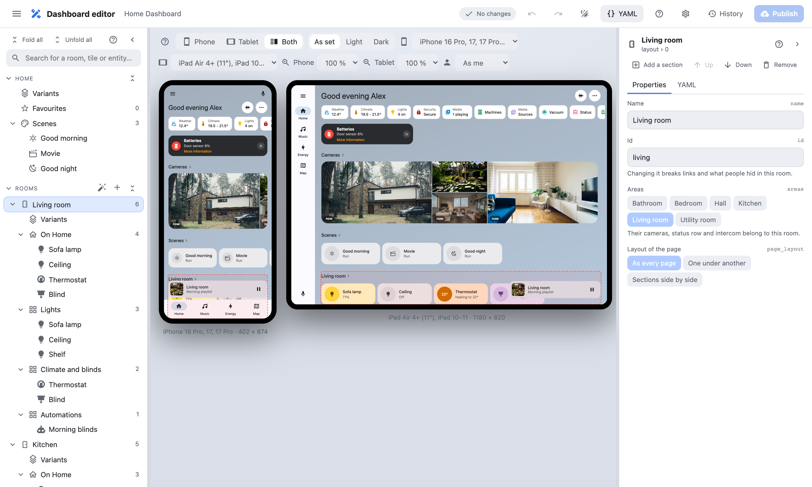

- **Add a room:** **+** beside *Rooms*. It starts empty, with a name to change.
- **The form of a room:** *Name* (shown everywhere), *Id* (the room's address in links; changing it later breaks
  links and the rooms people hid, so pick it once) and <b class="ui">Areas</b>: the areas of Home Assistant that belong to the room.
  A room can have several areas (the kitchen and the dining room together); their cameras, status row and intercom
  belong to the room.
  *Layout of the page* gives the room its own layout: as every page, one under another, or sections side by side
  (see the guide: [Sections side by side](guide.md#sections-side-by-side)).
- **Sections:** *Add a section* above the form. A section is a heading with tiles under it.
- **Order:** *Up* and *Down*, or drag the room in the tree. **Settings → Rooms: order and hidden** sets the order of
  rooms on Home and in the menu, and hides rooms from everyone.

A room has three kinds of lists under it in the tree:

| Node | What it is | Where it shows |
|---|---|---|
| <b class="ui">On Home</b> | tiles of the room on the Home page | Home, in the room's card |
| <b class="ui">Scenes of the room</b> | scenes and scripts of the room | the room's page, at the top |
| a **section** (*Lights*, *Climate and blinds*…) | tiles of the room's page | the room's page |

## 7. Sections and tiles {#sections-and-tiles}

### The list of a section {#the-list-of-a-section}

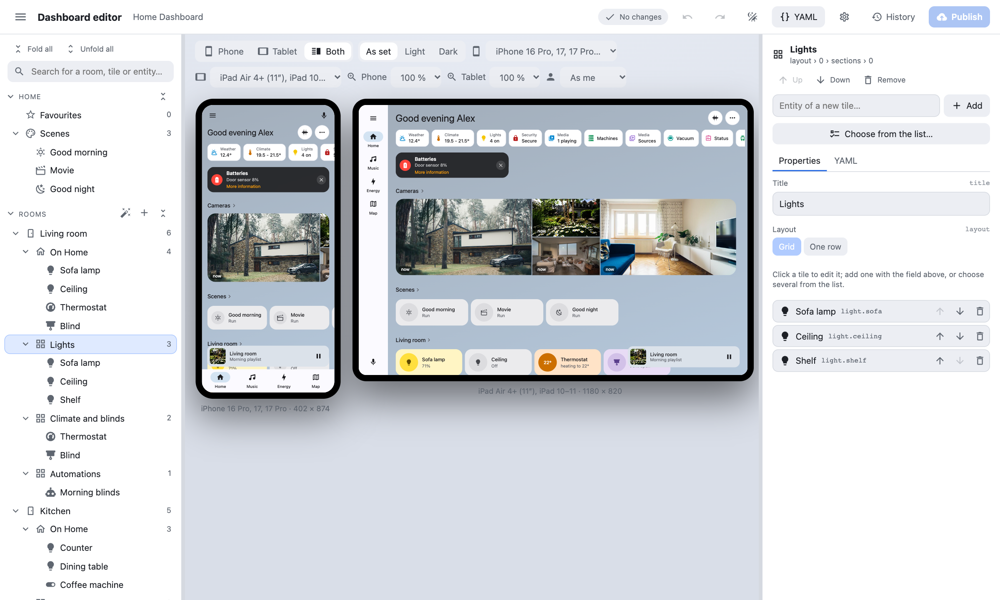

Choosing a section (or *On Home*, *Favourites*, *Scenes*) shows its form (*Title* and *Layout*: a grid, or one row
that scrolls sideways) and **the list of its tiles**: a click opens a tile in its form, the arrows move it, the bin
removes it.

### Adding tiles {#adding-tiles}

Two ways, both above the form:

- <b class="ui">Entity of a new tile…</b> — type the entity id (the field suggests them) and <b class="ui">Add</b>.
- <b class="ui">Choose from the list…</b> — a window with every entity of the home:

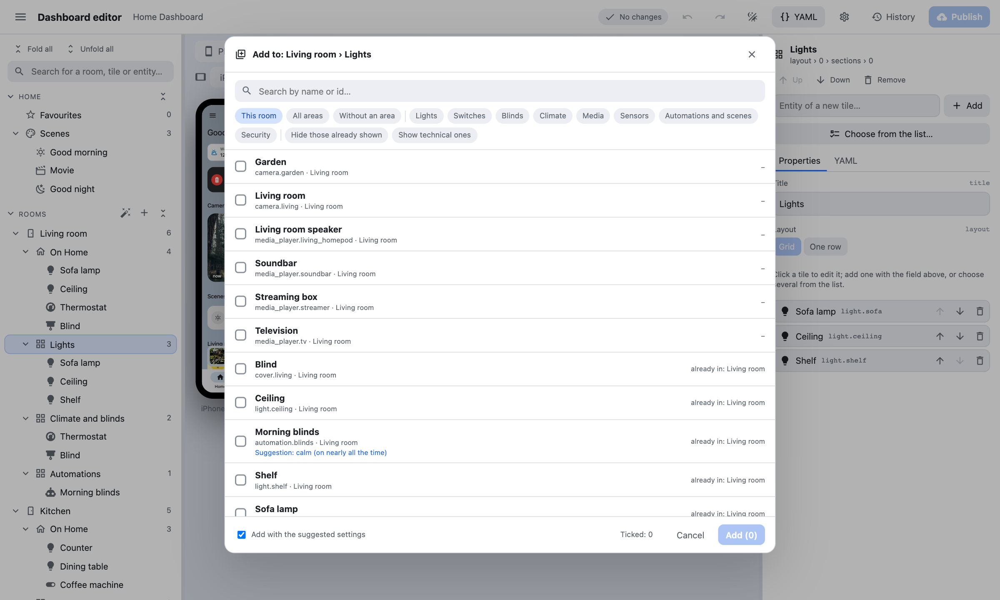

- **Filters** at the top: *This room* (the areas of the room), *All areas*, *Without an area*; kinds (*Lights*, *Switches*,
  *Blinds*, *Climate*, *Media*, *Sensors*, *Automations and scenes*, *Safety*); *Hide those already shown*; *Show technical ones*.
- Each row says the entity's area, and on the right where the entity **already is** (*already in: Living room*).
- **Suggestions** in blue: settings that suit the entity, such as *calm* for something that is on almost all the time.
  *Add with the suggested settings* takes them.
- When two entities are probably the same device from two integrations (a blind in Somfy and in HomeKit), the list
  says so, so you add only one.
- Tick several and **Add (n)**. What you tick shows in the preview first.

### The form of a tile {#the-form-of-a-tile}

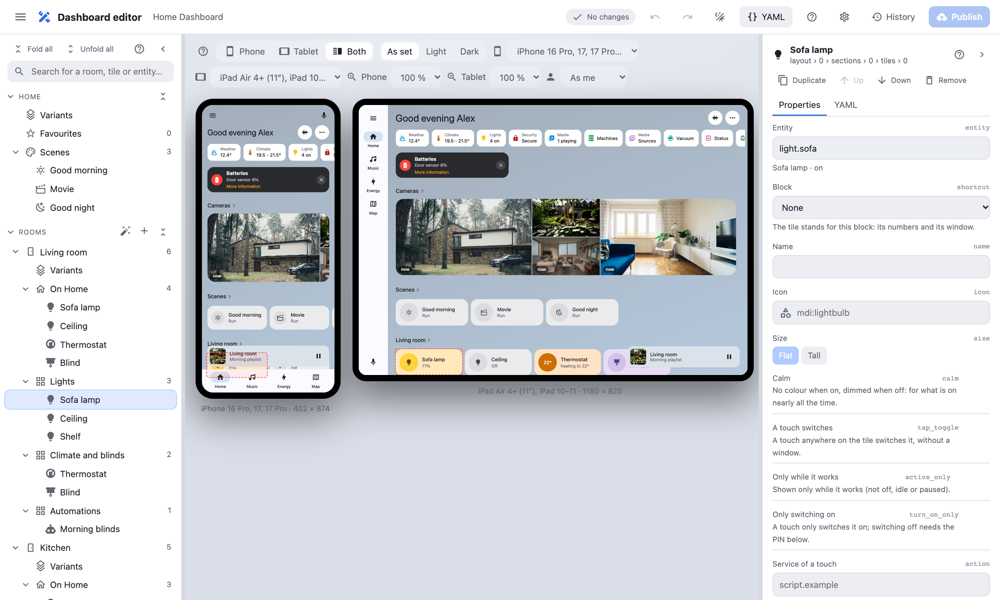

| Field | Key | Meaning |
|---|---|---|
| Entity | `entity` | what the tile shows and controls |
| Block | `shortcut` | the tile opens a block instead (chapter 9) |
| Name | `name` | your own name; empty = the name from Home Assistant |
| Icon | `icon` | an icon of Home Assistant: type *lamp*, *tv*, *door* and choose from the list |
| Size | `size` | *Flat* or *Tall* |
| Calm | `calm` | no colour when on, dimmed when off: for things that are on almost always |
| A touch switches | `tap_toggle` | a touch anywhere on the tile switches it, without opening its window |
| Only while it works | `active_only` | shown only while it is on (not off, idle or paused) |
| Only switching on | `turn_on_only` | a touch only turns on; *Switching off with a PIN* (`off_pin`) asks for a PIN to turn off |
| Service of a touch | `action` | a script or service called on a touch instead |
| Mark, then run; Names of options | `confirm`, `labels` | for a list (`select`): run only after choosing, and own names of its options |

Under the form, <b class="ui">Window of the device</b> says what a tap on the tile opens:

- <b class="ui">Own card (YAML)</b>: a card of Home Assistant opens instead of the dashboard's window, for this entity everywhere
  on the dashboard (`entities.overrides.<id>.card`). Type it with its `type`, e.g. `type: custom:lamp-card`; empty
  brings the dashboard's window back.
- <b class="ui">Make a block of this tile</b>: the tile becomes a block in its place, with its name, icon and size (chapter 9).

A tile that already is a block, or opens one, has no such part: its block has its own forms. How to choose between
a tile, a card and a block is in [Windows for your own devices](own-devices.md).

The <b class="ui">YAML</b> tab shows the tile as text:

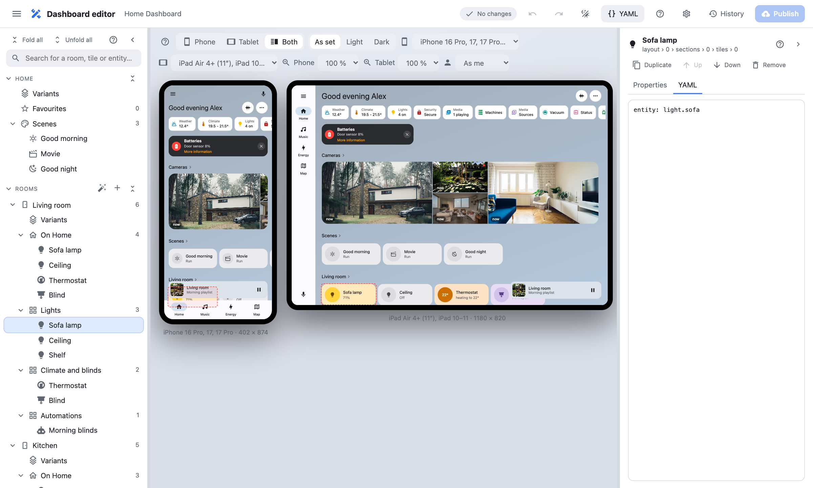

**Moving tiles:** *Up*, *Down*, or drag in the tree, also to another section or room. <b class="ui">Duplicate</b> makes a copy
under it. <b class="ui">Remove</b> removes it (one Undo brings it back).

## 8. The Home page {#the-home-page}

The Home page is what a phone and a tablet open first. It is made of:

1. <b class="ui">Favourites</b> (tree: *Home → Favourites*): the tiles at the top, the most used things in the home.
2. <b class="ui">Scenes</b> (*Home → Scenes*): scenes and scripts in a row; *Settings → Home page and tablet* sets whether they are
   a grid or a row.
3. **A card for each room** with the tiles of its <b class="ui">On Home</b> list. A room with an empty *On Home* list still shows its
   name, which opens the room.

In the screenshot of chapter 4 the tile *Sofa lamp* of the living room's *On Home* list is chosen: its red frame shows
where it is on Home, on the phone and on the tablet.

**Settings → Home page and tablet** holds the weather entity, the security summary, a tablet left alone going back
to Home after some minutes, and the layout of the scenes. The chips at the top of Home (weather, climate, lights,
security, media) come from the dashboard itself.
*Layout of the pages* chooses sections side by side for every page or for Home alone, and how many rows a section
shows before it scrolls.

## 9. Blocks: machines, appliances, screens of their own {#blocks-machines-appliances-screens-of-their}

A **block** is a tile that opens a screen of its own instead of a single device: a coffee machine with its numbers
and settings, a washing machine, a car, a vacuum, a server, the school plan, the trams. Blocks live under <b class="ui">Blocks</b>
in the tree, or directly in a section (a tile with `kind`).

**A new block:** **+** beside **Blocks** lists the kinds (Block, Status, Departures, App, News, Machines, Page), the
same as <b class="ui">Add</b> on the tablet; the new block is chosen at once and shows among the badges of Home. **A block in a
room:** <b class="ui">Make a block of this tile</b> under a tile's form, or a block chosen in the tile's <b class="ui">Block</b> field.

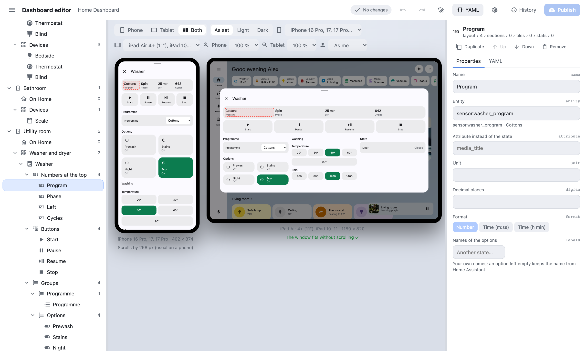

A block of several entities (`kind: panel`) opens in the tree into its parts, each with a form:

- <b class="ui">Numbers at the top</b> (`stats`): a number each, with its unit, decimal places and format. *Time (m:ss)* and
  *Time (h min)* show seconds (or the unit of the sensor) as time. *Attribute instead of the state* shows an attribute,
  such as the game a console plays.
- <b class="ui">Buttons</b> (`actions`): an entity, a service (empty = press or turn on), a question asked first (`confirm`), and
  fields for a script (`data`, in YAML). With more than three buttons they stand in their own row on a tablet.
- <b class="ui">Groups</b> (`groups`) with **rows**: a group is a heading and rows of entities. *Layout*: rows, *controls* (big
  switches, choices, sliders) or *summary* (one line that unfolds, which says "All fine" or what needs a look). A row of
  a list (`select`) can have its options ordered, named and hidden with the eye.
- **From the device, not in the block yet**: the entities of the block's devices its window leaves out; a click adds
  one as a row.
- In the form of the block itself: name, icon, the entity of its tile and its state, own names of states, when the
  tile is "on" (`active`, `active_state`), a card of Home Assistant at the end, the whole screen.
- A button on the tile while the device is on (`quick`, e.g. *Turn off* on a console) is set in YAML. With `active`
  the button follows that entity, not the tile's: an Xbox has `active: binary_sensor.xbox_playing` (the cloud and a
  ping together), as its cloud state can stay "on" after it went off. A time below zero in *Time (h min)* reads as
  "over by 10 min".

Choosing a block opens its window in the preview, and under the tablet the editor says whether it fits without
scrolling. A tile becomes a block by choosing the block in its <b class="ui">Block</b> field; a block renamed is renamed in its
tiles, the menu, the status bar and the rules of access too.

**Other kinds of blocks** have a form with the same fields as the block form on the tablet. A Status screen, for
example, has sections with entries (a list of lights that are on, an alarm of water, a low battery, a device in a
state, a word of a state such as `OB` of a UPS on battery). An entry with <b class="ui">Also as a warning on Home</b> (`notify`) is also a card
over the cameras on Home, as a low battery is; with <b class="ui">Alarm (red, cannot be closed on Home)</b> (`alarm`) it cannot be
closed while the state lasts (a water
leak, smoke, an alarm going off):

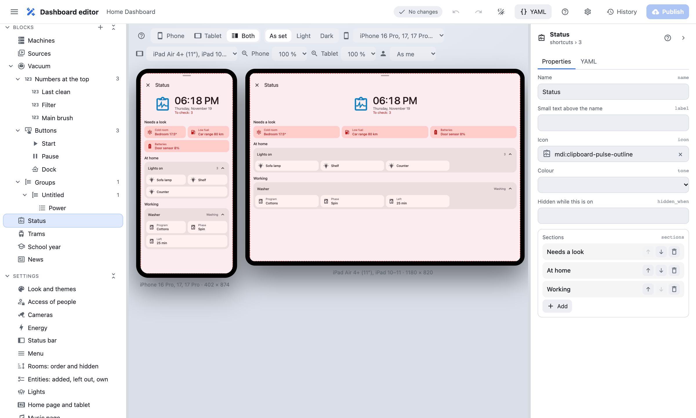

The others: departures (lines with colours), news, a host with its columns of bars and machines, the school year, an
add-on in a frame, a page, a TV with its apps, a scale. Lists unfold, move with the arrows and go with the bin.

## 10. Look, themes and backgrounds {#look-themes-and-backgrounds}

**Settings → Look and themes** has a part for each group of the look: the whole dashboard, page backgrounds, tiles
(with colours by kind), writing, the blocks at the top, round buttons, badges, windows, the map and the player. Long
parts start folded; a click on a heading unfolds one.

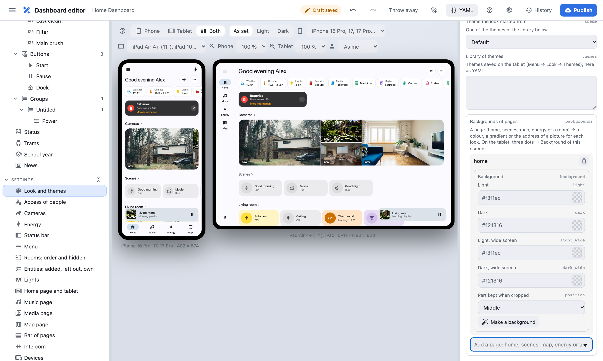

**Backgrounds of pages:** a background each for Home, Scenes, Map, Energy and every room, with four fields: *Light*,
*Dark*, *Light, wide screen* and *Dark, wide screen* (a tablet on its side or a laptop crops an upright picture hard,
so it can have its own). *The part kept when cropped* chooses the top, the middle or the bottom.

Each field shows at its end what it holds: a sample of the colour or the gradient, or a magnifier that opens the
picture big. A click on the field opens a window:

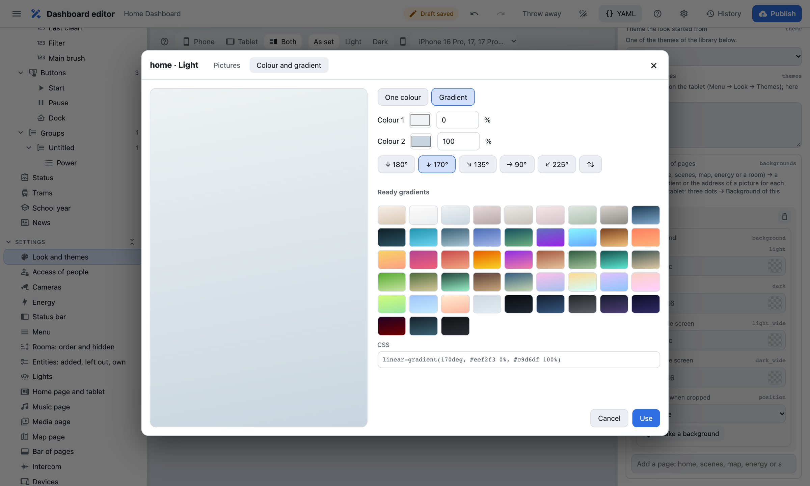

- **Pictures:** those sent to Home Assistant and those in the `/config/www` folder, as small pictures (a click
  chooses, the magnifier enlarges), and <b class="ui">Send a picture from the computer</b>.
- **Colour and gradient:** one colour from a palette, or a gradient: its colours, their places in percent, the
  direction, ⇅ to reverse it, 48 ready gradients and a large preview. The CSS stays below to change by hand.

<b class="ui">Make a background</b> under the fields opens the background maker: 16 ready backgrounds, patterns, gradients and a
photo of your own, see-through, greyed or blurred, with a phone and a tablet beside it. The photo can be made smaller
and put in a corner, at a side or in the middle (<b class="ui">Size and place</b>), moved, turned, mirrored and faded out from up to
three of its edges (<b class="ui">Fades out from</b>), e.g. a room in the top right corner melting into the gradient on its left and
at its bottom. <b class="ui">Tinted by the background</b> (the default) gives the photo the colours of the gradient under it: its
darks take the deep shade of the background, its lights the light one. <b class="ui">Use as background</b> makes an
upright and a wide picture and puts them in the light look, the dark one or both.

**Themes:** a look can be saved on a tablet as a theme (Menu → Look → Themes) and shared as a file. Two come with the
dashboard: **Home Dashboard** and **Apple Home** (see [the Apple Home guide](apple-home.md)).

## 11. The status bar of a tablet and the calendars {#the-status-bar-of-a-tablet}

A tablet on its side can show a column with the time, the weather, today's events and what is going on, in place of
the narrow bar. **Settings → Status bar**:

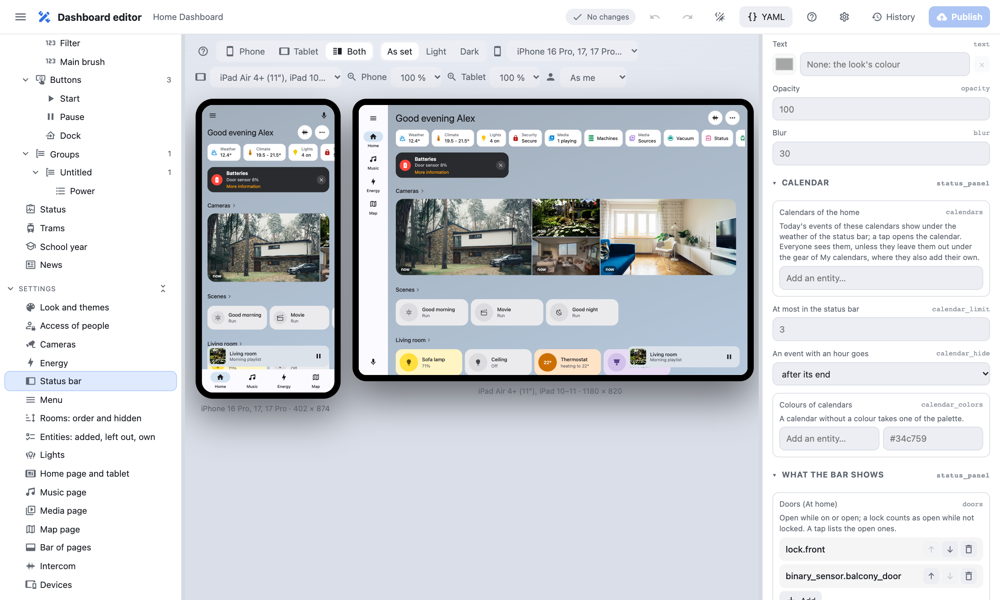

- **Look of the bar** (`appearance.status`): whether it shows, its parts and their order, colours, opacity, blur.
- <b class="ui">Calendar</b> (`status_panel.calendars`): the calendars of the home. Today's events show under the weather: all-day
  ones softly in their calendar's colour, the others with their hour, "now" while they last, gone once over; at most
  *At most in the status bar* of them. A tap opens a month with the events of the chosen day. *Colours of calendars*
  gives each calendar its colour. On a phone the same events are under *Choose an area → My calendars*, where each
  person adds their own calendars under the gear.
- <b class="ui">What the bar shows</b> (`status_panel`), the badges of *At home* and the rest of the bar:
  - <b class="ui">Doors (At home)</b> and <b class="ui">Windows (At home)</b> (`doors`, `windows`): each list has its badge while something of it
    is open; a tap on the tablet lists the open ones with when they opened. Put in only those that should speak (the
    front door, the balcony, the toilet), not the doors of rooms, which are usually open.
  - <b class="ui">Flags (At home)</b> (`flags`): a badge while a helper is on, e.g. **Mail** from `input_boolean.mail_in_mailbox`,
    which opening the mailbox turns on; a tap opens the helper to turn it off.
  - <b class="ui">Not counted in At home</b> (`ignore`): lights and devices left out of the count, e.g. a lamp with its own
    schedule. This is the only place of the setting; the tablet only lists them apart among those on.
  - what runs *Now* (a washer with its program and time left), power with a line of the last hours, trams.

The iPad of the preview shows the bar of the draft at once.

## 12. Menu and bar of pages {#menu-and-bar-of-pages}

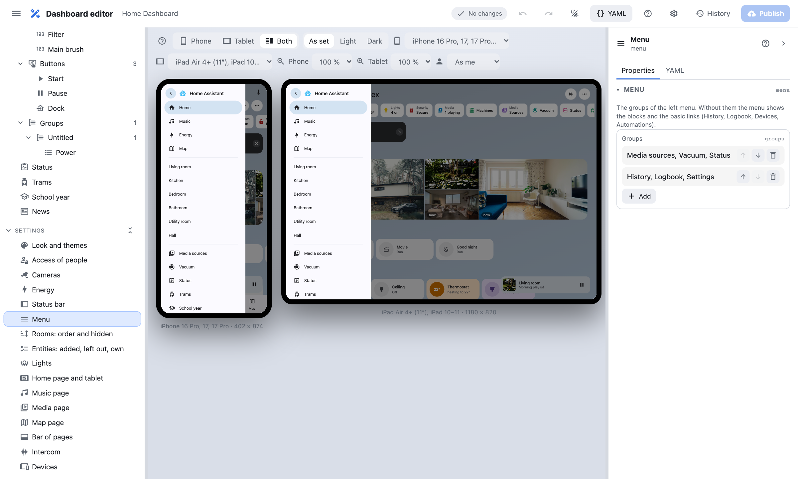

**Settings → Menu** holds the groups of the left menu and their entries. An entry opens a **block**, an **add-on**,
an **address** (a page of Home Assistant, another dashboard) or runs an **action**; it can be for administrators only,
for chosen people, and hidden in guest mode. Choosing *Menu* opens the menu in the preview.

**Settings → Bar of pages** holds the places of the bottom bar of a phone and the side rail of a tablet: 2 to 5 of
Home, Music, Media, Energy, Map, Scenes, the menu or a room, in order, and the bar's look.

## 13. Cameras, energy, intercom and the other settings {#cameras-energy-intercom-and-the-other}

| Node | What it sets |
|---|---|
| <b class="ui">Cameras</b> | which cameras and in what order; privacy and guest mode (rules with a switch, the cameras they hide and the people); single cameras: the live camera of a picture, talking, round buttons, turning, the entities under the gear |
| <b class="ui">Energy</b> | the phases of the meter, the range of the voltage, energy storage (a power station on a battery) |
| <b class="ui">Intercom</b> | the script of announcements, the rooms to tick and the fields of the call |
| <b class="ui">Rooms: order and hidden</b> | the order of rooms and rooms hidden from everyone |
| <b class="ui">Entities</b> | entities added to a room, never shown by themselves, and an entity's own name, icon, area or card |
| <b class="ui">Lights</b> | a light group in place of its lamps |
| <b class="ui">Home page and tablet</b> | weather, security, a tablet going back to Home, scenes, layout of the pages |
| <b class="ui">Music</b>, <b class="ui">Media</b>, <b class="ui">Map</b> pages | the music app in a frame, the groups of speakers and media, the people and places of the map |

A block that opens a page (such as <b class="ui">Sources</b> with `page: media`) has no groups of its own: the groups and tiles of
the Media page (speakers, TVs, groups of your own) are added in <b class="ui">Media page</b> → **sections**. Under the properties of
such a block an **Edit: Media page** button leads there.

Each has a form; the YAML tab stays beside it for what you would rather type. The keys are described in the
[configuration reference](configuration.md).

A setting whose part Home Assistant does not have is shown greyed and does not open, with what it needs under its
name: *Cameras* needs a camera, *Media page* a speaker, *Intercom* the Intercom integration or a script, *Music
page* the Music Assistant integration. Install it and the setting opens. The dashboard itself keeps working without
them: without the Intercom integration (or the script it names) no button offers to speak, and without Music
Assistant the Music page says it cannot open it.

## 14. Who sees what {#who-sees-what}

Children do not need the switches of the garage, and a guest does not need the cameras inside.
**Settings → Access of people**:

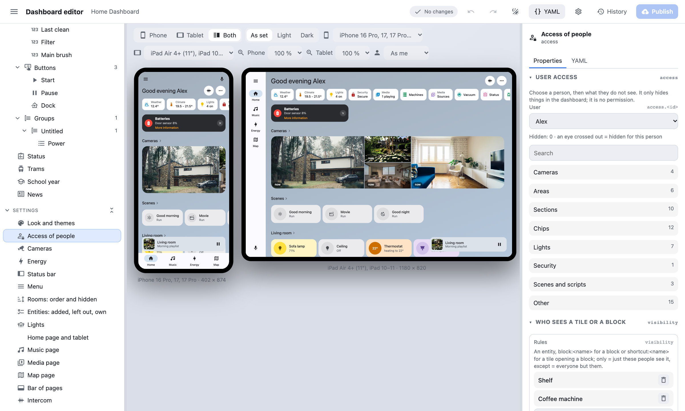

- Choose a **person**, then what they **do not see**, in groups (cameras, rooms, sections, the blocks at the top,
  lights, media, security, scenes and scripts, the rest), with an eye by each.
- <b class="ui">Who sees a tile or a block</b> (`visibility`): rules for one thing, an entity, `block:<name>` or `shortcut:<name>`,
  with the people who see it (*only*) or do not (*except*).
- This only hides things in the dashboard; it is not a permission of Home Assistant. Administrators see everything in
  the editor.

Check it with **As** in the preview: the dashboard of that person, as they will see it.

## 15. Saving, publishing and history {#saving-publishing-and-history}

**The draft** is saved on the server a moment after each change (*Draft saved*). It waits for you in another browser
too. *Throw away* drops it.

<b class="ui">Publish</b> opens a summary:

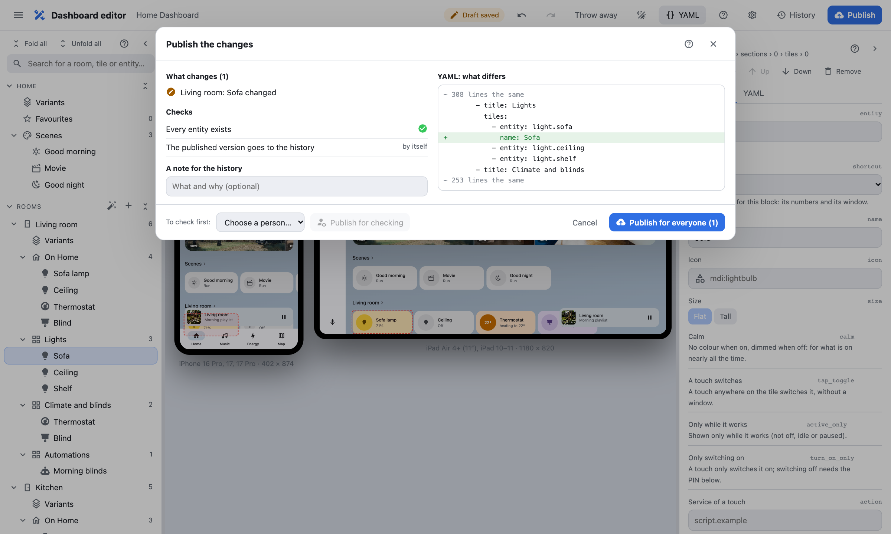

- **What changes**, in plain words, and the **differences in YAML**.
- **A check:** the entities that do not exist, and that the published version goes to the history.
- <b class="ui">A note for the history</b> (what and why, optional).
- <b class="ui">To check first:</b> choose a person and <b class="ui">Publish for checking</b>: only their dashboard shows this version, with a
  banner *A version to check* and a button back to the usual one. The top of the editor says who checks it; *End*
  stops it. Good for trying a big change on one tablet first.
- **Publish for everyone:** every device loads the new version, and the one it replaces goes to the history. If the
  dashboard was changed elsewhere in the meantime (on a tablet), the editor says so instead of overwriting that change;
  *Publish anyway* does.

<b class="ui">History</b> keeps the last 30 published versions, with who published them, when and the note. Choose one to see how
it differs from the version now; <b class="ui">Take back as a draft</b> makes it the draft, to look at and publish like any other.

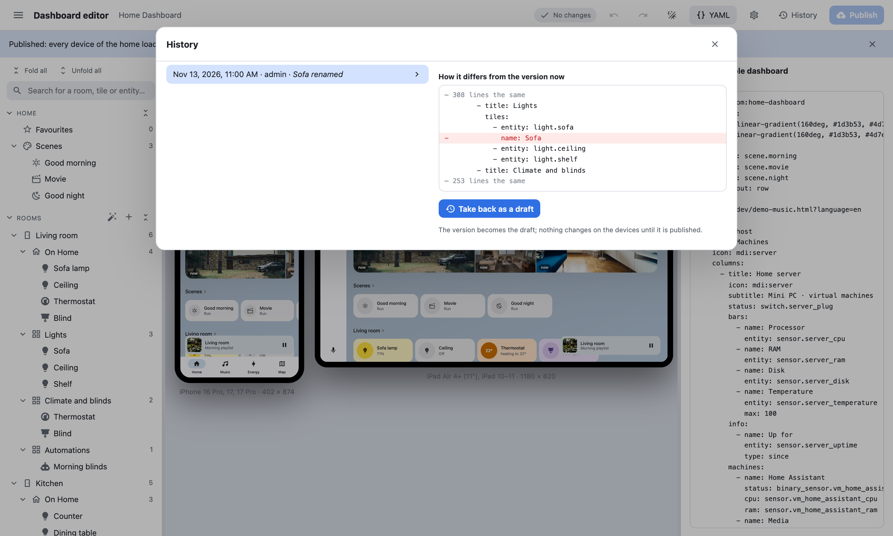

### Page variants {#page-variants}

A variant is another version of one page, Home or a room, to try out without touching the published one. It holds
only what belongs to its page, **its background included**: for Home the favourites, scenes, the strip of cameras, the
order of the rooms and what each shows on Home, the layout of the page; for a room its card (sections, status,
layout). Everything else (menu, look, the other pages) always comes from the published dashboard.

In the tree, Home and every room have the node <b class="ui">Variants</b>. Its cards:

- The published page (<b class="ui">Published</b>); the pencil gives it a name, as *Classic*.
- Every variant, with who sees it. A touch shows it in the preview, as its devices would.
- <b class="ui">New variant: a copy of the published page</b> (or of the chosen one).

What a chosen variant offers:

- <b class="ui">Edit</b>: the tree, the forms and the preview work on the variant; the top says *Variant: …*, changes of
  its page are saved into it at once, and <b class="ui">Publish</b> waits. Anything else changed meanwhile (a new block, the
  menu, another room) goes to the draft and is published as always, so a block made for the variant is not lost.
  <b class="ui">Done</b> goes back to the draft.
- <b class="ui">Share with the household</b>: the people of the home who are not administrators can choose it for themselves on
  their phone (three dots → <b class="ui">Variant of this page</b> → <b class="ui">Choose for me</b>), on all their devices. <b class="ui">Stop sharing</b>
  gives them the published page again.
- <b class="ui">Copy</b>: a new variant from this one.
- <b class="ui">Who sees it</b>: for each device and each person, which variant of this page it shows. A device appears there once
  it has opened the dashboard (named after its Browser Mod name, or its kind and its person; give it a name, as *Hall
  iPad*). The dashboard keeps an id of its own on each device, so signing in again keeps it the same device, with its
  name and variants; only clearing the app's data (or private browsing) makes it a new one. A device's own
  choice wins over its person's; everyone else sees the published page. It takes effect at once.
- <b class="ui">Make it the published page</b>: its part goes into the dashboard for everyone. The version it replaces goes to the
  history, and the page it replaced stays among the variants, so going back is the same button on that card. A draft
  takes the new page too.

<b class="ui">Devices</b> in the settings lists every phone and tablet that opened the dashboard: its name (type one you
recognise), its kind and person, when it was last opened and which variant of which page it shows. <b class="ui">Forget</b> takes
off a device that was signed out or given away; it comes back as a new one when it opens the dashboard again.

The magnifier next to the title of the variants opens <b class="ui">Where the variants run</b>: for every page, each variant with
the devices (and when they last opened the dashboard) and the people that see it; *chose it* marks those who chose a
shared variant themselves, and the published page says how many known devices have no variant of their own.

A variant nobody sees changes nothing in the home. The variants are kept by the editor on the server
(`.storage/home_dashboard.editor`), not in the dashboard's configuration.

On a phone or a tablet, an administrator finds the same choice under the three dots → <b class="ui">Variant of this page</b> (only on
a page that has variants): <b class="ui">Show on this device</b>, <b class="ui">Just look</b> (for this visit, with a banner *Looking at: …* and
<b class="ui">Back</b>) and <b class="ui">Publish for everyone…</b>. Changes made on a page that shows a variant (its room's edit, its background)
go into that variant.

## 16. Editor settings: your own phones and tablets {#editor-settings-your-own-phones-and}

The ⚙ in the top bar opens a small pop-up under it, without leaving what you edit:

- **Theme**: As HA, Light or Dark – the same choice as the half sun on the bar.
- **Language**: As in HA (your profile), Polski or English – the editor is drawn again in it at once and keeps it in
  this browser. Parts drawn by Home Assistant itself (e.g. its pickers of entities) stay in the language of your
  profile.
- <b class="ui">Preview devices</b> opens the settings of the phones and tablets below.

A choice works at once and the pop-up stays open; Esc, a click beside it, ⚙ again or ☰ close it.

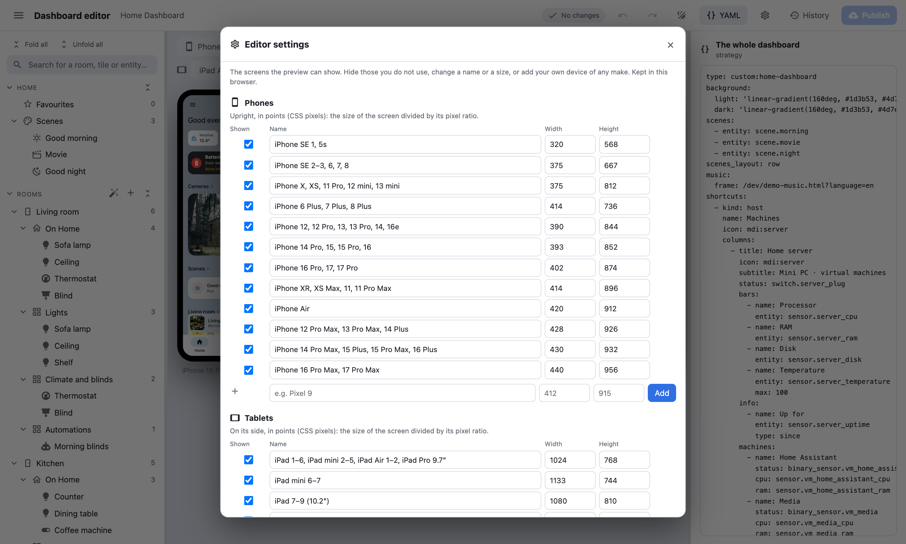

- Each built-in model (Apple's) can be **hidden** from the choice above the preview, **renamed** or **resized**; the
  arrow sets it back.
- Below each list you **add a device of your own** of any make: a name, a width and a height in points (CSS pixels:
  the resolution of the screen divided by its pixel ratio; for example 1280 × 800 for a Galaxy Tab S9). A phone always
  stands upright and a tablet on its side, whatever order the size is typed in.
- The list is kept in this browser. One model of each kind always stays shown.

## 17. A whole dashboard in ten steps {#a-whole-dashboard-in-ten-steps}

The order that works best for a new home:

1. **Areas first.** In Home Assistant give every device an area (Settings → Areas). Hide what nobody needs.
2. **Open the editor** and **create a dashboard** (chapter 3).
3. <b class="ui">Make the rooms from the areas</b>, with *Lights*, *Climate and blinds*, *Media*, *Devices* and *Safety*, and a few tiles of
   each room on Home.
4. **Tidy the rooms:** rename them, merge areas that are one room, put the rooms in order (*Rooms: order and hidden*),
   remove tiles you do not need and add those that are missing with *Choose from the list…*.
5. **Make Home:** a few <b class="ui">Favourites</b> (the main lights, the front door, the heating), the <b class="ui">Scenes</b>, and in each room
   the <b class="ui">On Home</b> list with two to four tiles.
6. **Add blocks** for things with many entities: a coffee machine, a washer, the car, a vacuum, a server, a UPS. Start
   with the numbers that matter most, then groups; *From the device, not in the block yet* lists what is left.
7. **Choose the look:** a theme, a background for Home and each room (the background maker helps), colours of tiles.
8. **Set up the wall tablet:** the status bar with its calendars and what it shows (the doors and windows that should
   speak, flags such as the mail, lamps not counted), on the Status screen the warnings for Home (water, smoke, the
   alarm, low batteries), a tablet going back to Home, the bar of pages and the menu.
9. **Decide who sees what** and check it with **As** in the preview.
10. <b class="ui">Publish for checking</b> on one tablet, then **Publish for everyone**. Keep a note for the history.

After that the editor is the place for every change: a new device is a tile added in a minute, a new room a click on
✨.

## 18. Tips and problems {#tips-and-problems}

- **Something you changed does not show on a tablet.** It shows after **publishing**. A tablet that was open keeps
  the old version until it loads the dashboard again (pull down or reopen the app).
- **The editor says the dashboard was changed elsewhere.** Someone changed it on a tablet (for example a person moved
  tiles). Publishing would replace that change; look at the differences first, then *Publish anyway* or throw your draft
  away.
- **The editor was open in two browsers.** Each saves its draft; the last one wins. Reload the editor before going
  on in the other one.
- **A tile has ⚠.** Its entity does not exist (renamed or removed in Home Assistant). Choose the tile and pick its
  new entity, or remove it.
- **A window of a block scrolls on the tablet.** The editor says by how much under the preview. Fold a group into a
  summary, move rows into fewer groups, or set the block to the whole screen.
- **The pictures of the `www` folder do not show in the background window.** They show after a restart of Home
  Assistant on a new version of the integration.
- **Nothing in the editor ever calls a service**, so you can explore freely. The only thing that changes the home's
  dashboards is <b class="ui">Publish</b>.

More answers, with exact messages, are in the [FAQ of the README](../README.md#faq), and every key of the
configuration in the [configuration reference](configuration.md).
