# Edytor dashboardu: od zera do gotowego dashboardu

[English](editor.md) · [README](../README.pl.md) · [Przewodnik](guide.pl.md) · [Opis konfiguracji](configuration.pl.md)

**Edytor dashboardu** służy do budowania i zmieniania Home Dashboard na komputerze. Po lewej widzisz cały dashboard
jako drzewo, pośrodku prawdziwy dashboard iPhone'a i iPada, a po prawej formularz tego, co wybrałeś. Każda zmiana od
razu pojawia się w podglądzie. **Na telefonach i tabletach w domu nic się nie zmienia, dopóki nie opublikujesz.** YAML
nie jest potrzebny, ale zawsze jest obok każdego formularza, jeśli wolisz pisać.

Ten dokument prowadzi krok po kroku od pustego Home Assistanta do dashboardu takiego jak na zrzutach: pokoje z
urządzeniami, strona główna, bloki dla maszyn, własny wygląd, pasek statusu tabletu na ścianie, menu i zasady, kto co
widzi. Za pierwszym razem czytaj po kolei; później każdy rozdział można czytać osobno.

Zrzuty ekranu pokazują zmyślony dom (`dev/demo.js`), nigdy prawdziwy.

## Spis treści

1. [Zanim zaczniesz](#1-zanim-zaczniesz)
2. [Otwieranie edytora](#2-otwieranie-edytora)
3. [Pierwszy dashboard i jego pokoje](#3-pierwszy-dashboard-i-jego-pokoje)
4. [Co jest na ekranie](#4-co-jest-na-ekranie)
5. [Podgląd](#5-podgląd)
6. [Pokoje](#6-pokoje)
7. [Sekcje i kafelki](#7-sekcje-i-kafelki)
8. [Strona główna](#8-strona-główna)
9. [Bloki: maszyny, urządzenia, własne ekrany](#9-bloki-maszyny-urządzenia-własne-ekrany)
10. [Wygląd, motywy i tła](#10-wygląd-motywy-i-tła)
11. [Pasek statusu tabletu i kalendarze](#11-pasek-statusu-tabletu-i-kalendarze)
12. [Menu i pasek stron](#12-menu-i-pasek-stron)
13. [Kamery, energia, interkom i pozostałe ustawienia](#13-kamery-energia-interkom-i-pozostałe-ustawienia)
14. [Kto co widzi](#14-kto-co-widzi)
15. [Zapisywanie, publikowanie i historia](#15-zapisywanie-publikowanie-i-historia)
16. [Ustawienia edytora: własne telefony i tablety](#16-ustawienia-edytora-własne-telefony-i-tablety)
17. [Cały dashboard w dziesięciu krokach](#17-cały-dashboard-w-dziesięciu-krokach)
18. [Wskazówki i problemy](#18-wskazówki-i-problemy)

## 1. Zanim zaczniesz

Potrzebujesz:

- **Home Assistanta** z zainstalowaną i dodaną integracją **Home Dashboard** (zob.
  [Instalacja w README](../README.pl.md#instalacja)). Po dodaniu integracji Home Assistant potrzebuje jednego restartu.
- **Konta administratora.** Edytor jest tylko dla administratorów; pozostałe osoby tylko używają dashboardu.
- **Komputera** z aktualną przeglądarką (Chrome, Safari, Edge, Firefox). Wygodne jest okno szersze niż 1400 px; w
  mniejszym przeciągnij boczne kolumny węziej.
- **Obszarów w Home Assistant** (Ustawienia → Obszary, etykiety i strefy) z przypisanymi urządzeniami. Edytor tworzy
  pokoje z obszarów, więc czas poświęcony tutaj oszczędza czas później. Urządzenie bez obszaru też da się dodać, ale
  ręcznie.

Dobrze wiedzieć przed pierwszym kliknięciem:

- Edytor trzyma **szkic** na serwerze. Możesz zamknąć przeglądarkę i wrócić później, także na innym komputerze.
- **Podgląd niczego nie przełącza.** Dotknięcie lampy w podglądzie wybiera ją w drzewie; nigdy nie wywołuje usługi.
  Możesz klikać bez obaw.
- **Cofnij** i **Ponów** (⌘Z i ⇧⌘Z albo Ctrl+Z i Ctrl+Shift+Z) cofają każdy krok, nawet duży, jak utworzenie
  wszystkich pokoi naraz.

## 2. Otwieranie edytora

**Edytor dashboardu** jest w bocznym menu Home Assistanta (widzą go tylko administratorzy). Jeśli wolisz krótsze
menu, otwórz Ustawienia → Urządzenia oraz usługi → Home Dashboard → **Konfiguruj** i wyłącz *Pokazuj edytor w pasku
bocznym*; edytor otwiera się wtedy pod adresem `/home-dashboard-editor`.

Edytor ma własny jasny i ciemny wygląd. Domyślnie idzie za Home Assistantem; przycisk z połową słońca na górnym pasku
przełącza Auto, Jasny i Ciemny, a przeglądarka to zapamiętuje. Dashboard w podglądzie ma własny wybór (rozdział 5).

## 3. Pierwszy dashboard i jego pokoje

### Jeszcze nie ma dashboardu

Przy pierwszym uruchomieniu edytor nie znajduje dashboardu korzystającego z Home Dashboard i proponuje go utworzyć:

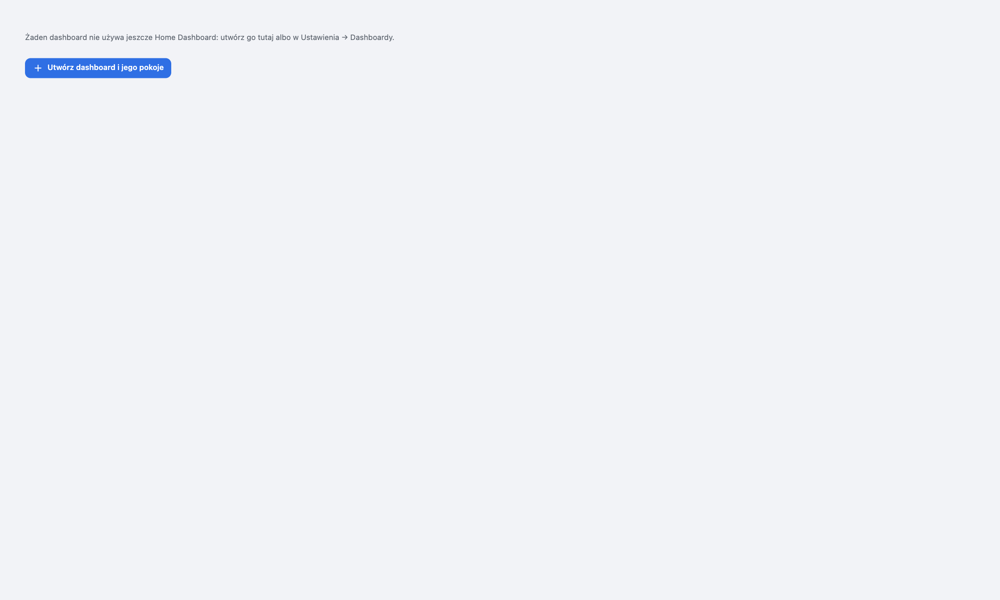

**Utwórz dashboard i jego pokoje** dodaje dashboard *Home Dashboard* w Ustawienia → Dashboardy i otwiera go w
edytorze. (Można go też utworzyć ręcznie w Ustawienia → Dashboardy i wkleić `strategy: {type: custom:home-dashboard}`
do jego surowej konfiguracji; edytor go wtedy znajdzie.)

### Pokoje z obszarów

Nowy dashboard nie ma pokoi. W drzewie jest **Utwórz pokoje z obszarów**; otwiera to okno:

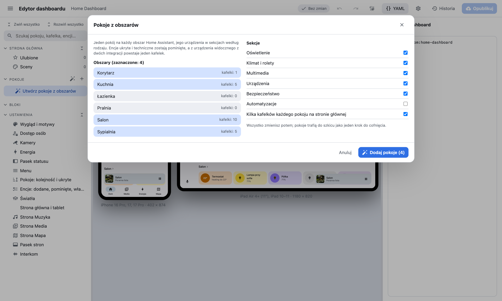

- **Obszary** po lewej: jeden pokój dla każdego zaznaczonego obszaru. Liczba mówi, ile kafelków dostanie pokój.
  Obszary bez kafelków nie są zaznaczone.
- **Sekcje** po prawej: w jakie grupy trafią urządzenia pokoju, według rodzaju: *Oświetlenie*, *Klimat i rolety*,
  *Multimedia*, *Urządzenia*, *Bezpieczeństwo* i *Automatyzacje*, jeśli je zaznaczysz.
- **Kilka kafelków każdego pokoju na stronie głównej** umieszcza główne światła, termostat i rolety każdego pokoju
  także na stronie głównej.
- Encje ukryte, konfiguracyjne i diagnostyczne zostają pominięte. Urządzenie widoczne w dwóch integracjach (np.
  termostat w Netatmo i w HomeKit) daje jeden kafelek, nie dwa.

To, co zaznaczysz, widać w podglądzie, zanim to dodasz. **Dodaj pokoje** wstawia je do szkicu jako jeden krok, więc
jedno **Cofnij** wycofuje wszystkie. Później, gdy dodasz w Home Assistant nowy obszar, to samo okno otwiera różdżka ✨
obok *Pokoje* i proponuje tylko obszary, które nie mają jeszcze pokoju.

> Zaczęcie od pokoi z obszarów to najszybsza droga. Wszystko dalej można zmienić: przemianować pokoje, połączyć dwa
> obszary w jeden pokój, przesunąć kafelki, usunąć niepotrzebne.

## 4. Co jest na ekranie

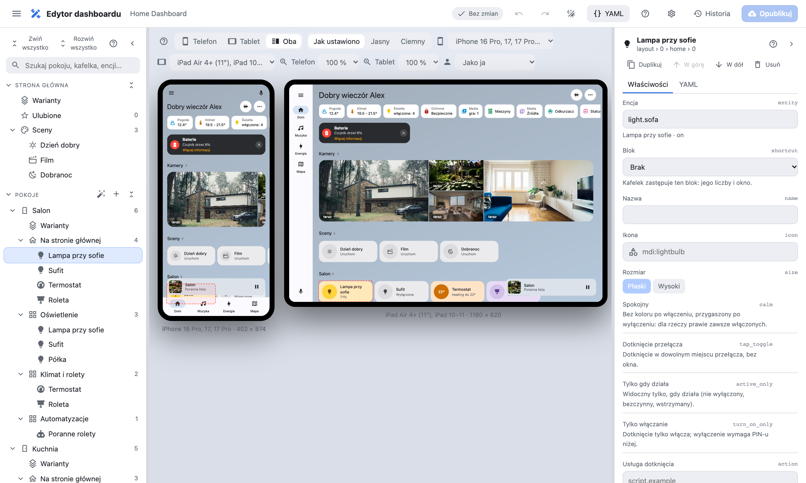

**Górny pasek**, od lewej:

| Element | Co robi |
|---|---|
| ☰ | otwiera menu Home Assistanta, żeby wyjść z edytora |
| *Edytor dashboardu · Home Dashboard* | który dashboard edytujesz (przy kilku: lista do wyboru) |
| *Bez zmian* / *Szkic zapisany* | czy jest szkic; zapisuje się sam chwilę po każdej zmianie |
| ↶ ↷ | Cofnij i Ponów |
| *Wyrzuć* | wyrzuca szkic i wraca do opublikowanej wersji (tylko gdy jest szkic) |
| połowa słońca | wygląd edytora: Auto, Jasny, Ciemny |
| **{} YAML** | cały dashboard jako YAML, do przeczytania albo wklejenia |
| ⚙ | ustawienia edytora: telefony i tablety podglądu (rozdział 16) |
| **Historia** | opublikowane wersje (rozdział 15) |
| **Opublikuj** | publikuje szkic (rozdział 15) |

**Drzewo** po lewej zawiera wszystko, w czterech grupach:

- **Strona główna**: *Ulubione* i *Sceny* strony głównej.
- **Pokoje**: każdy pokój z listą *Na stronie głównej*, własnymi scenami i sekcjami z kafelkami.
- **Bloki**: kafelki, które otwierają własny ekran (rozdział 9).
- **Ustawienia**: wygląd, osoby, kamery, energia, pasek statusu, menu, kolejność pokoi, encje, światła, strona główna i
  tablet, strony Muzyka, Media i Mapa, pasek stron i interkom.

Liczba obok węzła mówi, ile rzeczy jest w środku. Żółty ⚠ oznacza pokój albo kafelek z problemem, zwykle z encją,
której już nie ma. *Zwiń wszystko* i *Rozwiń wszystko* zwijają drzewo; strzałka obok grupy zwija tę grupę, a ikona po
jej prawej zwija albo rozwija wszystko w niej. **Wyszukiwarka** znajduje pokój, kafelek albo encję po nazwie lub id.

**Formularz** po prawej edytuje to, co wybrałeś. Nad nim są przyciski dla tej rzeczy (*Duplikuj*, *W górę*, *W dół*,
*Usuń*, a dla pokoju *Dodaj sekcję*). Obok każdego pola szarym tekstem jest nazwa jego klucza w YAML, więc zawsze
łatwo go znaleźć w konfiguracji. Zakładka **YAML** pokazuje to samo jako tekst i przyjmuje wpisane tam zmiany.
Klucze, których formularz nie zna, zostają nietknięte.

**Kolumny** są tak szerokie, jak je przeciągniesz: przeciągnij paski między nimi; dwuklik przywraca pierwszą szerokość.

## 5. Podgląd

Podgląd to nie obrazek: to prawdziwy dashboard działający w ramkach iPhone'a i iPada, od razu pokazujący szkic.

- **Telefon**, **Tablet**, **Oba**: które urządzenia pokazać.
- **Jak ustawiono**, **Jasny**, **Ciemny**: kolory dashboardu. *Jak ustawiono* idzie za ustawieniem samego dashboardu.
- **Model** telefonu i tabletu: każdy rozmiar ekranu Apple raz, z modelami tego rozmiaru (od iPhone'a SE do 17 Pro
  Max, od iPada 1–6 do iPada Pro 13″). Własne urządzenia dowolnej marki dodaje się w ustawieniach edytora
  (rozdział 16).
- **Powiększenie** każdego urządzenia: ustaw jak w aplikacji Home Assistant na tym urządzeniu (Ustawienia →
  Aplikacja towarzysząca → Ogólne → Powiększenie). iPad Air przy 85 % pokazuje dashboard jako stronę 1388 × 965 i tak
  samo robi podgląd, więc co mieści się w podglądzie, zmieści się na ścianie.
- **Jako**: dashboard innej osoby, z ukrytym tym, czego ona nie widzi (rozdział 14).

Podgląd i drzewo działają razem:

- **Wybranie węzła go pokazuje.** Wybranie pokoju przenosi ramki do tego pokoju; wybranie bloku otwiera jego okno;
  wybranie menu otwiera menu. Zwinięta część (podsumowana grupa okna) rozwija się sama.
- **Czerwona przerywana ramka** oznacza to, co wybrałeś: kafelek, sekcję, pokój, okno bloku albo pojedynczą liczbę,
  przycisk, grupę czy wiersz w nim. Podgląd przewija się do niej.
- **Dotknięcie w podglądzie wybiera** w drzewie to, czego dotknąłeś, niczego nie robiąc.
- Pod ramką edytor mówi, czy okno wybranego bloku **mieści się na tablecie bez przewijania** (*Okno mieści się bez
  przewijania ✓*) albo o ile się przewija.

## 6. Pokoje

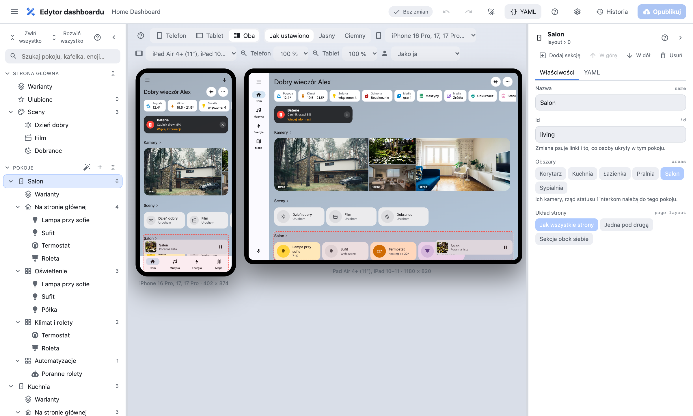

- **Dodanie pokoju:** **+** obok *Pokoje*. Zaczyna pusty, z nazwą do zmiany.
- **Formularz pokoju:** *Nazwa* (widoczna wszędzie), *Id* (adres pokoju w linkach; jego zmiana później psuje linki i
  pokoje ukryte przez osoby, więc wybierz go raz) i **Obszary**: obszary Home Assistanta należące do pokoju. Pokój może
  mieć kilka obszarów (kuchnia i jadalnia razem); ich kamery, rząd statusu i interkom należą do pokoju.
- **Sekcje:** *Dodaj sekcję* nad formularzem. Sekcja to nagłówek z kafelkami pod nim.
- **Kolejność:** *W górę* i *W dół* albo przeciągnięcie pokoju w drzewie. **Ustawienia → Pokoje: kolejność i ukryte**
  ustawia kolejność pokoi na stronie głównej i w menu oraz ukrywa pokoje przed wszystkimi.

Pokój ma w drzewie trzy rodzaje list:

| Węzeł | Co to jest | Gdzie widać |
|---|---|---|
| **Na stronie głównej** | kafelki pokoju na stronie głównej | strona główna, karta pokoju |
| **Sceny pokoju** | sceny i skrypty pokoju | strona pokoju, na górze |
| **sekcja** (*Oświetlenie*, *Klimat i rolety*…) | kafelki strony pokoju | strona pokoju |

## 7. Sekcje i kafelki

### Lista sekcji

Wybranie sekcji (albo *Na stronie głównej*, *Ulubione*, *Sceny*) pokazuje jej formularz (*Tytuł* i *Układ*: siatka
albo jeden rząd przewijany w bok) i **listę jej kafelków**: kliknięcie otwiera kafelek w jego formularzu, strzałki go
przesuwają, kosz usuwa.

### Dodawanie kafelków

Dwa sposoby, oba nad formularzem:

- **Encja nowego kafelka…** — wpisz id encji (pole podpowiada) i **Dodaj**.
- **Wybierz z listy…** — okno ze wszystkimi encjami domu:

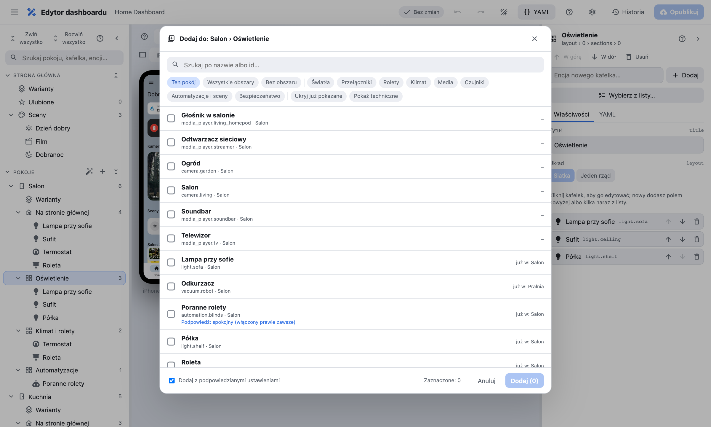

- **Filtry** na górze: *Ten pokój* (obszary pokoju), *Wszystkie obszary*, *Bez obszaru*; rodzaje (*Światła*,
  *Przełączniki*, *Rolety*, *Klimat*, *Media*, *Czujniki*, *Automatyzacje i sceny*, *Bezpieczeństwo*); *Ukryj już
  pokazane*; *Pokaż techniczne*.
- Każdy wiersz podaje obszar encji, a po prawej, gdzie encja **już jest** (*już w: Salon*).
- **Podpowiedzi** na niebiesko: ustawienia pasujące do encji, np. *spokojny* dla czegoś włączonego prawie zawsze.
  *Dodaj z podpowiedzianymi ustawieniami* je przyjmuje.
- Gdy dwie encje to pewnie to samo urządzenie z dwóch integracji (roleta w Somfy i w HomeKit), lista to mówi, żebyś
  dodał tylko jedną.
- Zaznacz kilka i **Dodaj (n)**. To, co zaznaczysz, najpierw widać w podglądzie.

### Formularz kafelka

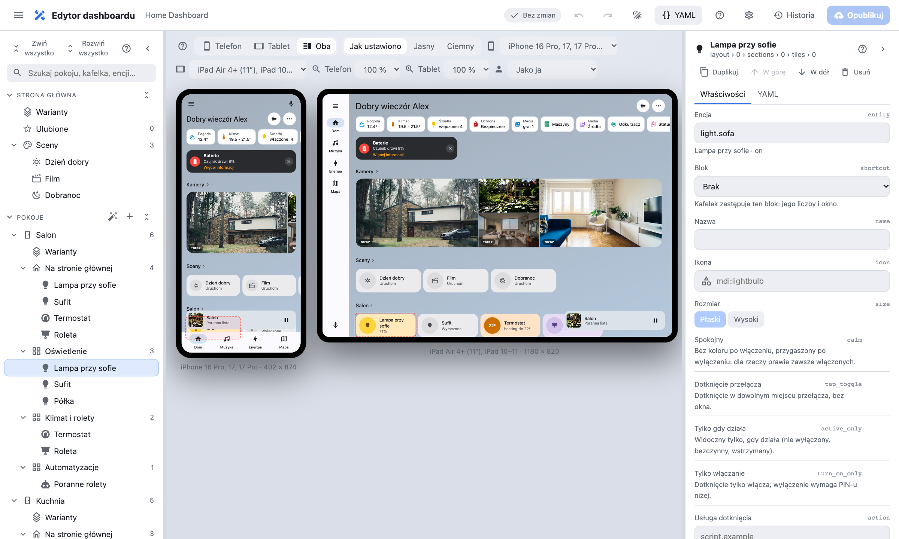

| Pole | Klucz | Znaczenie |
|---|---|---|
| Encja | `entity` | co kafelek pokazuje i czym steruje |
| Blok | `shortcut` | kafelek otwiera zamiast tego blok (rozdział 9) |
| Nazwa | `name` | własna nazwa; puste = nazwa z Home Assistanta |
| Ikona | `icon` | ikona Home Assistanta: wpisz *lampa*, *tv*, *drzwi* po angielsku (*lamp*, *door*) i wybierz z listy |
| Rozmiar | `size` | *Płaski* albo *Wysoki* |
| Spokojny | `calm` | bez koloru po włączeniu, przygaszony po wyłączeniu: dla rzeczy prawie zawsze włączonych |
| Dotknięcie przełącza | `tap_toggle` | dotknięcie w dowolnym miejscu przełącza, bez okna |
| Tylko gdy działa | `active_only` | widoczny tylko, gdy działa (nie wyłączony, bezczynny, wstrzymany) |
| Tylko włączanie | `turn_on_only` | dotknięcie tylko włącza; *Wyłączanie PIN-em* (`off_pin`) pyta o PIN przy wyłączaniu |
| Usługa dotknięcia | `action` | skrypt albo usługa wywołana zamiast tego przy dotknięciu |
| Zaznacz, potem uruchom; Nazwy opcji | `confirm`, `labels` | dla listy (`select`): uruchomienie dopiero po wyborze i własne nazwy opcji |

Pod formularzem **Okno urządzenia** mówi, co otwiera dotknięcie kafelka:

- **Własna karta (YAML)**: karta Home Assistant otwiera się zamiast okna dashboardu, dla tej encji w całym
  dashboardzie (`entities.overrides.<id>.card`). Wpisz ją razem z `type`, np. `type: custom:lamp-card`; puste pole
  przywraca okno dashboardu.
- **Zrób blok z tego kafelka**: kafelek staje się na miejscu blokiem, z nazwą, ikoną i rozmiarem (rozdział 9).

Kafelek, który już jest blokiem albo go otwiera, nie ma tej części: jego blok ma własne formularze. Jak wybrać między
kafelkiem, kartą a blokiem, opisuje [Okna dla własnych urządzeń](own-devices.pl.md).

Zakładka **YAML** pokazuje kafelek jako tekst:

**Przesuwanie kafelków:** *W górę*, *W dół* albo przeciągnięcie w drzewie, także do innej sekcji lub pokoju.
**Duplikuj** robi kopię pod spodem. **Usuń** usuwa (jedno Cofnij przywraca).

## 8. Strona główna

Strona główna to to, co telefon i tablet otwierają najpierw. Składa się z:

1. **Ulubionych** (w drzewie: *Strona główna → Ulubione*): kafelki na górze, najczęściej używane rzeczy w domu.
2. **Scen** (*Strona główna → Sceny*): sceny i skrypty w rzędzie; *Ustawienia → Strona główna i tablet* ustawia, czy
   są siatką, czy rzędem.
3. **Karty każdego pokoju** z kafelkami jego listy **Na stronie głównej**. Pokój z pustą listą nadal pokazuje swoją
   nazwę, która otwiera pokój.

Na zrzucie z rozdziału 4 wybrany jest kafelek *Lampa przy sofie* z listy *Na stronie głównej* salonu: czerwona ramka
pokazuje, gdzie jest na stronie głównej, na telefonie i na tablecie.

**Ustawienia → Strona główna i tablet** zawiera encję pogody, podsumowanie ochrony, powrót tabletu zostawionego bez
dotyku na stronę główną po kilku minutach i układ scen. Plakietki na górze strony głównej (pogoda, klimat, światła,
ochrona, media) tworzy sam dashboard.

## 9. Bloki: maszyny, urządzenia, własne ekrany

**Blok** to kafelek, który zamiast jednego urządzenia otwiera własny ekran: ekspres z liczbami i ustawieniami, pralka,
samochód, odkurzacz, serwer, plan lekcji, tramwaje. Bloki są w drzewie pod **Bloki** albo bezpośrednio w sekcji
(kafelek z `kind`).

**Nowy blok:** **+** obok **Bloki** wypisuje rodzaje (Blok, Status, Odjazdy, Aplikacja, Wiadomości, Maszyny, Strona),
te same co **Dodaj** na tablecie; nowy blok od razu jest wybrany i pojawia się wśród odznak strony głównej. **Blok w
pokoju:** **Zrób blok z tego kafelka** pod formularzem kafelka albo blok wybrany w polu **Blok** kafelka.

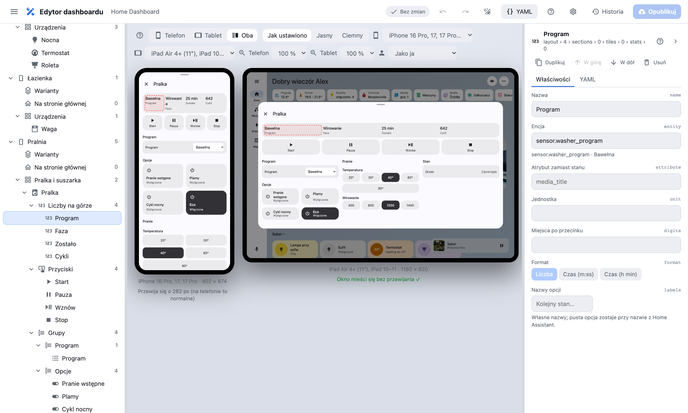

Blok kilku encji (`kind: panel`) rozwija się w drzewie na części, każda z formularzem:

- **Liczby na górze** (`stats`): po jednej liczbie, z jednostką, miejscami po przecinku i formatem. *Czas (m:ss)* i
  *Czas (h min)* pokazują sekundy (albo jednostkę czujnika) jako czas. *Atrybut zamiast stanu* pokazuje atrybut, np.
  grę uruchomioną na konsoli.
- **Przyciski** (`actions`): encja, usługa (puste = naciśnij albo włącz), pytanie zadawane najpierw (`confirm`) i pola
  dla skryptu (`data`, w YAML). Przy więcej niż trzech przyciskach na tablecie stoją we własnym rzędzie.
- **Grupy** (`groups`) z **wierszami**: grupa to nagłówek i wiersze encji. *Układ*: *Wiersze*, *Kontrolki* (duże
  przełączniki, wybory, suwaki) albo *Podsumowanie* (jedna linia, która się rozwija i mówi „Wszystko w porządku” albo
  co wymaga uwagi). Wiersz listy (`select`) może mieć opcje ułożone, nazwane i ukryte okiem.
- **Z urządzenia, jeszcze nie w bloku**: encje urządzeń bloku, których jego okno nie pokazuje; kliknięcie dodaje
  jedną jako wiersz.
- W formularzu samego bloku: nazwa, ikona, encja i stan jego kafelka, własne nazwy stanów, kiedy kafelek jest
  „włączony” (`active`, `active_state`), karta Home Assistanta na końcu, cały ekran.
- Przycisk na kafelku, gdy urządzenie działa (`quick`, np. *Wyłącz* przy konsoli), ustawia się w YAML.

Wybranie bloku otwiera jego okno w podglądzie, a pod tabletem edytor mówi, czy mieści się bez przewijania. Kafelek
staje się blokiem po wybraniu bloku w jego polu **Blok**; zmiana nazwy bloku zmienia ją też w jego kafelkach, menu,
pasku statusu i zasadach dostępu.

**Inne rodzaje bloków** mają formularz z tymi samymi polami co formularz bloku na tablecie. Na przykład ekran Status
ma sekcje z pozycjami (lista włączonych świateł, alarm wody, słaba bateria, urządzenie w danym stanie, słowo stanu
jak `OB` UPS-a na baterii):

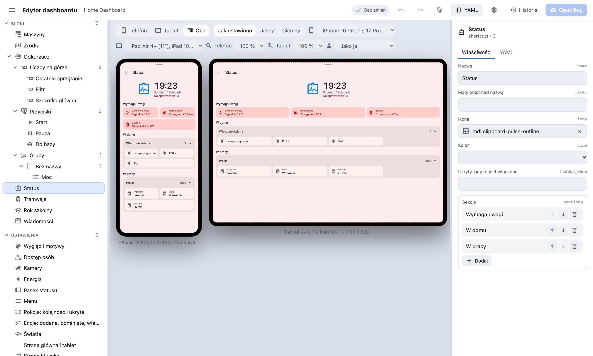

Pozostałe: odjazdy (linie z kolorami), wiadomości, host z kolumnami pasków i maszyn, rok szkolny, dodatek w ramce,
strona, telewizor z aplikacjami, waga. Listy się rozwijają, przesuwają strzałkami i usuwają koszem.

## 10. Wygląd, motywy i tła

**Ustawienia → Wygląd i motywy** ma część dla każdej grupy wyglądu: cały dashboard, tła stron, kafelki (z kolorami
według rodzaju), napisy, bloki na górze, okrągłe przyciski, plakietki, okna, mapa i odtwarzacz. Długie części startują
zwinięte; kliknięcie nagłówka rozwija jedną.

**Tła stron:** po jednym tle dla strony głównej, scen, mapy, energii i każdego pokoju, z czterema polami: *Jasny*,
*Ciemny*, *Jasny, szeroki ekran* i *Ciemny, szeroki ekran* (tablet w poziomie albo laptop mocno przycina pionowe
zdjęcie, więc może mieć własne). *Część zostawiana przy przycięciu* wybiera górę, środek albo dół.

Każde pole pokazuje na końcu, co zawiera: próbkę koloru albo gradientu albo lupkę, która otwiera obrazek w dużym
oknie. Kliknięcie w pole otwiera okno:

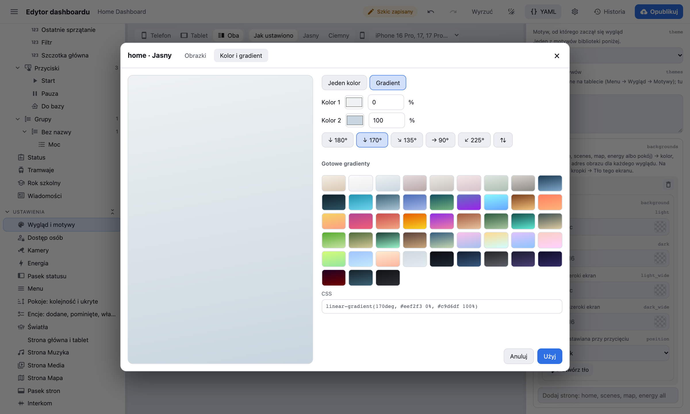

- **Obrazki:** wgrane do Home Assistanta i te z folderu `/config/www`, jako miniatury (kliknięcie wybiera, lupka
  powiększa), oraz **Wgraj obrazek z komputera**.
- **Kolor i gradient:** jeden kolor z palety albo gradient: jego kolory, ich miejsca w procentach, kierunek, ⇅ do
  odwrócenia, 48 gotowych gradientów i duży podgląd. CSS zostaje pod spodem do ręcznej zmiany.

**Utwórz tło** pod polami otwiera kreator tła: 16 gotowych teł, wzory, gradienty i własne zdjęcie, przezroczyste,
odbarwione albo rozmyte, z telefonem i tabletem obok. **Użyj jako tło** tworzy obraz pionowy i szeroki i wpisuje je do
jasnego wyglądu, ciemnego albo obu.

**Motywy:** wygląd można zapisać na tablecie jako motyw (Menu → Wygląd → Motywy) i udostępnić jako plik. Z
dashboardem przychodzą dwa: **Home Dashboard** i **Apple Home** (zob. [przewodnik Apple Home](apple-home.pl.md)).

## 11. Pasek statusu tabletu i kalendarze

Tablet w poziomie może pokazywać kolumnę z godziną, pogodą, dzisiejszymi wydarzeniami i tym, co się dzieje, zamiast
wąskiego paska. **Ustawienia → Pasek statusu**:

- **Wygląd paska** (`appearance.status`): czy jest widoczny, jego części i ich kolejność, kolory, krycie, rozmycie.
- **Kalendarz** (`status_panel.calendars`): kalendarze domu. Dzisiejsze wydarzenia są pod pogodą: całodniowe miękko w
  kolorze kalendarza, pozostałe z godziną, w trakcie „teraz”, znikają po końcu; najwyżej tyle, ile *Najwięcej w pasku
  statusu*. Dotknięcie otwiera miesiąc z wydarzeniami wybranego dnia. *Kolory kalendarzy* nadają każdemu kalendarzowi
  kolor. Na telefonie te same wydarzenia są w *Wybierz obszar → Moje kalendarze*, gdzie każda osoba dodaje pod
  trybikiem własne kalendarze.
- **Co pokazuje pasek** (`status_panel`): drzwi i okna (*W domu*), światła i urządzenia nieliczone, co *Teraz* działa
  (pralka z programem i pozostałym czasem), pobór mocy z wykresem ostatnich godzin, tramwaje.

iPad w podglądzie od razu pokazuje pasek ze szkicu.

## 12. Menu i pasek stron

**Ustawienia → Menu** zawiera grupy lewego menu i ich pozycje. Pozycja otwiera **blok**, **dodatek**, **adres**
(stronę Home Assistanta, inny dashboard) albo uruchamia **akcję**; może być tylko dla administratorów, dla wybranych
osób i ukryta w trybie gościa. Wybranie *Menu* otwiera menu w podglądzie.

**Ustawienia → Pasek stron** zawiera miejsca dolnego paska telefonu i bocznego paska tabletu: od 2 do 5 z: strona
główna, Muzyka, Media, Energia, Mapa, Sceny, menu albo pokój, w kolejności, oraz wygląd paska.

## 13. Kamery, energia, interkom i pozostałe ustawienia

| Węzeł | Co ustawia |
|---|---|
| **Kamery** | które kamery i w jakiej kolejności; prywatność i tryb gościa (zasady z przełącznikiem, kamery, które ukrywają, i osoby); pojedyncze kamery: kamera na żywo dla zdjęcia, rozmowa, okrągłe przyciski, obracanie, encje pod trybikiem |
| **Energia** | fazy licznika, zakres napięcia, magazyn energii (stacja zasilania na baterii) |
| **Interkom** | skrypt komunikatów, pokoje do zaznaczenia i pola wywołania |
| **Pokoje: kolejność i ukryte** | kolejność pokoi i pokoje ukryte przed wszystkimi |
| **Encje: dodane, pominięte, własne** | encje dodane do pokoju, nigdy niepokazywane same, własna nazwa, ikona, obszar albo karta encji |
| **Światła** | grupa świateł zamiast jej lamp |
| **Strona główna i tablet** | pogoda, ochrona, powrót tabletu na stronę główną, sceny |
| **Strona Muzyka**, **Strona Media**, **Strona Mapa** | aplikacja muzyczna w ramce, grupy głośników i mediów, osoby i miejsca na mapie |

Blok otwierający stronę (np. **Źródła** z `page: media`) nie ma własnych grup: grupy i kafelki strony Media
(Głośniki, Telewizory, własne grupy) dodajesz w **Strona Media** → **sections**. Pod właściwościami takiego bloku jest
przycisk **Edytuj: Strona Media**, który tam prowadzi.

Każdy ma formularz; zakładka YAML zostaje obok dla tego, co wolisz wpisać. Klucze opisuje
[opis konfiguracji](configuration.pl.md).

## 14. Kto co widzi

Dzieci nie potrzebują przełączników garażu, a gość kamer wewnątrz domu. **Ustawienia → Dostęp osób**:

- Wybierz **osobę**, a potem to, czego **nie widzi**, w grupach (kamery, pokoje, sekcje, bloki na górze, światła,
  media, ochrona, sceny i skrypty, reszta), z okiem przy każdej rzeczy.
- **Kto widzi kafelek albo blok** (`visibility`): zasady dla jednej rzeczy, encji, `block:<nazwa>` albo
  `shortcut:<nazwa>`, z osobami, które ją widzą (*only*) albo nie (*except*).
- To tylko ukrywa rzeczy w dashboardzie; to nie jest uprawnienie Home Assistanta. Administratorzy widzą wszystko w
  edytorze.

Sprawdź to przez **Jako** w podglądzie: dashboard tej osoby, tak jak ona go zobaczy.

## 15. Zapisywanie, publikowanie i historia

**Szkic** zapisuje się na serwerze chwilę po każdej zmianie (*Szkic zapisany*). Czeka też w innej przeglądarce.
*Wyrzuć* go usuwa.

**Opublikuj** otwiera podsumowanie:

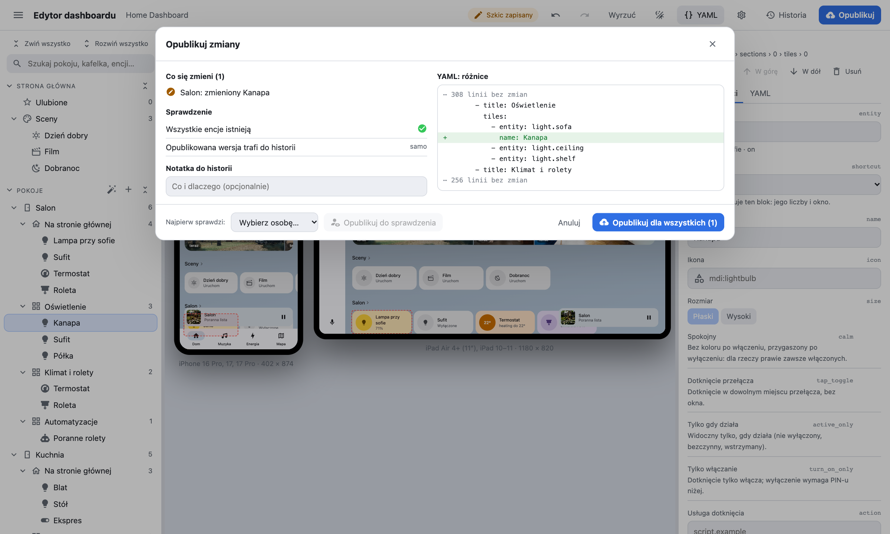

- **Co się zmieni**, prostymi słowami, i **różnice w YAML**.
- **Sprawdzenie:** encje, których nie ma, i informacja, że opublikowana wersja trafi do historii.
- **Notatka do historii** (co i dlaczego, opcjonalnie).
- **Najpierw sprawdzi:** wybierz osobę i **Opublikuj do sprawdzenia**: tylko jej dashboard pokazuje tę wersję, z
  paskiem *Wersja do sprawdzenia* i przyciskiem powrotu do zwykłej. Góra edytora mówi, kto sprawdza; *Zakończ* kończy
  sprawdzanie. Dobre, żeby dużą zmianę wypróbować najpierw na jednym tablecie.
- **Opublikuj dla wszystkich:** każde urządzenie wczyta nową wersję, a ta, którą zastępuje, trafia do historii. Jeśli
  w międzyczasie dashboard zmieniono gdzie indziej (na tablecie), edytor to mówi, zamiast nadpisać tę zmianę;
  *Opublikuj mimo to* ją nadpisuje.

**Historia** przechowuje 30 ostatnich opublikowanych wersji, z tym, kto i kiedy je opublikował, oraz notatką. Wybierz
jedną, żeby zobaczyć, czym różni się od obecnej; **Przywróć jako szkic** robi z niej szkic, do obejrzenia i
opublikowania jak każdy inny.

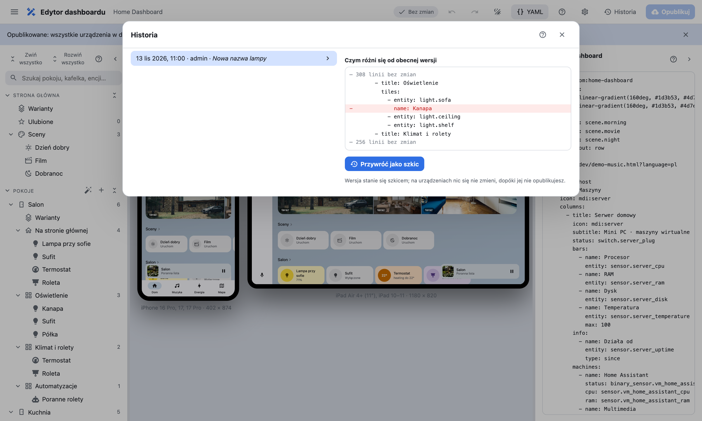

## 16. Ustawienia edytora: własne telefony i tablety

⚙ na górnym pasku otwiera ustawienia edytora:

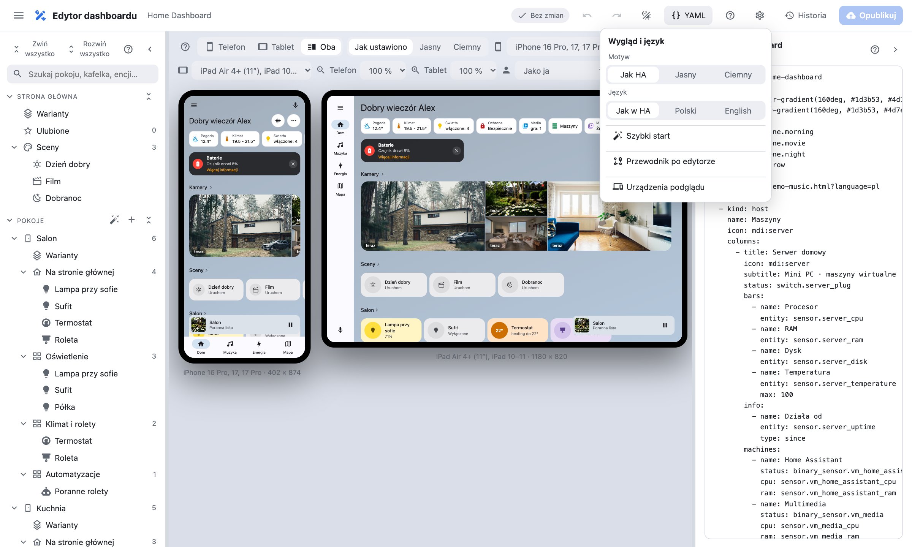

- Każdy wbudowany model (Apple) można **ukryć** z wyboru nad podglądem, **przemianować** albo **zmienić mu rozmiar**;
  strzałka przywraca ustawienia fabryczne.
- Pod każdą listą **dodajesz własne urządzenie** dowolnej marki: nazwę, szerokość i wysokość w punktach (pikselach
  CSS: rozdzielczość ekranu podzielona przez gęstość pikseli; np. 1280 × 800 dla Galaxy Tab S9). Telefon zawsze stoi
  pionowo, a tablet poziomo, niezależnie od kolejności wpisanych wymiarów.
- Lista jest zapisywana w tej przeglądarce. Jeden model każdego rodzaju zawsze zostaje widoczny.

## 17. Cały dashboard w dziesięciu krokach

Kolejność, która najlepiej działa dla nowego domu:

1. **Najpierw obszary.** W Home Assistant przypisz każdemu urządzeniu obszar (Ustawienia → Obszary). Ukryj to, czego
   nikt nie potrzebuje.
2. **Otwórz edytor** i **utwórz dashboard** (rozdział 3).
3. **Utwórz pokoje z obszarów**, z *Oświetleniem*, *Klimatem i roletami*, *Multimediami*, *Urządzeniami* i
   *Bezpieczeństwem* oraz kilkoma kafelkami każdego pokoju na stronie głównej.
4. **Uporządkuj pokoje:** przemianuj je, połącz obszary będące jednym pokojem, ułóż pokoje w kolejności (*Pokoje:
   kolejność i ukryte*), usuń niepotrzebne kafelki i dodaj brakujące przez *Wybierz z listy…*.
5. **Zbuduj stronę główną:** kilka **Ulubionych** (główne światła, drzwi wejściowe, ogrzewanie), **Sceny**, a w każdym
   pokoju listę **Na stronie głównej** z dwoma do czterech kafelków.
6. **Dodaj bloki** dla rzeczy z wieloma encjami: ekspres, pralka, samochód, odkurzacz, serwer, UPS. Zacznij od
   najważniejszych liczb, potem grupy; *Z urządzenia, jeszcze nie w bloku* pokazuje, co zostało.
7. **Wybierz wygląd:** motyw, tło dla strony głównej i każdego pokoju (pomoże kreator tła), kolory kafelków.
8. **Przygotuj tablet na ścianę:** pasek statusu z kalendarzami i tym, co pokazuje, powrót tabletu na stronę główną,
   pasek stron i menu.
9. **Zdecyduj, kto co widzi**, i sprawdź to przez **Jako** w podglądzie.
10. **Opublikuj do sprawdzenia** na jednym tablecie, potem **Opublikuj dla wszystkich**. Zostaw notatkę w historii.

Potem edytor jest miejscem każdej zmiany: nowe urządzenie to kafelek dodany w minutę, nowy pokój to kliknięcie ✨.

## 18. Wskazówki i problemy

- **Zmiana nie pojawia się na tablecie.** Pojawia się po **opublikowaniu**. Otwarty tablet trzyma starą wersję, dopóki
  nie wczyta dashboardu ponownie (przeciągnij w dół albo otwórz aplikację jeszcze raz).
- **Edytor mówi, że dashboard zmieniono gdzie indziej.** Ktoś zmienił go na tablecie (np. osoba przesunęła kafelki).
  Publikacja zastąpiłaby tę zmianę; najpierw obejrzyj różnice, potem *Opublikuj mimo to* albo wyrzuć swój szkic.
- **Edytor był otwarty w dwóch przeglądarkach.** Każda zapisuje swój szkic; wygrywa ostatnia. Przeładuj edytor, zanim
  zaczniesz pracę w drugiej.
- **Kafelek ma ⚠.** Jego encja nie istnieje (zmieniona albo usunięta w Home Assistant). Wybierz kafelek i wskaż nową
  encję albo go usuń.
- **Okno bloku przewija się na tablecie.** Edytor mówi pod podglądem, o ile. Zwiń grupę w podsumowanie, przenieś
  wiersze do mniejszej liczby grup albo ustaw blok na cały ekran.
- **W oknie tła nie ma obrazków z folderu `www`.** Pojawiają się po restarcie Home Assistanta z nową wersją
  integracji.
- **Nic w edytorze nie wywołuje usług**, więc możesz śmiało wszystko sprawdzać. Jedyne, co zmienia dashboardy domu,
  to **Opublikuj**.

Więcej odpowiedzi, z dokładnymi komunikatami, jest w [FAQ w README](../README.pl.md#faq), a każdy klucz konfiguracji
w [opisie konfiguracji](configuration.pl.md).
