# Home Dashboard guide

From a fresh installation to a finished dashboard. No scripts are needed: everything here is done in
Home Assistant's settings, in the dashboard itself, or in its YAML editor.

[Polski](guide.pl.md) · [README](../README.md)

| Home | Room | Menu | Choosing an area |
|---|---|---|---|
| 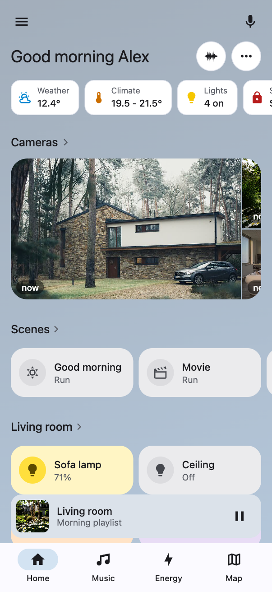 | 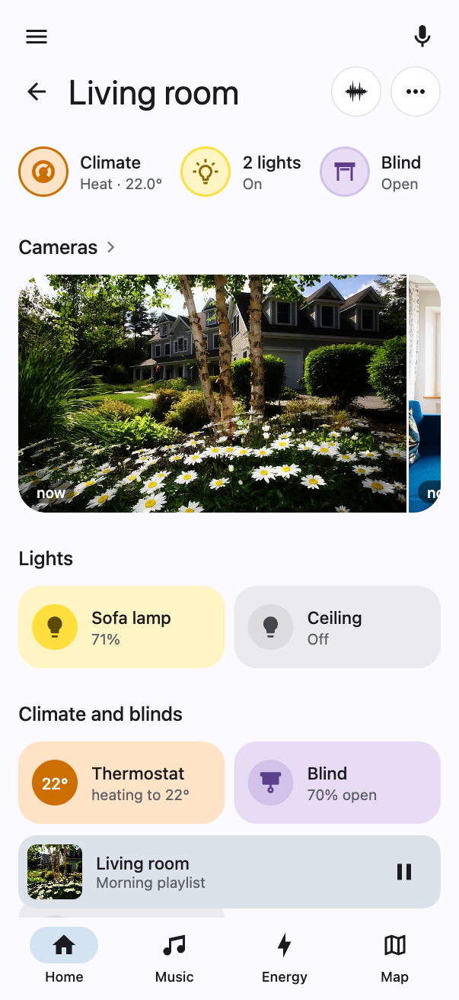 | 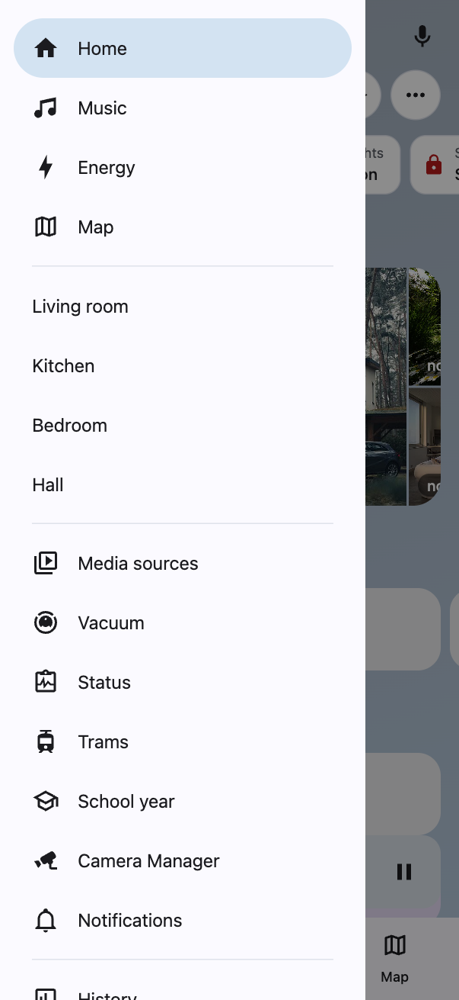 | 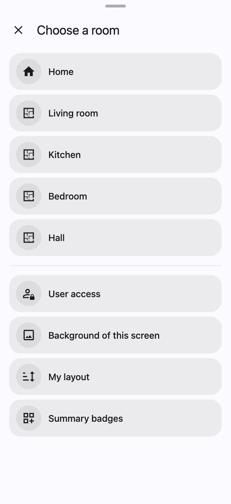 |

## 1. Install

You need Home Assistant 2026.10 or newer. On a phone or tablet use the Companion app.

1. In HACS (Marketplace from Home Assistant 2026.11) open the three dots → **Custom repositories**, add
   `https://github.com/witold-gren/home-assistant-dashboard` as an **Integration**, download
   **Home Dashboard** and restart Home Assistant. Without HACS, copy `custom_components/home_dashboard` into
   the `custom_components` folder of your configuration and restart.
2. Go to **Settings → Devices & services → Add integration** and add **Home Dashboard**.
3. Go to **Settings → Dashboards → Add dashboard → New dashboard from scratch**, and give it a name.
4. Open it, choose **Edit**, then the three dots → **Raw configuration editor**, replace everything with
   the lines below and save:

```yaml
strategy:
  type: custom:home-dashboard
```

The dashboard appears at once, built from your areas. It hides Home Assistant's own header, so from now
on its configuration is under **Menu → Dashboard settings → Edit configuration**.

**Colours:** Settings → Devices & services → Home Dashboard → **Configure** offers Automatic, Light and Dark.

## 2. What Home Assistant decides

The dashboard has no list of devices of its own. Most of what it shows comes from these settings, so
this is the first place to look when something is missing.

| In Home Assistant | Effect on the dashboard |
|---|---|
| **Areas** (Settings → Areas) | Every area with something to show becomes a room, with its name. An entity with no area stays out. |
| **Area of a device** | Its entities follow it. An entity can also have its own area, which wins. |
| **Entity name** | The tile's name. The name of the area is dropped from it, so "Kitchen Lamp" in Kitchen reads "Lamp". |
| **Hidden, configuration and diagnostic entities** | Never shown on their own. |
| **Light groups** | A group replaces its member lights, so one tile controls them. `lights.prefer_groups: false` shows each lamp. |
| **Users** | Administrators can edit. Everyone else can only use the dashboard and arrange it for themselves. |
| **Persons and zones** | The Map page lists people and how far they are from home. |
| **Energy dashboard** (Settings → Dashboards → Energy) | Decides what the Energy page shows. |
| **Language of the user** | The language of the interface. English and Polish are included. |

By default only lights, climate, covers and locks become tiles. Anything else is added by you, see
[Rooms](#3-rooms).

## 3. Rooms

### Adding a room

Create the area in Home Assistant and assign devices to it. The room appears by itself.

### Choosing what a room shows

Open the room, then three dots → **Edit this screen**.

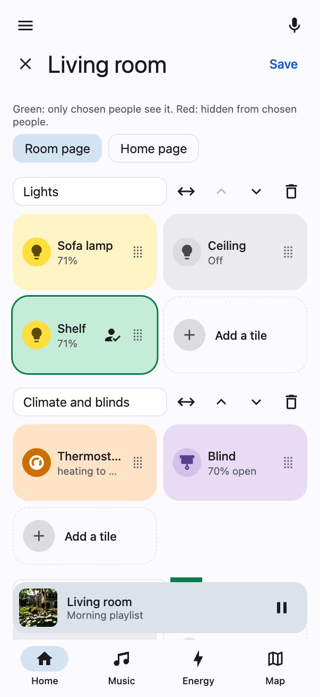

- **Room page** edits the sections shown on the room's own page. **Home page** edits the tiles of this room
  on Home.
- **Add a tile** searches all of Home Assistant, so a switch, a sensor, a scene or an automation can be added.
- Drag a tile by its handle, also to another section. Tap a tile to rename it, remove it, or choose who sees it.
- Each section has a name, arrows to move it, and a button with arrows that makes it one row scrolling
  sideways, which suits scenes and automations.
- Nothing reaches the server before **Save**.

The first edit writes the room down in `layout`. From then on the room shows what is listed there, and a new
device in the area needs adding by hand.

### Rooms made of several areas, and their order

Menu → Dashboard settings → **Edit configuration** opens all the configuration as YAML:

```yaml
layout:
  - id: kitchen
    name: Kitchen and dining
    areas: [kitchen, dining_room]
    home:
      - {entity: light.kitchen, name: Main}
    sections:
      - title: Lights
        tiles:
          - {entity: light.kitchen, name: Main}
```

Rooms appear in the order of `layout`, and the areas it does not cover come after them. `rooms.order` and
`rooms.hidden` change the order and hide a room without describing it.

### Tile options

| Option | What it does |
|---|---|
| `name`, `icon` | Own name and icon. |
| `tap_toggle: true` | One tap anywhere on the tile toggles it. Good for automations, which would otherwise open a dialog. |
| `calm: true` | No colour when on, faded when off. For things that are nearly always on. |
| `action: script.x` | Runs the script instead of toggling. |
| `active_only: true` | Shown only while the device plays. |
| `turn_on_only: true` | Can only be turned on. With `off_pin: {service: script.x, field: pin}` a keypad turns it off, and the script checks the PIN. |

## 4. Home

From the top: the greeting, the weather, the chips, your shortcuts, cameras, scenes, favorites and rooms.

- **Chips** count what is on and filter the page: climate, lights, security and media.
- **Rooms** show the tiles from the Home page tab of each room. Set a short list there: the room's own page
  has the rest.
- **Favorites** go above the rooms: `favorites: [climate.living_room, lock.front_door]`, or My layout → Favorites → **For everyone**.
- **Shortcuts** sit in the row of chips, see [Shortcuts and blocks](#7-shortcuts-and-blocks).

### Weather

The first chip shows the temperature and opens a screen with the current readings and the forecast for
the next hours and days. It appears by itself when Home Assistant has a `weather` entity. Add a service such
as **Met.no** under **Settings → Devices & services** if there is none.

By default the chip uses the first weather entity, and the forecast comes from the first one that has it. A home
station usually has no forecast, so the two can differ. Missing readings, such as wind, come from the forecast
entity too.

```yaml
weather:
  entity: weather.home_station
  forecast: weather.forecast_home
```

`weather: false` removes the chip. **User access** hides it from one person, under **Chips**.

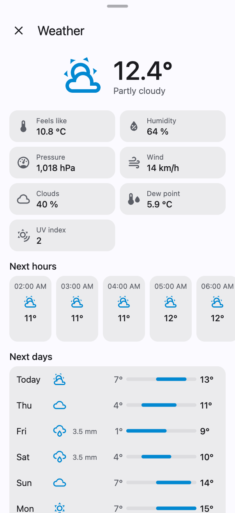

## 5. Cameras

### Which cameras appear

The strip does not show every camera, on purpose: a thumbnail fetched from a battery camera wakes it and
drains it. It shows:

- **Stored pictures:** `image.*` entities ending in `_last_screen` or `_last_snapshot`.
- **Cameras of safe platforms:** `camera.*` from `cameras.snapshot_platforms`, by default `frigate`.

A camera also needs an area. To add another platform that keeps its own frame:

```yaml
cameras:
  snapshot_platforms: [frigate, generic]
  battery_platforms: [my_platform]   # only cameras that do not report a battery
```

A camera on a battery never appears, even when its platform is listed. The dashboard recognises it by itself: its
device in Home Assistant has a battery level sensor (`device_class: battery`). This works for every brand.
`battery_platforms` is needed only for cameras that do not report a battery.

### Order and hiding

| Goal | How |
|---|---|
| Your own order, or hide one for yourself | Three dots → **My layout** |
| The same order for everyone | `cameras.order: [camera.a, camera.b]` |
| Hide from everyone | `cameras.hide: [image.garage_last_screen]` |
| Hide from one person | Three dots → **User access** |
| Exactly this list and nothing else | `cameras.hero` and `cameras.tiles` |

In the strip a single picture alternates with two smaller ones. A camera that stops working stays visible
in a small picture, blurred and marked as unavailable. The Security chip lists all cameras one under another.

### Siren, light, night vision and positions

When the camera's device has them, its window gets round buttons. Upright they stand in a row over the line of time,
from the right; on a phone on its side in a column in the bottom left corner, from the bottom (the siren lowest, the
light, night vision and positions over it).

- **Siren**: asks "Sound the siren?" first, glows red while it sounds, and a tap stops it.
- **Light**: on and off, glowing yellow while on.
- **Night vision**: a list of modes, e.g. Off (day), Infrared, Full colour (light).
- **Positions** (while turning live): the camera's saved positions.

**How they are found.** The dashboard looks among the entities of the camera's device, and for a recorder camera
linked to the same camera in another integration among that camera's. It goes by what does not depend on the language
or the name in Home Assistant:

| Button | Entity it finds by itself | What a tap does |
|---|---|---|
| Siren | the first entity of the `siren` domain | after asking `siren.turn_on`, then `siren.turn_off` |
| Light | a `light` entity, else a `switch` whose id ends in `_light`, `_spotlight`, `_floodlight` or `_lamp` | on and off |
| Night vision | a `select` with `night_vision` in its id, else a list that offers infrared (`Infrared`) | opens the options of that entity |
| Positions | the list of positions and its button from the camera's **turning** | goes to the chosen position |

Hidden and unavailable entities are left out. A setting switch such as `…_spotlight_enabled` is not taken for a light.

**Other cameras and own entities.** In **Dashboard settings → Turning and talking of each camera** open a camera: the
fields **Siren button**, **Light button** and **Night vision button** offer **Automatic** (with what was found beside
it), **None** or any entity. That is how the buttons go on a camera of any integration, also to devices that are not
part of the camera, such as a lamp in the garden or the siren of an alarm:

| Button | Entities to choose from |
|---|---|
| Siren | `siren`, `switch`, `input_boolean`, `script` |
| Light | `light`, `switch`, `input_boolean` |
| Night vision | `select`, `input_select` |

The same in the configuration (`cameras.quick`, keyed by the camera of the dashboard):

```yaml
cameras:
  quick:
    camera.garden:
      siren: switch.garden_alarm
      light: light.garden_floodlight
      night: none                 # no night vision button
```

The buttons work at any time, without the live view too; only the positions need it, as the arrows of turning do.

### All cameras

A tap on the heading **Cameras ›** on Home or in a room opens all cameras one under another, big, with their name and
the age of the picture (two side by side on a tablet). Their order and hiding are those of the page. A tap on a camera
opens its window, and the arrow at the top left goes back to the list.

### Live view

Tapping a picture opens it without a stream. **LIVE** at the bottom starts one, from a camera on the same device or
from `cameras.live: {image.door_last_screen: camera.door}`. While the camera wakes the window shows its last
picture with a loading ring in its middle, and the LIVE pill is grey. The live view takes the picture's place only
once the video really moves, and the pill takes its colour. The sound and turning buttons are greyed while nothing
plays (turning works live only). The battery hint stays upright all the time, faint while a recording plays, so the
window does not jump.

**LIVE** on the line of time is grey, orange at once when tapped, and turns into an orange **DISCONNECT** once the
video moves. DISCONNECT ends the live view without closing the window, so the recordings can be looked through at
once. Moving the line of time lets the camera go at once too. A camera unavailable in Home Assistant stays in the
window with its last picture, dimmed, saying **The camera is unavailable**, without LIVE; the words go by themselves
once the camera is back. A picture that did not load is asked for again every 5 seconds.

**Zooming:** spread two fingers on the picture to zoom in (up to 4×) and pinch to zoom out. One finger moves a zoomed
picture, and a double tap zooms 2.5× in at that point or back to the whole picture. On a computer ctrl with the wheel
or a trackpad pinch does it. A badge at the top right shows the zoom, and a tap on it goes back to 1×. It is a digital
zoom: the picture, the live view and a recording are enlarged as they came, and the camera does not move. Another
camera, or going between the picture, the live view and a recording, brings the whole picture back.

The button next to it speaks to the camera's area. It appears when the [intercom](#11-intercom) is set up and
that area is one of its areas. **Dashboard settings → Talking in a camera window → The camera's speaker** turns it into
talking through the speaker of the camera itself, where it has one (the eufy-sdk integration, a `…_speaker` switch).
The microphone works only over HTTPS or in the Home Assistant app. A recorder camera, e.g. Frigate, has no speaker or
buttons for turning of its own. In **Dashboard settings → The same camera in another integration** choose a camera of
the dashboard first, then the same camera in another integration (the list offers only cameras of other
integrations), and tap **Link**. From then on the window of that camera talks and turns through the other one
(`cameras.controls`). The links are listed above the choice, and the cross removes a link. **Save** keeps the changes.

| Phone upright | Phone on its side |
|---|---|
| 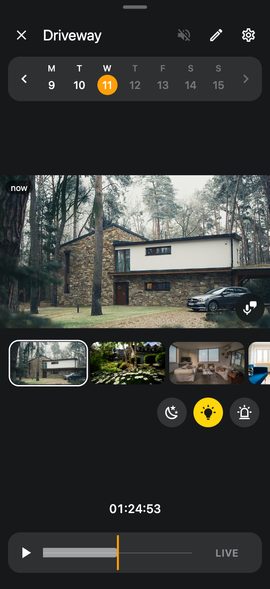 | 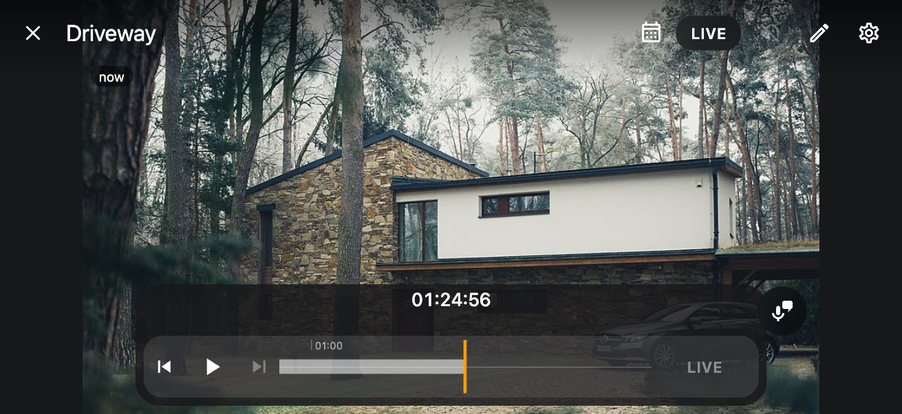 |

### Turning and talking of each camera

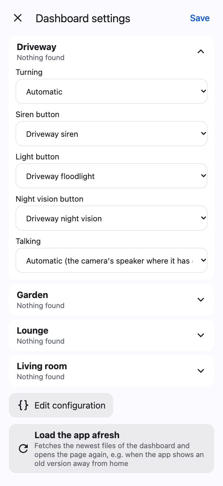

**Dashboard settings → Turning and talking of each camera** shows for each camera what was found to turn it. A tap on
the camera opens the choice.

| Turning | What it does |
|---|---|
| **Automatic** | in turn: the eufy set, ONVIF, buttons of the device named like `pan_left`, `tilt_up`, `go_to_preset` |
| **eufy (ready-made)** | the buttons of the eufy-sdk integration, known by their translation keys, so entity ids in any language do |
| **ONVIF** | the `onvif.ptz` service of a camera of the ONVIF integration; positions are typed as tokens, separated by commas |
| **Chosen by hand** | any buttons, scripts or scenes for the four directions, and a list of positions with its button |
| **No turning** | the camera has no turning button |

| Talking | What it does |
|---|---|
| **Automatic** | the camera's speaker where an integration offers one (below), else the room's intercom |
| **Through go2rtc** | a WebRTC connection of its own that only sends the microphone; works with cameras with two-way audio (ONVIF Profile T, Tapo, Dahua, Hikvision and others), not with a `generic` camera |
| **The room's intercom** | always the intercom |
| **No talking** | no button |

The sound button in the header is lit only while something plays and has sound. A camera without a microphone
leaves it grey.

Talking through the camera's speaker works only once the live view really moves, so you see whom you talk to. Before
that the button is locked, and the end of the live view ends the talk too. A camera that takes a moment to connect its
speaker shows a grey button saying "Connecting to the camera's speaker, you can talk already", and a red one once it
listens.

**For authors of integrations:** the dashboard talks through the camera of any integration that has, on the camera's
device, an entity with a `talk_path` attribute, e.g. `talk_path: /api/mine/talk/gate`. The dashboard signs the path,
adds `?rate=<Hz>`, opens a WebSocket and sends binary frames of 16-bit little-endian mono PCM, then the text `stop`.
The integration answers with JSON `{"ok": true}` or `{"ok": false, "error": "busy" | "no_speaker" | "unreachable" |
"failed"}` and closes. eufy-sdk and Neolink work that way.

### Turning, settings and recordings

- **Turning**: a camera whose device has buttons to move (e.g. `button.…_pan_left`, `…_pan_right`, `…_tilt_up`,
  `…_tilt_down`) gets a button with arrows in the header, next to the speaker. A tap lays a ring of arrows over the right side of
  the picture, and the **Position** list stands in the bottom left corner; another tap hides them. The age of the picture is in the top left corner, where LIVE shows during the live view. Playing a recording puts the controls away, since a recording cannot be turned. The window therefore looks the same for every camera, and turning works during
  the live view and on a camera with recordings too. A `select.…_preset` list with a `…_go_to_preset` button gives a
  list of the saved positions under the ring; empty ones ("empty") are left out.
- **Settings**: the gear in the camera window opens a window with the settings and state of the camera instead of the
  window of Home Assistant: **Settings** (switches, lists, sliders), **State** (sensors) and **Actions** (other
  buttons), gathered from the entities of the camera's device. Your own choice of entities for a camera:

  ```yaml
  cameras:
    settings:
      camera.garden: [switch.garden_microphone, select.garden_night_vision, sensor.garden_battery]
  ```

- **Recordings** (Frigate cameras): under the name of the camera is a week of days; days with recordings are
  bright, and the arrows change the week. At the bottom of the window is a line of the chosen day's time: bright
  stretches are recordings, orange dots are events, and the orange upright mark is the chosen moment, with its time
  above the line. Move the line left or right with a finger and the recording starts at that moment; in a gap between
  recordings it starts at the next one. Tapping a dot plays the event. On the left is **play and pause**, on the
  right **LIVE**. Play never starts the live view: past the last recording it plays that last one, and when it ends
  the window goes back to the last picture. Only **LIVE** wakes the camera.
- **Fast moving**: hold the line still for a moment and the whole day fits on it. Once the finger moves, the mark is
  under it: the left edge of the line is midnight, the right edge the end of the day. Point at the hour you want,
  e.g. 4:00, and let go: the line returns to its usual scale at that moment and plays the
  recording. Then fine-tune the moment with an ordinary move.
- **Weeks**: swipe over the days to the right to go a week back, or to the left to come forward again.
- **Phone on its side**: the picture of the camera fills the screen, and its name and buttons lie over it in the
  corners. The thumbnails of other cameras are hidden. **The calendar** in the header brings the days out at the top
  edge (the calendar and LIVE leave the header meanwhile), and **the clock with a line** in the bottom right corner
  brings out the line of time in place of the button. Put them away with the
  same button, with a swipe (the days up, the line down) or with a tap on the picture, which hides both at once. After a day is picked the days hide by themselves.
  **LIVE** always stays at the top, by the speaker. On the line of time **⏮** and
  **⏭** stand on both sides of play: a jump to the previous and the next recording of the day, which plays at once. Buttons are used instead of pulling from the edges because on
  iPhone the gestures from the top and bottom edges belong to the system (notifications and switching apps).
- **One picture**: the picture, the live view and a recording show in the same place and take each other's place.
  Going from the live view to a recording ends the connection to the camera, so a camera on a battery saves its
  energy. Every camera has the same layout: a camera without recordings has greyed days and an empty line, and the
  live view starts with **LIVE** or with play on the line.
- **Sound**: the speaker button next to the gear turns the sound of the live view and of recordings on and off.
  Holding it shows a volume slider. On iPhone and iPad the volume is set with the buttons of the device, so there the
  button only turns the sound on and off.
- **Recorded live views of battery cameras (eufy)**: when **Record live view** is on in the camera's settings
  (gear → Settings; a switch of the eufy-sdk integration, off by default), the eufy bridge saves every live view of
  that camera to `/media/eufy/<serial number>/<day>/`, whoever opens it (the dashboard, the window of Home Assistant,
  HomeKit). The bridge never wakes the camera itself; it records only what flows anyway. During the live view the
  pill on the picture says **REC · LIVE**. The days and the line of time show these recordings from the last 14 days;
  older ones stay on disk. Another media folder is set with `cameras.recordings_folder` (e.g.
  `media-source://media_source/local/eufy`).
- **Recorded live views of Reolink cameras (Neolink)**: the **Record live** switch of the Neolink integration works
  the same way (Neolink app 0.2.0 or newer). The files go to `/media/neolink/<camera>/<day>/`, and the switch names
  that folder itself in its `recordings_path` attribute, so `cameras.recordings_folder` does not move it.
- A Frigate camera is recognised by itself, also through a picture of the same device. The data and the recordings
  come from the Frigate integration of Home Assistant.

### Guest mode and privacy

```yaml
cameras:
  guest:
    entity: input_boolean.guest
    hide: [camera.living_room, camera.bedroom]
  private:
    - {entity: switch.bedroom_privacy, hide: [camera.bedroom]}
```

Add `users: [Tablet]` to `guest` to make it hold only for those accounts, by name or id. Everyone else keeps
seeing the cameras.

While `guest` is on, these cameras leave Home and Security, and stay on their room's page blurred. While a
`private` switch is on, the camera is gone from every page.

## 6. Scenes

`scenes` is the section under the cameras. Tap its heading, then three dots → **Edit this screen**: the list
offers scenes and scripts. The arrows button lays them out in one row that scrolls sideways. A room shows its own scenes and scripts under its cameras in the same layout. You choose them in the room editor, in the **Scenes** tab (`scenes` of the room). Until you save them, the room shows the scenes and scripts assigned to its area in Home Assistant.

## 7. Shortcuts and blocks

A block is several entities on one screen. It is plain data, so it needs no code. How to build a window for a device
the dashboard does not know, step by step and with examples, is in the [guide to your own devices](own-devices.md).

| Vacuum | Media | Blind | Switch |
|---|---|---|---|
|  | 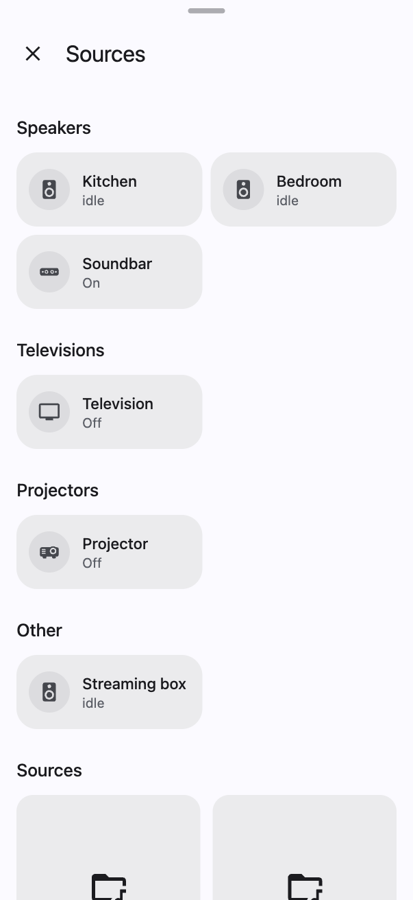 | 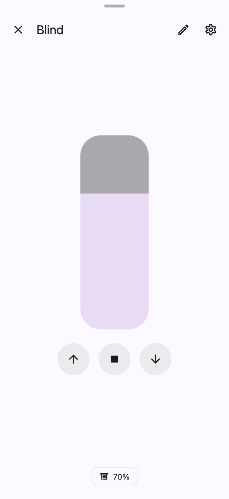 | 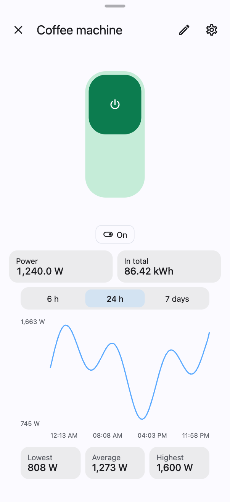 |

A vacuum as a shortcut:

```yaml
shortcuts:
  - kind: panel
    name: Vacuum
    icon: mdi:robot-vacuum
    entity: vacuum.robot
    stats:
      - {name: Filter, entity: sensor.vacuum_filter, unit: "%", digits: 0}
    actions:
      - {name: Start, icon: mdi:play, entity: vacuum.robot, service: vacuum.start}
      - {name: Dock, icon: mdi:home-import-outline, entity: vacuum.robot, service: vacuum.return_to_base}
    card: {type: custom:xiaomi-vacuum-map-card, entity: vacuum.robot}
    card_open: true
    groups:
      - layout: controls
        rows:
          - {entity: select.vacuum_power, name: Power, labels: {quiet: Quiet, turbo: Turbo}}
```

The same block can stand in a room: put it among the tiles in `layout`.

| Part | What it does |
|---|---|
| `stats` | Numbers across the top. |
| `actions` | Buttons. `confirm: Text` asks first, `service` calls a service of the entity. |
| `groups` | Rows of entities. A `select` becomes a list, a `switch` a switch, a `number` a slider. |
| `groups[].layout: controls` | Big buttons, choices, a wide slider and small cards instead of rows. |
| `groups[].layout: summary` | One line that opens on a tap, and by itself when a door, window or problem sensor is on. |
| `card`, `card_open`, `card_last` | A Home Assistant card in the block: on a button, at once, or below the groups. |
| `frame` | A web page on the whole screen. |
| `tone` | Icon colour of a shortcut: green, purple, teal or pink. |

The home overview is `kind: overview`: a clock, the date and only what is worth a look now. An item with nothing to show disappears,
and a section goes with its last item. A section with `alert: true` counts towards the summary by the clock, and `bottom: true` always stands at the very
bottom. `title` is optional. Tapping an
entity opens its details.

```yaml
shortcuts:
  - kind: overview
    name: Status
    icon: mdi:clipboard-pulse-outline
    sections:
      - title: Needs a look
        alert: true
        items:
          - name: Cold room
            icon: mdi:snowflake
            attribute: current_temperature
            unit: "°"
            below: 19
            entities: [{entity: climate.bedroom, name: Bedroom}]
          - {name: Batteries, icon: mdi:battery-alert, auto: battery, below: 11}
      - title: At home
        items:
          - {name: Open windows, icon: mdi:window-open-variant, entities: [binary_sensor.window]}
      - title: Working
        items:
          - name: Washer
            icon: mdi:washing-machine
            entity: sensor.washer_state
            state: [Running]
            labels: {Running: Washing}
            facts: [{name: Program, entity: sensor.washer_program}]
      - title: Sunday
        items:
          - {name: Service, icon: mdi:church, text: "8.00, 10.00", weekdays: [7]}
```

| Item | When it shows |
|---|---|
| `entities` | When an entity is in `state` (`on` by default). An entity is an id or `{entity, name}`. |
| `entities` with `below` | When the value is lower than `below`. `attribute` reads it from an attribute, `unit` gives the unit. |
| `auto: battery` with `below` | Finds batteries itself: percentages of entities with `battery` in the id or the `battery` class. |
| `list` | When a list in an attribute is not empty: `{entity, attribute, name, detail, since}` name its fields. |
| `entity` with `state` | When a device is in one of the states. `labels` describes the state, `facts` shows values. |
| `text` | Always, and with `weekdays` (1 is Monday, 7 is Sunday) and `months` only on those days and months. |

`weekdays` and `months` work in every item.

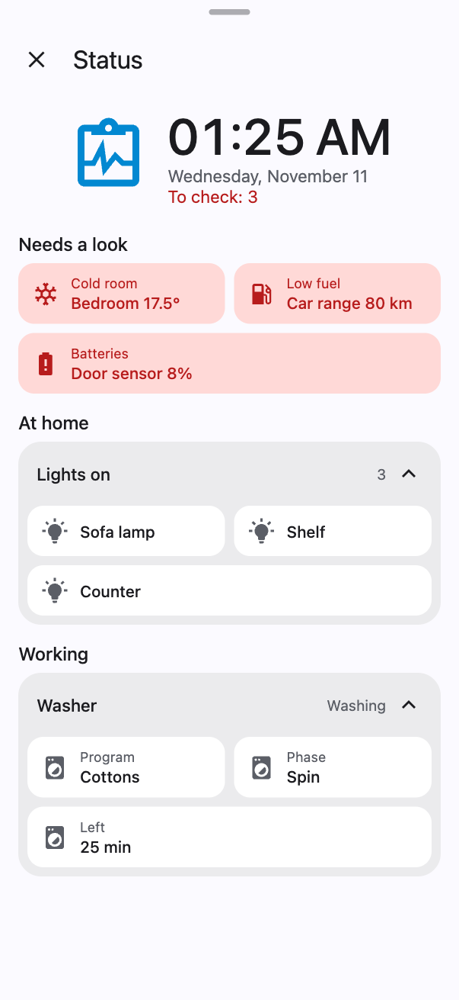

Tram and bus departures are `kind: departures`. The next one is large, and under it every line shows its coming
times and any delay. The entities must keep the departures in a `list` attribute (`line`, `direction`, `departure`,
`time_to_departure`, `delay`):

```yaml
shortcuts:
  - kind: departures
    name: Trams
    icon: mdi:tram
    entities: [sensor.tram_4, sensor.tram_11]
```

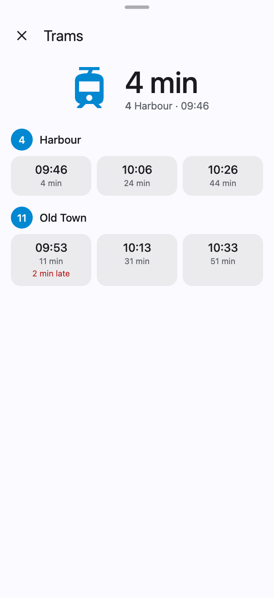

Other shortcuts: `{kind: page, name: Media, icon: mdi:play, page: media}` opens a page in a sheet, and
`kind: host` shows machines with `columns`. A TV has `kind: tv`, with `entity`, `on`, `off` and `shortcuts`,
and a webOS TV gets arrows and keys by itself.

A device with a card of its own opens it instead of the dashboard's sheet:

```yaml
entities:
  overrides:
    light.aquarium:
      card: {type: custom:lamp-card, entity: light.aquarium}
```

The rest of `entities`:

```yaml
entities:
  include:
    kitchen: [switch.dishwasher]     # adds an entity to a room
  exclude: [light.tablet_screen]     # leaves one out
  overrides:
    cover.window_3: {area: bedroom, name: Blind, icon: mdi:blinds}
```

### The block editor

Three dots on Home → **Summary badges** (administrators) lists all shortcuts. Here you add a new block and set their order, and
the pencil opens a form. Status, Departures, Machines (`kind: host`), Block (`kind: panel`), Page and School year have
one, with their sections, rows and buttons. Entities are suggested as you type, and a Home Assistant card goes in as
YAML in its field. A block standing in a room opens from the room editor: tile → **Edit the block**. A shortcut can have a `label`, a small text above its
name. Options the form does not know stay in the block untouched. After a rename the rules of **User access** follow the block, while the order
and hiding in someone's **My layout** have to be set again.

| Summary badges | Form |
|---|---|
| 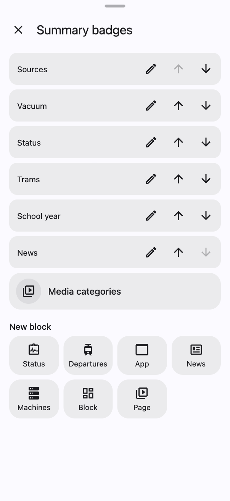 | 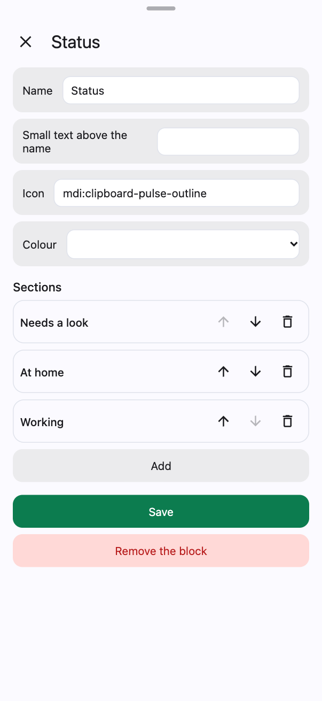 |

### Settings and editing of a device

Every device window has two buttons in the top right corner:

- **The gear** opens the settings of the device in tabs, gathered from its other entities: **Settings** (switches,
  lists, sliders, e.g. the transition time of a lamp), **State** (sensors, e.g. power), **Actions** (buttons, e.g.
  Identify) and **Activity** (the logbook of that device over 1, 6 or 24 hours). A group, e.g. a group of lights, has
  a **Members** tab first, with switches. Only tabs with something in them show, Activity always. The gear in that
  window opens the full window of Home Assistant.
- **The pencil** (administrators only) changes the **name**, the **area**, the **labels** and whether the device is
  **enabled**. An entity without a device is changed itself. A disabled device disappears from Home Assistant and
  from the dashboard; you enable it again in Settings → Devices.

Both windows take the look of the theme from **Look → Windows**, like every window of the dashboard.

### The side menu

The three bars open the menu: pages, areas, your groups and settings. Administrators arrange the groups with **Edit the
menu** at the very bottom. A group can have a title, and an entry has a name, an icon and one of three: the **Address** of
a Home Assistant page (it suggests panels such as `/config`), a **Shortcut** by name, or the **Action** `notifications`,
which opens a window of notifications, live, where they can be dismissed. **Administrators only** hides an entry from the others, **Who sees it** limits it to the ticked people (`users`, none ticked means everyone), and **Hide in guest mode** hides
it while guest mode holds for the account: use it for cameras, so the entry does not get around the block. With no menu
of your own it shows the shortcuts and the basic links.

Under **Edit the menu** is **Profile** with the name of the signed-in person: it opens the profile of Home Assistant.

The menu of Home Assistant is hidden while the dashboard is open, also on a wide phone on its side and on a tablet,
so the dashboard takes the whole screen. Your setting does not change: on other pages of Home Assistant the menu is
back as it was. A phone on its side keeps the phone layout, with three tiles in a row.

In the Home Assistant app a swipe from the left edge opens this menu on Home, instead of the menu of Home Assistant.
Anywhere else the same swipe goes back: an open window closes, and a room or another page returns to Home.

Entries with the address `/history` and `/logbook` open in windows of the dashboard. The logbook shows the devices of the
dashboard for the last hour, 6 or 24 hours, and the history shows graphs of the entities each person picks for themselves.

| Logbook | History |
|---|---|
| 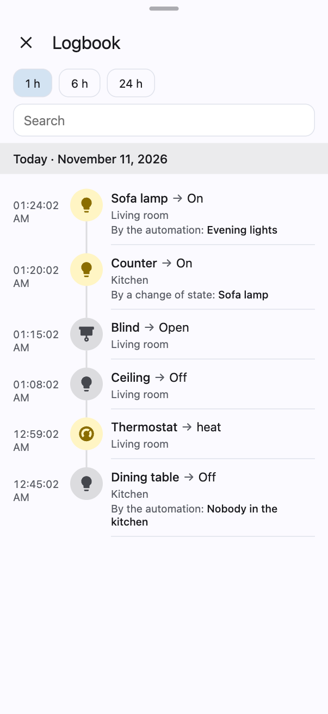 | 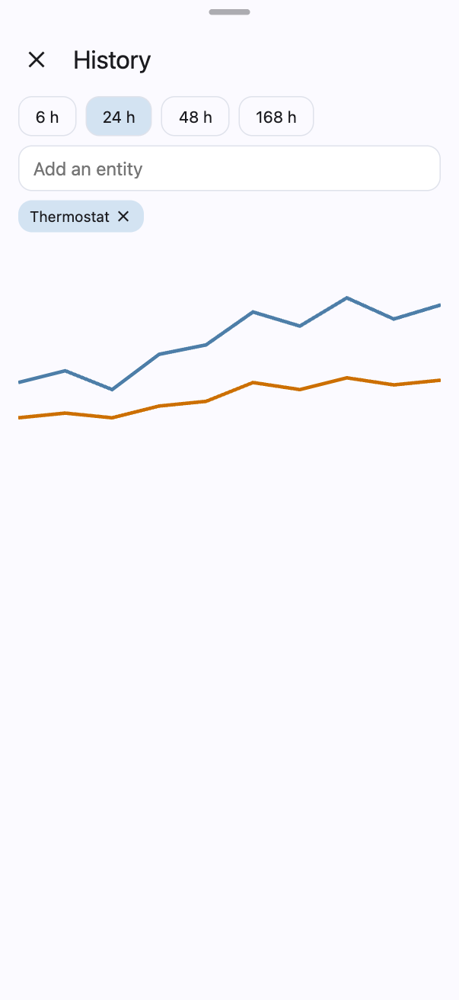 |

| Menu editor | Notifications |
|---|---|
| 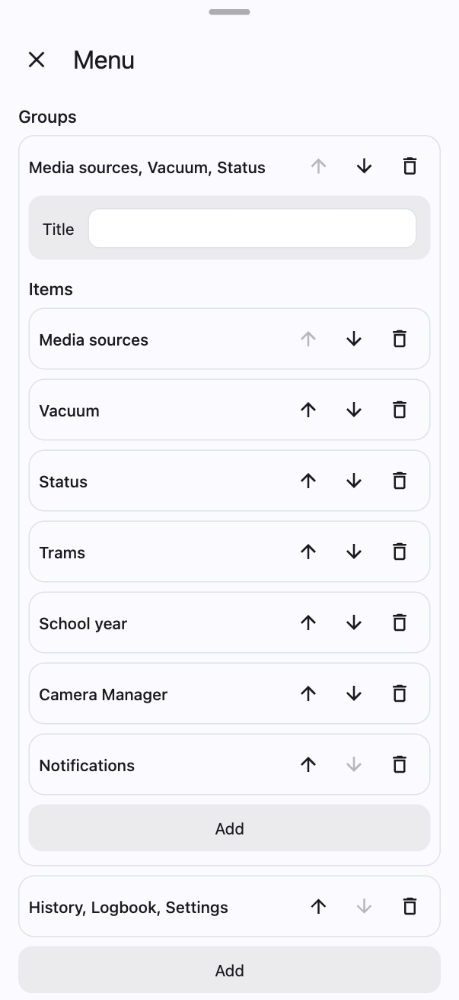 | 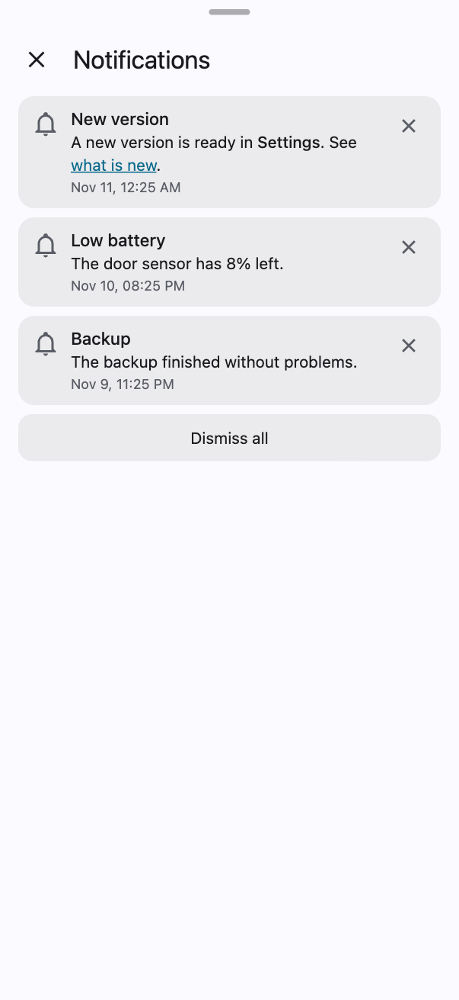 |

```yaml
menu:
  groups:
    - items:
        - {shortcut: Status}
        - {name: Cameras, icon: mdi:cctv, path: /my_camera_panel, hide_for_guests: true}
        - {name: Notifications, icon: mdi:bell-outline, action: notifications}
    - title: System
      items:
        - {name: Settings, icon: mdi:cog-outline, path: /config, admin: true}
```

### News

`kind: news` is a screen for reading. Each section is a sensor with a `news` attribute, a list of articles: `title`, `text`,
and optionally `rating`, `votes`, `source`, `source_url` and `url`. The `release` and `attribution` attributes show at
the top and bottom. In **Summary badges** it is **News**:

```yaml
shortcuts:
  - kind: news
    name: News
    icon: mdi:newspaper-variant-outline
    sections:
      - {title: Home, entity: sensor.news_home}
      - {title: World, entity: sensor.news_world}
```

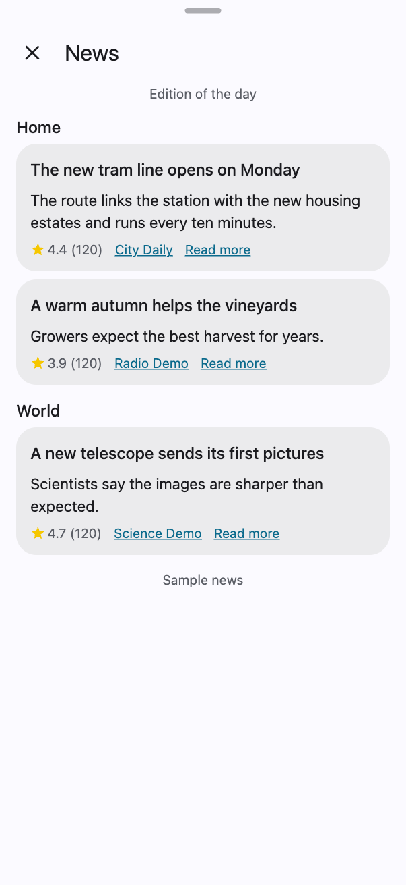

### Apps in a window

An add-on with a web interface, such as Frigate, opens in a window of the dashboard. In the menu put its id in the **App**
field, which suggests the installed add-ons. As a shortcut on Home it is **Summary badges → App**:

```yaml
shortcuts:
  - {kind: app, name: Frigate, icon: mdi:cctv, addon: abcd1234_frigate}
menu:
  groups:
    - items:
        - {name: Frigate, icon: mdi:cctv, addon: abcd1234_frigate, hide_for_guests: true}
```


When the window cannot open, for example because the add-on is off, a message and a button that opens it in Home
Assistant appear. `frame: http://...` gives a fallback address for such cases.

### The school year from your own data

`kind: school` reads sensors and assumes nothing about where they come from, so your own add-on or a template that
provides them is enough. `sources` changes the entity names. The data lives in attributes, and the state of a sensor does
not matter. A tab without data only says so.

```yaml
shortcuts:
  - kind: school
    name: School year
    icon: mdi:school-outline
    children: [Lena, Kuba]            # the order; other children go last
    sources:
      plan: sensor.my_timetable       # sensor.rodzinnik_plan_lekcji by default
      grades: sensor.my_grades        # sensor.rodzinnik_oceny
      events: sensor.my_calendar      # sensor.rodzinnik_terminarz
      meals: sensor.my_meals          # sensor.rodzinnik_obiady
      duties: sensor.my_duties        # sensor.rodzinnik_obowiazki
      jobs: sensor.my_jobs            # sensor.rodzinnik_prace
      bank: sensor.my_bank            # sensor.rodzinnik_bank
      librus: sensor.my_school_events # sensor.rodzinnik_librus
```

The children and their tabs come from `plan`. Dates look like `2026-11-09` and times like `08:00`. Day names are shown
as you send them, in any language, and a weekend is recognised by its date.

```yaml
# plan: the children attribute
children:
  - child: Lena
    days:
      - date: "2026-11-09"
        name: Monday
        is_today: true
        no_lessons: false              # true crosses out the lessons of the day
        events: [...]                  # as below
        lessons:
          - {number: 1, start: "08:00", end: "08:45", subject: Maths, teacher: Anna Nowak, classroom: "12",
             type: lesson, canceled: false, substitution: false, note: ""}   # type: extra is an extra activity

# event: an event in days[].events and in librus
- {date: "2026-11-09", title: School trip, start: "08:00", end: "15:00", place: Museum, description: "",
   instead_of_lessons: false, important: true}

# librus: the children attribute, important events of Today and Tomorrow and the events of the calendar
children:
  - {child: Lena, events: [...]}

# events: the children attribute, entries of the calendar
children:
  - child: Lena
    entries:
      - {date: "2026-11-10", kind: Test, title: Maths, description: Fractions, start: "10:10"}

# grades: the children attribute
children:
  - child: Lena
    semester: 1
    subjects:
      - subject: Maths
        averages: {semester_1: 4.5, year: 4.5}
        grades: [{grade: "5", category: test, is_new: true, proposition: false}]

# meals: the variants attribute
variants:
  - variant: school
    label: School
    available: true
    days:
      - {name: Monday, meals: [{meal: Lunch, items: [{name: Soup}, {name: Pasta}]}]}

# duties: the week_start, week_end and children attributes, optionally previous_week and next_week of the same shape
children:
  - {child: Lena, child_color: "#f5ec00", avatar: "https://...", set: Kitchen, color: "#77bb41", tasks: [Dishes], free_week: false}

# jobs: the jobs attribute
jobs:
  - {name: Raking, description: Leaves, reward_label: "5 - 10 EUR", limit: {label: once a week}}

# bank: the currency and children attributes
currency: EUR
children:
  - {child: Lena, balance: 65, savings: 10, debt: 0, allowance: {next_payment: "2026-11-09"}}
```

## 8. Music, Energy and Map

| Music | Energy | Map | Player |
|---|---|---|---|
| 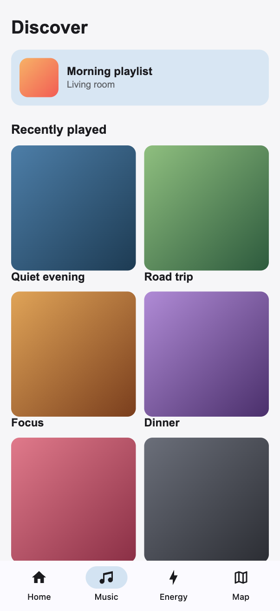 | 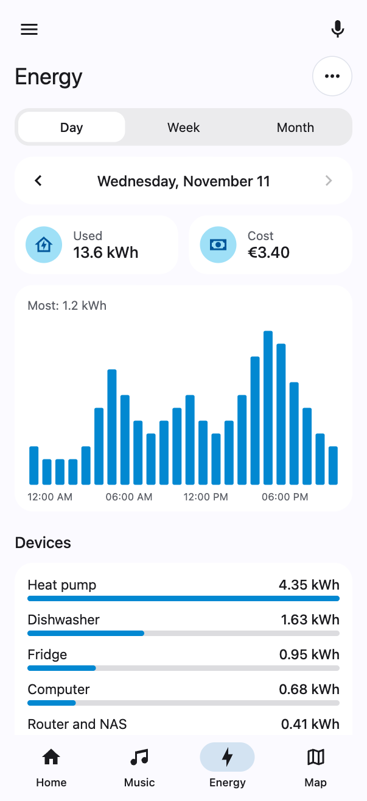 | 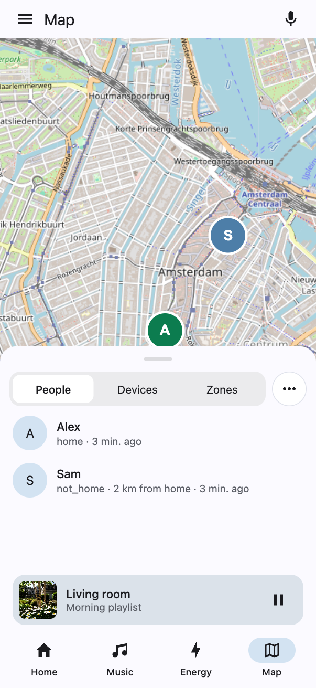 | 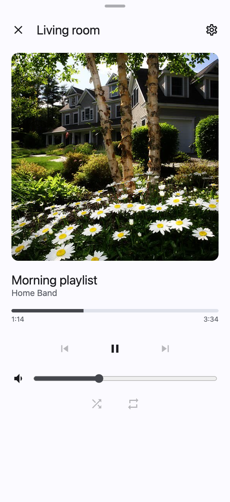 |

The music picture stands in for your music app, and the Energy and Map pictures for Home Assistant's cards,
with made-up numbers.

**Music** takes the place of Media on the navigation bar. Add a card or a web page:

```yaml
music:
  frame: http://homeassistant.local:8095
```

A page served over HTTP cannot open from a dashboard on HTTPS. On phones the bottom bar goes away for
Music Assistant's full-screen player only when the frame comes from the same address as Home Assistant.
When something plays a mini player shows above the bar on the other pages. Speakers that are the same device
are merged with `media.group_patterns`.

**Energy** is a page of the dashboard itself, in its look: **Day**, **Week** or **Month** with arrows to earlier
periods, the **Used** and **Cost** tiles (and **From the sun**, **To the grid**, **Gas**, **Water** when you have them),
a chart of hours or days and the list of **Devices** with the share of each. The numbers come from the energy settings
and statistics of Home Assistant, as in its Energy panel, so they are the same. The cards take the look of the buttons
of the theme. The small player does not show on Energy or the Map, so the bottom of the page stays free. Set it up in
**Settings → Dashboards → Energy**. Add your meter as the grid source and devices under
**Individual devices**. If one device is plugged into another that is measured, set it as a child there, or it
counts twice.

**Map** draws the routes of people over the last hours, with the zones, on the map of Home Assistant. Over the map are
two rows of buttons: **whose routes** (Everyone, each person and chosen devices) and **range**: 6 h, 24 h, 3 days or
7 days. Each device remembers its choice. A device with a route, such as a car, is added in the configuration:

```yaml
map:
  track: [device_tracker.car_location]
```

The colours of the map (as the page, light, dark) and the range at first are set in **Look → Background → Map**; Apple
Home has a dark map. The list of People, Devices and Zones lies on the map: on a phone it is a panel you drag between a thin bar, half the screen and the whole screen, and on a tablet it floats on the left. Tapping an entry shows it on the map.

The music page opens the Music Assistant add-on, also for accounts without administrator rights: `music: {addon: abcd1234_music_assistant}`. With `fullscreen: true` the bottom bar goes away, and the **Home Assistant** button in the menu of Music Assistant goes back to Home.

`media.sections`, or the form **Summary badges → Media categories** (pictured below), puts the media page in your own groups. Tiles are written as in a room, `kind: tv` and `kind: panel`
included. Those also standing in the layout of a room show in the Media filter on Home, in their room:

```yaml
media:
  sections:
    - title: Speakers
      tiles:
        - {entity: media_player.living_homepod, name: Living room}
    - title: Televisions
      tiles:
        - {kind: tv, entity: media_player.tv, name: Television}
```

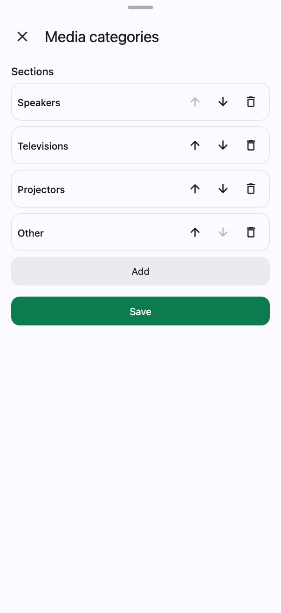

## 9. People

### Three dots on Home

The three dots menu ends with, in order: **User access**, **Background of this screen**, **My layout** and **Summary
badges**; in a room **My view** and **Edit this screen** instead of the last two. **Look** is in the side menu.
Some change the dashboard for you alone, some for the household:

| Entry | Who sees it | What it sets | For whom, and where it is kept | Where the change shows |
|---|---|---|---|---|
| **My layout** | everyone | order and hiding of cameras, areas, chips and scenes, your own favorites, hidden menu entries, the start of the dashboard | for you, with your HA account, so on all your devices; on Areas and Favorites an administrator can tick **For everyone** | Home, rooms, the menu, Security (cameras) |
| **Summary badges** | administrators | the list of shortcuts (blocks): adding one, their order, editing in a form, media categories | for everyone, in the dashboard configuration | shortcuts on Home, in the menu and in rooms; categories on the Music page |
| **User access** | administrators | what to take away from one person or from everyone but you: cameras, areas, sections of rooms, chips, lights, media, security, scenes and more | for that person, in the dashboard configuration (`access`); they cannot bring it back | everywhere in this dashboard, for that person |
| **Look** | everyone, in the side menu | background strength, bounce at the ends, the look of buttons (opacity, rounded corners, colour on the whole button or only on the icon, colours for kinds of buttons) and own icons of devices; themes for administrators | for you, with your HA account; with **For everyone** an administrator sets the shared look (`appearance`) | the whole dashboard |
| **Background of this screen** | everyone | the background of the page you are on, for the light and the dark look separately, and your look: System, Light, Dark | for you, with your account; with **For everyone** (administrators) as the default, in the configuration | only this page: Home or the room you are in |

What wins: first **User access** (what is taken away no layout brings back), then the **For everyone** settings, and
last a person's **My layout** and own background. Each entry is described below, and **Summary badges** in
[The block editor](#the-block-editor).

| Background | My layout | User access |
|---|---|---|
| 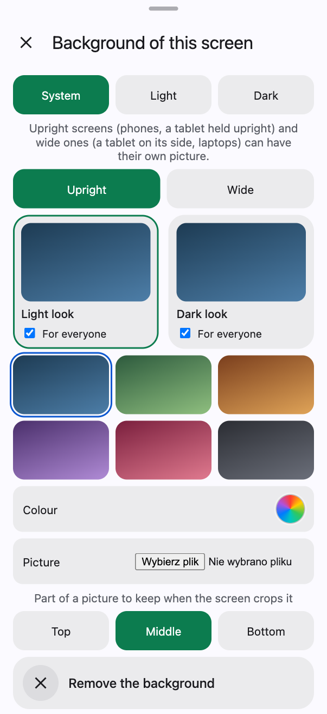 | 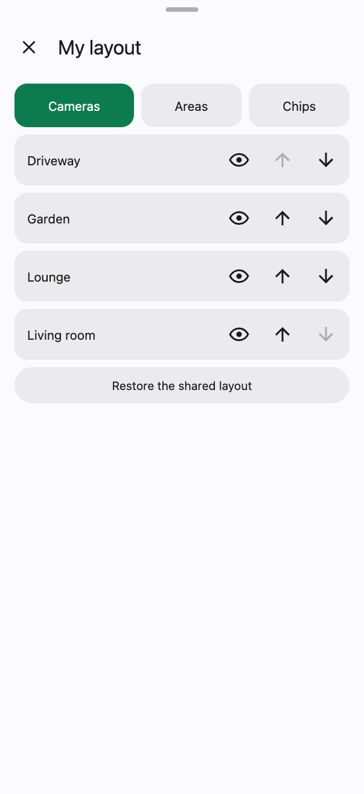 | 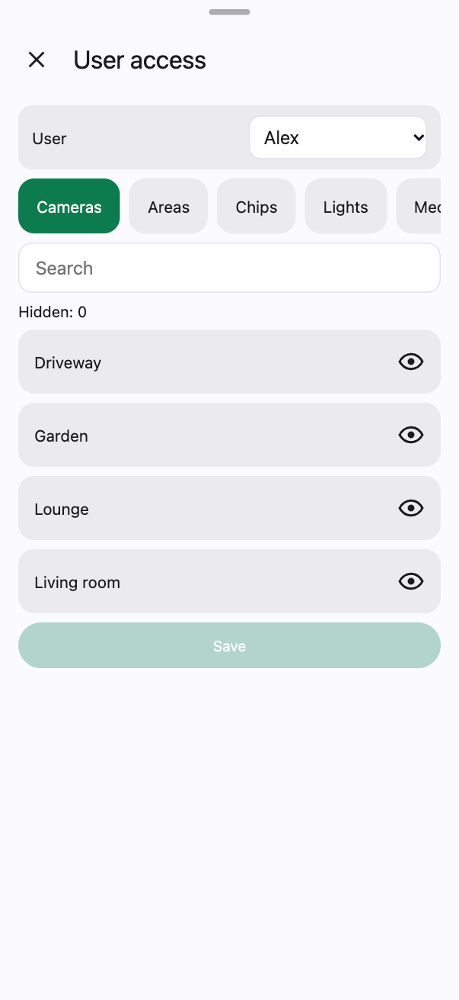 |

**My layout** (three dots on Home, for everyone): the order and hiding of cameras, areas, chips and scenes, your own
**Favorites** (they start from the shared ones, and you add more by search) and hiding entries of the **Menu**. At the
bottom, **Open this dashboard at start on my devices** is kept with the account, and every device takes it over once it
connects to Home Assistant.

On the **Areas** and **Favorites** tabs an administrator ticks **For everyone** and then sets the shared order of areas,
which are hidden, and the shared favorites everyone starts from. **Save for everyone** saves them. An area hidden for
everyone stays on that list, so it can be shown again. This is the only place for these settings: the **Dashboard
settings** window has the return after idle time, the start on this device, talking in a camera window, linking
recorder cameras to the same cameras in another integration, the configuration editor and at the bottom **Load the app
afresh**: it fetches fresh files of the dashboard and opens the page again, when the app shows an old version, e.g.
away from home.

**My view** (three dots in a room, for everyone): hides a whole section or a single tile for you, the **Scenes** group
included. A hidden tile leaves the room and its place on Home. **Show everything in this room** brings it all back.
What an administrator took away is not on the list and cannot be brought back. It is kept with the
account, so it follows the person to all their devices.

| My view of a room | My scenes |
|---|---|
| 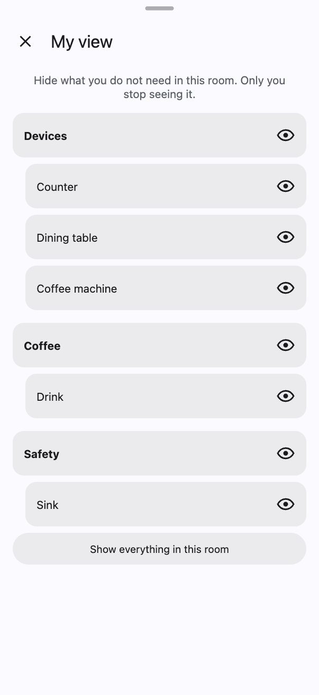 | 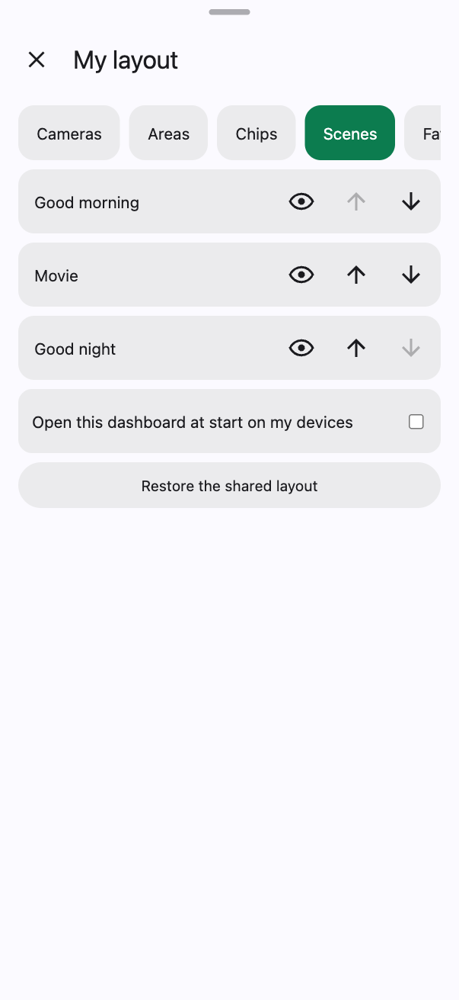 |

**Background of this screen** (three dots, for everyone): a gradient, a colour or a picture for Home, a room or the Scenes page (key `scenes`), the Map (`map`) or Energy (`energy`),
separately for the light and dark look; a look without its own background shows the plain page. At the top of this window you also choose the look of the whole dashboard for yourself: System, Light or Dark. **For everyone** appears for administrators and makes it the default.
Without it the background stays with that account. A person's own background beats the default.

Upright and wide screens can have different pictures, because an upright picture is cropped hard on a laptop:

| Shape | When | Key in the configuration |
|---|---|---|
| **Upright** | a phone, a tablet held upright, any window taller than wide | `light`, `dark` |
| **Wide** | a tablet on its side, a laptop, any window wider than tall | `light_wide`, `dark_wide` |

The **Upright / Wide** switch in the background window chooses which shape you edit; it starts on the shape of your
screen. A shape without a picture of its own takes the other shape of the same look. Its preview is then dimmed and
labelled **As upright** or **As wide**, so one picture is still enough for both. Turning a tablet changes the background
at once.

**Part of a picture to keep when the screen crops it** (Top, Middle, Bottom) keeps that part in view. For a picture
with a house at the top, choose **Top**. It applies to pictures, not to gradients or colours. In the configuration it is
`position: top`; middle is the default and is not saved.

```yaml
backgrounds:
  home:
    light: /api/image/serve/<id>/original       # upright
    light_wide: /api/image/serve/<id>/original  # wide
    dark: "#121316"
    position: top
```

### Look

**Look** (side menu, above **Dashboard settings**, everyone) has three tabs, and a fourth with **For everyone**: **Themes**. An administrator has **For everyone** ticked and then
changes the shared look, saved with **Save for everyone**. Without that tick, and for everyone else, the changes are
yours alone. Only what differs from the shared look is saved, so what you leave alone keeps following the
administrator's changes. **Back to the look for everyone** removes your changes.

| Background | Buttons | Colours | Icons |
|---|---|---|---|
| 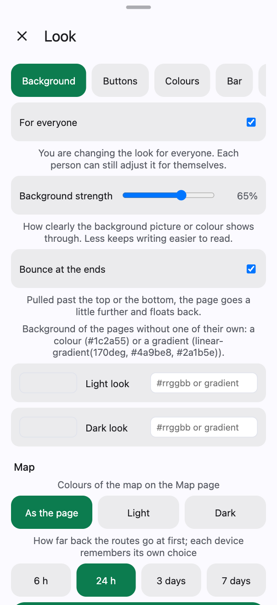 | 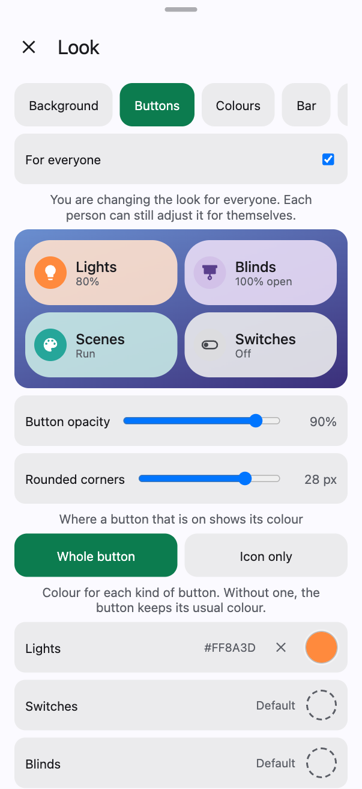 | 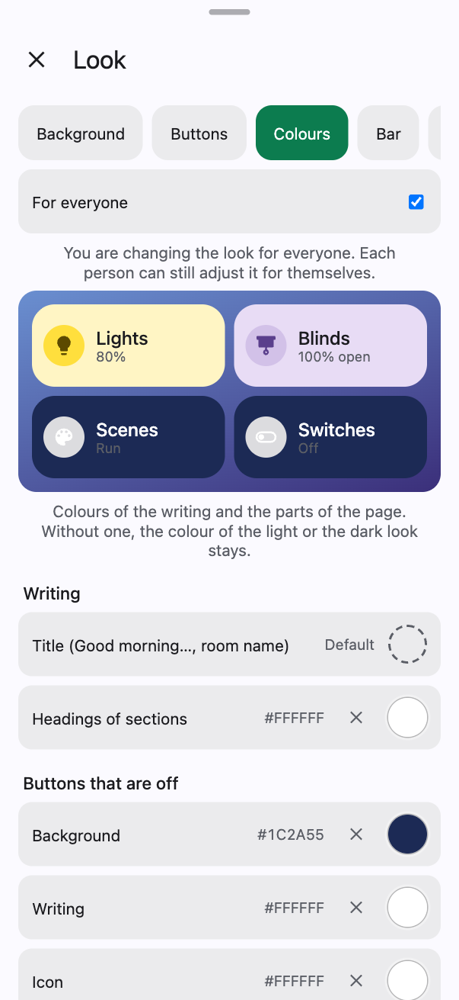 | 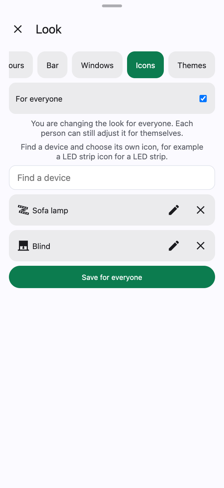 |

| Bar | Windows |
|---|---|
| 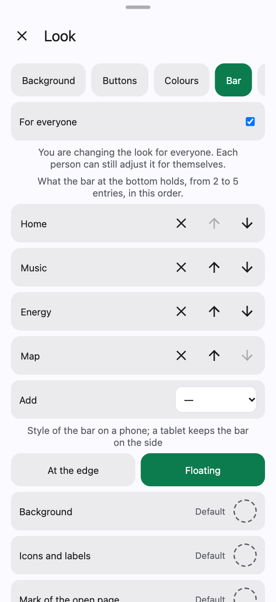 | 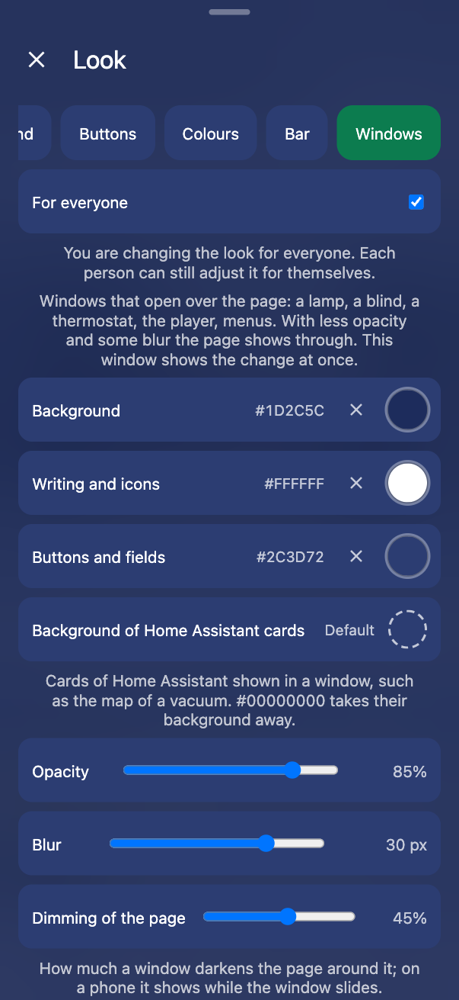 |

A colour without a value (**Default**) keeps the colour of the light or the dark look, so a theme can change only some
colours. A chosen colour stays the same in both modes. In YAML and in a theme a colour may be see-through:
`#rrggbbaa`, e.g. `#ffffff26` is white at 15%. Apple Home is built that way: black buttons at 26% and white circles at
15% take the colour of the background they lie on, so they suit every room. Picking a colour in the sheet changes the
hue and keeps the see-through part.

| Tab | Setting | Default | What it does |
|---|---|---|---|
| **Background** | **Background strength** (0-100%) | 40% | how clearly the background picture or colour shows; the rest is the page colour laid over it, so writing stays readable. 100% is the background as it is |
| **Background** | **Bounce at the ends** | on | pulled past the top or the bottom, the page goes a little further and floats back, as in phone apps; the background stays still and only the layout bounces |
| **Background** | **Light look / Dark look** (background of pages without one) | none | a colour (`#1c2a55`) or a gradient (`linear-gradient(170deg, #4a9be8, #2a1b5e)`) for every page without a background of its own, except Music; on the Map it shows above and below the map; no pictures, so a theme suits any home |
| **Buttons** | **Button opacity** (20-100%) | 100% | with less opacity the background shows through the buttons |
| **Buttons** | **Rounded corners** (0-36 px) | 20 px | 0 is a rectangle, 36 a pill |
| **Buttons** | **Whole button / Icon only** | Whole button | where a button that is on shows its colour; with **Icon only** the button itself stays neutral |
| **Buttons** | colours of kinds | none | your own colour for lights, switches, blinds, thermostats, speakers and TVs, locks and alarm, fans, scenes, scripts, automations and sensors |
| **Colours** | **Writing**: the title (Good morning…, room name) and the headings of sections | colours of the look | also the icons in the top bar |
| **Colours** | **Buttons that are off**: background, writing, icon, circle under the icon | colours of the look | buttons that are off, and every button with **Icon only** |
| **Colours** | **Blocks at the top**: background, writing, opacity, rounded corners | light background, 100%, 14 px | the Weather, Climate, Lights… blocks; with a chosen background they lose their outline |
| **Colours** | **Round buttons**: background, icon, opacity | light background, 100% | intercom and the three dots |
| **Colours** | **Badges in rooms**: writing, icon and ring | colours of the look | badges under the room name (Temperature, Humidity…) |
| **Bar** | entries: 2 to 5 of Home, Media or Music, Energy, Map, Scenes, Menu and the rooms; arrows set the order | Home, Media/Music, Energy, Map | a room and Scenes light up while open; in any other room Home does |
| **Bar** | **At the edge / Floating** | At the edge | a floating bar is a rounded pill above the bottom edge, as in Apple Home; a tablet always keeps the bar on the side |
| **Bar** | background, icons and labels, mark of the open page, opacity, blur | colours of the look, 100%, 0 px | with less opacity and some blur, the page under the bar shows through as frosted glass |
| **Bar** | **Player**: paused stays (0-120 min), background, writing and icons, opacity, blur, rounded corners | 10 min, colours of the look, 100%, 0 px, 16 px | the small player above the bar; it shows only what plays or was paused a short while ago; 0 hides anything paused at once, and × closes it until something plays |
| **Windows** | background, writing and icons, buttons and fields, background of Home Assistant cards, opacity, blur (0-40 px), dimming of the page (0-80%) | colours of the look, 100%, 0 px, 45% | every window that opens over the page: a lamp, a blind, a thermostat, the player, the three dots menu, Weather, Status, Host, School year, departures, News, Media, a vacuum; `#00000000` for Home Assistant cards takes away e.g. the grey background of a vacuum map; chosen tabs and highlighted events get a lighter and a yellow glass; with less opacity the page shows through blurred; the Look sheet shows the change at once, before saving |
| **Icons** | icon of a device | icon from HA | find a device, then an icon (e.g. `led strip`) and pick it; the list under the search shows your icons |

The colour of a kind shows while the button is on. Scenes, scripts and sensors have no "off", so their colour always
shows. A chosen colour also replaces the colour of the bulb on a light tile. Writing on the icon turns dark or white by
itself, depending on how light the colour is. The top of the **Buttons** tab shows a preview with a few buttons.

An own icon wins over the icon set in the room editor and over the icon from Home Assistant.

```yaml
appearance:
  background_strength: 70   # 0-100, default 40
  bounce: false             # default true
  tiles:
    opacity: 85             # 20-100, default 100
    radius: 28              # 0-36, default 20
    fill: icon              # tile or icon
    colours:
      light: "#ffb300"
      cover: "#7e57c2"
      scene: "#26a69a"
    background: "#1c2a55"   # buttons that are off
    text: "#ffffff"
    icon: "#ffffff"
    icon_background: "#2b3a6b"
  text:
    title: "#ffffff"
    headings: "#ffffff"
  chips:                    # blocks at the top
    background: "#1c2a55"
    text: "#ffffff"
    opacity: 60             # 20-100, default 100
    radius: 24              # 0-30, default 14
  buttons:                  # intercom and three dots
    background: "#1c2a55"
    icon: "#ffffff"
    opacity: 50
  badges:                   # badges in rooms
    text: "#ffffff"
    icon: "#ffffff"
  nav:                      # bar at the bottom
    items: [home, scenes, "room:living_room", menu]   # 2 to 5: home, media, music, energy, map, scenes, menu, room:<id>
    style: floating         # docked or floating
    background: "#2a2f6a"
    icon: "#ffffff"
    active: "#4a4f9a"
    opacity: 55             # 20-100, default 100
    blur: 20                # 0-30 px, default 0
  sheets:                   # windows over the page
    background: "#1d2c5c"
    text: "#ffffff"
    controls: "#2c3d72"     # buttons and fields in a window
    cards: "#00000000"      # background of Home Assistant cards, e.g. a vacuum map
    opacity: 70             # 20-100, default 100
    blur: 30                # 0-40 px, default 0
    scrim: 25               # dimming of the page 0-80, default 45
  player:                   # the small player
    background: "#2a2f6a"
    text: "#ffffff"
    opacity: 60             # 20-100, default 100
    blur: 20                # 0-30 px, default 0
    radius: 22              # 0-32 px, default 16
    paused_minutes: 0       # 0-120, default 10
  icons:
    light.led_strip: mdi:led-strip-variant
```

Colour keys: `light`, `switch`, `cover`, `climate`, `media_player`, `lock`, `fan`, `scene`, `script`, `automation`,
`binary_sensor`, `sensor`. The helper `input_boolean` counts as `switch`, `alarm_control_panel` as `lock` and `button`
as `script`.

#### Themes

The **Themes** tab shows while **For everyone** is ticked. A theme is the look for everyone (background, bounce,
buttons, colours, own icons) with the shared backgrounds of the pages. Personal settings, such as the children's, are
not part of a theme. Themes make a library in the dashboard configuration (`themes`), and `theme` says which one the
current look started from.

Two themes come with Home Dashboard as a base for your own:

| Theme | Look |
|---|---|
| **Home Dashboard** | light buttons, 40% background veil, no bounce: the look so far |
| **Apple Home** | dark see-through buttons with white writing, white headings, pill-shaped blocks at the top, a floating glass bar, the full background and a blue gradient for pages without one |

A theme that comes with Home Dashboard says **Comes with Home Dashboard**. It cannot be deleted, but it can be changed:
change the look and choose **Save the changes into the theme …**, and your home keeps its own version (**your version**).
The button with a round arrow next to such a theme brings back the version that came. Themes that come with Home
Dashboard have no pictures, at most gradients (Apple Home has a dark background on the Map, for the dark map); your version also keeps the backgrounds of your pages.

| Entry | What it does |
|---|---|
| **In use: …** | the theme the current look started from; **changed since it was chosen** when you changed it afterwards |
| **Save the changes into the theme …** | saves the current look and backgrounds of pages into the theme in use; from now on that is its version |
| **Back to the theme …** | brings back the look and backgrounds of pages saved in the theme |
| row of a theme | **Use** (replaces the look with the theme's, and backgrounds only on the pages the theme has; your other backgrounds stay), **Export to a file**, **Delete** from the library or, for a theme that came with Home Dashboard, bring back that version (the current look stays) |
| **Plain look** | the look without the settings of a theme; the backgrounds of pages stay |
| **Name of the theme** + **Keep the current look as a theme** | adds your version to the library and marks it as used |
| **Export the current look to a file** | a file `<name>.home-dashboard-theme.json` with the look and the pictures of the backgrounds |
| **Import a theme** | reads a file, lets you choose its name and where each background goes, adds it to the library and uses it at once |

| Library of themes | Importing a theme |
|---|---|
| 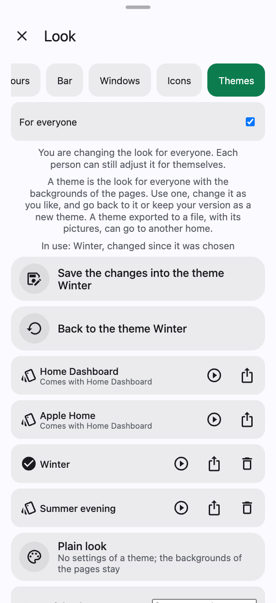 | 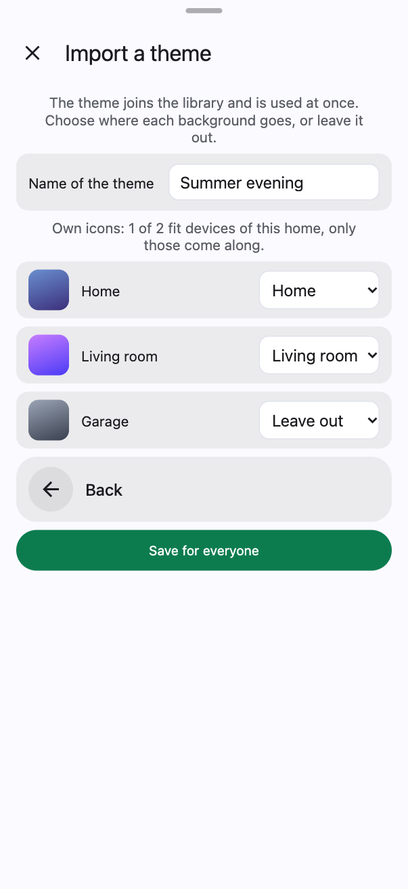 |

How to use it:

1. **Choose a base.** Menu → **Look** → **Themes** and **Use** next to **Home Dashboard** or **Apple Home**.
   You can also start from the current look: type a name, e.g. "Our home", and choose **Keep the current look as a
   theme**.
2. **Adjust.** Change what you like on the **Background**, **Buttons** and **Icons** tabs and press **Save for
   everyone**; the backgrounds of pages change in **Background of this screen**. The theme then shows as **changed
   since it was chosen**.
3. **Save, undo or keep apart.** **Save the changes into the theme …** saves them into the theme in use. **Back to
   the theme …** undoes them. Type a new name and **Keep the current look as a theme**, and the new version stands
   next to the old one; **Use** switches between them.
4. **Share.** The export button of a theme (or **Export the current look to a file**) saves a file you can send, for
   example to your brother.
5. **Load someone else's theme.** **Import a theme**, choose the file, adjust the name, give each background a page of
   yours or choose **Leave out**, then **Save for everyone**.

Switching themes does not lose your work: a look that is not in the library yet is kept there by itself as
**My look <date>**.

The import shows each background with a thumbnail and a list: **Leave out**, **Home**, **Scenes** or a room. At first
the same page is chosen when it exists, or a room of the same name; the rest waits for a choice. The pictures go to
Home Assistant (as choosing a picture in the background sheet does), and the library keeps only their addresses. Own
icons come along only for devices with the same `entity_id`; the sheet says how many fit.

The file can take a few MB, as the pictures are inside. Pictures from the internet (`https://` addresses) do not come
along, only images from the file and colours.

#### Apple Home step by step

A detailed guide, from installation to making backgrounds and colour palettes, is in a [separate document](apple-home.md).

| Home | Dark mode | Room | Lamp | Energy |
|---|---|---|---|---|
| 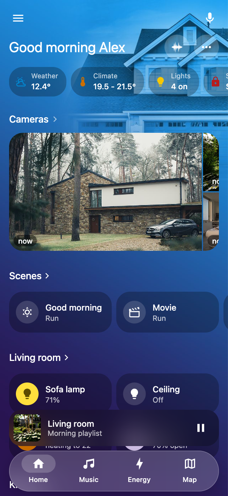 | 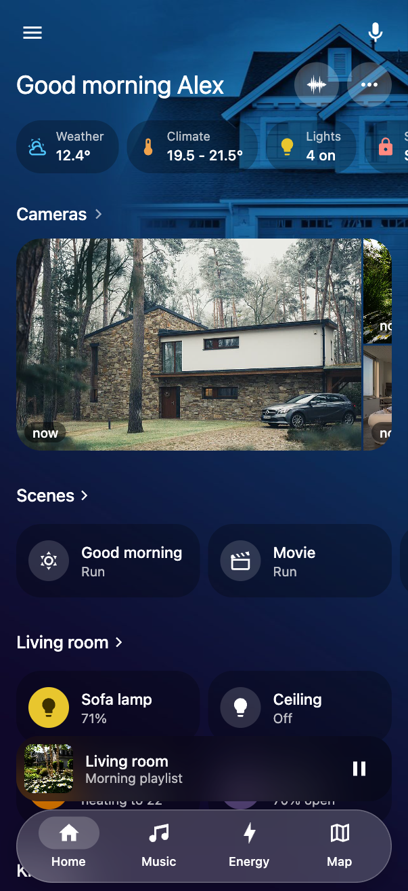 | 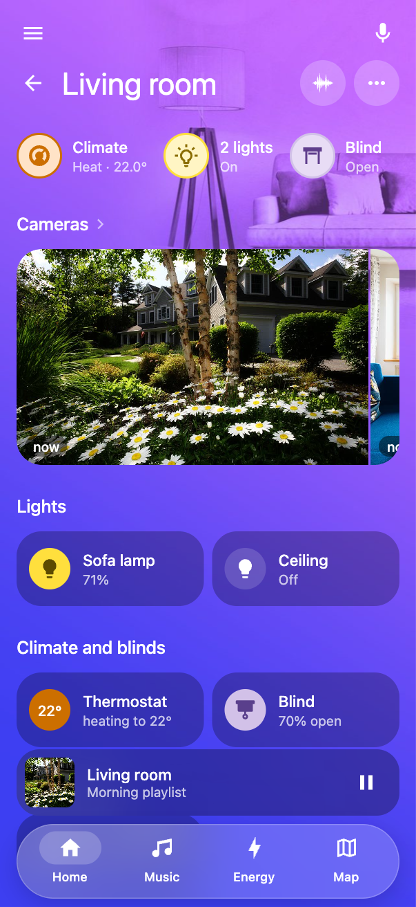 | 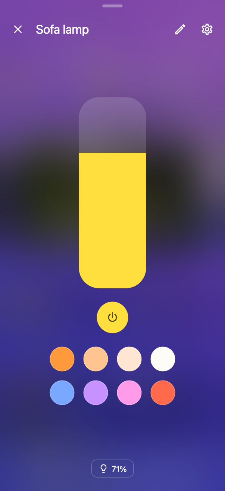 | 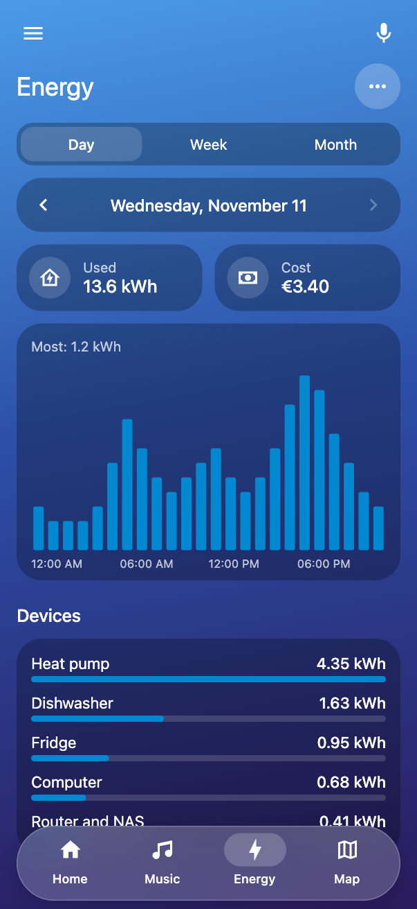 |

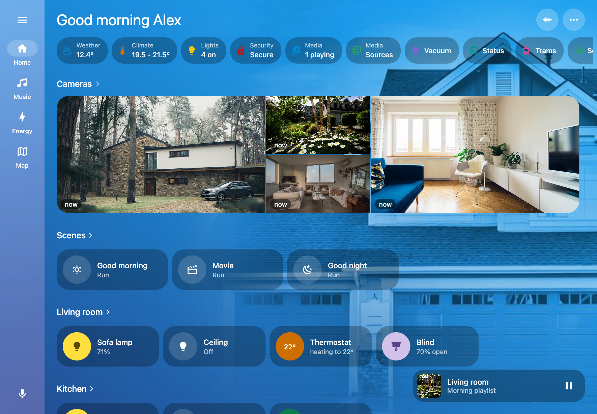

1. **Turn the theme on.** Menu → **Look**, tick **For everyone**, **Themes** tab → **Use** next to **Apple
   Home**. Buttons, the blocks at the top, the bar and windows turn to glass, writing to white, and pages without a
   background of their own get a blue gradient.
2. **Add backgrounds.** On Home and in every room: three dots → **Background of this screen**, a picture for the
   **Light** and the **Dark** look, **Part of the picture: Top**, **For everyone**. An upright picture works best
   (e.g. 1284 × 2778) with the room at the top fading into one colour below; the dark one is the same picture made
   darker. Examples are in `dev/demo-pictures/backgrounds`.
3. **Leave the colour of buttons alone.** In Apple Home they are neutral (black at 26%), so in each room they take the
   colour of its background. The window of a device shows the blurred background of the room it opened from.
4. **Map and Energy** have a background of their own in **Background of this screen**; Apple Home gives the Map a
   dark one under the dark map.
5. **Icons.** **Look → Icons**: own icons for devices, e.g. a LED strip icon for a LED strip.
6. **Save.** **Look → Themes → Save the changes into the theme Apple Home**. Export saves the theme with the pictures
   of its backgrounds into a file you can import in another home.

**User access** (three dots, administrators): choose a person and hide areas, cameras, lights, media, security,
scenes, scripts, other entities and blocks, and in the **Sections** tab whole sections of rooms. The **Chips** tab holds the weather, the chips and the shortcuts, and a
hidden shortcut also leaves that person's menu and **My layout**. **Everyone but me** hides something from all other
accounts at once, such as administrative blocks. It covers the accounts that exist when you save it, so set it
separately for a new user.

**Who sees this** (a tile in the editor): Everyone, Only chosen or All except. It applies to the entity
everywhere, your own account included. In the editor an administrator still sees everything: a green tile is
seen only by chosen people, and a red one is hidden from someone.

All of this hides things in the dashboard. It is not a permission: Home Assistant has none for single entities,
so the same person can reach them in another dashboard. Hide those dashboards too if it matters.

## 10. Phones and tablets

- Below 900 px of width the navigation is at the bottom, from 900 px at the side.
- A tablet left alone returns to Home after 3 minutes: `idle: {return_after: 300}` in seconds, `0` turns it off.
- A lock can only be locked on a tablet, because anyone can reach a wall: `security.unlock_on_tablet: true`
  changes it.
- **Dashboard settings → open at start** makes this device start on the dashboard, whatever the account's
  default is.
- After an update close and reopen the Companion app. If the old look stays, use
  **Settings → Companion App → Debugging → Reset frontend cache**.
- If the page zooms with fingers, turn off pinch to zoom in the Companion app's settings.

## 11. Intercom

With a script that speaks in chosen areas, the dashboard adds buttons to Home, rooms and the camera screen:

```yaml
intercom:
  script: script.announce
  areas_field: areas
  text_field: text
  areas: [living_room, bedroom]
```

The script gets the areas and the text in these fields. Recording a voice message needs HTTPS.

## 12. When something is wrong

| Symptom | Look at |
|---|---|
| A device is missing | Its area, whether it is hidden, and whether its domain is shown by default. |
| A light is missing | It may be a member of a light group. |
| A camera is missing | Its area, and the rules in [Cameras](#5-cameras). |
| A room is missing | The area needs at least one thing to show. |
| I cannot edit | Editing needs an administrator account. |
| A new device does not appear in a room | The room is in `layout`: add it with **Add a tile**. |

The [FAQ in the README](../README.md#faq) has more, with exact messages.
