# Home Dashboard guide

From a fresh installation to a finished dashboard. No scripts are needed: everything here is done in
Home Assistant's settings, in the dashboard itself, or in its YAML editor.

[Polski](guide.pl.md) · [README](../README.md) · [Configuration reference](configuration.md)

| Home | Room | Menu | Choosing an area |
|---|---|---|---|
| 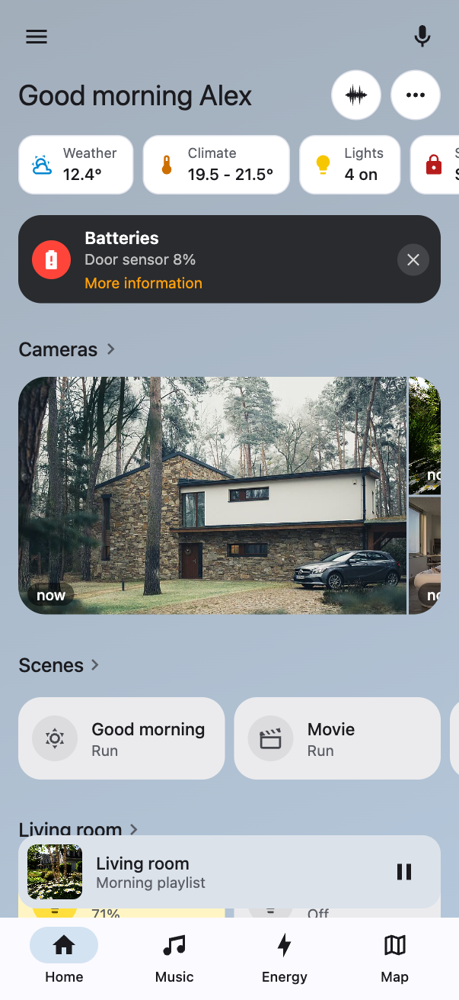 | 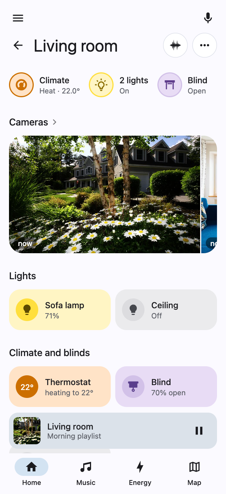 | 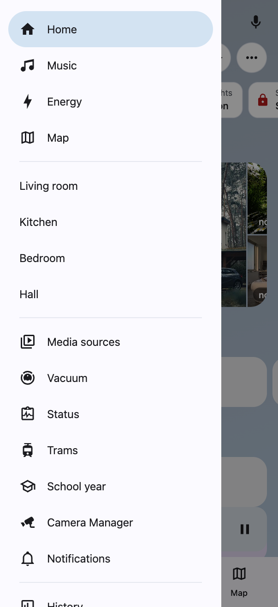 | 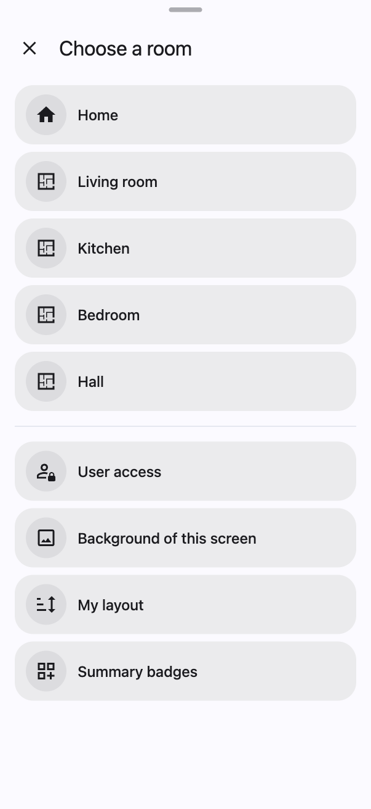 |

## 1. Install

You need Home Assistant 2026.10 or newer. On a phone or tablet use the Companion app.

1. In HACS (Marketplace from Home Assistant 2026.11) open the three dots → **Custom repositories**, add
   `https://github.com/witold-gren/home-assistant-dashboard` as an **Integration**, download
   **Home Dashboard** and restart Home Assistant. Without HACS, copy `custom_components/home_dashboard` into
   the `custom_components` folder of your configuration and restart.
2. Go to **Settings → Devices & services → Add integration** and add **Home Dashboard**.
3. Go to **Settings → Dashboards → Add dashboard → New dashboard from scratch**, and give it a name.
4. Open it, choose <b class="ui">Edit</b>, then the three dots → **Raw configuration editor**, replace everything with
   the lines below and save:

```yaml
strategy:
  type: custom:home-dashboard
```

The dashboard appears at once, built from your areas. It hides Home Assistant's own header, so from now
on its configuration is under **Menu → Dashboard settings → Edit configuration**.

**Colours:** Settings → Devices & services → Home Dashboard → **Configure** offers Automatic, Light and Dark.

## 2. What Home Assistant decides

The dashboard has no list of devices of its own. Most of what it shows comes from these settings, so
this is the first place to look when something is missing.

| In Home Assistant | Effect on the dashboard |
|---|---|
| <b class="ui">Areas</b> (Settings → Areas) | Every area with something to show becomes a room, with its name. An entity with no area stays out. |
| **Area of a device** | Its entities follow it. An entity can also have its own area, which wins. |
| **Entity name** | The tile's name. The name of the area is dropped from it, so "Kitchen Lamp" in Kitchen reads "Lamp". |
| **Hidden, configuration and diagnostic entities** | Never shown on their own. |
| **Light groups** | A group replaces its member lights, so one tile controls them. `lights.prefer_groups: false` shows each lamp. |
| **Users** | Administrators can edit. Everyone else can only use the dashboard and arrange it for themselves. |
| **Persons and zones** | The Map page lists people and how far they are from home. |
| **Energy dashboard** (Settings → Dashboards → Energy) | Decides what the Energy page shows. |
| **Language of the user** | The language of the interface. English and Polish are included. |

By default only lights, climate, covers and locks become tiles. Anything else is added by you, see
[Rooms](#3-rooms).

## 3. Rooms

### Adding a room

Create the area in Home Assistant and assign devices to it. The room appears by itself.

### Choosing what a room shows

Open the room, then three dots → <b class="ui">Edit this screen</b>.

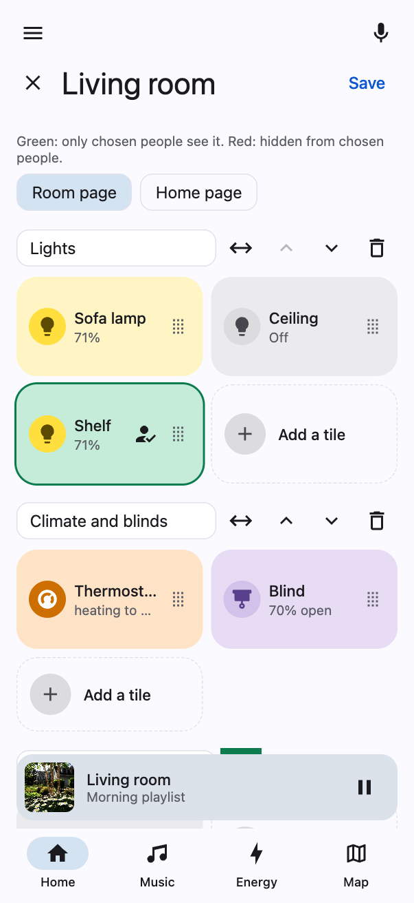

- <b class="ui">Room page</b> edits the sections shown on the room's own page. <b class="ui">Home page</b> edits the tiles of this room
  on Home.
- <b class="ui">Add a tile</b> searches all of Home Assistant, so a switch, a sensor, a scene or an automation can be added.
- Drag a tile by its handle, also to another section. Tap a tile to rename it, remove it, or choose who sees it.
- Each section has a name, arrows to move it, and a button with arrows that makes it one row scrolling
  sideways, which suits scenes and automations.
- Nothing reaches the server before <b class="ui">Save</b>.

The first edit writes the room down in `layout`. From then on the room shows what is listed there, and a new
device in the area needs adding by hand.

### Rooms made of several areas, and their order

Menu → Dashboard settings → <b class="ui">Edit configuration</b> opens all the configuration as YAML:

```yaml
layout:
  - id: kitchen
    name: Kitchen and dining
    areas: [kitchen, dining_room]
    home:
      - {entity: light.kitchen, name: Main}
    sections:
      - title: Lights
        tiles:
          - {entity: light.kitchen, name: Main}
```

Rooms appear in the order of `layout`, and the areas it does not cover come after them. `rooms.order` and
`rooms.hidden` change the order and hide a room without describing it.

### Tile options

| Option | What it does |
|---|---|
| `name`, `icon` | Own name and icon. |
| `tap_toggle: true` | One tap anywhere on the tile toggles it. Good for automations, which would otherwise open a dialog. |
| `calm: true` | No colour when on, faded when off. For things that are nearly always on. |
| `action: script.x` | Runs the script instead of toggling. |
| `active_only: true` | Shown only while the device plays. |
| `turn_on_only: true` | Can only be turned on. With `off_pin: {service: script.x, field: pin}` a keypad turns it off, and the script checks the PIN. |

## 4. Home

From the top: the greeting, the weather, the chips, your shortcuts, cameras, scenes, favorites and rooms.

- <b class="ui">Chips</b> count what is on and filter the page: climate, lights, security and media.
- <b class="ui">Rooms</b> show the tiles from the Home page tab of each room. Set a short list there: the room's own page
  has the rest.
- <b class="ui">Favorites</b> go above the rooms: `favorites: [climate.living_room, lock.front_door]`, or My layout → Favorites → <b class="ui">For everyone</b>.
- **Shortcuts** sit in the row of chips, see [Shortcuts and blocks](#7-shortcuts-and-blocks).

### Sections side by side {#sections-side-by-side}

Home and the room pages can lay out their parts in sections side by side instead of one under another: the headings
over the background and the sections in as many columns as fit. A tablet on its side has two, also with the status
bar open at a zoom of 85 % in the app; a phone has one. The sections keep their order, each one going to the column
that is shortest so far.

- At the top, in place of the greeting (on a room page in place of the arrow and its name), tabs of Home and the
  rooms take you to each page; the chips, the warnings and the buttons on the right stay.
- A section longer than four rows scrolls inside. Its heading then says how many tiles it has, and its foot fades
  while there is more below.
- The cameras come two at a time; more of them are swiped to sideways, two by two.
- A heading with an arrow opens its page: <b class="ui">Cameras</b> all the cameras, a room its own page, <b class="ui">Scenes</b> the Scenes page.
- Over a background a tile that is on is white with its colour in the circle; a tile that is off keeps the look.
- The side menu, the status bar of a tablet and the bar of pages stay as they are. A page in a window and a room
  being edited keep the classic layout.

Choose it in Menu → <b class="ui">Dashboard settings</b> → <b class="ui">Layout of the pages</b>: <b class="ui">Every page</b>, <b class="ui">Home</b> on its own and
<b class="ui">Rows of a section before it scrolls</b> (all of them, without scrolling, too). A room gets its own layout in its editor: three dots →
<b class="ui">Edit this screen</b> → <b class="ui">Layout of this page</b>. In the editor on a computer the same is under *Settings → Home page and
tablet → Layout of the pages*, and a room has the field *Layout of the page*. The classic layout stays the default.
The keys: [`page_layout`](configuration.md#page_layout).

### Variants of a page {#variants-of-a-page}

Home and every room can have variants: other versions of the page, each with its own layout and background, for one
device (as the tablet in the hall) or one person, while everyone else keeps the published page. They are made in the
editor on a computer ([Page variants](editor.md#page-variants)). On a page that has some, an administrator finds
three dots → <b class="ui">Variant of this page</b>: <b class="ui">Show on this device</b>, <b class="ui">Just look</b> (a banner *Looking at: …* with
<b class="ui">Back</b>) and <b class="ui">Publish for everyone…</b>, which keeps the replaced page as a variant. A variant shared with the
household can be chosen there by anyone: <b class="ui">Choose for me</b> works on all their devices.

Without the dashboard settings (they are for administrators), the side menu has <b class="ui">Load the app afresh</b>: it fetches
the newest files and opens the page again.

### Weather

The first chip shows the temperature and opens a screen with the current readings and the forecast for
the next hours and days. It appears by itself when Home Assistant has a `weather` entity. Add a service such
as **Met.no** under **Settings → Devices & services** if there is none.

By default the chip uses the first weather entity, and the forecast comes from the first one that has it. A home
station usually has no forecast, so the two can differ. Missing readings, such as wind, come from the forecast
entity too.

```yaml
weather:
  entity: weather.home_station
  forecast: weather.forecast_home
```

On a tablet on its side the weather takes the whole screen. On the left the temperature now with today's high and
low, sunrise and sunset (from `sun.sun`) and the readings; on the right the next 24 hours as a temperature chart
with the precipitation of each hour under it in mm (blue rain, white snow, purple both) and the day's total, and the
next days as columns on one scale of temperature with their precipitation. The forecast gives the amount of
precipitation, not its chance. A phone and an upright tablet keep the list.

`weather: false` removes the chip. <b class="ui">User access</b> hides it from one person, under <b class="ui">Chips</b>.

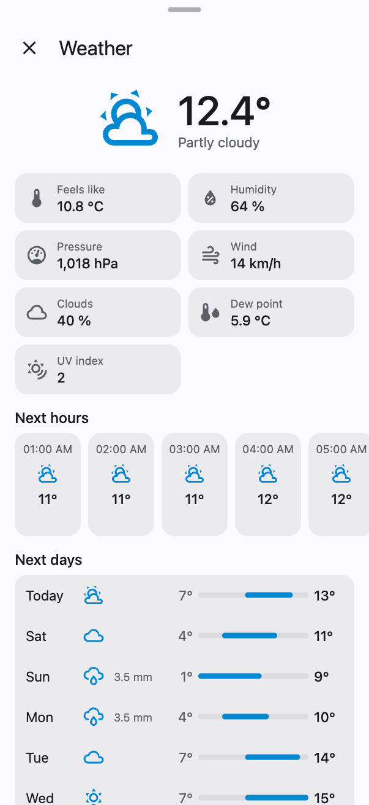

## 5. Cameras

### Which cameras appear

The strip does not show every camera, on purpose: a thumbnail fetched from a battery camera wakes it and
drains it. It shows:

- **Stored pictures:** `image.*` entities ending in `_last_screen` or `_last_snapshot`.
- **Cameras of safe platforms:** `camera.*` from `cameras.snapshot_platforms`, by default `frigate`.

A camera also needs an area. To add another platform that keeps its own frame:

```yaml
cameras:
  snapshot_platforms: [frigate, generic]
  battery_platforms: [my_platform]   # only cameras that do not report a battery
```

A camera on a battery never appears, even when its platform is listed. The dashboard recognises it by itself: its
device in Home Assistant has a battery level sensor (`device_class: battery`). This works for every brand.
`battery_platforms` is needed only for cameras that do not report a battery.

### Order and hiding

| Goal | How |
|---|---|
| Your own order, or hide one for yourself | Three dots → <b class="ui">My layout</b> |
| The same order for everyone | `cameras.order: [camera.a, camera.b]` |
| Hide from everyone | `cameras.hide: [image.garage_last_screen]` |
| Hide from one person | Three dots → <b class="ui">User access</b> |
| Exactly this list and nothing else | `cameras.hero` and `cameras.tiles` |

In the strip a single picture alternates with two smaller ones. A camera that stops working stays visible
in a small picture, blurred and marked as unavailable; a tap opens its window, with its name, so you see which one
went away. The Security chip lists all cameras one under another.

### Siren, light, night vision and positions

When the camera's device has them, its window gets round buttons. Upright they stand in a row over the line of time,
from the right; on a phone on its side in a column in the bottom left corner, from the bottom (the siren lowest, the
light, night vision and positions over it).

- <b class="ui">Siren</b>: asks "Sound the siren?" first, glows red while it sounds, and a tap stops it.
- <b class="ui">Light</b>: on and off, glowing yellow while on.
- <b class="ui">Night vision</b>: a list of modes, e.g. Off (day), Infrared, Full colour (light).
- **Positions** (while turning live): the camera's saved positions.

**How they are found.** The dashboard looks among the entities of the camera's device, and for a recorder camera
linked to the same camera in another integration among that camera's. It goes by what does not depend on the language
or the name in Home Assistant:

| Button | Entity it finds by itself | What a tap does |
|---|---|---|
| Siren | the first entity of the `siren` domain | after asking `siren.turn_on`, then `siren.turn_off` |
| Light | a `light` entity, else a `switch` whose id ends in `_light`, `_spotlight`, `_floodlight` or `_lamp` | on and off |
| Night vision | a `select` with `night_vision` in its id, else a list that offers infrared (`Infrared`) | opens the options of that entity |
| Positions | the list of positions and its button from the camera's **turning** | goes to the chosen position |

Hidden and unavailable entities are left out. A setting switch such as `…_spotlight_enabled` is not taken for a light.

**Other cameras and own entities.** In **Dashboard settings → Turning and talking of each camera** open a camera: the
fields <b class="ui">Siren button</b>, <b class="ui">Light button</b> and <b class="ui">Night vision button</b> offer <b class="ui">Automatic</b> (with what was found beside
it), <b class="ui">None</b> or any entity. That is how the buttons go on a camera of any integration, also to devices that are not
part of the camera, such as a lamp in the garden or the siren of an alarm:

| Button | Entities to choose from |
|---|---|
| Siren | `siren`, `switch`, `input_boolean`, `script` |
| Light | `light`, `switch`, `input_boolean` |
| Night vision | `select`, `input_select` |

The same in the configuration (`cameras.quick`, keyed by the camera of the dashboard):

```yaml
cameras:
  quick:
    camera.garden:
      siren: switch.garden_alarm
      light: light.garden_floodlight
      night: none                 # no night vision button
```

The buttons work at any time, without the live view too; only the positions need it, as the arrows of turning do.

### All cameras

| All cameras on a tablet | One big camera |
|---|---|
| 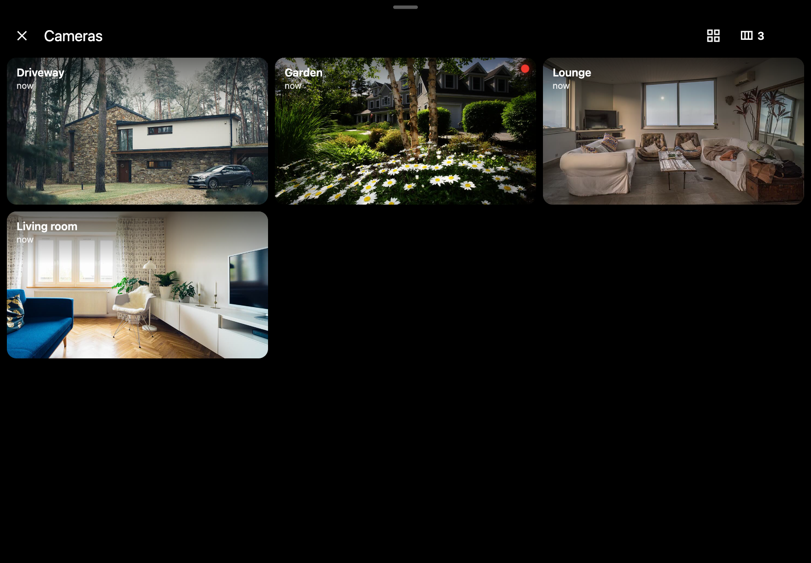 | 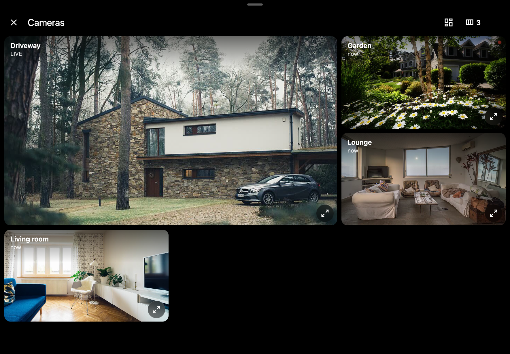 |

A tap on the heading **Cameras ›** on Home or in a room opens all cameras one under another, big, with their name and
the age of the picture. Their order and hiding are those of the page. A tap on a camera opens its window, and the
arrow at the top left goes back to the list.

On a tablet they fill the whole screen on black, three in a row. The button with the number in the header switches
between 2, 3, 4 and 5 in a row on this device. The other button in the header switches to one big camera with the
rest small around it: the big one plays live by itself, a tap on a small one puts it in the big place and lets the
other go, and the corner button of each camera opens its window. On a battery the big camera stops after two minutes,
and a tap starts it again. **Dashboard settings → Layout of all cameras on a tablet** (`cameras.layout: featured`)
chooses it for every tablet. **Dashboard settings → Columns of all cameras on a tablet**
(`cameras.columns: 4`) sets it for every tablet that has not chosen its own.

On a tablet on its side (a touch screen) a camera window takes the whole screen like on a phone on its side: the
picture at the full width, the header in the band above it, every button on the picture and the ring that turns the
camera halfway down it. The camera button in the header brings the other cameras up from the bottom; a drag down
puts them away.

### Warnings on Home

Warnings are items of the <b class="ui">Status</b> screen. An item with `notify` on also shows as a card on Home, under the chips,
while it has something to say: the item's name and a short list of what it names, e.g. "Living room thermostat
battery 25 %". With one device <b class="ui">More information</b> opens it. The same warnings always stay on the Status screen, so
a card closed by mistake can be read again there.

**Closing and muting**

| What | Does |
|---|---|
| The cross on a card | hides it until the end of the day; it comes back at once when another device joins the list, and the next day while the problem lasts |
| Dashboard settings → Warnings on Home → <b class="ui">Mute for a week</b> | hides every card for 7 days for you, on every device; then they come back by themselves, and <b class="ui">Show again</b> brings them back sooner |

Closing remembers the devices (in the browser, until the day ends); muting is kept in your user data in Home
Assistant.

**How the configuration is built**

The Status screen is a shortcut `kind: overview`. It has a list of sections (`sections`), each with a list of items
(`items`). An item says what to look for and when to speak up:

| Field | Meaning |
|---|---|
| `name`, `icon` | the card's title and icon |
| `notify: true` | also show it as a card on Home |
| `below` | report values below this number (e.g. 20 for a battery in %, 80 for a range in km) |
| `entities` | chosen entities, e.g. `sensor.car_range` |
| `auto: battery` | instead of a list: every battery level in %, without a battery's wear (`…_health`) and without unavailable devices |
| `platforms` | with `auto: battery`: only entities of these integrations, e.g. `[zha]`, `[netatmo]`, `[eufy_sdk, neolink]` |
| `device_has` | with `auto: battery`: only devices that also have an entity of this domain, e.g. `camera` (cameras, not the sensors of the same integration) |

```yaml
shortcuts:
  - kind: overview
    name: Status
    icon: mdi:clipboard-pulse-outline
    sections:
      - title: Needs a look
        alert: true
        items:
          - name: Low fuel
            icon: mdi:gas-station
            entities: [{ entity: sensor.car_range, name: Car }]
            below: 80
            notify: true
          - name: Battery cameras
            icon: mdi:battery-alert-variant-outline
            auto: battery
            platforms: [eufy_sdk, neolink]
            device_has: camera
            below: 20
            notify: true
```

**Where to edit it**

1. **In the app, without YAML (recommended).** On Home the three dots → <b class="ui">Summary badges</b> → the pencil by the
   <b class="ui">Status</b> block. Open a section and an item. <b class="ui">Shown when</b> → "a battery is low" gives the fields <b class="ui">Below</b>, **Only these
   integrations** (comma separated, e.g. `zha, netatmo`) and **Only devices that also have** (e.g. `camera`). Every
   item has the switch <b class="ui">Also as a warning on Home</b>. <b class="ui">Save</b> saves at once.
2. **The whole configuration as YAML.** Menu → <b class="ui">Dashboard settings</b> → <b class="ui">Edit configuration</b>. Status is in the list
   `shortcuts`, as in the example above.
3. **The integration's name** for `platforms` shows in Home Assistant: Settings → Devices & services → Entities, the
   "Integration" column (e.g. `zha`, `netatmo`, `sonoff`).

### Open connections of cameras on a battery

| Connections of a camera | Camera window on a tablet |
|---|---|
| 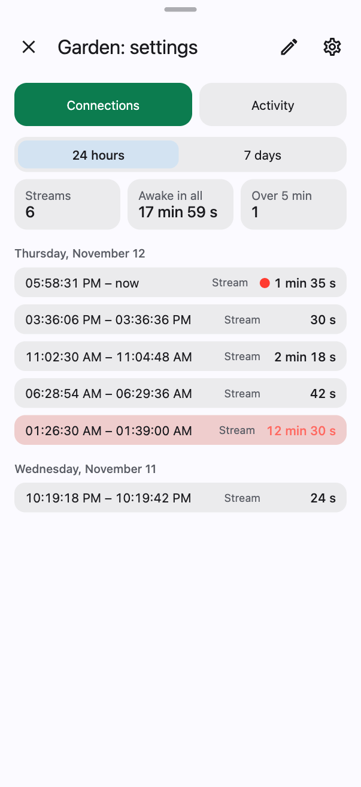 | 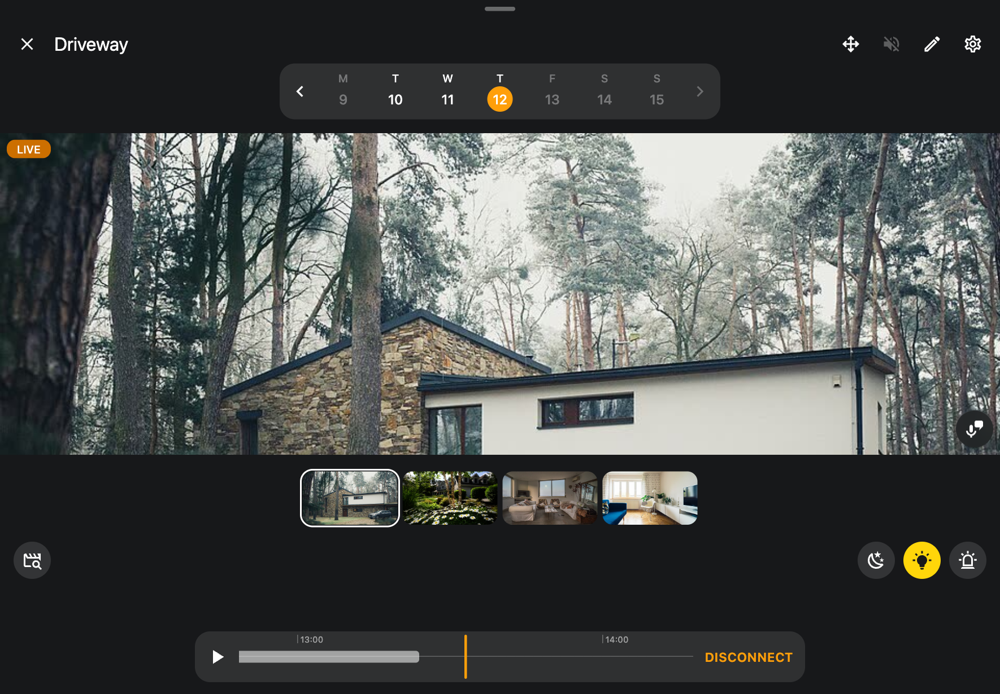 |

**Battery.** The window of a camera whose device has a battery sensor shows the percentage of its battery in the top
right corner of the picture; up to 20 % the badge is red. The pages and all cameras leave it out, so it does not cover
the pictures. A picture
(`image.*`) takes the battery of the camera that plays it live (`cameras.live`) or of the same camera in another
integration (`cameras.controls`).

A red, blinking dot in the top right corner of a picture (on Home, in all cameras and in a camera window) says a stream
of that camera is open now: from the dashboard, another window of Home Assistant or anything asking the bridge. The
camera is awake then and uses its battery. The dashboard reads it from the sensors of the camera's device: eufy
`binary_sensor.*_streaming`, Neolink `*_camera_link` and `*_recording_live_view`. In the window of a camera on a battery the dot sits in the badge of the battery.

In the camera's settings (the gear) the <b class="ui">Connections</b> tab shows, from the history of Home Assistant, the last 24 hours
or 7 days: how many times it was woken (streams), for how long in all and how many lasted over 5 minutes, and under it
each connection with its start, end and length. Connections over 5 minutes are red; one going on has a dot and "now".

### Recordings on the disk

The film button looks for the recordings on the line of time without searching along it: upright it stands at the
left over the line of time, on its side beside the line's button. It lists them by day, newest first (for Frigate its
detections, with their pictures), and reads more days as the list is scrolled to its end. A tap goes back to the
camera at that recording: its day is chosen, the line moves to it and it plays. Recorded files on the disk (eufy,
Neolink) have no pictures of their own, so the dashboard takes a frame from the first second of each file (two files at
a time) and keeps it on this device: the next time the pictures are there at once.

### Recordings on the camera's card

A camera that keeps recordings on its own card and says so (the attribute `sd_recordings` with its `list` and
`download` commands, e.g. the Neolink integration) has a card button in its window. It opens the recordings by day,
newest first, with a small picture of each, asked for only for those in sight because each wakes the camera. The list
remembered by the integration shows at once, while the card itself is read in the background. The download button
brings a recording down into the folder of the line of time; the green mark of one already there opens the line of
time at it. The button by a day brings down every recording of that day not on the disk yet, oldest first, and
shows a double mark once all of it is there. Nothing on the card is removed.

### Live view

Tapping a picture opens it without a stream. <b class="ui">LIVE</b> at the bottom starts one, from a camera on the same device or
from `cameras.live: {image.door_last_screen: camera.door}`. The big play button in the middle of the picture does the
same; it shows while there is no live view (and fades on an enlarged picture). While the camera wakes the window shows its last
picture with a loading ring in its middle, and the LIVE pill is grey. The live view takes the picture's place only
once the video really moves, and the pill takes its colour. The sound and turning buttons are greyed while nothing
plays (turning works live only). The battery hint stays upright all the time, faint while a recording plays, so the
window does not jump.

<b class="ui">LIVE</b> on the line of time is grey, orange at once when tapped, and turns into an orange <b class="ui">DISCONNECT</b> once the
video moves. DISCONNECT ends the live view without closing the window, so the recordings can be looked through at
once. Moving the line of time lets the camera go at once too. A camera unavailable in Home Assistant stays in the
window with its last picture, dimmed, saying <b class="ui">The camera is unavailable</b>, without LIVE; the words go by themselves
once the camera is back. A picture that did not load is asked for again every 5 seconds.

**Zooming:** spread two fingers on the picture to zoom in (up to 4×) and pinch to zoom out. One finger moves a zoomed
picture, and a double tap zooms 2.5× in at that point or back to the whole picture. On a computer ctrl with the wheel
or a trackpad pinch does it. A badge at the top right shows the zoom, and a tap on it goes back to 1×. It is a digital
zoom: the picture, the live view and a recording are enlarged as they came, and the camera does not move. Another
camera, or going between the picture, the live view and a recording, brings the whole picture back.

The button next to it speaks to the camera's area. It appears when the [intercom](#11-intercom) is set up and
that area is one of its areas. **Dashboard settings → Talking in a camera window → The camera's speaker** turns it into
talking through the speaker of the camera itself, where it has one (the eufy-sdk integration, a `…_speaker` switch).
The microphone works only over HTTPS or in the Home Assistant app. A recorder camera, e.g. Frigate, has no speaker or
buttons for turning of its own. In **Dashboard settings → The same camera in another integration** choose a camera of
the dashboard first, then the same camera in another integration (the list offers only cameras of other
integrations), and tap <b class="ui">Link</b>. From then on the window of that camera talks and turns through the other one
(`cameras.controls`). The links are listed above the choice, and the cross removes a link. <b class="ui">Save</b> keeps the changes.

| Phone upright | Phone on its side |
|---|---|
| 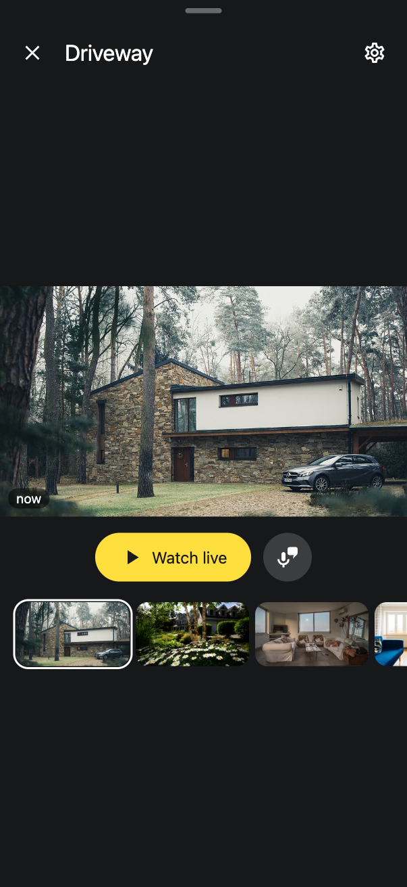 | 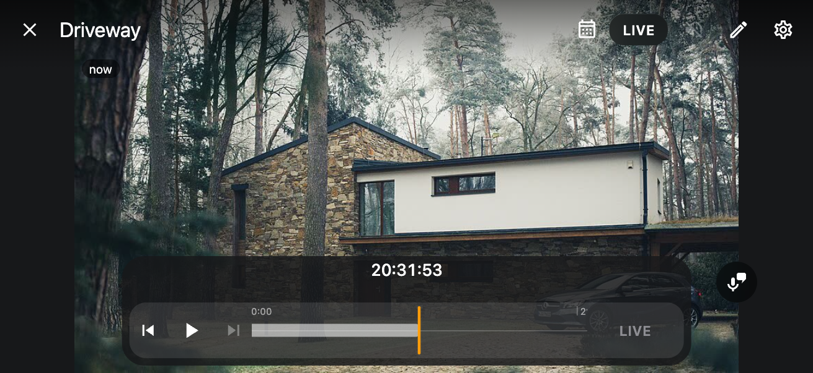 |

On its side the picture fills the screen. The header runs across the whole screen: close in the far left corner and
the settings in the far right one, over the dark bands beside a narrower picture, with the camera's own buttons
(recordings by day, LIVE, turning, sound, editing) set a little apart from the settings. Everything that works the
camera stays on the picture: on the left, from the bottom, the siren, the light, night vision and the positions; on
the right, from the bottom, the line of time, talking and the ring that turns the camera.

| Positions of the camera | The line of time |
|---|---|
| 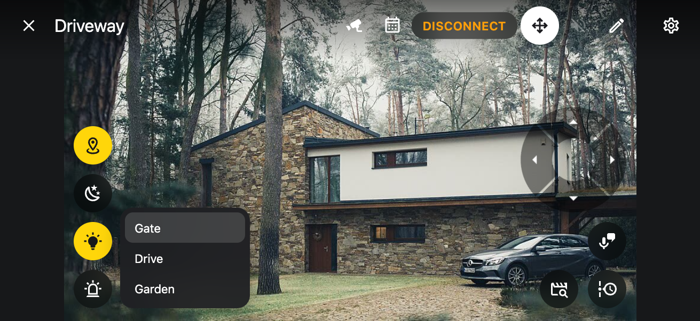 | 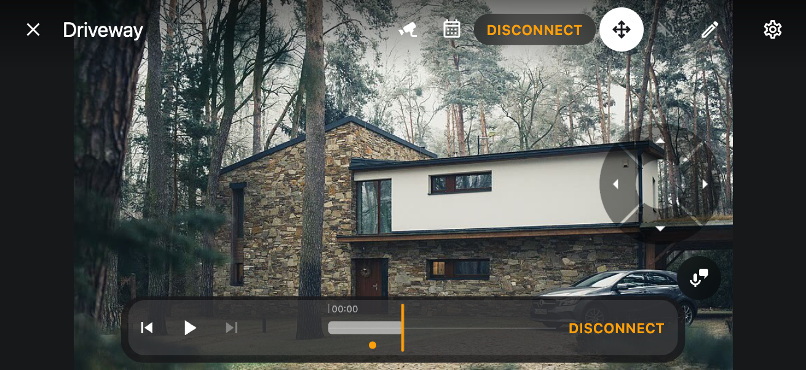 |

### Turning and talking of each camera

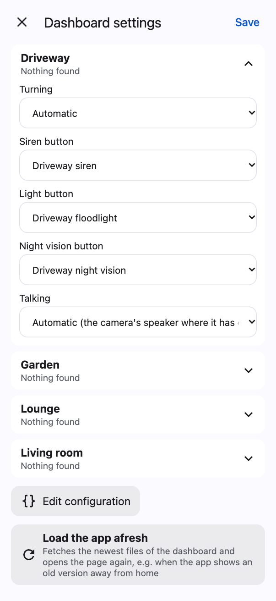

**Dashboard settings → Turning and talking of each camera** shows for each camera what was found to turn it. A tap on
the camera opens the choice.

| Turning | What it does |
|---|---|
| <b class="ui">Automatic</b> | in turn: the eufy set, ONVIF, buttons of the device named like `pan_left`, `tilt_up`, `go_to_preset` |
| <b class="ui">eufy (ready-made)</b> | the buttons of the eufy-sdk integration, known by their translation keys, so entity ids in any language do |
| <b class="ui">ONVIF</b> | the `onvif.ptz` service of a camera of the ONVIF integration; positions are typed as tokens, separated by commas |
| <b class="ui">Chosen by hand</b> | any buttons, scripts or scenes for the four directions, and a list of positions with its button |
| <b class="ui">No turning</b> | the camera has no turning button |

| Talking | What it does |
|---|---|
| <b class="ui">Automatic</b> | the camera's speaker where an integration offers one (below), else the room's intercom |
| **Through go2rtc** | a WebRTC connection of its own that only sends the microphone; works with cameras with two-way audio (ONVIF Profile T, Tapo, Dahua, Hikvision and others), not with a `generic` camera |
| <b class="ui">The room's intercom</b> | always the intercom |
| <b class="ui">No talking</b> | no button |

The sound button in the header is lit only while something plays and has sound. A camera without a microphone
leaves it grey.

Talking through the camera's speaker works only once the live view really moves, so you see whom you talk to. Before
that the button is locked, and the end of the live view ends the talk too. A camera that takes a moment to connect its
speaker shows a grey button saying "Connecting to the camera's speaker, you can talk already", and a red one once it
listens.

**For authors of integrations:** the dashboard talks through the camera of any integration that has, on the camera's
device, an entity with a `talk_path` attribute, e.g. `talk_path: /api/mine/talk/gate`. The dashboard signs the path,
adds `?rate=<Hz>`, opens a WebSocket and sends binary frames of 16-bit little-endian mono PCM, then the text `stop`.
The integration answers with JSON `{"ok": true}` or `{"ok": false, "error": "busy" | "no_speaker" | "unreachable" |
"failed"}` and closes. eufy-sdk and Neolink work that way.

### Turning, settings and recordings

- <b class="ui">Turning</b>: a camera whose device has buttons to move (e.g. `button.…_pan_left`, `…_pan_right`, `…_tilt_up`,
  `…_tilt_down`) gets a button with arrows in the header, next to the speaker. A tap lays a ring of arrows over the right side of
  the picture, and the <b class="ui">Position</b> list stands in the bottom left corner; another tap hides them. The age of the picture is in the top left corner, where LIVE shows during the live view. Playing a recording puts the controls away, since a recording cannot be turned. The window therefore looks the same for every camera, and turning works during
  the live view and on a camera with recordings too. A `select.…_preset` list with a `…_go_to_preset` button gives a
  list of the saved positions under the ring; empty ones ("empty") are left out.
- <b class="ui">Settings</b>: the gear in the camera window opens a window with the settings and state of the camera instead of the
  window of Home Assistant: <b class="ui">Settings</b> (switches, lists, sliders), <b class="ui">State</b> (sensors) and <b class="ui">Actions</b> (other
  buttons), gathered from the entities of the camera's device. Your own choice of entities for a camera:

  ```yaml
  cameras:
    settings:
      camera.garden: [switch.garden_microphone, select.garden_night_vision, sensor.garden_battery]
  ```

- <b class="ui">Recordings</b> (Frigate cameras): under the name of the camera is a week of days; days with recordings are
  bright, and the arrows change the week. At the bottom of the window is a line of the chosen day's time: bright
  stretches are recordings, orange dots are events, and the orange upright mark is the chosen moment, with its time
  above the line. Move the line left or right with a finger and the recording starts at that moment; in a gap between
  recordings it starts at the next one. Tapping a dot plays the event. On the left is **play and pause**, on the
  right <b class="ui">LIVE</b>. Play never starts the live view: past the last recording it plays that last one, and when it ends
  the window goes back to the last picture. Only <b class="ui">LIVE</b> wakes the camera.
- **Fast moving**: hold the line still for a moment and the whole day fits on it. Once the finger moves, the mark is
  under it: the left edge of the line is midnight, the right edge the end of the day. Point at the hour you want,
  e.g. 4:00, and let go: the line returns to its usual scale at that moment and plays the
  recording. Then fine-tune the moment with an ordinary move.
- **The clip bar**: while a recording plays, a thin bar above the line runs from its start (left, with the clock) to
  its end (right). On the line of the day a clip of 50 s is a few pixels; here it is the whole width. Tap or drag the
  bar: a bubble over the finger says where you are (`0:36 / 0:50 · 18:02:46`) and the picture follows the finger;
  let go and the recording plays from that second. **Hold the bar still for a moment** and it shows 30 s around the
  finger with a tick for each second (a longer one every five), so even in a 10-minute piece of Frigate you pick the
  exact second. With a mouse the bubble shows the moment under the pointer without playing it; the arrow keys move by
  a second, with Shift by ten. The bar stays in the line's panel, so on a phone on its side it comes out and goes away
  with the line; the buttons of the camera (night vision, light, siren, talk, recordings) keep their places.
- **The line zoomed to the clip** (the other way, chosen in **Dashboard settings → Picking a moment in a recording**,
  for all cameras or, in a camera's own block, for one): there is no bar. A tap on a recording on the line of the day
  plays it and zooms the line so the clip with 5 s on either side fills it (the clip orange, the mark white); the orange
  badge under the time ("Zoom to the clip") does the same for the clip that plays, and tapped again ("back to the day")
  brings the day's scale back, as LIVE does.
  - The scale stays while zoomed, and the recordings before and after are on the line too (white). Move the line onto
    one and it plays from there; in a gap nothing plays. Inside the clip that plays the picture follows the line.
  - A recording that ends **stops** at its end: the next one is a move of the line away, so recordings side by side can
    be watched one by one. Only the next 10-minute part of the same continuous Frigate recording plays on.
  - **Hold the zoomed line still** for a moment: it shows 30 s over its width with a tick for each second, and the mark
    follows the finger; let go and it plays from that second.
- **Weeks**: swipe over the days to the right to go a week back, or to the left to come forward again.
- **Phone on its side**: the picture of the camera fills the screen, and its name and buttons lie over it in the
  corners. The thumbnails of other cameras are hidden. **The calendar** in the header brings the days out at the top
  edge (the calendar and LIVE leave the header meanwhile), and **the clock with a line** in the bottom right corner
  brings out the line of time in place of the button. Put them away with the
  same button, with a swipe (the days up, the line down) or with a tap on the picture, which hides both at once. After a day is picked the days hide by themselves.
  <b class="ui">LIVE</b> always stays at the top, by the speaker. On the line of time **⏮** and
  **⏭** stand on both sides of play: a jump to the previous and the next recording of the day, which plays at once. Buttons are used instead of pulling from the edges because on
  iPhone the gestures from the top and bottom edges belong to the system (notifications and switching apps).
- **One picture**: the picture, the live view and a recording show in the same place and take each other's place.
  Going from the live view to a recording ends the connection to the camera, so a camera on a battery saves its
  energy. Every camera has the same layout: a camera without recordings has greyed days and an empty line, and the
  live view starts with <b class="ui">LIVE</b> or with play on the line.
- <b class="ui">Sound</b>: the speaker button next to the gear turns the sound of the live view and of recordings on and off.
  Holding it shows a volume slider. On iPhone and iPad the volume is set with the buttons of the device, so there the
  button only turns the sound on and off.
- **Recorded live views of battery cameras (eufy)**: when **Record live view** is on in the camera's settings
  (gear → Settings; a switch of the eufy-sdk integration, off by default), the eufy bridge saves every live view of
  that camera to `/media/eufy/<serial number>/<day>/`, whoever opens it (the dashboard, the window of Home Assistant,
  HomeKit). The bridge never wakes the camera itself; it records only what flows anyway. During the live view the
  pill on the picture says **REC · LIVE**. The days and the line of time show every day on the
  disk, also clips weeks old brought down from a camera's card. Another media folder is set with `cameras.recordings_folder` (e.g.
  `media-source://media_source/local/eufy`).
- **Recorded live views of Reolink cameras (Neolink)**: the **Record live** switch of the Neolink integration works
  the same way (Neolink app 0.2.0 or newer). The files go to `/media/neolink/<camera>/<day>/`, and the switch names
  that folder itself in its `recordings_path` attribute, so `cameras.recordings_folder` does not move it.
- A Frigate camera is recognised by itself, also through a picture of the same device. The data and the recordings
  come from the Frigate integration of Home Assistant.

### A camera window from an automation {#a-camera-window-from-an-automation}

An automation can open the dashboard's own window of a camera, e.g. on the tablet in the hall when a camera sees
motion. The window looks like every camera window of the dashboard, shows the picture of the event and closes by
itself after a while. Touching it, or starting the live view, keeps it open; it then closes after the longest live
view, or with ✕, Esc or a swipe.

```yaml
- action: home_dashboard.show_camera
  response_variable: window
  data:
    entity_id: camera.garden          # the camera, or its picture (image.*)
    picture: image.garden_last_event  # the picture of the event (optional)
    title: Motion in the garden       # optional; the name of the camera by default
    close_after: 15                   # seconds; 0 keeps it open
    live_limit: 600                   # at most this long once somebody uses it
    live: false                       # true: live view at once (the doorbell, a camera that records all the time)
    interrupt: false                  # true: takes the place of another camera window (the doorbell)
    browser_id: [hall_tablet]         # Browser Mod ids of devices; empty = every device
    user_id: []                       # Home Assistant users; empty = everybody
```

- The answer says how many open dashboards got it: `{request: 3, sent_to: 1}`. With `sent_to: 0` no dashboard was
  open there (a tablet with its screen off has its app asleep: wake it first, e.g. with a notification).
- When the window is gone, or was not opened, the event `home_dashboard_camera_closed` comes with `request`,
  `entity_id`, `browser_id`, `user_id`, `live` (whether somebody watched live) and `reason`: `timeout`, `closed`,
  `busy` (another camera or the settings were open; they are never taken away), `hidden` (the dashboard does not
  show this camera to this person: hidden, private or guest mode), `unknown_camera` or `replaced` (a camera with
  `interrupt` took its place). An automation waits for it
  with `wait_for_trigger` on that event.
- `close_after` counts only while the screen shows the window: a tablet woken by a notification connects while its
  screen is still dark, so the time starts when the page is visible (and again from the full time if the screen goes
  dark before it ran out). For a live view that wakes a camera on a battery give it time, e.g. 45 s.
- A second camera while one is on the screen is refused (`busy`), so nobody loses what they are watching, unless
  it comes first (`interrupt: true`, e.g. the doorbell with `live: true`): then it takes the place of the other
  camera. The settings and editing are never taken away.
- The device is known by its Browser Mod id (Browser Mod only has to be installed), or by the account it is logged
  in with (`user_id`): a wall tablet with an account of its own is found that way even when Browser Mod loses it.
  The editor's preview never opens these windows.
- A camera the dashboard shows through another one opens the window of that one: the eufy camera of a room behind
  its Frigate camera (`cameras.controls`), or a camera of the same device. A camera hidden from this person is not
  shown at all.
- A notification can open the same window: the address `/home-dashboard/home?camera=camera.garden&live=1` opens that
  camera, live at once with `live=1`. The address forgets it afterwards, so a reload does not open it again.

### Household activity {#household-activity}

Home Assistant keeps no record of what anybody looks at. The dashboard does: every page and window a person opens
(Home, a room, Energy, the window of a lamp or a camera, the menu, the settings) is written down with the time and the
device (the Browser Mod id, or the kind of device and whether it is the Home Assistant app or a browser), and kept for
30 days in `.storage/home_dashboard_activity/`, one file a day. The editor's preview writes nothing.

The panel **Household activity** in the menu of Home Assistant shows it, laid out as the History and Logbook of
Home Assistant:

- **On the left, the filters.** *People*: every person with a colour of their own, the number of things they did in
  the range and the device they used last (the Home Assistant app, a browser); tick the people to see (*Everybody*,
  *Nobody*); the choice is remembered. *Kind*: pages, windows, changes. *Devices*: lights, switches, blinds and
  covers, buttons and scenes, cameras, climate, locks and alarm, media, automations and scripts, other, each with how
  many things were done with them. *Rooms*: the areas of Home Assistant (of the entity or its device) and *No room*.
  Narrowing devices or rooms leaves out what has no device, such as a page. Every section folds; the choices are
  remembered.
- **Search** beside the range: a device, a window, a page, a person, a room or an entity id, to find quickly whether
  something was changed, when and by whom.
- **On top, the range of time**: the arrows go a range back or forward, and a click on the dates opens a window with
  ready ranges (Today, Yesterday, the last hour, 12 or 24 hours, 7 or 30 days) or a range of your own from and to.
- **One timeline** of everybody chosen, newest first, day by day: the time, a circle in the person's colour, what
  happened (a page, a window, a lamp turned on, a button pressed) and under it who, what kind and on what device.

A range that reaches now (Today, the last hour…) is **live**, as the Logbook: each new page, window and change
comes on top of the timeline as it happens, without reloading. A range in the past is not.

On a phone the filters open with the **Filters** button.

The same view is in the dashboard too, to look through on a phone: **Household activity** in the side menu of the
dashboard opens it in a window over the whole screen, in the look of the dashboard. Only the person who sees the
activity (the owner, or the people chosen) has this entry; the rest of the household does not.

The changes come from the history of Home Assistant: a change made from an app carries the person who made it, kept
as long as the recorder keeps its history (`purge_keep_days`). Changes made by automations have no person and are
not shown. A chip above the list shows one person.

The panel is in the menu of administrators, but its data is shown only to the **owner** of Home Assistant; another
administrator sees a note instead. A range is at most 31 days.

Two options of the integration (Settings → Devices & services → Home Dashboard → **Configure**), both on at first:

- *Show Household activity in the sidebar*: off, the panel leaves the menu and still opens at
  `/home-dashboard-activity`.
- *Write down the household activity*: off, the dashboards tell nothing more (an open page hears it at once) and
  nothing new is written; what was written goes away after 30 days. The changes of devices still come from the
  history of Home Assistant.
 The people of the house should know that their use
of the dashboard is written down.

### Guest mode and privacy

```yaml
cameras:
  guest:
    entity: input_boolean.guest
    hide: [camera.living_room, camera.bedroom]
  private:
    - {entity: switch.bedroom_privacy, hide: [camera.bedroom]}
```

Add `users: [Tablet]` to `guest` to make it hold only for those accounts, by name or id. Everyone else keeps
seeing the cameras.

While `guest` is on, these cameras leave Home and Security, and stay on their room's page blurred. While a
`private` switch is on, the camera is gone from every page.

## 6. Scenes

`scenes` is the section under the cameras. Tap its heading, then three dots → <b class="ui">Edit this screen</b>: the list
offers scenes and scripts. The arrows button lays them out in one row that scrolls sideways. A room shows its own scenes and scripts under its cameras in the same layout. You choose them in the room editor, in the <b class="ui">Scenes</b> tab (`scenes` of the room). Until you save them, the room shows the scenes and scripts assigned to its area in Home Assistant.

## 7. Shortcuts and blocks

A block is several entities on one screen. It is plain data, so it needs no code. How to build a window for a device
the dashboard does not know, step by step and with examples, is in the [guide to your own devices](own-devices.md).

| Vacuum | Media | Blind | Switch |
|---|---|---|---|
| 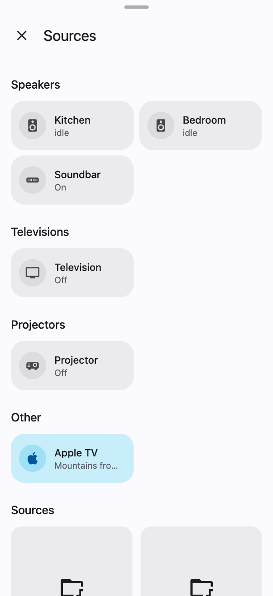 |  | 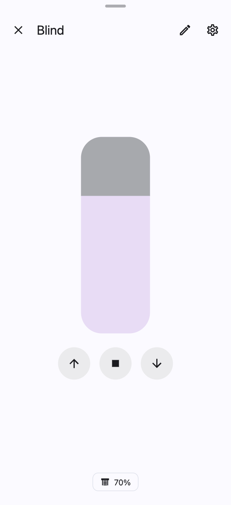 | 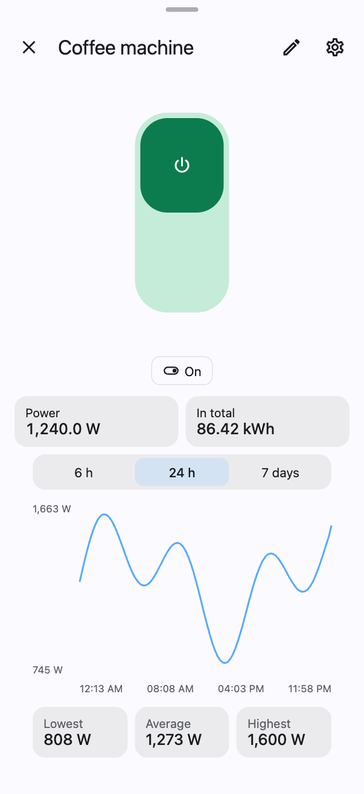 |

A vacuum as a shortcut:

```yaml
shortcuts:
  - kind: panel
    name: Vacuum
    icon: mdi:robot-vacuum
    entity: vacuum.robot
    stats:
      - {name: Filter, entity: sensor.vacuum_filter, unit: "%", digits: 0}
    actions:
      - {name: Start, icon: mdi:play, entity: vacuum.robot, service: vacuum.start}
      - {name: Dock, icon: mdi:home-import-outline, entity: vacuum.robot, service: vacuum.return_to_base}
    card: {type: custom:xiaomi-vacuum-map-card, entity: vacuum.robot}
    card_open: true
    groups:
      - layout: controls
        rows:
          - {entity: select.vacuum_power, name: Power, labels: {quiet: Quiet, turbo: Turbo}}
```

The same block can stand in a room: put it among the tiles in `layout`. To keep one copy, a tile can name the shortcut
instead: it shows the shortcut's numbers and opens the same window, and what the tile sets itself (here the entity
whose state it shows) stands over the shortcut's. On a tablet such a tile is two tiles wide, below the ordinary tiles
of its section.

```yaml
layout:
  - id: hall
    sections:
      - title: Devices
        tiles:
          - {shortcut: Vacuum, entity: vacuum.robot}
```

| Part | What it does |
|---|---|
| `stats` | Numbers across the top. |
| `actions` | Buttons. `confirm: Text` asks first, `service` calls a service of the entity. |
| `groups` | Rows of entities. A `select` becomes a list, a `switch` a switch, a `number` a slider. |
| `groups[].layout: controls` | Big buttons, choices, a wide slider and small cards instead of rows. |
| `groups[].layout: summary` | One line that opens on a tap, and by itself when a door, window or problem sensor is on. |
| `card`, `card_open`, `card_last` | A Home Assistant card in the block: on a button, at once, or below the groups. |
| `frame` | A web page on the whole screen. |
| `tone` | Icon colour of a shortcut: green, purple, teal or pink. |

When the card is a vacuum map with a room mode (`vacuum_clean_segment` with `predefined_selections`), on a tablet on its
side the rooms stand as buttons in the left column with the times over and **Clean the chosen**. The card's own
buttons are put away, and the map stands alone, centred, on a clear background, narrowed when it would not fit.

A block on the whole screen (`fullscreen: true`) with its card open (`card_open: true`), such as a vacuum with its
map, stands in two columns on a tablet on its side: its rows, its numbers as tiles (a share in `%` with a bar under
it) and its buttons at the bottom on the left, the card on the rest of the screen. Upright and on a phone it keeps
one column. Turning the tablet does not start the card again.

The home overview is `kind: overview`: a clock, the date and only what is worth a look now. An item with nothing to show disappears,
and a section goes with its last item. A section with `alert: true` counts towards the summary by the clock, and `bottom: true` always stands at the very
bottom. `title` is optional. Tapping an
entity opens its details.

```yaml
shortcuts:
  - kind: overview
    name: Status
    icon: mdi:clipboard-pulse-outline
    sections:
      - title: Needs a look
        alert: true
        items:
          - name: Cold room
            icon: mdi:snowflake
            attribute: current_temperature
            unit: "°"
            below: 19
            entities: [{entity: climate.bedroom, name: Bedroom}]
          - {name: Batteries, icon: mdi:battery-alert, auto: battery, below: 11}
      - title: At home
        items:
          - {name: Open windows, icon: mdi:window-open-variant, entities: [binary_sensor.window]}
      - title: Working
        items:
          - name: Washer
            icon: mdi:washing-machine
            entity: sensor.washer_state
            state: [Running]
            labels: {Running: Washing}
            facts: [{name: Program, entity: sensor.washer_program}]
      - title: Sunday
        items:
          - {name: Service, icon: mdi:church, text: "8.00, 10.00", weekdays: [7]}
```

| Item | When it shows |
|---|---|
| `entities` | When an entity is in `state` (`on` by default). An entity is an id or `{entity, name}`. |
| `entities` with `below` | When the value is lower than `below`. `attribute` reads it from an attribute, `unit` gives the unit. |
| `auto: battery` with `below` | Finds batteries itself: percentages of entities with `battery` in the id or the `battery` class. |
| `list` | When a list in an attribute is not empty: `{entity, attribute, name, detail, since}` name its fields. |
| `entity` with `state` | When a device is in one of the states. `labels` describes the state, `facts` shows values. |
| `text` | Always, and with `weekdays` (1 is Monday, 7 is Sunday) and `months` only on those days and months. |

`weekdays` and `months` work in every item.

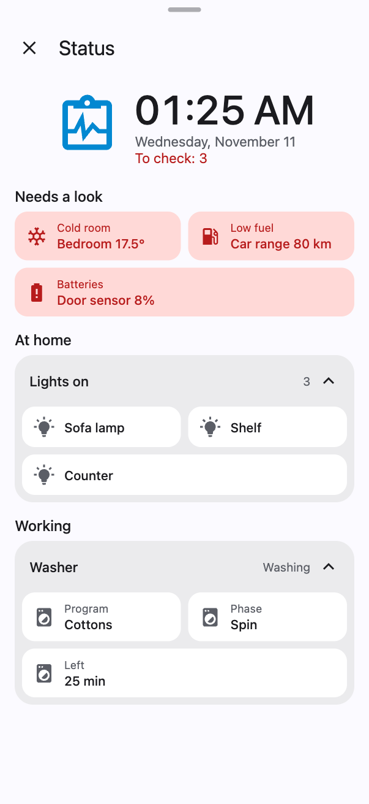

Tram and bus departures are `kind: departures`. The next one is large, and under it every line shows its coming
times and any delay. The entities must keep the departures in a `list` attribute (`line`, `direction`, `departure`,
`time_to_departure`, `delay`). On a tablet on its side they take the whole screen: the next one large with whether it
is on time, every departure of all lines in one order, the next hour (up to two, when the last departure is later) as
a line of time a row per line, and a card per line with every time the timetable gives. Each line has a colour of its
own; `colors: {"8": "#ff9f0a"}` chooses it by hand. How many times come per line is up to the source of the data (such
as the timetable's server), not the dashboard. `news: binary_sensor.impk_news` adds the carrier's notices (diversions,
disruptions) from its `list` attribute: a warm card above the departures, only while there are any.

```yaml
shortcuts:
  - kind: departures
    name: Trams
    icon: mdi:tram
    entities: [sensor.tram_4, sensor.tram_11]
```

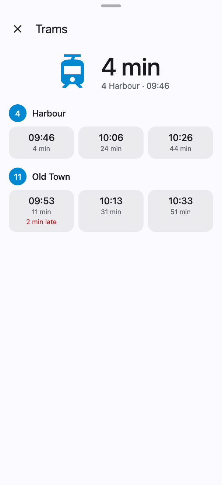

Other shortcuts: `{kind: page, name: Media, icon: mdi:play, page: media}` opens a page in a sheet, and
`kind: host` shows machines with `columns`. A TV has `kind: tv`, with `entity`, `on`, `off` and `shortcuts`,
and a webOS TV gets arrows and keys by itself.

A device with a card of its own opens it instead of the dashboard's sheet:

```yaml
entities:
  overrides:
    light.aquarium:
      card: {type: custom:lamp-card, entity: light.aquarium}
```

The rest of `entities`:

```yaml
entities:
  include:
    kitchen: [switch.dishwasher]     # adds an entity to a room
  exclude: [light.tablet_screen]     # leaves one out
  overrides:
    cover.window_3: {area: bedroom, name: Blind, icon: mdi:blinds}
```

### The block editor

Three dots on Home → <b class="ui">Summary badges</b> (administrators) lists all shortcuts. Here you add a new block and set their order, and
the pencil opens a form. Status, Departures, Machines (`kind: host`), Block (`kind: panel`), Page and School year have
one, with their sections, rows and buttons. Entities are suggested as you type, and a Home Assistant card goes in as
YAML in its field. A block standing in a room opens from the room editor: tile → <b class="ui">Edit the block</b>. A shortcut can have a `label`, a small text above its
name. Options the form does not know stay in the block untouched. After a rename the rules of <b class="ui">User access</b> follow the block, while the order
and hiding in someone's <b class="ui">My layout</b> have to be set again.

| Summary badges | Form |
|---|---|
| 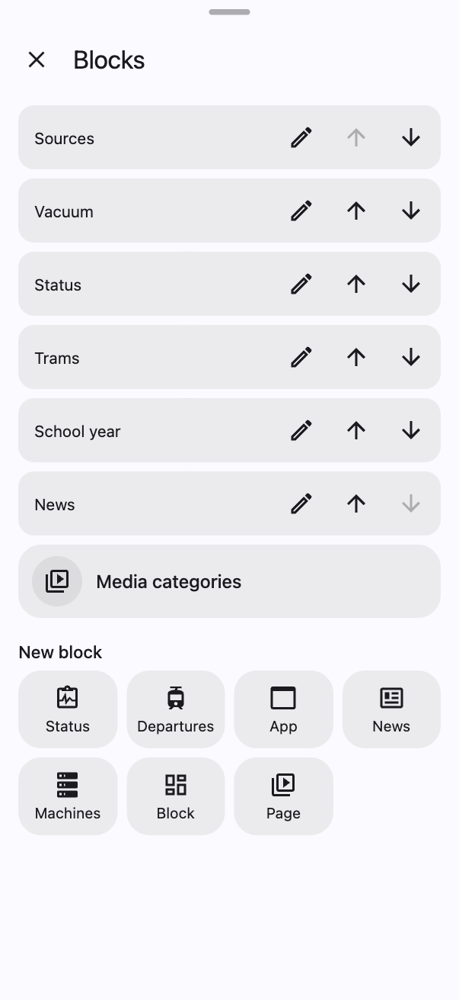 | 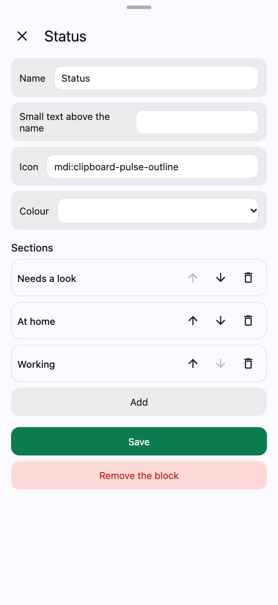 |

### Settings and editing of a device

Everything that turns on and off has a round **power button** in its window, seen without scrolling: a light under its
slider, a switch, a plug, a helper or an automation under its big switch. One tap turns it off (or on); nothing has to
be slid down. On a light, or a switch of a lamp, it glows yellow while the light is on.

Every device window has two buttons in the top right corner:

- **The gear** opens the settings of the device in tabs, gathered from its other entities: <b class="ui">Settings</b> (switches,
  lists, sliders, e.g. the transition time of a lamp), <b class="ui">State</b> (sensors, e.g. power), <b class="ui">Actions</b> (buttons, e.g.
  Identify) and <b class="ui">Activity</b> (the logbook of that device over 1, 6 or 24 hours). A group, e.g. a group of lights, has
  a <b class="ui">Members</b> tab first, with switches. Only tabs with something in them show, Activity always. The gear in that
  window opens the full window of Home Assistant.
- **The pencil** (administrators only) changes the **name**, the **area**, the **labels** and whether the device is
  **enabled**. An entity without a device is changed itself. A disabled device disappears from Home Assistant and
  from the dashboard; you enable it again in Settings → Devices. A switch also has <b class="ui">It is a light</b>: a switch that
  powers a lamp is then yellow while on and counted with the lights. One with a lamp icon is a light by itself; the
  choice is saved in the dashboard (`entities.overrides.<id>.light`).

Both windows take the look of the theme from **Look → Windows**, like every window of the dashboard.

### The side menu

The three bars open the menu: pages, areas, your groups and settings. Administrators arrange the groups with **Edit the
menu** at the very bottom. A group can have a title, and an entry has a name, an icon and one of three: the <b class="ui">Address</b> of
a Home Assistant page (it suggests panels such as `/config`), a **Shortcut** by name, or the <b class="ui">Action</b> `notifications`,
which opens a window of notifications, live, where they can be dismissed. <b class="ui">Administrators only</b> hides an entry from the others, <b class="ui">Who sees it</b> limits it to the ticked people (`users`, none ticked means everyone), and <b class="ui">Hide in guest mode</b> hides
it while guest mode holds for the account: use it for cameras, so the entry does not get around the block. With no menu
of your own it shows the shortcuts and the basic links.

Under <b class="ui">Edit the menu</b> is <b class="ui">Profile</b> with the name of the signed-in person: it opens the profile of Home Assistant.

The menu of Home Assistant is hidden while the dashboard is open, also on a wide phone on its side and on a tablet,
so the dashboard takes the whole screen. Your setting does not change: on other pages of Home Assistant the menu is
back as it was. A phone on its side keeps the phone layout, with three tiles in a row.

In the Home Assistant app a swipe from the left edge opens this menu on Home, instead of the menu of Home Assistant.
Anywhere else the same swipe goes back: an open window closes, and a room or another page returns to Home. On Home the
menu follows the finger as it is drawn out: let go past a third of it, or with a flick, and it opens; short of that it
goes back. It slides in and out.

On a computer **Esc** closes the open window, as its ✕ does (a camera opened from another window goes back to it, as
its arrow does). A small window inside it goes first: a question, a menu, a list slid in at the side, a picture shown
big. One press closes one thing; a window of Home Assistant over the dashboard closes itself.

Entries with the address `/history` and `/logbook` open in windows of the dashboard. The logbook shows the devices of the
dashboard for the last hour, 6 or 24 hours, and the history shows graphs of the entities each person picks for themselves.

| Logbook | History |
|---|---|
| 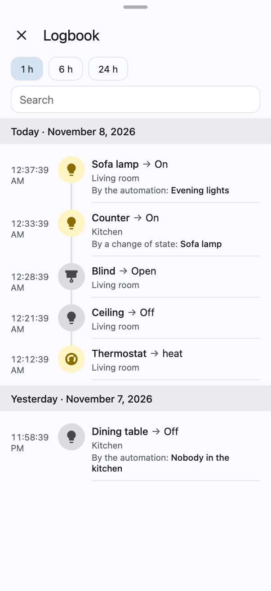 | 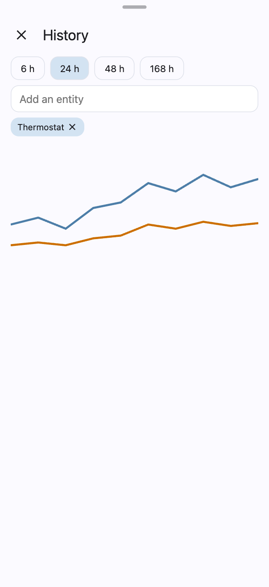 |

| Menu editor | Notifications |
|---|---|
| 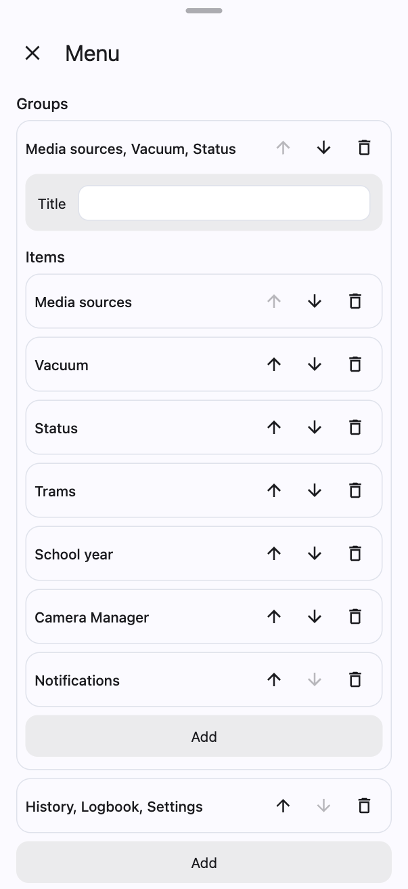 | 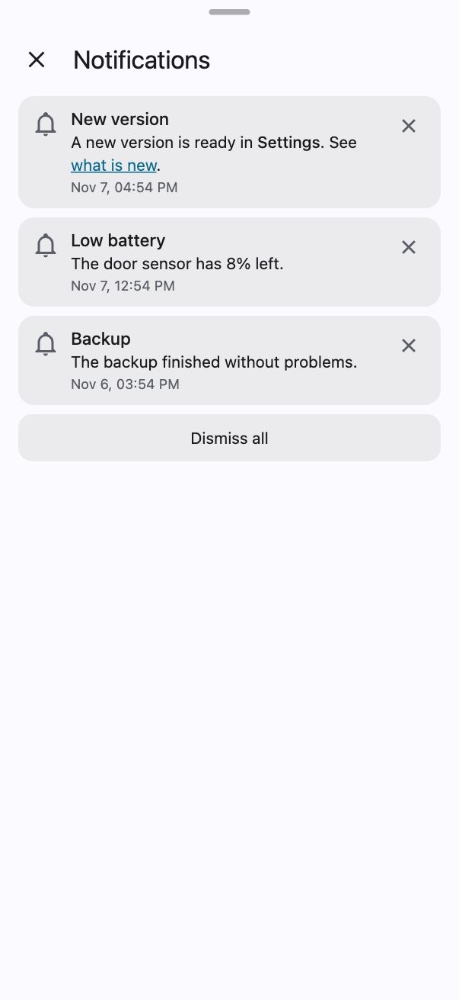 |

```yaml
menu:
  groups:
    - items:
        - {shortcut: Status}
        - {name: Cameras, icon: mdi:cctv, path: /my_camera_panel, hide_for_guests: true}
        - {name: Notifications, icon: mdi:bell-outline, action: notifications}
    - title: System
      items:
        - {name: Settings, icon: mdi:cog-outline, path: /config, admin: true}
```

### News

`kind: news` is a screen for reading. Each section is a sensor with a `news` attribute, a list of articles: `title`, `text`,
and optionally `rating`, `votes`, `source`, `source_url` and `url`. The `release` and `attribution` attributes show at
the top and bottom. In <b class="ui">Summary badges</b> it is <b class="ui">News</b>:

```yaml
shortcuts:
  - kind: news
    name: News
    icon: mdi:newspaper-variant-outline
    sections:
      - {title: Home, entity: sensor.news_home}
      - {title: World, entity: sensor.news_world}
```

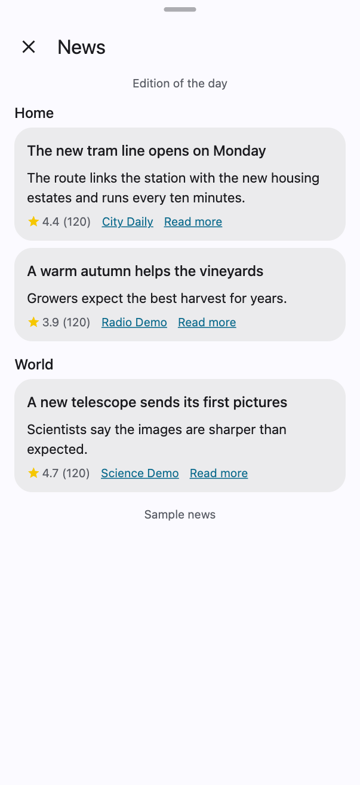

### Text

`kind: text` is a block for reading: the readings of the day's Mass, a page of a book for today, a thought of the day.
Each section is an entity: its state is the small line above the text (a reference, a page), its attributes the text,
the paragraphs of a psalm keep their lines and its refrain stands out. An entity with no text in its attributes shows
its state as the text. A section with nothing to say is left out (a second reading on a weekday), and the badge shows
while one of its entities exists. In <b class="ui">Summary badges</b> it is <b class="ui">Text</b>:

```yaml
shortcuts:
  - kind: text
    name: Word of God
    icon: mdi:book-cross
    heading: sensor.readings_day          # the name of the day, with its date
    label_entity: sensor.readings_gospel  # the small line of the badge
    sections:
      - {entity: sensor.readings_first, name: First reading}
      - {entity: sensor.readings_psalm, name: Psalm}
      - {entity: sensor.readings_gospel, name: Gospel, read: true}
    # Read aloud on a speaker, or through a script of announcements (a HomePod needs the whole file first)
    script: script.announce
    script_field: text
    script_data: {areas: hall}
    speaker: media_player.hall_homepod    # stops it
```

With a speaker or a script the window has <b class="ui">Read everything</b> and a button for each section with `read: true`;
the text read is the intro, the refrain, the text and the ending, without the marks of a psalm.

<b class="ui">Listen to everything</b> reads everything on the device the window is open on — a phone, a tablet, a
Mac — not on a speaker; each section with `read: true` also has its own <b class="ui">Listen: {name}</b> (e.g.
*Listen: Gospel*). The button reading is lit and stops it; another one starts its own text instead. Home Assistant makes a recording with the same text-to-speech (`tts`, else the first) and the browser plays
it, with <b class="ui">Pause</b> and <b class="ui">Stop</b>. A long text takes a few seconds to prepare. Without any
text-to-speech, or when it fails, the browser reads it in its own voice. Closing the window stops it;
`hide_read_here: true` hides the "Listen" buttons.

**Voice** (`voice`) chooses a voice of the text-to-speech for every button: the editor lists the voices of the chosen
engine (`tts`, else the first) in your language. A script reads in it when its field for a voice is named in
`script_voice_field` — `script.announce` of the example would take `voice` beside `text`. The voice assistant keeps
its own voice.

### Apps in a window

An add-on with a web interface, such as Frigate, opens in a window of the dashboard. In the menu put its id in the <b class="ui">App</b>
field, which suggests the installed add-ons. As a shortcut on Home it is **Summary badges → App**:

```yaml
shortcuts:
  - {kind: app, name: Frigate, icon: mdi:cctv, addon: abcd1234_frigate}
menu:
  groups:
    - items:
        - {name: Frigate, icon: mdi:cctv, addon: abcd1234_frigate, hide_for_guests: true}
```

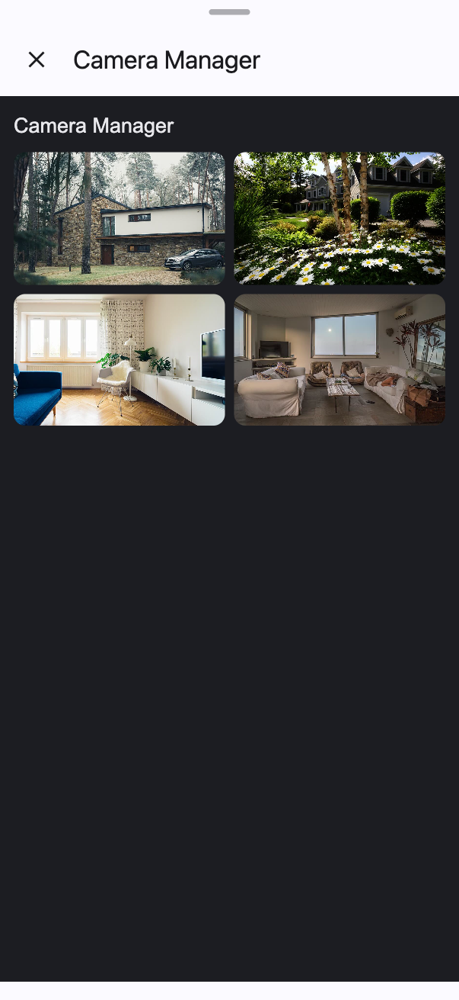

When the window cannot open, for example because the add-on is off, a message and a button that opens it in Home
Assistant appear. `frame: http://...` gives a fallback address for such cases.

### The school year from your own data

`kind: school` reads sensors and assumes nothing about where they come from, so your own add-on or a template that
provides them is enough. `sources` changes the entity names. The data lives in attributes, and the state of a sensor does
not matter. A tab without data only says so.

```yaml
shortcuts:
  - kind: school
    name: School year
    icon: mdi:school-outline
    children: [Lena, Kuba]            # the order; other children go last
    sources:
      plan: sensor.my_timetable       # sensor.rodzinnik_plan_lekcji by default
      grades: sensor.my_grades        # sensor.rodzinnik_oceny
      events: sensor.my_calendar      # sensor.rodzinnik_terminarz
      meals: sensor.my_meals          # sensor.rodzinnik_obiady
      duties: sensor.my_duties        # sensor.rodzinnik_obowiazki
      jobs: sensor.my_jobs            # sensor.rodzinnik_prace
      bank: sensor.my_bank            # sensor.rodzinnik_bank
      librus: sensor.my_school_events # sensor.rodzinnik_librus
```

The children and their tabs come from `plan`. Dates look like `2026-11-09` and times like `08:00`. Day names are shown
as you send them, in any language, and a weekend is recognised by its date.

```yaml
# plan: the children attribute
children:
  - child: Lena
    days:
      - date: "2026-11-09"
        name: Monday
        is_today: true
        no_lessons: false              # true crosses out the lessons of the day
        events: [...]                  # as below
        lessons:
          - {number: 1, start: "08:00", end: "08:45", subject: Maths, teacher: Anna Nowak, classroom: "12",
             type: lesson, canceled: false, substitution: false, note: ""}   # type: extra is an extra activity

# event: an event in days[].events and in librus
- {date: "2026-11-09", title: School trip, start: "08:00", end: "15:00", place: Museum, description: "",
   instead_of_lessons: false, important: true}

# librus: the children attribute, important events of Today and Tomorrow and the events of the calendar
children:
  - {child: Lena, events: [...]}

# events: the children attribute, entries of the calendar
children:
  - child: Lena
    entries:
      - {date: "2026-11-10", kind: Test, title: Maths, description: Fractions, start: "10:10"}

# grades: the children attribute
children:
  - child: Lena
    semester: 1
    subjects:
      - subject: Maths
        averages: {semester_1: 4.5, year: 4.5}
        grades: [{grade: "5", category: test, is_new: true, proposition: false}]

# meals: the variants attribute
variants:
  - variant: school
    label: School
    available: true
    days:
      - {name: Monday, meals: [{meal: Lunch, items: [{name: Soup}, {name: Pasta}]}]}

# duties: the week_start, week_end and children attributes, optionally previous_week and next_week of the same shape
children:
  - {child: Lena, child_color: "#f5ec00", avatar: "https://...", set: Kitchen, color: "#77bb41", tasks: [Dishes], free_week: false}

# jobs: the jobs attribute
jobs:
  - {name: Raking, description: Leaves, reward_label: "5 - 10 EUR", limit: {label: once a week}}

# bank: the currency and children attributes
currency: EUR
children:
  - {child: Lena, balance: 65, savings: 10, debt: 0, allowance: {next_payment: "2026-11-09"}}
```

### An energy store

A power station on a battery (an EcoFlow, a home battery) is a block in its room, like any other: its numbers on the
tile and its outputs, charging and battery in its window. `energy.storage` puts it on the Energy page too, as a card
with its charge, what it does, the power in and out and how long it lasts; a tap opens the same window. The fields are
in the [README](../README.md#energy).

### The scale

A bathroom scale with each person's body from [BodyMiScale](https://github.com/dckiller51/bodymiscale): `kind: scale`
in a room (or among `shortcuts`). Its tile says who weighed last and when, with their weight, BMI, body fat and
muscle; a tap opens its window:

- the people of BodyMiScale to choose from, each with their weight, starting with the one who weighed last;
- what the scale shows now (`entity`);
- the weight against the ideal one, with the difference, and the fat to lose;
- BMI on its bands (underweight, healthy, overweight, obesity), with the label BodyMiScale gives;
- what the body is made of: body fat, muscle, water, bone, visceral fat, protein, lean mass, basal metabolism,
  metabolic age, body score and body type;
- the weight over 30 days, 90 days or a year, from the statistics of the person's weight sensor, with the ideal weight
  as a dashed line. A weight that did not change says there were no weighings in that time.

A tablet shows it in two columns, a phone in one.

```yaml
- kind: scale
  name: Scale
  icon: mdi:scale-bathroom
  entity: sensor.mi_body_composition_scale_mass   # what the scale shows now
  people:                                         # optional: all bodymiscale.* without it
    - bodymiscale.alex
    - {entity: bodymiscale.sam, name: Sam, weight: sensor.sam_weight}
```

Each person's weight sensor is found by itself as `sensor.<person>_weight…`; `weight` names another one.

## 8. Music, Energy and Map

| Music | Energy | Map | Player |
|---|---|---|---|
| 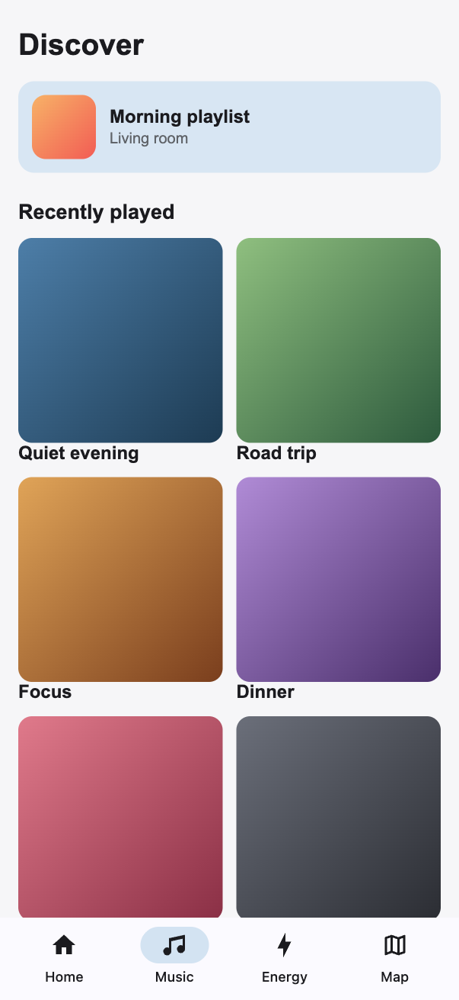 | 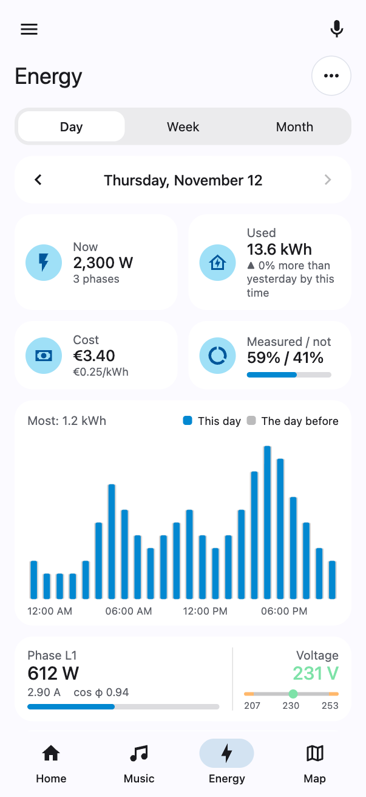 | 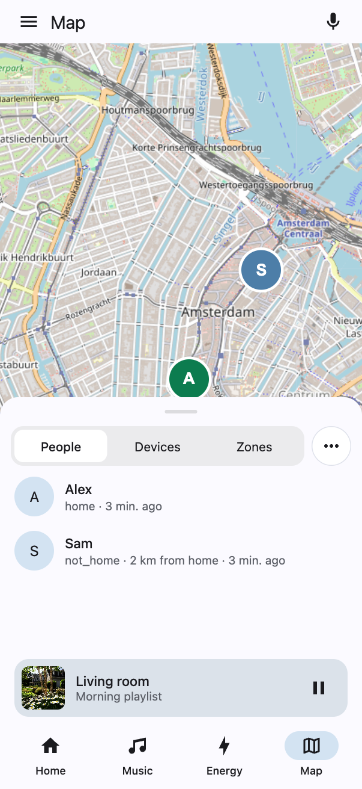 | 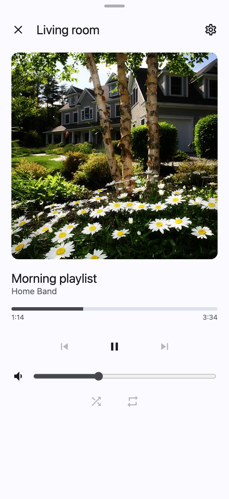 |

| Energy on a tablet | Chart of a phase |
|---|---|
| 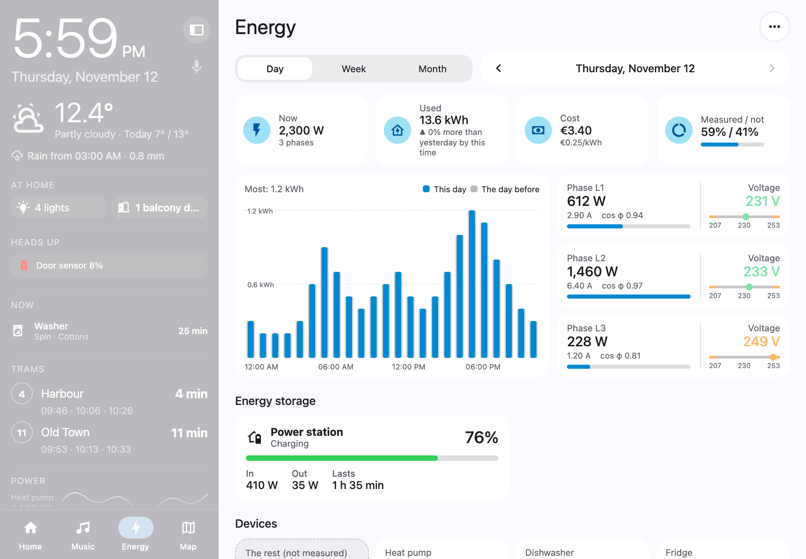 | 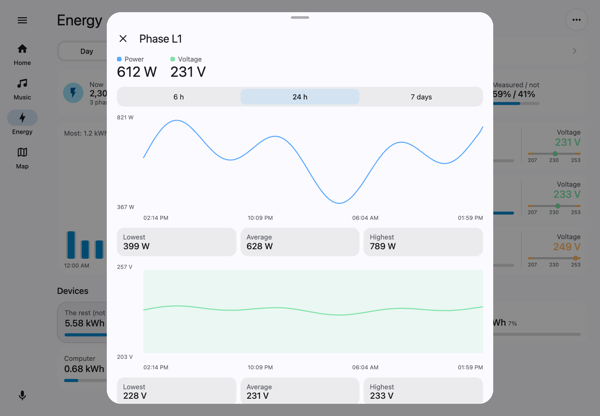 |

The music picture stands in for your music app, and the Energy and Map pictures for Home Assistant's cards,
with made-up numbers.

<b class="ui">Music</b> takes the place of Media on the navigation bar. Add a card or a web page:

```yaml
music:
  frame: http://homeassistant.local:8095
```

A page served over HTTP cannot open from a dashboard on HTTPS. On phones the bottom bar goes away for
Music Assistant's full-screen player only when the frame comes from the same address as Home Assistant.
When something plays a mini player shows above the bar on the other pages. Speakers that are the same device
are merged with `media.group_patterns`.

<b class="ui">Energy</b> is a page of the dashboard itself, in its look: <b class="ui">Day</b>, <b class="ui">Week</b> or <b class="ui">Month</b> with arrows to earlier
periods, the <b class="ui">Used</b> and <b class="ui">Cost</b> tiles (and <b class="ui">From the sun</b>, <b class="ui">To the grid</b>, <b class="ui">Gas</b>, <b class="ui">Water</b> when you have them),
a chart of hours or days and the list of <b class="ui">Devices</b> with the share of each. The numbers come from the energy settings
and statistics of Home Assistant, as in its Energy panel, so they are the same. The cards take the look of the buttons
of the theme. The small player does not show on Energy or the Map, so the bottom of the page stays free. Set it up in
**Settings → Dashboards → Energy**. Add your meter as the grid source and devices under
**Individual devices**. If one device is plugged into another that is measured, set it as a child there, or it
counts twice.

A meter with phases (e.g. ZAMEL MEW-01 through SUPLA and MQTT) gives more:

- <b class="ui">Now</b>: the power of the whole home, the phases added up, and the frequency of the grid.
- <b class="ui">Used</b> against the period before: for the current day "yesterday by this time", for a week and a month "by now".
  The chart shows the period before faintly behind the bars.
- <b class="ui">Cost</b> with the price per kWh, and <b class="ui">Measured / not</b>: the share of the use that devices with a meter account for.
  The rest is in the list as <b class="ui">The rest (not measured)</b>.
- **Phases L1–L3**: power, current, cos φ and the voltage on the scale of 207–253 V (230 V ±10%). The voltage is green
  within it, orange near its ends and red out of it. A tap on a phase opens a window with a chart of its power
  and voltage (with the band of the range), and a tap on a device, <b class="ui">Used</b> or <b class="ui">Now</b> a chart of its energy or of the
  power of the phases. Ranges: 6 h, 24 h, 7 days (power) or 24 h, 7 days, 30 days (energy); a finger on the chart
  shows the value at that moment, and under it are the lowest, the average and the highest.

The phases are found by themselves on the device of the first grid meter, by the number of the phase in the names of
its sensors (`faza_1`, `phase_2`, `_l3`) and what they measure. Otherwise list them in the dashboard's YAML:

```yaml
energy:
  phases:
    - power: sensor.meter_phase_1_power
      voltage: sensor.meter_phase_1_voltage
      current: sensor.meter_phase_1_current
      factor: sensor.meter_phase_1_power_factor
  voltage_range: [207, 253]   # the default
```

On a tablet on its side the numbers stand in one row, the chart beside the phases, and the devices are tiles four in
a row.

<b class="ui">Map</b> draws the routes of people over the last hours, with the zones, on the map of Home Assistant. Over the map are
two rows of buttons: **whose routes** (Everyone, each person and chosen devices) and **range**: 6 h, 24 h, 3 days or
7 days. Each device remembers its choice. A device with a route, such as a car, is added in the configuration:

```yaml
map:
  track: [device_tracker.car_location]
```

The colours of the map (as the page, light, dark) and the range at first are set in **Look → Background → Map**; Apple
Home has a dark map. The list of People, Devices and Zones lies on the map: on a phone it is a panel you drag between a thin bar, half the screen and the whole screen, and on a tablet it floats on the left. Tapping an entry shows it on the map.

The music page opens the Music Assistant add-on, also for accounts without administrator rights: `music: {addon: abcd1234_music_assistant}`. With `fullscreen: true` the bottom bar goes away, and the **Home Assistant** button in the menu of Music Assistant goes back to Home.

`media.sections`, or the form **Summary badges → Media categories** (pictured below), puts the media page in your own groups. Tiles are written as in a room, `kind: tv` and `kind: panel`
included. Those also standing in the layout of a room show in the Media filter on Home, in their room:

```yaml
media:
  sections:
    - title: Speakers
      tiles:
        - {entity: media_player.living_homepod, name: Living room}
    - title: Televisions
      tiles:
        - {kind: tv, entity: media_player.tv, name: Television}
```

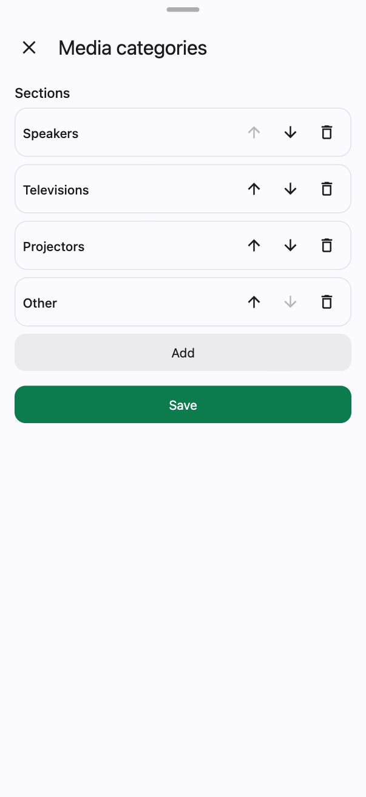

## 9. People

### Three dots on Home

The three dots menu ends with, in order: <b class="ui">User access</b>, <b class="ui">Background of this screen</b>, <b class="ui">My layout</b> and **Summary
badges**; in a room **My view** and **Edit this screen** instead of the last two. **Look** is in the side menu.
Some change the dashboard for you alone, some for the household:

| Entry | Who sees it | What it sets | For whom, and where it is kept | Where the change shows |
|---|---|---|---|---|
| <b class="ui">My layout</b> | everyone | order and hiding of cameras, areas, chips and scenes, your own favorites, hidden menu entries, the start of the dashboard | for you, with your HA account, so on all your devices; on Areas and Favorites an administrator can tick <b class="ui">For everyone</b> | Home, rooms, the menu, Security (cameras) |
| <b class="ui">Summary badges</b> | administrators | the list of shortcuts (blocks): adding one, their order, editing in a form, media categories | for everyone, in the dashboard configuration | shortcuts on Home, in the menu and in rooms; categories on the Music page |
| <b class="ui">User access</b> | administrators | what to take away from one person or from everyone but you: cameras, areas, sections of rooms, chips, lights, media, security, scenes and more | for that person, in the dashboard configuration (`access`); they cannot bring it back | everywhere in this dashboard, for that person |
| <b class="ui">Look</b> | everyone, in the side menu | background strength, bounce at the ends, the look of buttons (opacity, rounded corners, colour on the whole button or only on the icon, colours for kinds of buttons) and own icons of devices; themes for administrators | for you, with your HA account; with <b class="ui">For everyone</b> an administrator sets the shared look (`appearance`) | the whole dashboard |
| <b class="ui">Background of this screen</b> | everyone | the background of the page you are on, for the light and the dark look separately, and your look: System, Light, Dark | for you, with your account; with <b class="ui">For everyone</b> (administrators) as the default, in the configuration | only this page: Home or the room you are in |

What wins: first <b class="ui">User access</b> (what is taken away no layout brings back), then the <b class="ui">For everyone</b> settings, and
last a person's <b class="ui">My layout</b> and own background. Each entry is described below, and <b class="ui">Summary badges</b> in
[The block editor](#the-block-editor).

| Background | My layout | User access |
|---|---|---|
| 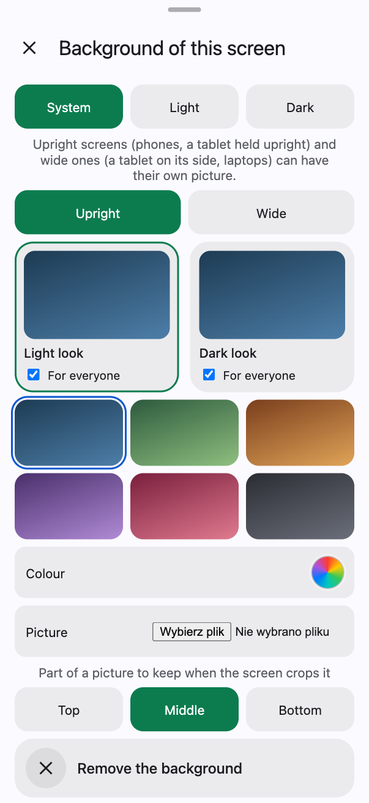 | 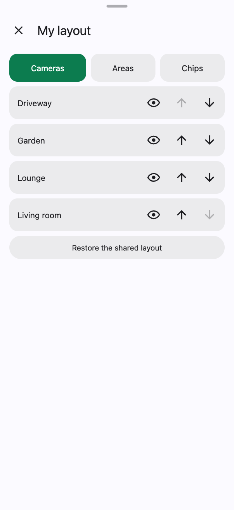 | 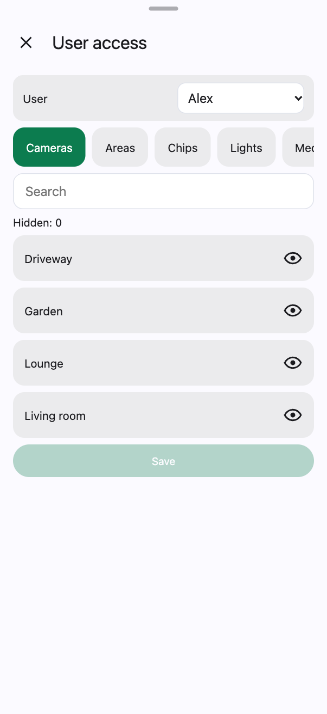 |

<b class="ui">My layout</b> (three dots on Home, for everyone): the order and hiding of cameras, areas, chips and scenes, your own
<b class="ui">Favorites</b> (they start from the shared ones, and you add more by search) and hiding entries of the <b class="ui">Menu</b>. At the
bottom, <b class="ui">Open this dashboard at start on my devices</b> is kept with the account, and every device takes it over once it
connects to Home Assistant.

On the <b class="ui">Areas</b> and <b class="ui">Favorites</b> tabs an administrator ticks <b class="ui">For everyone</b> and then sets the shared order of areas,
which are hidden, and the shared favorites everyone starts from. <b class="ui">Save for everyone</b> saves them. An area hidden for
everyone stays on that list, so it can be shown again. This is the only place for these settings: the **Dashboard
settings** window has at the top **Load the app afresh**, and under it the return after idle time, the start on this
device, talking in a camera window, linking recorder cameras to the same cameras in another integration and the
configuration editor. <b class="ui">Load the app afresh</b> it fetches fresh files of the dashboard and opens the page again, when the app shows an old version, e.g.
away from home.

<b class="ui">My view</b> (three dots in a room, for everyone): hides a whole section or a single tile for you, the <b class="ui">Scenes</b> group
included. A hidden tile leaves the room and its place on Home. <b class="ui">Show everything in this room</b> brings it all back.
What an administrator took away is not on the list and cannot be brought back. It is kept with the
account, so it follows the person to all their devices.

| My view of a room | My scenes |
|---|---|
| 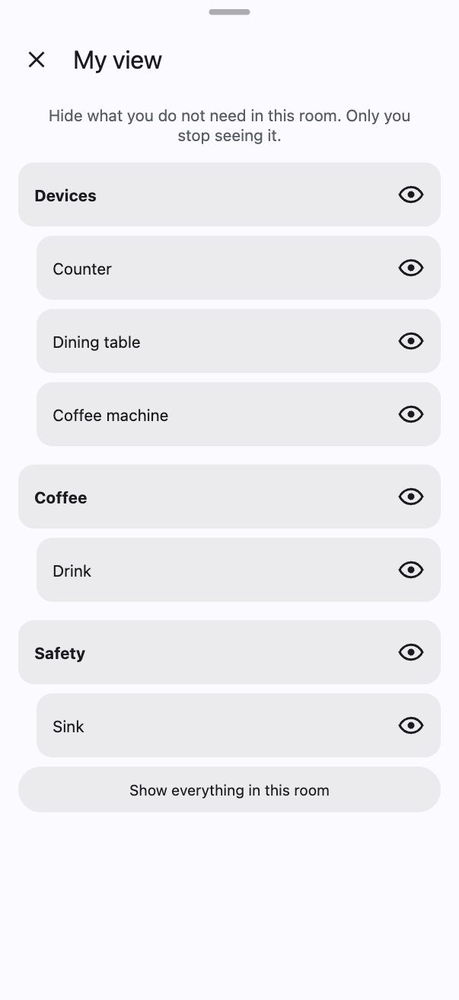 | 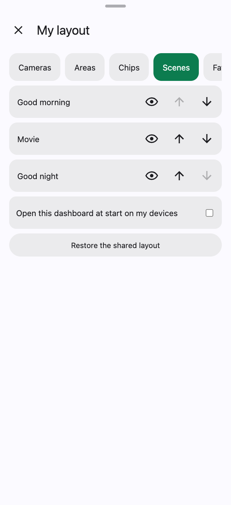 |

<b class="ui">Background of this screen</b> (three dots, for everyone): a gradient, a colour or a picture for Home, a room or the Scenes page (key `scenes`), the Map (`map`) or Energy (`energy`),
separately for the light and dark look; a look without its own background shows the plain page. At the top of this window you also choose the look of the whole dashboard for yourself: System, Light or Dark. <b class="ui">For everyone</b> appears for administrators and makes it the default.
Without it the background stays with that account. A person's own background beats the default.

<b class="ui">Make a background</b> in the same window opens the background maker, much like apps that make wallpapers for the Home
app: pick one of 16 ready backgrounds, or a pattern and a gradient (48 to choose from, or your own two colours), and
lay a photo over it if you like, see-through, greyed or blurred, smaller and in a corner, turned or mirrored, faded
out from up to three of its edges. The preview shows a few tiles on it, so you see at
once whether the dashboard stays readable. <b class="ui">Use as background</b> makes an upright and a wide picture at once and puts
them in the light look, the dark one or both. In the editor on a computer the same maker opens wide from **Make a
background** in an entry of **Backgrounds of pages** (Look → Themes and backgrounds), with a phone and a tablet side
by side.

Each field of such an entry (light, dark and both wide) shows at its end what it holds: a sample of the colour or the
gradient, or a magnifier that opens the picture big. A click on the field opens a window with two tabs. <b class="ui">Pictures</b>
shows those sent to Home Assistant and those in the `/config/www` folder as small pictures (a click chooses one, the
magnifier opens it big), and <b class="ui">Send a picture from the computer</b> adds a new one. <b class="ui">Colour and gradient</b> sets one
colour from a palette, or a gradient of its colours, their places in percent and its direction, with 48 ready
gradients and a large preview; the CSS it makes stays below, to change by hand. Any other field of the editor that holds
the address of a picture also has a magnifier. The pictures of the `www` folder show after a restart of Home Assistant
on a new version of the integration.

Upright and wide screens can have different pictures, because an upright picture is cropped hard on a laptop:

| Shape | When | Key in the configuration |
|---|---|---|
| <b class="ui">Upright</b> | a phone, a tablet held upright, any window taller than wide | `light`, `dark` |
| <b class="ui">Wide</b> | a tablet on its side, a laptop, any window wider than tall | `light_wide`, `dark_wide` |

The **Upright / Wide** switch in the background window chooses which shape you edit; it starts on the shape of your
screen. A shape without a picture of its own takes the other shape of the same look. Its preview is then dimmed and
labelled <b class="ui">As upright</b> or <b class="ui">As wide</b>, so one picture is still enough for both. Turning a tablet changes the background
at once.

<b class="ui">Part of a picture to keep when the screen crops it</b> (Top, Middle, Bottom) keeps that part in view. For a picture
with a house at the top, choose <b class="ui">Top</b>. It applies to pictures, not to gradients or colours. In the configuration it is
`position: top`; middle is the default and is not saved.

```yaml
backgrounds:
  home:
    light: /api/image/serve/<id>/original       # upright
    light_wide: /api/image/serve/<id>/original  # wide
    dark: "#121316"
    position: top
```

### Look

<b class="ui">Look</b> (side menu, above <b class="ui">Dashboard settings</b>, everyone) has six tabs (<b class="ui">Background</b>, <b class="ui">Buttons</b>, <b class="ui">Colours</b>, <b class="ui">Bar</b>, <b class="ui">Windows</b>, <b class="ui">Icons</b>), and a seventh with <b class="ui">For everyone</b>: <b class="ui">Themes</b>. An administrator has <b class="ui">For everyone</b> ticked and then
changes the shared look, saved with <b class="ui">Save for everyone</b>. Without that tick, and for everyone else, the changes are
yours alone. Only what differs from the shared look is saved, so what you leave alone keeps following the
administrator's changes. <b class="ui">Back to the look for everyone</b> removes your changes.

| Background | Buttons | Colours | Icons |
|---|---|---|---|
| 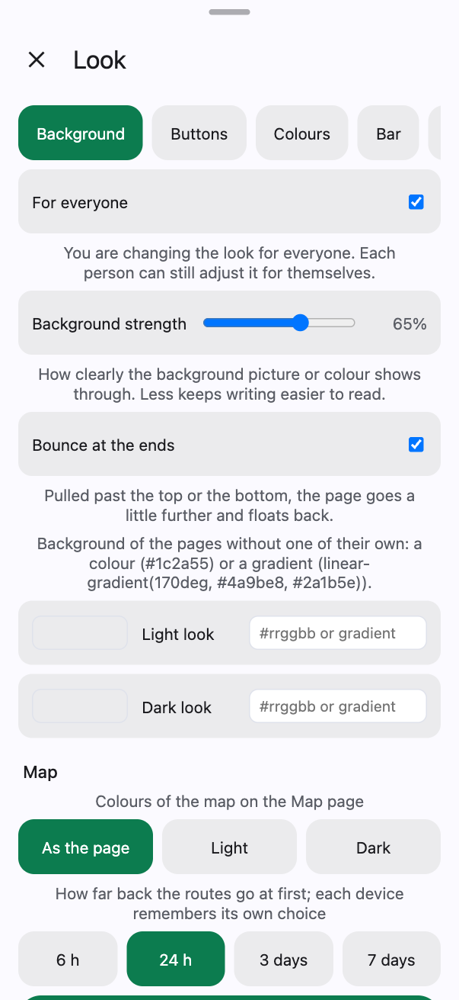 | 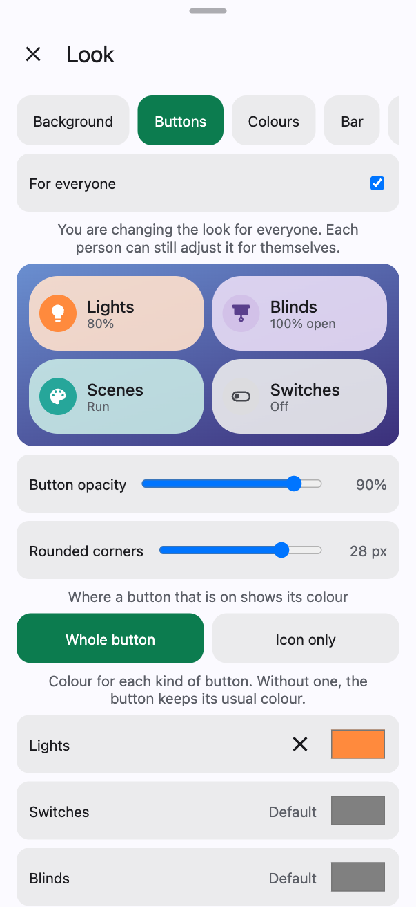 | 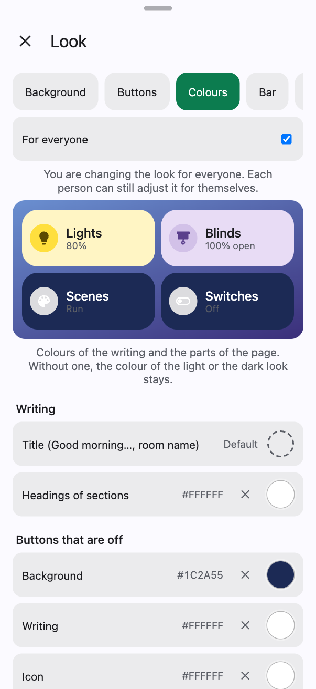 | 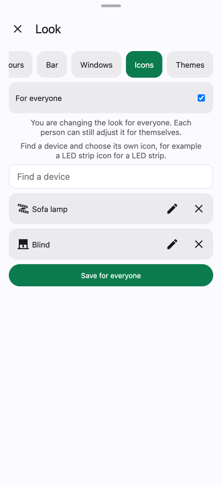 |

| Bar | Windows |
|---|---|
| 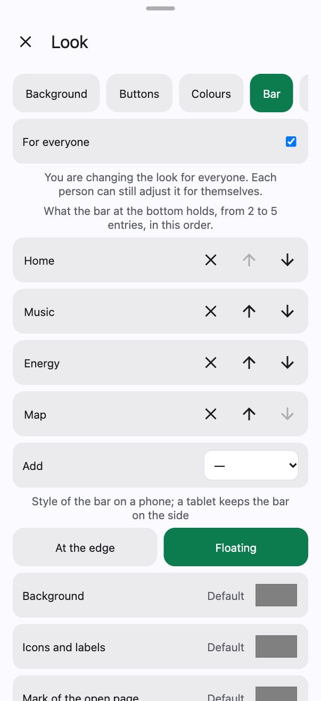 | 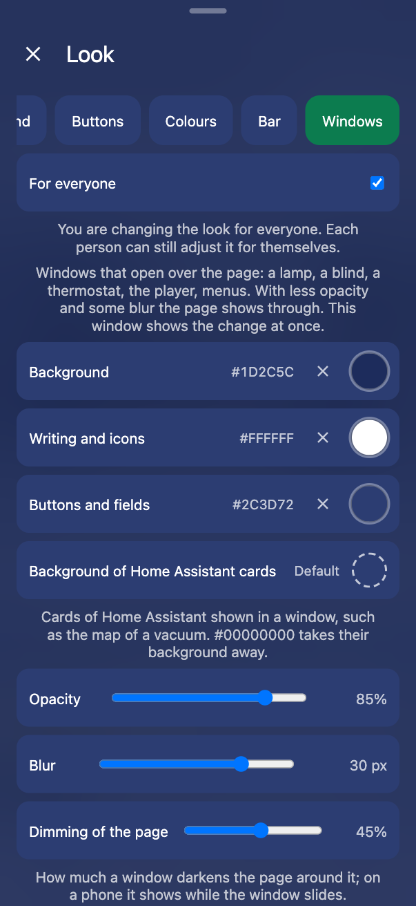 |

A colour without a value (<b class="ui">Default</b>) keeps the colour of the light or the dark look, so a theme can change only some
colours. A chosen colour stays the same in both modes. In YAML and in a theme a colour may be see-through:
`#rrggbbaa`, e.g. `#ffffff26` is white at 15%. Apple Home is built that way: black buttons at 26% and white circles at
15% take the colour of the background they lie on, so they suit every room. Picking a colour in the sheet changes the
hue and keeps the see-through part.

| Tab | Setting | Default | What it does |
|---|---|---|---|
| <b class="ui">Background</b> | <b class="ui">Background strength</b> (0-100%) | 40% | how clearly the background picture or colour shows; the rest is the page colour laid over it, so writing stays readable. 100% is the background as it is |
| <b class="ui">Background</b> | <b class="ui">Bounce at the ends</b> | on | pulled past the top or the bottom, the page goes a little further and floats back, as in phone apps; the background stays still and only the layout bounces |
| <b class="ui">Background</b> | **Light look / Dark look** (background of pages without one) | none | a colour (`#1c2a55`) or a gradient (`linear-gradient(170deg, #4a9be8, #2a1b5e)`) for every page without a background of its own, except Music; on the Map it shows above and below the map; no pictures, so a theme suits any home |
| <b class="ui">Buttons</b> | <b class="ui">Button opacity</b> (20-100%) | 100% | with less opacity the background shows through the buttons |
| <b class="ui">Buttons</b> | <b class="ui">Rounded corners</b> (0-36 px) | 20 px | 0 is a rectangle, 36 a pill |
| <b class="ui">Buttons</b> | **Whole button / Icon only** | Whole button | where a button that is on shows its colour; with <b class="ui">Icon only</b> the button itself stays neutral |
| <b class="ui">Buttons</b> | colours of kinds | none | your own colour for lights, switches, blinds, thermostats, speakers and TVs, locks and alarm, fans, scenes, scripts, automations and sensors |
| <b class="ui">Colours</b> | <b class="ui">Writing</b>: the title (Good morning…, room name) and the headings of sections | colours of the look | also the icons in the top bar |
| <b class="ui">Colours</b> | <b class="ui">Buttons that are off</b>: background, writing, icon, circle under the icon | colours of the look | buttons that are off, and every button with <b class="ui">Icon only</b> |
| <b class="ui">Colours</b> | <b class="ui">Blocks at the top</b>: background, writing, opacity, rounded corners | light background, 100%, 14 px | the Weather, Climate, Lights… blocks; with a chosen background they lose their outline |
| <b class="ui">Colours</b> | <b class="ui">Round buttons</b>: background, icon, opacity | light background, 100% | intercom and the three dots |
| <b class="ui">Colours</b> | <b class="ui">Badges in rooms</b>: writing, icon and ring; <b class="ui">Filled room status circles</b> (off: the circles open inside, their ring and icon keeping the colour of their kind, as in Apple Home); <b class="ui">Colours of kinds in the room status circles</b> (off: every circle in the colour of the icon) | colours of the look, kinds on | badges under the room name (Temperature, Humidity, Climate, Lights…) |
| <b class="ui">Bar</b> | entries: 2 to 5 of Home, Media or Music, Energy, Map, Scenes, Menu and the rooms; arrows set the order | Home, Media/Music, Energy, Map | a room and Scenes light up while open; in any other room Home does |
| <b class="ui">Bar</b> | **At the edge / Floating** | At the edge | a floating bar is a rounded pill above the bottom edge, as in Apple Home; a tablet always keeps the bar on the side |
| <b class="ui">Bar</b> | background, icons and labels, mark of the open page, opacity, blur | colours of the look, 100%, 0 px | with less opacity and some blur, the page under the bar shows through as frosted glass |
| <b class="ui">Bar</b> | <b class="ui">Status bar</b>: on, its parts and their order, coloured icons, background, text, opacity, blur | off; weather, at home, heads up, now, departures, power; white icons on glass | a tablet on its side only; see chapter 10 |
| <b class="ui">Bar</b> | <b class="ui">Player</b>: paused stays (0-120 min), background, writing and icons, opacity, blur, rounded corners | 10 min, colours of the look, 100%, 0 px, 16 px | the small player above the bar; it shows only what plays or was paused a short while ago; 0 hides anything paused at once, and × closes it until something plays |
| <b class="ui">Windows</b> | background, writing and icons, buttons and fields, background of Home Assistant cards, opacity, blur (0-40 px), dimming of the page (0-80%) | colours of the look, 100%, 0 px, 45% | every window that opens over the page: a lamp, a blind, a thermostat, the player, the three dots menu, Weather, Status, Host, School year, departures, News, Media, a vacuum; `#00000000` for Home Assistant cards takes away e.g. the grey background of a vacuum map; chosen tabs and highlighted events get a lighter and a yellow glass; with less opacity the page shows through blurred; the Look sheet shows the change at once, before saving |
| <b class="ui">Icons</b> | icon of a device | icon from HA | find a device, then an icon (e.g. `led strip`) and pick it; the list under the search shows your icons |

The colour of a kind shows while the button is on. Scenes, scripts and sensors have no "off", so their colour always
shows. A chosen colour also replaces the colour of the bulb on a light tile. Writing on the icon turns dark or white by
itself, depending on how light the colour is. The top of the <b class="ui">Buttons</b> tab shows a preview with a few buttons.

An own icon wins over the icon set in the room editor and over the icon from Home Assistant.

```yaml
appearance:
  background_strength: 70   # 0-100, default 40
  bounce: false             # default true
  tiles:
    opacity: 85             # 20-100, default 100
    radius: 28              # 0-36, default 20
    fill: icon              # tile or icon
    colours:
      light: "#ffb300"
      cover: "#7e57c2"
      scene: "#26a69a"
    background: "#1c2a55"   # buttons that are off
    text: "#ffffff"
    icon: "#ffffff"
    icon_background: "#2b3a6b"
  text:
    title: "#ffffff"
    headings: "#ffffff"
  chips:                    # blocks at the top
    background: "#1c2a55"
    text: "#ffffff"
    opacity: 60             # 20-100, default 100
    radius: 24              # 0-30, default 14
  buttons:                  # intercom and three dots
    background: "#1c2a55"
    icon: "#ffffff"
    opacity: 50
  badges:                   # badges in rooms
    fill: false             # circles open inside, coloured ring and icon (the Apple Home theme)
    kinds: false            # circles without the colours of climate, lights, blinds
    text: "#ffffff"
    icon: "#ffffff"
  nav:                      # bar at the bottom
    items: [home, scenes, "room:living_room", menu]   # 2 to 5: home, media, music, energy, map, scenes, menu, room:<id>
    style: floating         # docked or floating
    background: "#2a2f6a"
    icon: "#ffffff"
    active: "#4a4f9a"
    opacity: 55             # 20-100, default 100
    blur: 20                # 0-30 px, default 0
  status:                   # the status bar of a tablet on its side
    shown: true             # default false
    widgets: [weather, home, alerts, now, departures, power]   # its parts in order
    colourful: false        # true = coloured icons, tram lines and charts
    background: "#17181c"   # without a colour: glass as the tiles (black 26%)
    text: "#ffffff"
    opacity: 95             # 20-100, default 100; for a chosen colour
    blur: 30                # 0-30 px, default 30
  sheets:                   # windows over the page
    background: "#1d2c5c"
    text: "#ffffff"
    controls: "#2c3d72"     # buttons and fields in a window
    cards: "#00000000"      # background of Home Assistant cards, e.g. a vacuum map
    opacity: 70             # 20-100, default 100
    blur: 30                # 0-40 px, default 0
    scrim: 25               # dimming of the page 0-80, default 45
  player:                   # the small player
    background: "#2a2f6a"
    text: "#ffffff"
    opacity: 60             # 20-100, default 100
    blur: 20                # 0-30 px, default 0
    radius: 22              # 0-32 px, default 16
    paused_minutes: 0       # 0-120, default 10
  icons:
    light.led_strip: mdi:led-strip-variant
```

Colour keys: `light`, `switch`, `cover`, `climate`, `media_player`, `lock`, `fan`, `scene`, `script`, `automation`,
`binary_sensor`, `sensor`. The helper `input_boolean` counts as `switch`, `alarm_control_panel` as `lock` and `button`
as `script`.

#### Themes

The <b class="ui">Themes</b> tab shows while <b class="ui">For everyone</b> is ticked. A theme is the look for everyone (background, bounce,
buttons, colours, own icons) with the shared backgrounds of the pages. Personal settings, such as the children's, are
not part of a theme. Themes make a library in the dashboard configuration (`themes`), and `theme` says which one the
current look started from.

Two themes come with Home Dashboard as a base for your own:

| Theme | Look |
|---|---|
| **Home Dashboard** | light buttons, 40% background veil, no bounce: the look so far |
| **Apple Home** | dark see-through buttons with white writing, white headings, pill-shaped blocks at the top, a floating glass bar, the full background and a blue gradient for pages without one |

A theme that comes with Home Dashboard says <b class="ui">Comes with Home Dashboard</b>. It cannot be deleted, but it can be changed:
change the look and choose **Save the changes into the theme …**, and your home keeps its own version (**your version**).
The button with a round arrow next to such a theme brings back the version that came. Themes that come with Home
Dashboard have no pictures, at most gradients (Apple Home has a dark background on the Map, for the dark map); your version also keeps the backgrounds of your pages.

| Entry | What it does |
|---|---|
| **In use: …** | the theme the current look started from; **changed since it was chosen** when you changed it afterwards |
| **Save the changes into the theme …** | saves the current look and backgrounds of pages into the theme in use; from now on that is its version |
| **Back to the theme …** | brings back the look and backgrounds of pages saved in the theme |
| row of a theme | <b class="ui">Use</b> (replaces the look with the theme's, and backgrounds only on the pages the theme has; your other backgrounds stay), <b class="ui">Export to a file</b>, <b class="ui">Delete</b> from the library or, for a theme that came with Home Dashboard, bring back that version (the current look stays) |
| <b class="ui">Plain look</b> | the look without the settings of a theme; the backgrounds of pages stay |
| <b class="ui">Name of the theme</b> + <b class="ui">Keep the current look as a theme</b> | adds your version to the library and marks it as used |
| <b class="ui">Export the current look to a file</b> | a file `<name>.home-dashboard-theme.json` with the look and the pictures of the backgrounds |
| <b class="ui">Import a theme</b> | reads a file, lets you choose its name and where each background goes, adds it to the library and uses it at once |

| Library of themes | Importing a theme |
|---|---|
| 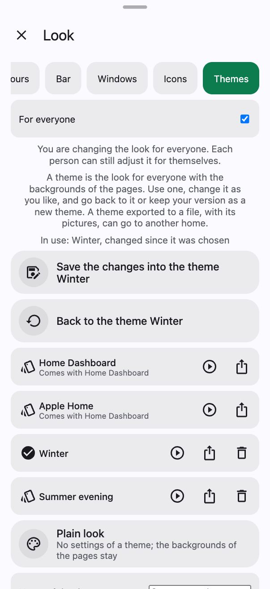 | 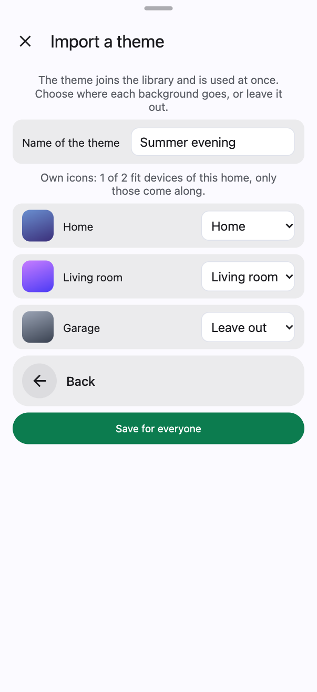 |

How to use it:

1. **Choose a base.** Menu → <b class="ui">Look</b> → <b class="ui">Themes</b> and <b class="ui">Use</b> next to **Home Dashboard** or **Apple Home**.
   You can also start from the current look: type a name, e.g. "Our home", and choose **Keep the current look as a
   theme**.
2. **Adjust.** Change what you like on the <b class="ui">Background</b>, <b class="ui">Buttons</b> and <b class="ui">Icons</b> tabs and press **Save for
   everyone**; the backgrounds of pages change in **Background of this screen**. The theme then shows as **changed
   since it was chosen**.
3. **Save, undo or keep apart.** **Save the changes into the theme …** saves them into the theme in use. **Back to
   the theme …** undoes them. Type a new name and **Keep the current look as a theme**, and the new version stands
   next to the old one; <b class="ui">Use</b> switches between them.
4. **Share.** The export button of a theme (or <b class="ui">Export the current look to a file</b>) saves a file you can send, for
   example to your brother.
5. **Load someone else's theme.** <b class="ui">Import a theme</b>, choose the file, adjust the name, give each background a page of
   yours or choose <b class="ui">Leave out</b>, then <b class="ui">Save for everyone</b>.

Switching themes does not lose your work: a look that is not in the library yet is kept there by itself as
**My look <date>**.

The import shows each background with a thumbnail and a list: <b class="ui">Leave out</b>, <b class="ui">Home</b>, <b class="ui">Scenes</b> or a room. At first
the same page is chosen when it exists, or a room of the same name; the rest waits for a choice. The pictures go to
Home Assistant (as choosing a picture in the background sheet does), and the library keeps only their addresses. Own
icons come along only for devices with the same `entity_id`; the sheet says how many fit.

The file can take a few MB, as the pictures are inside. Pictures from the internet (`https://` addresses) do not come
along, only images from the file and colours.

#### Apple Home step by step

A detailed guide, from installation to making backgrounds and colour palettes, is in a [separate document](apple-home.md).

| Home | Dark mode | Room | Lamp | Energy |
|---|---|---|---|---|
| 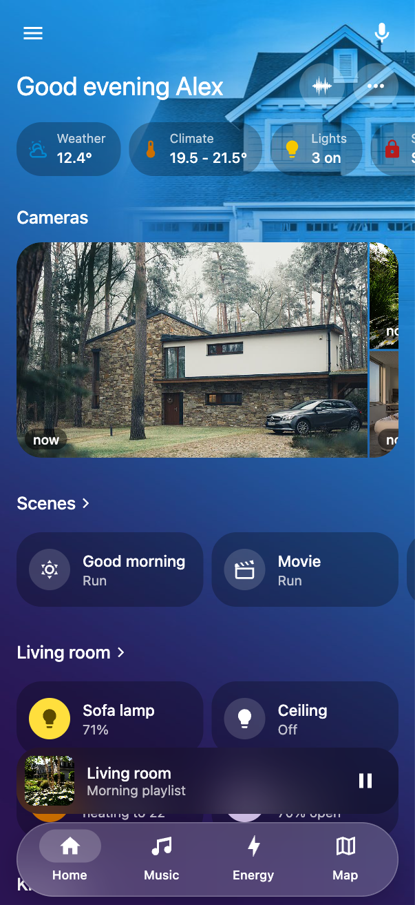 | 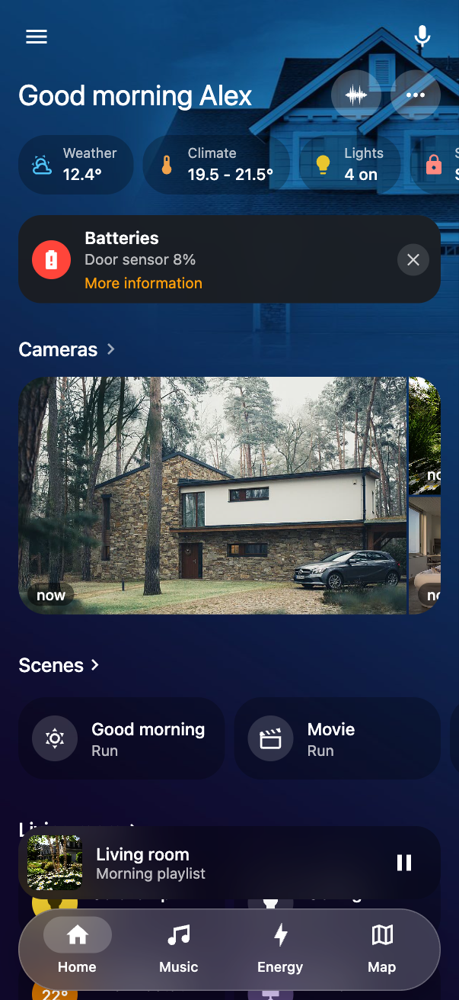 |  |  |  |


1. **Turn the theme on.** Menu → <b class="ui">Look</b>, tick <b class="ui">For everyone</b>, <b class="ui">Themes</b> tab → <b class="ui">Use</b> next to **Apple
   Home**. Buttons, the blocks at the top, the bar and windows turn to glass, writing to white, and pages without a
   background of their own get a blue gradient.
2. **Add backgrounds.** On Home and in every room: three dots → <b class="ui">Background of this screen</b>, a picture for the
   <b class="ui">Light</b> and the <b class="ui">Dark</b> look, **Part of the picture: Top**, <b class="ui">For everyone</b>. An upright picture works best
   (e.g. 1284 × 2778) with the room at the top fading into one colour below; the dark one is the same picture made
   darker. Examples are in `dev/demo-pictures/backgrounds`.
3. **Leave the colour of buttons alone.** In Apple Home they are neutral (black at 26%), so in each room they take the
   colour of its background. The window of a device shows the blurred background of the room it opened from.
4. **Map and Energy** have a background of their own in <b class="ui">Background of this screen</b>; Apple Home gives the Map a
   dark one under the dark map.
5. **Icons.** **Look → Icons**: own icons for devices, e.g. a LED strip icon for a LED strip.
6. **Save.** **Look → Themes → Save the changes into the theme Apple Home**. Export saves the theme with the pictures
   of its backgrounds into a file you can import in another home.

<b class="ui">User access</b> (three dots, administrators): choose a person and hide areas, cameras, lights, media, security,
scenes, scripts, other entities and blocks, and in the <b class="ui">Sections</b> tab whole sections of rooms. The <b class="ui">Chips</b> tab holds the weather, the chips and the shortcuts, and a
hidden shortcut also leaves that person's menu and <b class="ui">My layout</b>. <b class="ui">Everyone but me</b> hides something from all other
accounts at once, such as administrative blocks. It covers the accounts that exist when you save it, so set it
separately for a new user.

<b class="ui">Who sees this</b> (a tile in the editor): Everyone, Only chosen or All except. It applies to the entity
everywhere, your own account included. In the editor an administrator still sees everything: a green tile is
seen only by chosen people, and a red one is hidden from someone.

All of this hides things in the dashboard. It is not a permission: Home Assistant has none for single entities,
so the same person can reach them in another dashboard. Hide those dashboards too if it matters.

## 10. Phones and tablets

- Below 900 px of width the navigation is at the bottom, from 900 px at the side.
- A tablet left alone returns to Home after 3 minutes: `idle: {return_after: 300}` in seconds, `0` turns it off.
- A lock can only be locked on a tablet, because anyone can reach a wall: `security.unlock_on_tablet: true`
  changes it.
- **Dashboard settings → open at start** makes this device start on the dashboard, whatever the account's
  default is.
- After an update close and reopen the Companion app. If the old look stays, use
  **Settings → Companion App → Debugging → Reset frontend cache**.
- If the page zooms with fingers, turn off pinch to zoom in the Companion app's settings.

### The status bar of a tablet

| Status bar | Weather from the status bar |
|---|---|
|  |  |

A tablet on its side can show, in place of the narrow bar, a 320 px column (the width of the menu) with the time, the date, the weather and
what is going on, for a glance from across the room. The pages (Home, Music, Energy, Map) stay in a row at its bottom.

- **Turning it on:** menu → <b class="ui">Look</b> → the <b class="ui">Bar</b> tab → <b class="ui">Status bar</b> → <b class="ui">Show the status bar</b>. Like the whole look:
  for everyone (an administrator) or only for oneself. A phone and a tablet held upright stay as they were.
- **Parts and order:** in the same place, with the arrows; × removes a part, the list adds it back. Also the
  background, text, opacity and blur. By default the bar is glass as the tiles, with white icons; only the icon of a
  warning has a colour. <b class="ui">Coloured icons, lines and charts</b> brings the colours back. A part with nothing to say is left out by itself: <b class="ui">Heads up</b> without warnings,
  <b class="ui">Now</b> when nothing runs, closed doors and windows and no lights in <b class="ui">At home</b>.
- **The button at the top right** folds the column to the usual narrow bar; the tablet remembers it. The folded bar has
  this button on top and the menu and the assistant at the bottom.
- **A tap on a part** opens its window: the weather its window, in <b class="ui">At home</b> the count of lights or devices a list
  of what is on (with its room and the time it went on; a tap opens that device's window), and open doors the Status
  screen (the first Status block; without one, the door's details), the trams the timetable, the power the Energy
  page, and <b class="ui">Heads up</b> and <b class="ui">Now</b> the device's details.
- A light or a device left out of the count, such as a lamp that follows its own schedule, is configuration: in the
  editor on a computer **Status bar → Not counted in At home**
  ([`status_panel.ignore`](configuration.md#11-tablet-status-bar)). The list shows it apart, as **On, but not
  counted**; the tablet has no button that changes it.
- The doors and windows of <b class="ui">At home</b> are the lists **Status bar → Doors (At home)** and <b class="ui">Windows (At home)</b>
  (`status_panel.doors`, `windows`): each has its badge with the open ones of its list, not every sensor of the home
  (the doors of rooms are usually open). A tap lists the open ones with when they opened, as for the lights.
- <b class="ui">Flags (At home)</b> (`status_panel.flags`): a badge while a helper is on, such as **Mail** once someone opened the
  mailbox. A tap opens the helper; whoever took the letters turns it off.
- An item of the Status screen of one entity in a state (an alarm going off, a UPS on battery) with `notify` is also a
  red card on Home, as a low battery is; with `alarm: true` it stays while the state lasts.
- **The battery of the tablet itself:** one thin line at the foot of the bar, above the pages: the level in per cent
  and a thin bar. The icon and the bar are green with a lightning bolt while it is plugged in (charging or full),
  orange at 20% and less, red at 10% and less, otherwise the colour of the text; the number keeps the colour of
  the text, readable on any background. A browser on iOS does not tell a page its battery, so it comes
  from the Home Assistant app on the tablet: in the editor **Settings → Devices** → <b class="ui">Battery</b> of that
  tablet, among the battery sensors of the app (`sensor.<device>_battery_level`). Whether it charges is read from
  the app's battery state sensor of the same device. Without a chosen sensor there is no line.
- <b class="ui">My calendars</b> (a phone): the list of areas has under its rooms <b class="ui">My calendars</b>, with today's titles and how
  many; a tap opens today and the next 14 days that hold something, each event with its hour, place and description.
  The gear chooses the person's own calendars and whether they see the home's, kept in their own settings, so they
  follow them to every device. A tablet signed in as its own user sees the home's calendars.
- **Holding this button** opens the menu: a ring round it fills for half a second. A bubble tells about it the first
  three times. The arrow in the menu goes back to the bar. Under the button is the assistant's microphone.

Parts:

| Part | What it shows | From |
|---|---|---|
| <b class="ui">Weather</b> | temperature, condition, today's low/high, the next rain or snow within 12 h | the weather entity of chapter 4 |
| <b class="ui">Today</b> | today's events of the calendars: all-day ones softly in their calendar's colour at the top, the others with their hour and "in 3 h", "now" with a line while they last; one goes once it is over. At most 3, then "+N more"; a tap opens the calendar (a month on a tablet, the events of the day chosen beside it) | `status_panel.calendars` (Status bar → Calendar in the editor) and the person's own |
| <b class="ui">At home</b> | lights and devices on, doors and windows open | the rooms of the dashboard, `status_panel.doors` |
| <b class="ui">Heads up</b> | the same warnings as the cards on Home | Status items with `notify: true` |
| <b class="ui">Now</b> | what runs or happens (a washer, Sunday mass, a vacuum) | `status_panel.now` |
| <b class="ui">Departures</b> | each line with its minutes (past an hour: the hour it leaves) and three times | the first departures block or `status_panel.departures` |
| <b class="ui">Power</b> | power now and a line of the last 6 hours; an item with <b class="ui">Only while on</b> shows only while its switch is on | `status_panel.power` |

The facts are set in the dashboard's YAML (**Settings → Dashboards → Home Dashboard → ⋮ → Edit dashboard → ⋮ → Raw
configuration editor**, in the `strategy:` block):

```yaml
status_panel:
  doors:                          # only these doors and windows; a child's room does not count
    - binary_sensor.front_door
    - entity: binary_sensor.balcony_contact
      name: Balcony
  now:                            # an item shows while its entity is not resting
    - entity: sensor.mass_next    # "—" = nothing; otherwise the next hour
      name: Mass
      icon: mdi:church
    - entity: sensor.washer_phase
      name: Washer
      icon: mdi:washing-machine
      detail: sensor.washer_programme   # added after the state
      remaining: sensor.washer_left     # on the right
    - vacuum.robot
  power:
    - entity: sensor.server_power
      name: Server
      color: "#76b900"
    - sensor.nuc_power
  departures: null                # null = the first departures block
```

A <b class="ui">Now</b> item rests at `off`, `idle`, `docked`, `standby`, `unavailable`, `unknown`, `—`, `none`, `nie` (in any
case). `resting: [Off, Ready]` gives a list of its own.

## 11. Intercom


With a script that speaks in chosen areas, the dashboard adds buttons to Home, rooms and the camera screen:

```yaml
intercom:
  script: script.announce
  areas_field: areas
  text_field: text
  areas: [living_room, bedroom]
```

The script gets the areas and the text in these fields. Recording a voice message needs HTTPS.

With the <b class="ui">Intercom</b> integration (domain `intercom`) a recording goes straight to it, and it plays it itself:

```yaml
intercom:
  script: intercom.announce     # text
  areas_field: areas
  text_field: message
  played_field: played          # an empty list = no speaker, which the dashboard says
  upload: /api/intercom/message # a recording: a POST of the WAV, the areas in the address (?areas=a,b)
```

With `upload` anyone signed in may record, the account of a tablet on the wall too. Without it a recording goes to
`media_folder`, which only an administrator may upload to.

## 12. The editor on a computer

A step-by-step guide with pictures, from an empty Home Assistant to a finished dashboard, is in
**[The dashboard editor](editor.md)**. This chapter sums it up.

<b class="ui">Dashboard editor</b> in the sidebar of Home Assistant (administrators only) edits the dashboard on a big screen,
with the phone and the tablet side by side. Nothing changes on the devices of the home until you publish. The
integration's option *Show the editor in the sidebar* (Settings → Devices & services → Home Dashboard → Configure)
takes it out of the sidebar; it then opens at `/home-dashboard-editor`. The editor itself has a light and a dark look:
as Home Assistant by default, and a button in the top bar switches Auto, Light and Dark (the browser remembers it). The
preview has its own choice of a light or a dark dashboard.

What is chosen in the tree has a red dashed frame in the preview, so you see which element the form edits: a tile, a
section, a room, the window of a block, or a number, a button, a group or a row in that window. The settings have none.

<b class="ui">Editor settings</b> (the gear in the top bar) list the phones and tablets the preview can show. Each built-in model
(Apple's) can be hidden from the choice, renamed or resized, and set back with the arrow; below each list you add a
device of your own of any make with a name, a width and a height in points (CSS pixels: the resolution of the screen
divided by its pixel ratio, e.g. 1280 × 800 for a Galaxy Tab S9). A phone always stands upright and a tablet on its
side, whatever order the size is typed in. The list is kept in this browser; one model of each kind always stays shown.

**The three columns.** On the left the tree of the dashboard: Home (favourites, scenes), every room with its Home
list, its scenes and its sections, the blocks, and the other settings. *Fold all* and *Unfold all* fold the tree (the groups stay open), the arrow by a group's name folds the group itself,
and the icon on its right folds or unfolds everything inside that group,
the search finds a room, a tile or an entity, and a tile whose entity does not exist is marked. In the middle the
preview, on the right the properties of what is chosen. Drag the bars between the columns to make them wider; a
double click gives the first width back. The button ☰ at the top left opens the menu of Home Assistant.

**The preview** is the real dashboard in frames of an iPhone and an iPad, showing the draft at once, before it is
saved. Choose *iPhone*, *iPad* or *Both*, light or dark, and *As* a person to see their view. The lists of the phone and
the tablet hold every size of an Apple screen once, with the models of that size: from the iPhone SE 1 (320 × 568)
and SE 2–3, 6, 7, 8 (375 × 667) to the iPhone 16 Pro Max and 17 Pro Max (440 × 956), from the iPad 1–6 (1024 × 768)
and iPad mini 6–7 to the iPad Pro 13″ M4+ (1376 × 1032). The browser remembers the choice. Set the **zoom** of
the Home Assistant app of each device (Settings → Companion app → General → Zoom): an iPad Air at 85 % shows the
page as 1388 × 965, and so does the preview. A touch in the preview chooses that tile in the tree; the frames never
switch anything and never call a service. Choosing a room takes the frames there.

**Properties.** Every tile, section and room has a form with every key it takes, the name of the key in YAML beside
each field; the *YAML* tab shows and edits the same as text. Keys a form does not know are kept. A tile of a list
gets *Mark, then run* and names of its options.

**Starting quickly.** Right after the installation the editor offers to create the dashboard and make its rooms
from the areas of Home Assistant: one room for each area, its devices in sections by kind (lights, climate and
blinds, media, devices, safety, automations if you tick them), a few tiles of each on Home. Hidden and technical
entities stay out, and of a device seen from two integrations (Netatmo and HomeKit) only one tile is made. The same
comes later with ✨ beside *Rooms* for areas that have no room yet. What you tick shows in the preview first.

**Building.** *+* beside *Rooms* adds a room; a room gets sections, a section, a room's Home list, the favourites and
the scenes get tiles by their entity, or with *Choose from the list…*: every entity of the home with its area and
battery, filtered by the room, by kind, hiding those already shown; it warns when a blind, thermostat or lock may be
one device from two integrations and suggests settings. What you tick shows in the preview before you add it.
Tiles, sections and rooms are duplicated, moved up and down, removed, or dragged in the tree. **Undo** and **Redo**
(⌘Z, ⇧⌘Z) take back any step.

**Blocks.** A block of several entities opens in the tree into its numbers, buttons and groups with their rows, each
with a form. The options of a list (as the profiles of a coffee machine) are ordered, named and hidden with the eye.
*From the device, not in the block yet* lists the entities of the block's devices its window leaves out: a click
adds one as a row. Choosing a block opens its window in the preview and says whether it fits on the tablet without
scrolling. The other blocks (Status, departures, news, host, school year, add-on, page, TV, scale) have a form with
the same fields as the block form of the tablet: lists (the sections of a Status screen with their entries, a host's
columns, the entities of departures) unfold, move with the arrows and go; what has no field is typed as YAML in the
field itself. A host's column has bars (with their unit, maximum and the yellow and red thresholds), details with a
type to choose, machines inside (name, status, processor, memory) and power (power, plug, voltage, current, energy);
only the graph is a card in YAML. The school year names each sensor, the Rodzinnik one shown greyed when the field is
empty. Departures get a colour per line, and an entry of a Status screen can be an alarm. Own words for states (an
entry of a Status screen, an energy storage) are pairs state → word, an own way to turn a TV or a media tile on or
off is a service and an entity, the patterns of speakers are lines, and the backgrounds of pages have a field per
look. YAML is left only for Home Assistant cards and the library of themes. A block renamed is renamed in its tiles, the menu, the status bar and the rules of access and
visibility too.

**Settings.** The nodes under *Settings* have forms in parts, each showing the key it writes. <b class="ui">Status bar</b> sets the
look of the bar (`appearance.status`: whether it shows, its parts and their order, colours, opacity, blur) and what it
shows (`status_panel`: doors and windows, lights and devices not counted, Now, power, departures). The iPad preview
shows the bar of the draft at once. A part you empty leaves the configuration. <b class="ui">Look and themes</b> has a part for each
group of the look (the whole dashboard, page backgrounds, tiles with colours by kind, writing, the blocks at the top,
round buttons, badges, windows, the map, the player), with the same fields as the Look window of the tablet, and the
themes and page backgrounds. A long form starts folded; a click on a heading unfolds a part. <b class="ui">Menu</b> holds the
groups of the left menu and their entries (block, add-on, address, action, administrators only, who sees it, hidden
in guest mode); choosing it opens the menu in the preview. <b class="ui">Bar of pages</b> holds the places on the bar (2 to 5:
pages, the scenes, the menu or a room) in order and its look. Choosing a block of any kind opens its window in the
preview. <b class="ui">Cameras</b> has three parts: which cameras and in what order, privacy and guest mode (rules with a switch,
the cameras they hide and the people), and single cameras (the live camera of a picture, the same camera in another
integration, talking, round buttons, turning and the entities under the gear of each camera). <b class="ui">Intercom</b> holds the
script of messages, the rooms to tick and the fields of the call, and <b class="ui">Energy</b> the phases of the meter, the range
of the voltage and the energy storage. **People access** starts with a person, then what they do not see, in the same
groups as the tablet's window (cameras, rooms, sections, the blocks at the top, lights, media, security, scenes and
scripts, the rest), with an eye by each. Below are the rules of visibility: an entity, `block:<name>` or
`shortcut:<name>` and the people who see it (*only*) or do not (*except*). The other nodes are **Rooms: order and
hidden**, **Entities** (added to a room, never shown by themselves, an entity's own name, icon, area or card),
<b class="ui">Lights</b> (a group for its lamps), <b class="ui">Home page and tablet</b> (weather, security, a tablet left alone going back, the
layout of the scenes) and the <b class="ui">Music</b>, <b class="ui">Media</b> and <b class="ui">Map</b> pages. So every setting of the dashboard has a form;
the YAML tab stays beside it for what you would rather type.

**Publishing.** The draft is saved on the server a moment after each change, so it waits for you on another computer
too; *Throw away* drops it. *Publish* shows what changes in plain words and in YAML, the entities that are missing,
and a field for a note. Then either:

- <b class="ui">Publish for checking</b> to one person: their dashboard shows this version, with a banner *A version to check*
  and a button back to the usual one; nobody else sees it. The top of the editor says who checks it; *End* stops it.
- **Publish for everyone**: the dashboard of every device loads the new version, and the version it replaces goes to
  the <b class="ui">History</b>. If the dashboard was changed elsewhere since the draft began (on a phone), the editor says so
  instead of replacing that change; *Publish anyway* does.

<b class="ui">History</b> keeps the last 30 published versions with who published them and the note. Choose one to see how it
differs from the version now; *Take back as a draft* makes it the draft, to look at and publish like any other.

## 13. When something is wrong

| Symptom | Look at |
|---|---|
| A device is missing | Its area, whether it is hidden, and whether its domain is shown by default. |
| A light is missing | It may be a member of a light group. |
| A camera is missing | Its area, and the rules in [Cameras](#5-cameras). |
| A room is missing | The area needs at least one thing to show. |
| I cannot edit | Editing needs an administrator account. |
| A new device does not appear in a room | The room is in `layout`: add it with <b class="ui">Add a tile</b>. |
| Talking through the camera does nothing, the microphone is crossed out | Talking needs HTTPS: open Home Assistant over `https://` (in the app: Settings → Companion app → Servers → internal URL), then start the live view. |
| A tablet no longer shows its variant | Signing in again keeps the device; clearing the app's data (or reinstalling it) makes it a new one: in the editor, *Variants* → *Who sees it*, choose the variant for it again (it appears once it has opened the dashboard), and *Forget* the old one under *Devices*. |
| After a restart of Home Assistant today's events are missing from the status bar | Fixed: the dashboard reads them again once Home Assistant is back, and every 15 s while a calendar is still starting. If they stay missing, check that the calendar works in Home Assistant (Calendar in the sidebar). |
| The editor shows `not a valid option at 'shared'` (or another field) | The dashboard was updated but Home Assistant still runs the old code, which does not know that field. Restart Home Assistant, then reload the editor. |
| After a restart of Home Assistant the status bar on the left of a tablet covers the page, whose right part is cut off or under the bar | The app loaded the page in the background (screen dark or another size) and iOS did not tell the dashboard the shape of the screen changed: the bar was drawn for a tablet on its side, the page beside it for a narrower screen. Since 1.3.0 the dashboard checks it again at every resize, turn and return of the screen and puts the room of the page right by itself (and hides the menu of Home Assistant again when it comes back); it writes a warning `Layout of a page put right` to the log of Home Assistant with what it saw. On an older version load the app afresh. |

The [FAQ in the README](../README.md#faq) has more, with exact messages.
