# Przewodnik po Home Dashboard

Od świeżej instalacji do gotowego dashboardu. Nie potrzeba żadnych skryptów: wszystko robisz w ustawieniach
Home Assistant, w samym dashboardzie albo w jego edytorze YAML.

[English](guide.md) · [README](../README.pl.md) · [Opis konfiguracji](configuration.pl.md)

| Strona główna | Pokój | Menu | Wybór obszaru |
|---|---|---|---|
| 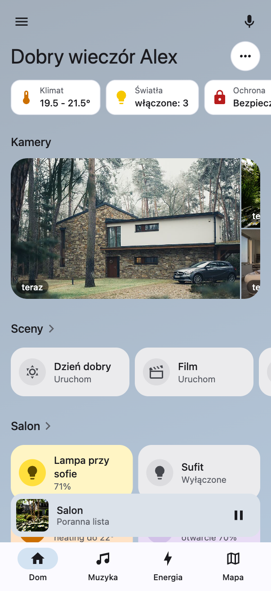 | 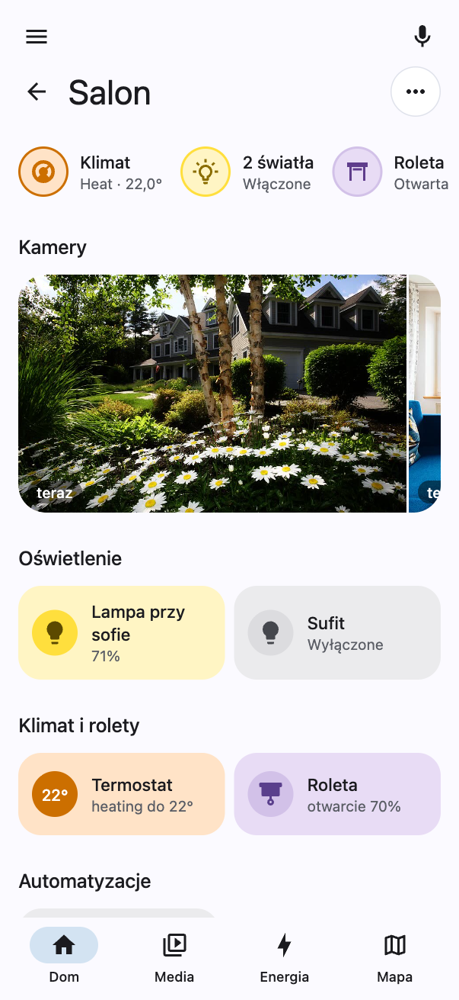 | 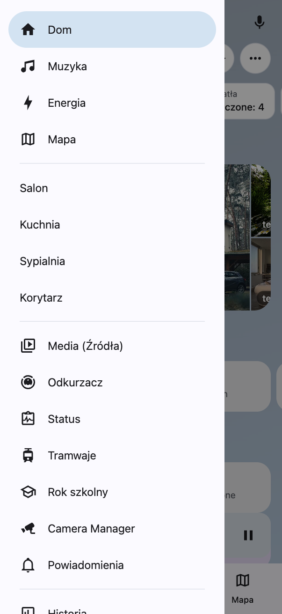 | 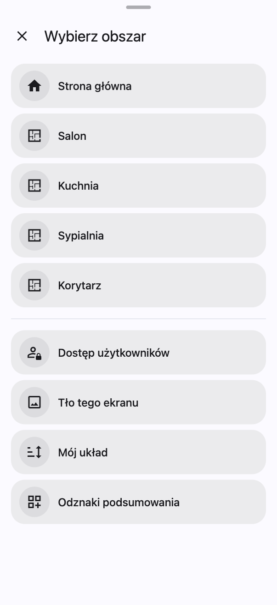 |

## 1. Instalacja

Potrzebujesz Home Assistant 2026.10 lub nowszego. Na telefonie i tablecie użyj aplikacji Companion.

1. W HACS (od Home Assistant 2026.11 to Marketplace) otwórz trzy kropki → **Niestandardowe repozytoria**, dodaj
   `https://github.com/witold-gren/home-assistant-dashboard` jako **Integrację**, pobierz **Home Dashboard**
   i uruchom ponownie Home Assistant. Bez HACS skopiuj `custom_components/home_dashboard` do folderu
   `custom_components` w konfiguracji i uruchom ponownie.
2. Wejdź w **Ustawienia → Urządzenia oraz usługi → Dodaj integrację** i dodaj **Home Dashboard**.
3. Wejdź w **Ustawienia → Dashboardy → Dodaj dashboard → Nowy dashboard od zera** i nadaj mu nazwę.
4. Otwórz go, wybierz <b class="ui">Edytuj</b>, potem trzy kropki → **Edytor konfiguracji**, zastąp wszystko poniższymi
   wierszami i zapisz:

```yaml
strategy:
  type: custom:home-dashboard
```

Dashboard pojawi się od razu, zbudowany z Twoich obszarów. Ukrywa on nagłówek Home Assistant, więc od teraz
konfiguracja jest w **Menu → Ustawienia dashboardu → Edytuj konfigurację**.

**Kolory:** Ustawienia → Urządzenia oraz usługi → Home Dashboard → **Konfiguruj** daje wybór: automatyczny,
jasny lub ciemny.

## 2. Co decyduje w Home Assistant

Dashboard nie ma własnej listy urządzeń. Większość tego, co pokazuje, wynika z poniższych ustawień, więc gdy
czegoś brakuje, zacznij od nich.

| W Home Assistant | Wpływ na dashboard |
|---|---|
| <b class="ui">Obszary</b> (Ustawienia → Obszary) | Każdy obszar, który ma coś do pokazania, staje się pokojem o tej nazwie. Encja bez obszaru się nie pokazuje. |
| **Obszar urządzenia** | Encje dziedziczą go po urządzeniu. Encja może mieć własny obszar i wtedy to on się liczy. |
| **Nazwa encji** | Nazwa kafelka. Nazwa obszaru jest z niej usuwana, więc „Kuchnia Lampa” w Kuchni to „Lampa”. |
| **Encje ukryte, konfiguracyjne i diagnostyczne** | Same się nie pokazują. |
| **Grupy świateł** | Grupa zastępuje swoje lampy, więc jeden kafelek steruje wszystkimi. `lights.prefer_groups: false` pokazuje każdą lampę. |
| **Użytkownicy** | Administratorzy mogą edytować. Pozostali tylko korzystają i układają dashboard dla siebie. |
| **Osoby i strefy** | Strona Mapa pokazuje osoby i ich odległość od domu. |
| **Panel energii** (Ustawienia → Dashboardy → Energia) | Decyduje, co pokazuje strona Energia. |
| **Język użytkownika** | Język interfejsu. W zestawie są angielski i polski. |

Domyślnie kafelki dostają tylko światła, klimat, rolety i zamki. Resztę dodajesz sam, patrz [Pokoje](#3-pokoje).

## 3. Pokoje

### Dodanie pokoju

Utwórz obszar w Home Assistant i przypisz do niego urządzenia. Pokój pojawi się sam.

### Wybór tego, co pokazuje pokój

Otwórz pokój, potem trzy kropki → <b class="ui">Edytuj ten ekran</b>.

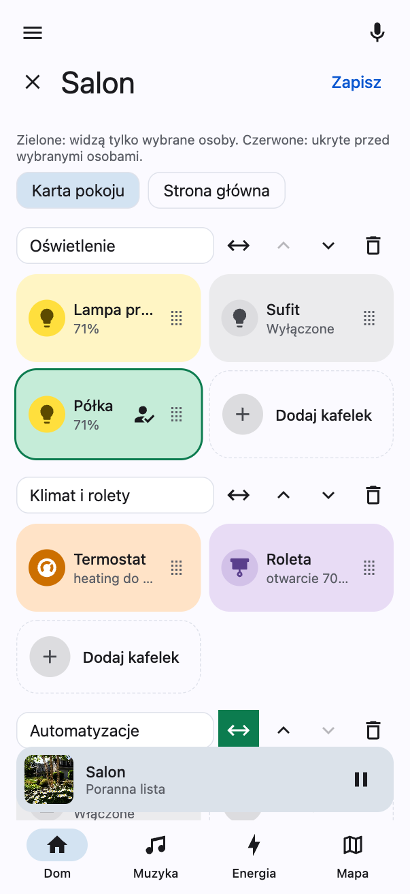

- <b class="ui">Karta pokoju</b> ustawia sekcje na stronie pokoju. <b class="ui">Strona główna</b> ustawia kafelki tego pokoju na stronie głównej.
- <b class="ui">Dodaj kafelek</b> przeszukuje cały Home Assistant, więc dodasz też przełącznik, czujnik, scenę czy automatyzację.
- Kafelek przeciągasz za uchwyt, także do innej sekcji. Dotknięcie kafelka pozwala zmienić nazwę, usunąć go
  albo wybrać, kto go widzi.
- Sekcja ma nazwę, strzałki do przesuwania i przycisk ze strzałkami, który układa ją w jeden rząd przewijany
  w bok. Pasuje to do scen i automatyzacji.
- Nic nie trafia na serwer przed <b class="ui">Zapisz</b>.

Pierwsza edycja zapisuje pokój w `layout`. Od tej chwili pokój pokazuje to, co jest na liście, a nowe urządzenie
w obszarze trzeba dodać ręcznie.

### Pokoje z kilku obszarów i ich kolejność

Menu → Ustawienia dashboardu → <b class="ui">Edytuj konfigurację</b> otwiera całą konfigurację jako YAML:

```yaml
layout:
  - id: kitchen
    name: Kuchnia i jadalnia
    areas: [kitchen, dining_room]
    home:
      - {entity: light.kitchen, name: Główne}
    sections:
      - title: Oświetlenie
        tiles:
          - {entity: light.kitchen, name: Główne}
```

Pokoje idą w kolejności `layout`, a obszary spoza niego po nich. `rooms.order` i `rooms.hidden` zmieniają
kolejność i ukrywają pokój bez jego opisywania.

### Opcje kafelka

| Opcja | Co robi |
|---|---|
| `name`, `icon` | Własna nazwa i ikona. |
| `tap_toggle: true` | Jedno dotknięcie całego kafelka przełącza. Dobre dla automatyzacji, które inaczej otwierają okno. |
| `calm: true` | Bez koloru, gdy włączone, i przygaszone, gdy wyłączone. Dla rzeczy prawie zawsze włączonych. |
| `action: script.x` | Uruchamia skrypt zamiast przełączać. |
| `active_only: true` | Widoczne tylko, gdy urządzenie gra. |
| `turn_on_only: true` | Można tylko włączyć. Z `off_pin: {service: script.x, field: pin}` wyłącza klawiatura, a PIN sprawdza skrypt. |

## 4. Strona główna

Od góry: powitanie, pogoda, chipy, Twoje skróty, kamery, sceny, ulubione i pokoje.

- **Chipy** liczą to, co włączone, i filtrują stronę: klimat, światła, ochrona i media.
- <b class="ui">Pokoje</b> pokazują kafelki z zakładki Strona główna każdego pokoju. Ustaw tam krótką listę, a resztę zostaw
  na stronie pokoju.
- <b class="ui">Ulubione</b> są nad pokojami: `favorites: [climate.living_room, lock.front_door]` albo Mój układ → Ulubione → <b class="ui">Dla wszystkich</b>.
- **Skróty** są w rzędzie chipów, patrz [Skróty i bloki](#7-skróty-i-bloki).

### Sekcje obok siebie {#sections-side-by-side}

Strona główna i strony pokoi mogą układać swoje części w sekcje obok siebie zamiast jedna pod drugą: nagłówki na tle,
a sekcje w tylu kolumnach, ile się zmieści. Tablet poziomo ma dwie, także z otwartym paskiem stanu przy powiększeniu
85 % w aplikacji; telefon ma jedną. Sekcje zachowują kolejność, każda trafia do kolumny, która jest na razie
najkrótsza.

- U góry, zamiast powitania (na stronie pokoju zamiast strzałki i nazwy), zakładki strony głównej i pokoi prowadzą
  do każdej strony; plakietki, ostrzeżenia i przyciski po prawej zostają.
- Sekcja dłuższa niż cztery rzędy przewija się w środku. Jej nagłówek mówi wtedy, ile ma kafelków, a jej dół zanika,
  dopóki niżej jest coś jeszcze.
- Kamery są po dwie; więcej przesuwa się w bok, parami.
- Nagłówek ze strzałką otwiera swoją stronę: <b class="ui">Kamery</b> wszystkie kamery, pokój jego stronę, <b class="ui">Sceny</b> stronę scen.
- Na tle włączony kafelek jest biały, z kolorem w kółku; wyłączony zachowuje wygląd.
- Menu boczne, pasek stanu tabletu i pasek stron zostają bez zmian. Strona w oknie i pokój w trakcie edycji mają
  układ klasyczny.

Wybierz go w Menu → <b class="ui">Ustawienia dashboardu</b> → <b class="ui">Układ stron</b>: <b class="ui">Wszystkie strony</b>, osobno <b class="ui">Strona główna</b> oraz
<b class="ui">Rzędy sekcji, zanim zacznie się przewijać</b> (także wszystkie, bez przewijania). Pokój dostaje własny układ w swojej edycji: trzy kropki →
<b class="ui">Edytuj ten ekran</b> → <b class="ui">Układ tej strony</b>. W edytorze na komputerze to samo jest w *Ustawienia → Strona główna i
tablet → Układ stron*, a pokój ma pole *Układ strony*. Domyślnie zostaje układ klasyczny. Klucze:
[`page_layout`](configuration.pl.md#page_layout).

### Warianty strony {#variants-of-a-page}

Strona główna i każdy pokój mogą mieć warianty: inne wersje strony, każda z własnym układem i tłem, dla jednego
urządzenia (np. tabletu w korytarzu) albo jednej osoby, podczas gdy reszta domu widzi obowiązującą stronę. Powstają w
edytorze na komputerze ([Warianty stron](editor.pl.md#page-variants)). Na stronie, która je ma, administrator znajdzie
trzy kropki → <b class="ui">Wariant tej strony</b>: <b class="ui">Pokaż na tym urządzeniu</b>, <b class="ui">Tylko zerknij</b> (pasek *Oglądasz: …* z
<b class="ui">Wróć</b>) i <b class="ui">Wdróż dla wszystkich…</b>, które zostawia zastąpioną stronę jako wariant. Wariant udostępniony
domownikom może tam wybrać każdy: <b class="ui">Wybierz dla siebie</b> działa na wszystkich jego urządzeniach.

Kto nie ma ustawień dashboardu (są dla administratorów), ma w menu bocznym <b class="ui">Wczytaj aplikację od nowa</b>: pobiera
najnowsze pliki i otwiera stronę od nowa.

### Pogoda

Pierwszy chip pokazuje temperaturę i otwiera ekran z bieżącymi odczytami oraz prognozą na najbliższe godziny
i dni. Pojawia się sam, gdy Home Assistant ma encję `weather`. Jeśli jej nie ma, dodaj usługę, np. **Met.no**, w
**Ustawienia → Urządzenia oraz usługi**.

Domyślnie chip używa pierwszej encji pogody, a prognoza pochodzi z pierwszej, która ją ma. Stacja domowa zwykle
nie ma prognozy, więc mogą to być dwie różne encje. Brakujące odczyty, np. wiatr, też pochodzą z encji prognozy.

```yaml
weather:
  entity: weather.home_station
  forecast: weather.forecast_home
```

`weather: false` usuwa chip. <b class="ui">Dostęp użytkowników</b> ukrywa go przed jedną osobą, w zakładce <b class="ui">Plakietki</b>.

Na tablecie w poziomie pogoda zajmuje cały ekran. Z lewej jest bieżąca temperatura z dzisiejszym maksimum i
minimum, wschód i zachód słońca (z `sun.sun`) oraz odczyty. Z prawej najbliższe 24 godziny jako wykres temperatury,
a pod nim opady każdej godziny w mm: niebieskie to deszcz, białe śnieg, fioletowe deszcz ze śniegiem, z sumą na
dobę. Pod spodem najbliższe dni jako kolumny ze wspólną skalą temperatury i sumą opadów. Prognoza podaje ilość
opadów, ale nie ich prawdopodobieństwo. Telefon i tablet w pionie zostają przy układzie listy.

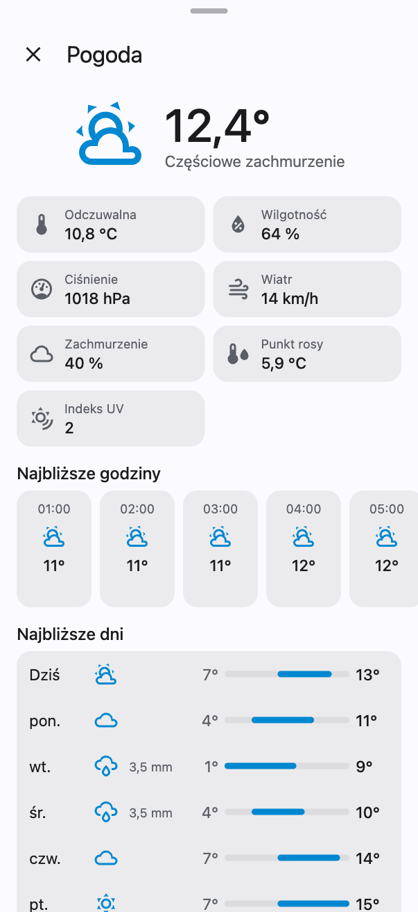

## 5. Kamery

### Które kamery się pokazują

Pasek celowo nie pokazuje każdej kamery: miniatura pobrana z kamery na baterię budzi ją i rozładowuje. Pokazuje:

- **Zapisane obrazy:** encje `image.*` kończące się na `_last_screen` lub `_last_snapshot`.
- **Kamery z bezpiecznych platform:** `camera.*` z `cameras.snapshot_platforms`, domyślnie `frigate`.

Kamera musi też mieć obszar. Inną platformę, która trzyma własną klatkę, dodasz tak:

```yaml
cameras:
  snapshot_platforms: [frigate, generic]
  battery_platforms: [my_platform]   # tylko kamery, które nie zgłaszają baterii
```

Kamera na baterię nigdy się nie pokaże, nawet gdy jej platforma jest na liście. Kamerę na baterię dashboard
rozpoznaje sam: jej urządzenie w Home Assistant ma czujnik poziomu baterii (`device_class: battery`). Działa to dla
każdej marki. `battery_platforms` jest potrzebne tylko dla kamer, które baterii nie zgłaszają.

### Kolejność i ukrywanie

| Cel | Jak |
|---|---|
| Własna kolejność albo ukrycie dla siebie | Trzy kropki → <b class="ui">Mój układ</b> |
| Ta sama kolejność dla wszystkich | `cameras.order: [camera.a, camera.b]` |
| Ukrycie przed wszystkimi | `cameras.hide: [image.garage_last_screen]` |
| Ukrycie przed jedną osobą | Trzy kropki → <b class="ui">Dostęp użytkowników</b> |
| Dokładnie ta lista i nic więcej | `cameras.hero` i `cameras.tiles` |

W pasku duży obraz przeplata się z dwoma mniejszymi. Kamera, która przestała działać, zostaje widoczna w małym
okienku, rozmyta i oznaczona jako niedostępna; dotknięcie otwiera jej okno z nazwą, więc widać, która przestała
działać. Chip Ochrona pokazuje wszystkie kamery jedna pod drugą.

### Syrena, światło, noktowizja i pozycje

Jeśli urządzenie kamery je ma, okno kamery dostaje okrągłe przyciski. Pionowo stoją w rzędzie nad linią czasu, od
prawej; na telefonie trzymanym poziomo w kolumnie w lewym dolnym rogu, od dołu (syrena najniżej, nad nią światło,
noktowizja i pozycje).

- <b class="ui">Syrena</b>: najpierw pyta „Włączyć syrenę?”, po włączeniu świeci na czerwono, a dotknięcie wyłącza.
- <b class="ui">Światło</b>: włącza i wyłącza, włączone świeci na żółto.
- <b class="ui">Noktowizja</b>: lista trybów, np. Wyłączona (dzień), Podczerwień, Pełny kolor (doświetlanie).
- <b class="ui">Pozycje</b> (przy włączonym sterowaniu na żywo): lista zapisanych pozycji kamery.

**Jak są rozpoznawane.** Dashboard szuka ich wśród encji urządzenia kamery, a dla kamery z rejestratora powiązanej z tą
samą kamerą w innej integracji wśród encji tamtej kamery. Bierze pod uwagę to, co nie zależy od języka ani od nazwy
w Home Assistant:

| Przycisk | Encja, którą znajduje automatycznie | Co robi dotknięcie |
|---|---|---|
| Syrena | pierwsza encja domeny `siren` | po potwierdzeniu `siren.turn_on`, ponownie `siren.turn_off` |
| Światło | encja `light`, a bez niej przełącznik `switch`, którego id kończy się na `_light`, `_spotlight`, `_floodlight` albo `_lamp` | włącza i wyłącza |
| Noktowizja | lista `select` z `night_vision` w id, a bez niej lista, która ma opcję podczerwieni (`Infrared`) | otwiera listę opcji tej encji |
| Pozycje | lista pozycji i przycisk przejścia ze **sterowania** kamery | przejście do wybranej pozycji |

Ukryte i niedostępne encje są pomijane. Przełącznik ustawienia, np. `…_spotlight_enabled`, nie jest brany za światło.

**Inne kamery i własne encje.** W **Ustawienia dashboardu → Sterowanie i mówienie każdej kamery** rozwiń kamerę: pola
<b class="ui">Przycisk syreny</b>, <b class="ui">Przycisk światła</b> i <b class="ui">Przycisk noktowizji</b> mają do wyboru <b class="ui">Automatycznie</b> (obok widać, co
znaleziono), <b class="ui">Brak</b> albo dowolną encję. Tak podepniesz przyciski do kamery każdej integracji, także do urządzeń,
które nie są częścią kamery, np. lampy w ogrodzie albo syreny alarmu:

| Przycisk | Encje do wyboru |
|---|---|
| Syrena | `siren`, `switch`, `input_boolean`, `script` |
| Światło | `light`, `switch`, `input_boolean` |
| Noktowizja | `select`, `input_select` |

To samo w konfiguracji (`cameras.quick`, klucz to kamera z dashboardu):

```yaml
cameras:
  quick:
    camera.garden:
      siren: switch.garden_alarm
      light: light.garden_floodlight
      night: none                 # bez przycisku noktowizji
```

Przyciski działają zawsze, także bez podglądu na żywo; tylko pozycje wymagają podglądu, jak strzałki sterowania.

### Wszystkie kamery

| Wszystkie kamery na tablecie | Jedna duża kamera |
|---|---|
| 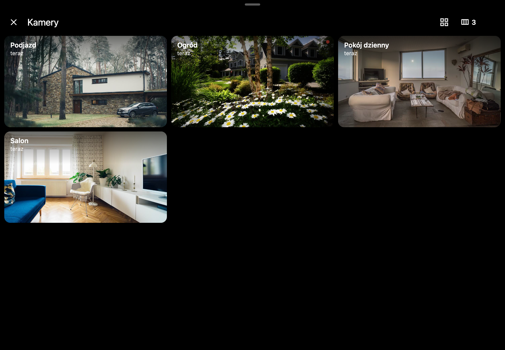 | 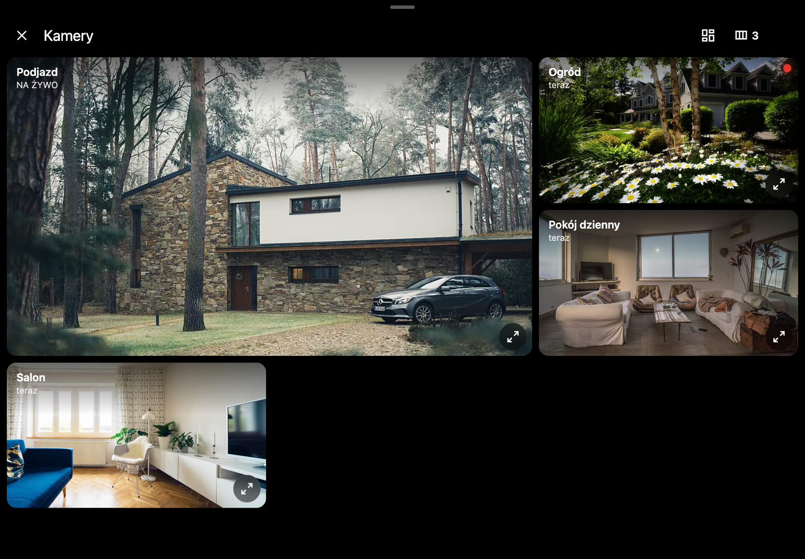 |

Dotknięcie nagłówka **Kamery ›** na stronie głównej albo w pokoju otwiera wszystkie kamery jedna pod drugą, duże, z
nazwą i wiekiem obrazka. Kolejność i ukrycia są te same co na stronie. Dotknięcie kamery otwiera jej okno, a strzałka
w lewym górnym rogu wraca do listy.

Na tablecie kamery wypełniają cały ekran na czarnym tle, po trzy w rzędzie. Przycisk z liczbą w nagłówku przełącza
2, 3, 4 i 5 w rzędzie na tym urządzeniu. Drugi przycisk w nagłówku przełącza na jedną dużą kamerę i resztę małych
wokół niej: duża sama uruchamia podgląd na żywo, dotknięcie małej przenosi ją na miejsce dużej i rozłącza poprzednią,
a przycisk w rogu każdej kamery otwiera jej okno. Kamera na baterię jako duża zatrzymuje się po dwóch minutach, a
dotknięcie uruchamia ją znowu. **Ustawienia dashboardu → Układ wszystkich kamer na tablecie**
(`cameras.layout: featured`) wybiera to dla każdego tabletu. **Ustawienia dashboardu → Kolumny wszystkich kamer na tablecie**
(`cameras.columns: 4`) ustawia to dla każdego tabletu, który nie wybrał własnej liczby.

Na tablecie w poziomie (ekran dotykowy) okno kamery zajmuje cały ekran, jak na telefonie w poziomie: obraz na całą
szerokość, nagłówek w pasie nad nim, wszystkie przyciski na obrazie, a pierścień obracania w połowie jego wysokości.
Przycisk kamery w nagłówku wysuwa z dołu pozostałe kamery, a przeciągnięcie w dół je chowa.

### Ostrzeżenia na stronie głównej

Ostrzeżenia to elementy ekranu <b class="ui">Status</b>. Element z włączonym `notify` pokazuje się dodatkowo jako karta na stronie
głównej, pod chipami, dopóki ma coś do zgłoszenia. Karta podaje nazwę elementu i krótką listę tego, czego dotyczy,
np. „Salon Termostat Bateria 25 %”. Przy jednym urządzeniu <b class="ui">Więcej informacji</b> otwiera jego szczegóły. Te same
ostrzeżenia są zawsze na ekranie Status, więc da się do nich wrócić po zamknięciu karty.

**Zamykanie i wyciszanie**

| Co | Działanie |
|---|---|
| Krzyżyk na karcie | chowa ją do końca dnia; wraca od razu, gdy na liście pojawi się nowe urządzenie, i następnego dnia, jeśli problem trwa |
| Ustawienia dashboardu → Ostrzeżenia na stronie głównej → <b class="ui">Wycisz na tydzień</b> | chowa wszystkie karty na 7 dni na Twoim koncie, na każdym urządzeniu; potem wracają same, a <b class="ui">Pokaż znowu</b> przywraca je wcześniej |

Zamknięcie zapamiętuje dane urządzenie (w przeglądarce, do końca dnia), a wyciszenie jest zapisane w danych
użytkownika w Home Assistant.

**Budowa konfiguracji**

Ekran Status to skrót `kind: overview`. Ma listę sekcji (`sections`), a każda sekcja listę elementów (`items`). Element
mówi, czego szukać i kiedy coś zgłosić:

| Pole | Znaczenie |
|---|---|
| `name`, `icon` | tytuł karty i jej ikona |
| `notify: true` | pokazuj też jako kartę na stronie głównej |
| `below` | zgłoś wartości poniżej tej liczby (np. 20 dla baterii w %, 80 dla zasięgu w km) |
| `entities` | wybrane encje, np. `sensor.volvo_xc90_distance_to_empty_tank` |
| `auto: battery` | zamiast listy encji: każdy poziom baterii w %, bez zużycia baterii (`…_health`) i bez urządzeń niedostępnych |
| `platforms` | przy `auto: battery`: tylko encje tych integracji, np. `[zha]`, `[netatmo]`, `[eufy_sdk, neolink]` |
| `device_has` | przy `auto: battery`: tylko urządzenia, które mają też encję tej domeny, np. `camera` (kamery, bez czujników tej samej integracji) |

Przykład, sekcja „Wymaga uwagi” z ostrzeżeniami:

```yaml
shortcuts:
  - kind: overview
    name: Status
    icon: mdi:clipboard-pulse-outline
    sections:
      - title: Wymaga uwagi
        alert: true
        items:
          - name: Mało paliwa
            icon: mdi:gas-station
            entities: [{ entity: sensor.volvo_xc90_distance_to_empty_tank, name: Volvo XC90 }]
            below: 80
            notify: true
          - name: Kamery na baterię
            icon: mdi:battery-alert-variant-outline
            auto: battery
            platforms: [eufy_sdk, neolink]
            device_has: camera
            below: 20
            notify: true
          - name: "Zigbee: słaba bateria"
            icon: mdi:battery-alert
            auto: battery
            platforms: [zha]
            below: 10
            notify: true
```

**Gdzie to edytować**

1. **W aplikacji, bez YAML (zalecane).** Na stronie głównej trzy kropki → <b class="ui">Odznaki podsumowania</b> → przy bloku
   <b class="ui">Status</b> ołówek. Rozwiń sekcję i element. <b class="ui">Pokazuj, gdy</b> → „bateria jest słaba” daje pola <b class="ui">Poniżej</b>, **Tylko te integracje**
   (po przecinku, np. `zha, netatmo`) i **Tylko urządzenia, które mają też** (np. `camera`). Każdy element ma
   przełącznik <b class="ui">Pokazuj też jako ostrzeżenie na stronie głównej</b>. <b class="ui">Zapisz</b> zapisuje od razu.
2. **Cała konfiguracja jako YAML.** Menu → <b class="ui">Ustawienia dashboardu</b> → <b class="ui">Edytuj konfigurację</b>. Status jest na liście
   `shortcuts`, jak w przykładzie powyżej.
3. **Nazwę integracji** do pola `platforms` widać w Home Assistant: Ustawienia → Urządzenia i usługi → Encje, kolumna
   „Integracja” (np. `zha`, `netatmo`, `sonoff`, `eufy_sdk`, `neolink`).

### Otwarte połączenia kamer na baterię

| Połączenia kamery | Okno kamery na tablecie |
|---|---|
| 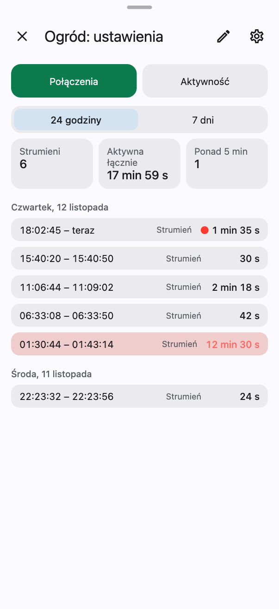 | 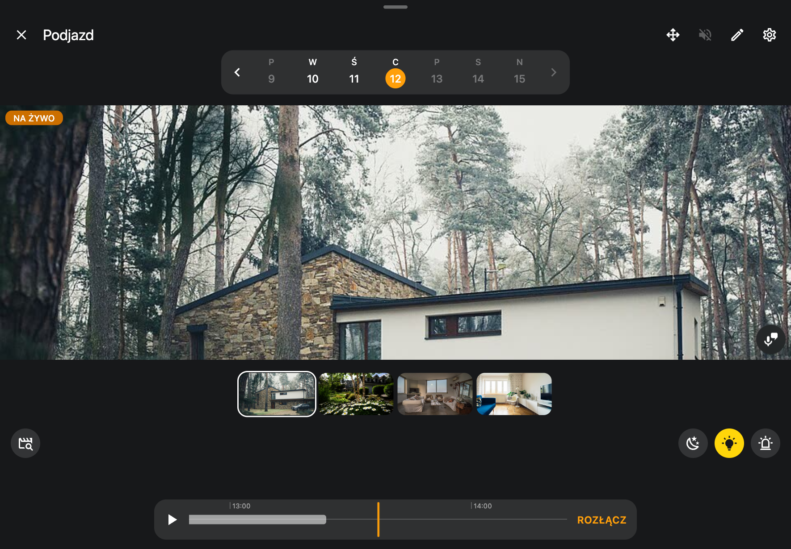 |

**Bateria.** Okno kamery, której urządzenie ma czujnik baterii, pokazuje w prawym górnym rogu obrazu procent baterii;
do 20 % plakietka jest czerwona. Na stronach i we wszystkich kamerach jej nie ma, żeby nie zasłaniać obrazów. Obraz
(`image.*`) bierze baterię kamery, która gra go na żywo (`cameras.live`), albo tej samej kamery z innej integracji
(`cameras.controls`).

Czerwona, migająca kropka w prawym górnym rogu obrazu (na stronie głównej, we wszystkich kamerach i w oknie kamery)
mówi, że strumień tej kamery jest teraz otwarty: z dashboardu, innego okna Home Assistant albo czegokolwiek, co pyta
most. Kamera jest wtedy wybudzona i zużywa baterię. Dashboard bierze to z czujników urządzenia kamery: eufy
`binary_sensor.*_streaming`, Neolink `*_camera_link` i `*_recording_live_view`. W oknie kamery z baterią kropka stoi
w plakietce baterii.

W ustawieniach kamery (trybik) zakładka <b class="ui">Połączenia</b> pokazuje z historii Home Assistant ostatnie 24 godziny albo 7 dni:
liczbę wybudzeń (strumieni), łączny czas i ile trwało ponad 5 minut, a pod tym każde połączenie z godziną początku,
końca i długością. Połączenia dłuższe niż 5 minut są czerwone; trwające ma kropkę i napis „teraz”.

### Nagrania na dysku

Przycisk z filmem pozwala znaleźć nagrania z linii czasu bez przewijania jej: w pionie stoi z lewej nad linią czasu, w
poziomie obok przycisku linii. Pokazuje nagrania według dni, najnowsze u góry (dla Frigate jego wykrycia z
obrazkami), a kolejne dni doczytuje, gdy lista dojdzie do końca. Dotknięcie wraca do kamery w miejscu tego nagrania:
wybiera jego dzień, przesuwa linię czasu i odtwarza je. Pliki nagrań z dysku (eufy, Neolink) nie mają własnych obrazków,
więc dashboard bierze kadr z pierwszej sekundy pliku (dwa pliki naraz) i zapamiętuje go na tym urządzeniu: przy
następnym otwarciu miniatury są od razu.

### Nagrania z karty kamery

Kamera, która trzyma nagrania na własnej karcie i to zgłasza (atrybut `sd_recordings` z poleceniami `list` i
`download`, np. integracja Neolink), ma w oknie przycisk karty. Otwiera on nagrania według dni, najnowsze u góry, z
małym obrazkiem każdego. Obrazki są pobierane tylko dla widocznych nagrań, bo każdy budzi kamerę. Lista zapamiętana
przez integrację pokazuje się od razu, a sama karta jest sprawdzana w tle. Przycisk pobierania ściąga nagranie do
folderu linii czasu, a zielony znacznik nagrania, które już tam jest, otwiera linię czasu w jego miejscu. Przycisk przy
dniu pobiera wszystkie nagrania z tego dnia, których jeszcze nie ma na dysku, od najstarszego, a gdy są już wszystkie,
pokazuje podwójny znacznik. Z karty nic nie jest kasowane.

### Podgląd na żywo

Dotknięcie obrazu otwiera go bez strumienia. <b class="ui">NA ŻYWO</b> na dole uruchamia strumień z kamery tego samego urządzenia
albo z `cameras.live: {image.door_last_screen: camera.door}`. To samo robi duży przycisk odtwarzania na środku obrazu,
widoczny, dopóki podgląd nie działa (znika przy przybliżonym obrazie). Dopóki kamera się budzi, okno pokazuje jej ostatni
obrazek z kółkiem ładowania na środku, a plakietka NA ŻYWO jest szara. Podgląd zastępuje obrazek dopiero wtedy, gdy
wideo naprawdę ruszy, a plakietka nabiera koloru. Głośnik i sterowanie kamerą są przygaszone, dopóki nic nie gra
(sterowanie działa tylko na żywo). Napis o kamerze na baterię zostaje w pionie cały czas, a przy nagraniu jest
przygaszony, więc okno nie skacze.

<b class="ui">NA ŻYWO</b> na linii czasu jest szare, po dotknięciu od razu pomarańczowe, a gdy wideo ruszy, zmienia się w pomarańczowe
<b class="ui">ROZŁĄCZ</b>. Dotknięcie ROZŁĄCZ kończy podgląd bez zamykania okna, więc możesz od razu przeglądać nagrania. Przesunięcie
linii czasu też od razu rozłącza kamerę. Kamera niedostępna w Home Assistant zostaje w oknie z ostatnim obrazkiem,
przygaszonym, z napisem <b class="ui">Kamera jest niedostępna</b> i bez NA ŻYWO; napis znika sam, gdy kamera wróci. Obrazek, który
się nie wczytał, okno próbuje pobrać co 5 sekund.

**Powiększanie:** rozsuń dwa palce na obrazie, żeby go przybliżyć (do 4×), i zsuń, żeby oddalić. Powiększony obraz
przesuwasz jednym palcem, a podwójne dotknięcie przybliża w tym miejscu 2,5× albo wraca do całego obrazu. Na komputerze
działa Ctrl z kółkiem albo szczypanie na gładziku. Plakietka w prawym górnym rogu pokazuje powiększenie, a jej dotknięcie
wraca do 1×. To powiększenie cyfrowe: zdjęcie, podgląd na żywo i nagranie są powiększane tak, jak przyszły, a kamera się
nie rusza. Zmiana kamery albo przejście między zdjęciem, podglądem i nagraniem wraca do całego obrazu.

Przycisk obok mówi do obszaru kamery. Pojawia się, gdy [intercom](#11-intercom) jest skonfigurowany, a ten obszar
należy do jego obszarów. **Ustawienia dashboardu → Mówienie w oknie kamery → Głośnik kamery** zmienia go na mówienie
przez głośnik samej kamery, gdy kamera go ma (integracja eufy-sdk, przełącznik `…_speaker`). Mikrofon działa tylko
przez HTTPS albo w aplikacji Home Assistant. Kamera z rejestratora, np. Frigate, nie ma własnego głośnika ani przycisków obracania. W
**Ustawienia dashboardu → Ta sama kamera w innej integracji** wybierz najpierw kamerę z dashboardu, potem tę samą
kamerę z innej integracji (lista pokazuje tylko kamery innych integracji) i dotknij <b class="ui">Połącz</b>. Od tej chwili okno tej
kamery mówi i obraca się przez drugą (`cameras.controls`). Powiązania są wypisane nad wyborem, a krzyżyk usuwa
powiązanie. Zmiany zapisuje <b class="ui">Zapisz</b>.

| Telefon pionowo | Telefon poziomo |
|---|---|
| 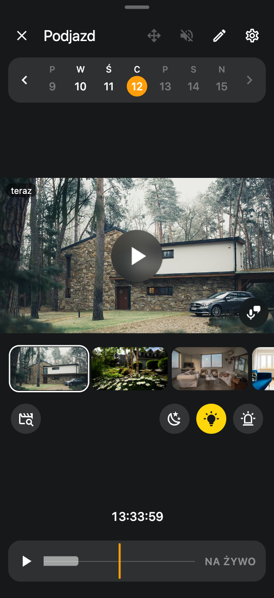 | 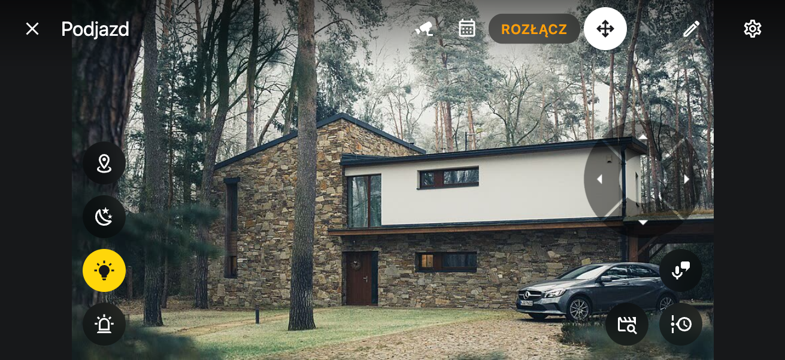 |

W poziomie obraz wypełnia ekran. Nagłówek biegnie przez cały ekran: zamknięcie w lewym rogu, a ustawienia w prawym,
nad ciemnymi pasami obok węższego obrazu. Przyciski samej kamery (nagrania z dni, NA ŻYWO, obracanie, dźwięk, edycja)
stoją lekko odsunięte od ustawień. Wszystko, czym sterujesz kamerą, zostaje na obrazie: z lewej, od dołu, syrena,
światło, noktowizja i pozycje; z prawej, od dołu, linia czasu, mówienie i pierścień obracania.

| Pozycje kamery | Linia czasu |
|---|---|
| 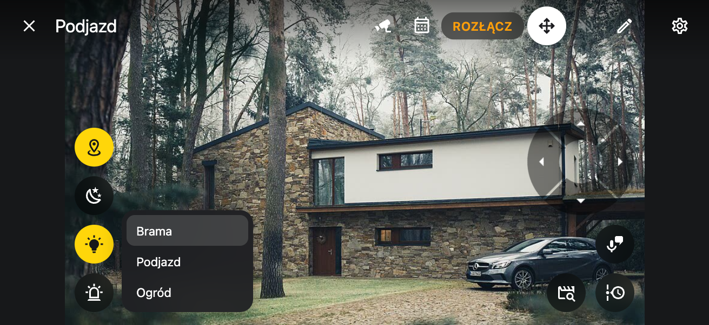 | 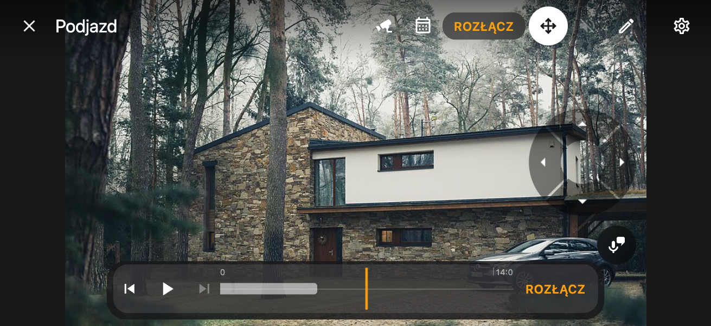 |

### Sterowanie i mówienie każdej kamery

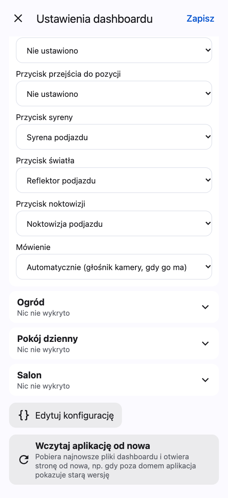

**Ustawienia dashboardu → Sterowanie i mówienie każdej kamery** pokazuje przy każdej kamerze, co znaleziono do jej
obracania. Dotknięcie kamery rozwija wybór.

| Sterowanie | Co robi |
|---|---|
| <b class="ui">Automatycznie</b> | po kolei: gotowe ustawienie eufy, ONVIF, przyciski urządzenia nazwane np. `pan_left`, `tilt_up`, `go_to_preset` |
| <b class="ui">eufy (gotowe ustawienie)</b> | przyciski integracji eufy-sdk, rozpoznane po kluczach tłumaczeń, więc działają też przy polskich nazwach encji |
| <b class="ui">ONVIF</b> | usługa `onvif.ptz` kamery z integracji ONVIF; pozycje wpisujesz jako tokeny po przecinku |
| <b class="ui">Wybrane ręcznie</b> | dowolne przyciski, skrypty albo sceny dla czterech kierunków oraz lista pozycji i przycisk przejścia |
| <b class="ui">Bez sterowania</b> | kamera nie ma przycisku sterowania |

| Mówienie | Co robi |
|---|---|
| <b class="ui">Automatycznie</b> | głośnik kamery, gdy integracja go oferuje (niżej), a gdy nie, interkom pokoju |
| **Przez go2rtc** | osobne połączenie WebRTC z samym mikrofonem; działa z kamerami z rozmową w obie strony (ONVIF Profile T, Tapo, Dahua, Hikvision i inne), nie z kamerą `generic` |
| <b class="ui">Interkom pokoju</b> | zawsze interkom |
| <b class="ui">Bez mówienia</b> | bez przycisku |

Głośnik w nagłówku jest aktywny tylko wtedy, gdy coś gra i ma dźwięk. Kamera bez mikrofonu zostawia go szarym.

Przez głośnik kamery mówisz dopiero wtedy, gdy podgląd na żywo naprawdę ruszy, czyli widzisz, do kogo mówisz. Wcześniej
przycisk jest zablokowany, a koniec podglądu kończy też mówienie. Kamera, która potrzebuje chwili na połączenie
głośnika, pokazuje szary przycisk z napisem „Łączę z głośnikiem kamery, możesz już mówić”, a czerwony, gdy już słucha.

**Dla autorów integracji:** dashboard mówi przez kamerę każdej integracji, która na urządzeniu kamery ma encję z
atrybutem `talk_path`, np. `talk_path: /api/moja/talk/brama`. Dashboard podpisuje tę ścieżkę, dopisuje `?rate=<Hz>`,
otwiera WebSocket i wysyła binarne ramki PCM s16le mono, a na koniec tekst `stop`. Integracja odpowiada JSON-em
`{"ok": true}` albo `{"ok": false, "error": "busy" | "no_speaker" | "unreachable" | "failed"}` i zamyka połączenie.
Tak działają eufy-sdk i Neolink.

### Obracanie, ustawienia i nagrania

- <b class="ui">Obracanie</b>: kamera, której urządzenie ma przyciski ruchu (np. `button.…_pan_left`, `…_pan_right`, `…_tilt_up`,
  `…_tilt_down`), dostaje w nagłówku, obok głośnika, przycisk ze strzałkami. Jego dotknięcie kładzie na obrazie, po
  prawej, koło ze strzałkami, a lista <b class="ui">Pozycja</b> staje w lewym dolnym rogu; ponowne dotknięcie je chowa. Wiek
  zdjęcia jest w lewym górnym rogu, a przy podglądzie w tym miejscu pojawia się NA ŻYWO. Odtworzenie nagrania chowa
  sterowanie, bo nagraniem nie da się obracać. Okno wygląda więc tak samo dla każdej kamery, a sterowanie
  działa też w trakcie podglądu na żywo i przy kamerze z nagraniami. Lista `select.…_preset` z przyciskiem
  `…_go_to_preset` daje pod kołem listę zapisanych pozycji; puste pozycje („empty”) się nie pokazują.
- <b class="ui">Ustawienia</b>: trybik w oknie kamery otwiera okno z ustawieniami i stanem kamery zamiast okna Home Assistant:
  <b class="ui">Ustawienia</b> (przełączniki, listy, suwaki), <b class="ui">Stan</b> (czujniki) i <b class="ui">Akcje</b> (pozostałe przyciski), zebrane z
  encji urządzenia kamery. Własny wybór encji dla kamery:

  ```yaml
  cameras:
    settings:
      camera.garden: [switch.garden_microphone, select.garden_night_vision, sensor.garden_battery]
  ```

- <b class="ui">Nagrania</b> (kamery Frigate): pod nazwą kamery jest tydzień z dniami; dni z nagraniami są jasne, strzałki
  zmieniają tydzień. Na dole okna jest linia czasu wybranego dnia: jasne odcinki to nagrania, pomarańczowe kropki to
  zdarzenia, a pomarańczowa pionowa kreska to wybrana chwila, z godziną nad linią. Przesuń linię palcem w lewo lub w
  prawo, a nagranie zacznie się od tej chwili; w przerwie między nagraniami zacznie się od następnego. Dotknięcie
  kropki odtwarza zdarzenie. Po lewej jest **odtwarzanie i pauza**, po prawej <b class="ui">NA ŻYWO</b>. Odtwarzanie nigdy nie
  włącza podglądu na żywo: za ostatnim nagraniem odtwarza to ostatnie, a po jego końcu okno wraca do ostatniego
  zdjęcia. Kamerę budzi tylko <b class="ui">NA ŻYWO</b>.
- **Szybkie przewijanie**: przytrzymaj linię chwilę bez ruchu, a zmieści się na niej cała doba. Gdy ruszysz palcem,
  kreska staje pod palcem: lewy brzeg linii to północ, prawy koniec doby. Wskaż palcem godzinę, np. 4:00, i puść: linia wraca do zwykłej skali w tym miejscu i odtwarza nagranie.
  Potem dokładnie poprawiasz chwilę zwykłym przesunięciem.
- **Pasek klipu**: gdy gra nagranie, nad linią jest cienki pasek od jego początku (z lewej, z godziną) do końca (z
  prawej). Na linii dnia klip 50 s to kilka pikseli, tu zajmuje całą szerokość. Stuknij lub przeciągnij pasek: dymek
  nad palcem mówi, gdzie jesteś (`0:36 / 0:50 · 18:02:46`), a obraz idzie za palcem; puść, a nagranie gra od tej
  sekundy. **Przytrzymaj pasek chwilę bez ruchu**, a pokaże 30 s wokół palca z kreską na każdą sekundę (dłuższą co
  pięć), więc nawet w 10-minutowym kawałku z Frigate trafisz co do sekundy. Myszką dymek pokazuje chwilę pod
  kursorem bez odtwarzania; strzałki na klawiaturze przesuwają o sekundę, z Shift o dziesięć. Pasek jest w panelu
  linii, więc na telefonie poziomo wysuwa się i chowa razem z nią; przyciski kamery (noc, światło, syrena, rozmowa,
  nagrania) zostają na swoich miejscach.
- **Linia przybliżona do klipu** (drugi sposób, wybierany w **Ustawienia dashboardu → Wybór chwili w nagraniu** dla
  wszystkich kamer albo, w bloku kamery, dla jednej): nie ma paska. Stuknięcie nagrania na linii dnia odtwarza je i
  przybliża linię tak, że klip z 5 s z każdej strony wypełnia ją (klip pomarańczowy, kreska biała); pomarańczowa
  plakietka pod godziną („Przybliż do klipu”) robi to samo dla grającego klipu, a stuknięta ponownie („wróć do dnia”)
  przywraca skalę dnia, tak jak NA ŻYWO.
  - Po przybliżeniu skala się nie zmienia, a nagrania przed i po są na linii (białe). Przesuń linię na jedno z nich, a
    zagra od tego miejsca; w przerwie nic nie gra. W grającym klipie obraz idzie za linią.
  - Nagranie, które się kończy, **zatrzymuje się** na końcu: do następnego przechodzisz przesunięciem linii, więc
    nagrania obok siebie oglądasz po kolei. Dalej gra tylko kolejna 10-minutowa część tego samego ciągłego nagrania
    z Frigate.
  - **Przytrzymaj przybliżoną linię** chwilę bez ruchu: pokaże 30 s na szerokości z kreską na każdą sekundę, a znacznik
    idzie za palcem; puść, a nagranie zagra od tej sekundy.
- **Tygodnie**: przesuń palcem po dniach w prawo, aby cofnąć się o tydzień, albo w lewo, aby wrócić.
- **Telefon poziomo**: obraz kamery zajmuje cały ekran, a nazwa i przyciski leżą na nim w rogach. Miniatury innych
  kamer się chowają. <b class="ui">Kalendarz</b> w nagłówku wysuwa dni przy górnej krawędzi (kalendarz i NA ŻYWO chowają się
  wtedy z nagłówka), a **zegar z osią** w prawym dolnym rogu wysuwa linię czasu w miejsce przycisku. Chowasz je tym samym przyciskiem, przesunięciem palcem (dni w górę, linię w dół) albo stuknięciem w obraz,
  które chowa oba naraz. Po
  wybraniu dnia pasek dni sam się chowa. <b class="ui">NA ŻYWO</b> jest zawsze u góry, obok głośnika. Na linii czasu po obu stronach
  przycisku odtwarzania są **⏮** i **⏭**: skok do poprzedniego i następnego nagrania tego dnia, od razu odtwarzanego. Przycisków zamiast
  przeciągania od krawędzi używamy dlatego, że na iPhonie gesty od górnej i dolnej krawędzi należą do systemu
  (powiadomienia i przełączanie aplikacji).
- **Jeden obraz**: zdjęcie, podgląd na żywo i nagranie pokazują się w tym samym miejscu i zastępują się nawzajem.
  Przejście z podglądu na żywo do nagrania kończy połączenie z kamerą, więc kamera na baterię nie traci energii.
  Każda kamera ma ten sam układ: kamera bez nagrań ma wyszarzone dni i pustą linię, a podgląd na żywo włącza
  <b class="ui">NA ŻYWO</b> albo odtwarzanie na linii.
- <b class="ui">Dźwięk</b>: przycisk z głośnikiem obok trybika włącza i wyłącza dźwięk podglądu i nagrania. Przytrzymanie go
  pokazuje suwak głośności. Na iPhonie i iPadzie głośność ustawia się przyciskami urządzenia, więc tam przycisk
  tylko włącza i wyłącza dźwięk.
- **Nagrane podglądy kamer na baterię (eufy)**: gdy w ustawieniach kamery (trybik → Ustawienia) włączysz
  **Nagrywaj podgląd** (przełącznik z integracji eufy-sdk, domyślnie wyłączony), most eufy zapisuje każdy podgląd
  tej kamery do `/media/eufy/<numer seryjny>/<dzień>/`, kto by go nie otworzył (dashboard, okno Home Assistant,
  HomeKit). Most nigdy nie budzi kamery sam, nagrywa tylko to, co i tak płynie. W trakcie podglądu
  plakietka na obrazie mówi **REC · NA ŻYWO**. Dni i linia czasu pokazują każdy dzień, który jest na
  dysku, także klipy sprzed tygodni pobrane z karty kamery. Inny folder mediów ustawisz w `cameras.recordings_folder` (np.
  `media-source://media_source/local/eufy`).
- **Nagrane podglądy kamer Reolink (Neolink)**: tak samo działa przełącznik **Nagrywaj podgląd** z integracji
  Neolink (aplikacja Neolink 0.2.0 lub nowsza). Pliki trafiają do `/media/neolink/<kamera>/<dzień>/`, a przełącznik
  sam podaje ten folder w atrybucie `recordings_path`, więc `cameras.recordings_folder` go nie zmienia.
- Kamera Frigate jest rozpoznawana sama, także przez obraz z tego samego urządzenia. Dane i nagrania pochodzą z
  integracji Frigate w Home Assistant.

### Okno kamery z automatyzacji {#a-camera-window-from-an-automation}

Automatyzacja może otworzyć własne okno kamery dashboardu, np. na tablecie w korytarzu, gdy kamera wykryje ruch.
Okno wygląda jak każde okno kamery dashboardu, pokazuje zdjęcie z wykrycia i samo zamyka się po chwili. Dotknięcie
okna albo włączenie podglądu na żywo zostawia je otwarte; wtedy zamyka się po najdłuższym podglądzie albo przez ✕,
Esc lub gest.

```yaml
- action: home_dashboard.show_camera
  response_variable: okno
  data:
    entity_id: camera.ogrod          # kamera albo jej obraz (image.*)
    picture: image.ogrod_last_event  # zdjęcie z wykrycia (opcjonalnie)
    title: Ruch w ogrodzie           # opcjonalnie; domyślnie nazwa kamery
    close_after: 15                  # sekundy; 0 = okno zostaje
    live_limit: 600                  # najdłużej tyle, gdy ktoś z niego korzysta
    live: false                      # true: od razu na żywo (dzwonek, kamera nagrywająca cały czas)
    interrupt: false                 # true: zastępuje okno innej kamery (dzwonek)
    browser_id: [tablet_korytarz]    # identyfikatory Browser Mod; puste = wszystkie urządzenia
    user_id: []                      # użytkownicy Home Assistant; puste = wszyscy
```

- Odpowiedź mówi, ile otwartych dashboardów dostało okno: `{request: 3, sent_to: 1}`. Przy `sent_to: 0` nie było
  tam otwartego dashboardu (tablet z wygaszonym ekranem usypia aplikację: najpierw go obudź, np. powiadomieniem).
- Gdy okno zniknie albo się nie otworzy, przychodzi zdarzenie `home_dashboard_camera_closed` z polami `request`,
  `entity_id`, `browser_id`, `user_id`, `live` (czy ktoś oglądał na żywo) i `reason`: `timeout`, `closed`,
  `busy` (była otwarta inna kamera albo ustawienia; nigdy ich nie zabiera), `hidden` (dashboard nie pokazuje tej
  kamery tej osobie: ukryta, tryb prywatny albo gość), `unknown_camera` lub `replaced` (jego miejsce zajęła
  kamera z `interrupt`). Automatyzacja czeka na nie przez
  `wait_for_trigger` na tym zdarzeniu.
- `close_after` liczy się tylko wtedy, gdy ekran pokazuje okno: tablet obudzony powiadomieniem łączy się, zanim
  jego ekran się rozjaśni, więc czas rusza, gdy strona jest widoczna (i od nowa w całości, jeśli ekran zgaśnie,
  zanim minie). Przy podglądzie na żywo, który budzi kamerę na baterii, daj mu czas, np. 45 s.
- Druga kamera, gdy jedna jest na ekranie, jest odrzucana (`busy`), więc nikt nie traci tego, co ogląda, chyba że
  ma pierwszeństwo (`interrupt: true`, np. dzwonek z `live: true`): wtedy zastępuje tamtą kamerę. Ustawień ani
  edycji nigdy nie zabiera.
- Urządzenie dashboard rozpoznaje po identyfikatorze Browser Mod (wystarczy, że Browser Mod jest zainstalowany)
  albo po koncie, na którym jest zalogowane (`user_id`): tablet na ścianie z własnym kontem znajdzie się tak nawet
  wtedy, gdy Browser Mod go zgubi. Podgląd w edytorze nigdy nie otwiera takich okien.
- Kamera, którą dashboard pokazuje przez inną, otwiera okno tamtej: kamera eufy pokoju za jego kamerą Frigate
  (`cameras.controls`) albo kamera tego samego urządzenia. Kamera ukryta przed tą osobą nie pokazuje się wcale.
- To samo okno może otworzyć powiadomienie: adres `/home-dashboard/home?camera=camera.ogrod&live=1` otwiera tę
  kamerę, z `live=1` od razu na żywo. Potem adres o tym zapomina, więc odświeżenie nie otwiera okna drugi raz.

### Aktywność domowników {#household-activity}

Home Assistant nie zapisuje, co kto przegląda. Dashboard tak: każda strona i okno, które ktoś otworzy (strona główna,
pokój, Energia, okno lampy albo kamery, menu, ustawienia), jest zapisane z godziną i urządzeniem (identyfikator
Browser Mod albo rodzaj urządzenia i to, czy to aplikacja Home Assistant, czy przeglądarka) i przechowywane 30 dni
w `.storage/home_dashboard_activity/`, jeden plik na dzień. Podgląd w edytorze niczego nie zapisuje.

Pokazuje to panel **Aktywność domowników** w menu Home Assistant, ułożony jak Historia i Aktywność w Home
Assistant:

- **Po lewej filtry.** *Osoby*: każda osoba ma swój kolor, liczbę rzeczy zrobionych w wybranym czasie i urządzenie,
  którego użyła ostatnio (aplikacja Home Assistant, przeglądarka); zaznacz osoby, które chcesz oglądać (*Wszyscy*,
  *Nikt*); wybór jest zapamiętywany. *Typ*: strony, okna, zmiany. *Urządzenia*: oświetlenie, przełączniki, rolety
  i osłony, przyciski i sceny, kamery, klimat, zamki i alarm, multimedia, automatyzacje i skrypty, inne, każde z liczbą
  tego, co z nimi zrobiono. *Pokoje*: obszary Home Assistant (encji albo jej urządzenia) i *Bez pokoju*. Zawężenie
  urządzeń albo pokoi pomija to, co nie ma urządzenia, np. stronę. Każdą sekcję można zwinąć; wybory są zapamiętywane.
- **Szukaj** obok zakresu: urządzenie, okno, strona, osoba, pokój albo identyfikator encji, żeby szybko sprawdzić,
  czy coś było zmieniane, kiedy i przez kogo.
- **Na górze zakres czasu**: strzałki przesuwają zakres wstecz albo do przodu, a kliknięcie dat otwiera okno
  z gotowymi zakresami (Dziś, Wczoraj, poprzednia godzina, 12 albo 24 godziny, 7 albo 30 dni) albo własnym od–do.
- **Jedna oś czasu** wszystkich wybranych osób, od najnowszych, dzień po dniu: godzina, kółko w kolorze osoby, co
  się stało (strona, okno, włączona lampa, naciśnięty przycisk), a pod spodem kto, jaki rodzaj i na jakim urządzeniu.

Zakres, który sięga teraz (Dziś, poprzednia godzina…), działa **na żywo**, jak Aktywność: każda nowa strona, okno
i zmiana pojawia się na górze osi czasu od razu, bez przeładowania. Zakres z przeszłości nie.

Na telefonie filtry otwiera przycisk **Filtry**.

Ten sam widok jest też w dashboardzie, żeby przeglądać go na telefonie: **Aktywność domowników** w bocznym menu
dashboardu otwiera go w oknie na cały ekran, w wyglądzie dashboardu. Tę pozycję ma tylko osoba, która widzi
aktywność (właściciel albo osoby wybrane); reszta domowników jej nie ma.

Zmiany pochodzą z historii Home Assistant: zmiana zrobiona z aplikacji ma przypisaną osobę, która ją zrobiła,
i jest przechowywana tak długo, jak historia recordera (`purge_keep_days`). Zmiany z automatyzacji nie mają osoby
i się nie pokazują. Chip nad listą pokazuje jedną osobę.

Panel jest w menu administratorów, ale dane pokazuje tylko **właścicielowi** Home Assistant; inny administrator
widzi zamiast nich komunikat. Zakres to najwyżej 31 dni.

Dwie opcje integracji (Ustawienia → Urządzenia i usługi → Home Dashboard → **Konfiguruj**), na początku obie
włączone:

- *Pokazuj Aktywność domowników w pasku bocznym*: wyłączona chowa panel z menu, a panel nadal otwiera się pod
  adresem `/home-dashboard-activity`.
- *Zapisuj aktywność domowników*: wyłączona sprawia, że dashboardy niczego więcej nie zgłaszają (otwarta strona
  dowiaduje się od razu) i nic nowego się nie zapisuje; to, co zapisane, znika po 30 dniach. Zmiany urządzeń nadal
  pochodzą z historii Home Assistant.
 Domownicy powinni wiedzieć, że ich korzystanie
z dashboardu jest zapisywane.

### Tryb gościa i prywatność

```yaml
cameras:
  guest:
    entity: input_boolean.guest
    hide: [camera.living_room, camera.bedroom]
  private:
    - {entity: switch.bedroom_privacy, hide: [camera.bedroom]}
```

Dodaj `users: [Tablet]` do `guest`, żeby działał tylko na tych kontach, po nazwie lub identyfikatorze. Pozostali
dalej widzą kamery.

Gdy `guest` jest włączony, te kamery znikają ze strony głównej i Ochrony, a na stronie pokoju zostają rozmyte.
Gdy włączony jest przełącznik z `private`, kamera znika ze wszystkich stron.

## 6. Sceny

`scenes` to sekcja pod kamerami. Dotknij jej nagłówka, potem trzy kropki → <b class="ui">Edytuj ten ekran</b>: lista oferuje
sceny i skrypty. Przycisk ze strzałkami układa je w jeden rząd przewijany w bok. Pokój pokazuje pod kamerami swoje sceny i skrypty w takim samym układzie. Wybierasz je w edycji pokoju, w zakładce <b class="ui">Sceny</b> (`scenes` pokoju). Dopóki ich nie zapiszesz, pokój pokazuje sceny i skrypty przypisane w Home Assistant do jego obszaru.

## 7. Skróty i bloki

Blok to kilka encji na jednym ekranie. To zwykłe dane, więc nie wymaga kodu. Jak zbudować okno dla urządzenia, którego
dashboard nie zna, krok po kroku i z przykładami, opisuje [poradnik o własnych urządzeniach](own-devices.pl.md).

| Odkurzacz | Media | Roleta | Przełącznik |
|---|---|---|---|
| 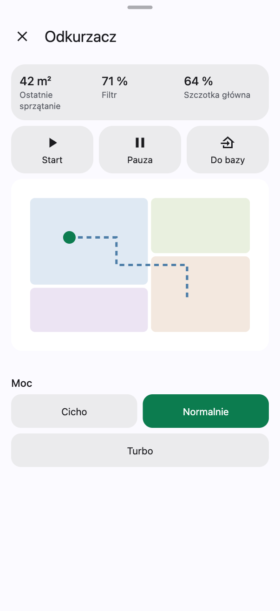 | 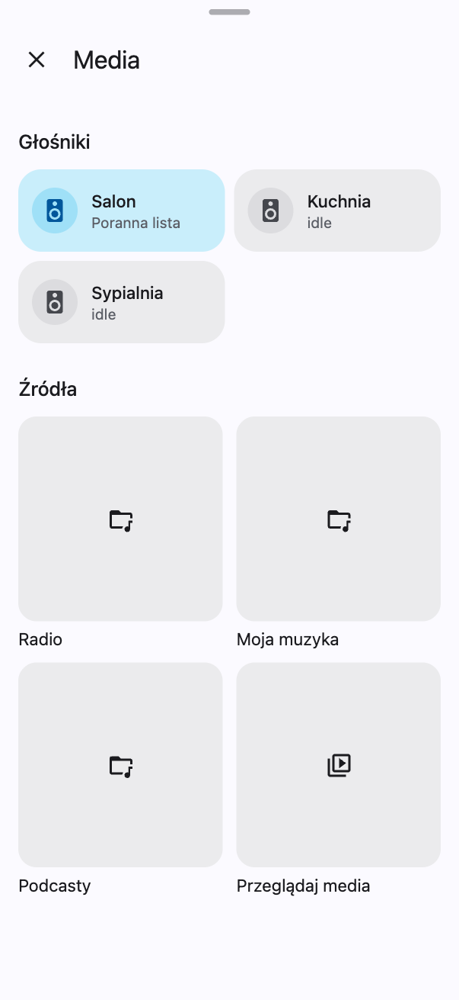 | 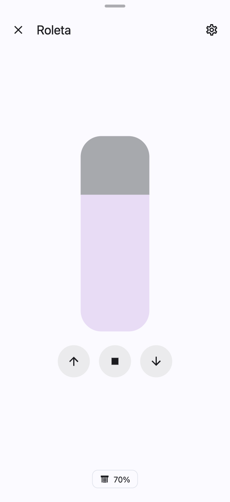 | 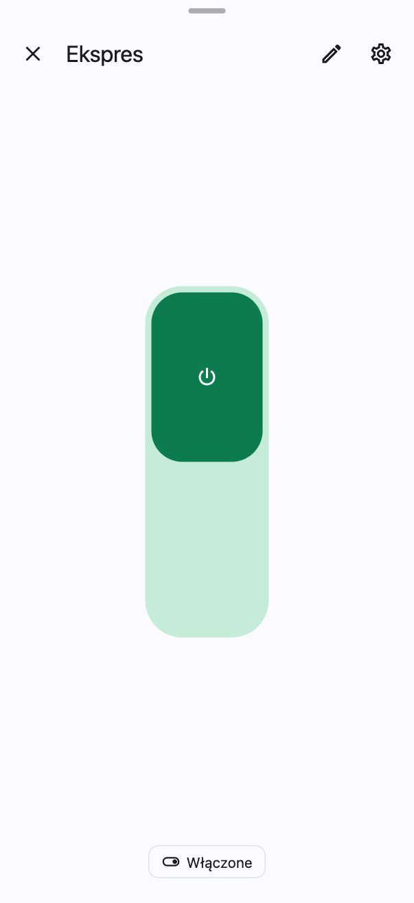 |

Odkurzacz jako skrót:

```yaml
shortcuts:
  - kind: panel
    name: Odkurzacz
    icon: mdi:robot-vacuum
    entity: vacuum.robot
    stats:
      - {name: Filtr, entity: sensor.vacuum_filter, unit: "%", digits: 0}
    actions:
      - {name: Start, icon: mdi:play, entity: vacuum.robot, service: vacuum.start}
      - {name: Do bazy, icon: mdi:home-import-outline, entity: vacuum.robot, service: vacuum.return_to_base}
    card: {type: custom:xiaomi-vacuum-map-card, entity: vacuum.robot}
    card_open: true
    groups:
      - layout: controls
        rows:
          - {entity: select.vacuum_power, name: Moc, labels: {quiet: Cicho, turbo: Turbo}}
```

Ten sam blok może stać w pokoju: wstaw go między kafelki w `layout`. Żeby nie trzymać dwóch kopii, kafelek może
zamiast tego wskazać skrót: pokazuje jego liczby i otwiera to samo okno, a to, co kafelek ustawia sam (tu encja,
której stan pokazuje), ma pierwszeństwo przed skrótem. Na tablecie taki kafelek ma szerokość dwóch kafelków i stoi
pod zwykłymi kafelkami swojej sekcji.

```yaml
layout:
  - id: korytarz
    sections:
      - title: Urządzenia
        tiles:
          - {shortcut: Odkurzacz, entity: vacuum.robot}
```

| Element | Co robi |
|---|---|
| `stats` | Liczby u góry. |
| `actions` | Przyciski. `confirm: Tekst` najpierw pyta, `service` wywołuje usługę encji. |
| `groups` | Wiersze encji. `select` staje się listą, `switch` przełącznikiem, `number` suwakiem. |
| `groups[].layout: controls` | Duże przyciski, wybór, szeroki suwak i małe karty zamiast wierszy. |
| `groups[].layout: summary` | Jedna linia, która rozwija się na dotknięcie i sama, gdy włączy się czujnik drzwi, okna lub problemu. |
| `card`, `card_open`, `card_last` | Karta Home Assistant w bloku: na przycisk, od razu albo pod grupami. |
| `frame` | Strona WWW na cały ekran. |
| `tone` | Kolor ikony skrótu: green, purple, teal lub pink. |

Gdy kartą jest mapa odkurzacza z trybem sprzątania pokoi (`vacuum_clean_segment` z `predefined_selections`), na
tablecie w poziomie pokoje stają jako przyciski w lewej kolumnie razem z liczbą powtórzeń i przyciskiem **Sprzątaj
wybrane**. Własne przyciski karty są wtedy schowane, a mapa stoi sama, wyśrodkowana, na przezroczystym tle i zmniejsza
się, gdyby nie mieściła się na ekranie.

Blok na całym ekranie (`fullscreen: true`) z otwartą kartą (`card_open: true`), np. odkurzacz z mapą, na tablecie w
poziomie stoi w dwóch kolumnach: z lewej jego wiersze, liczby jako kafelki (udział w `%` z paskiem pod spodem) i
przyciski na dole, a karta na reszcie ekranu. W pionie i na telefonie zostaje jedna kolumna. Obrót tabletu nie
uruchamia karty od nowa.

Ekran stanu domu to `kind: overview`: zegar, data i tylko to, co teraz warto zobaczyć. Pozycja bez niczego do pokazania znika, a razem
z ostatnią pozycją znika cała sekcja. Sekcja z `alert: true` liczy się do podsumowania przy zegarze, a `bottom: true` stoi zawsze na samym dole. `title` można pominąć. Dotknięcie encji
otwiera jej szczegóły.

```yaml
shortcuts:
  - kind: overview
    name: Status
    icon: mdi:clipboard-pulse-outline
    sections:
      - title: Wymaga uwagi
        alert: true
        items:
          - name: Zimno w pokoju
            icon: mdi:snowflake
            attribute: current_temperature
            unit: "°"
            below: 19
            entities: [{entity: climate.bedroom, name: Sypialnia}]
          - {name: Baterie, icon: mdi:battery-alert, auto: battery, below: 11}
      - title: W domu
        items:
          - {name: Otwarte okna, icon: mdi:window-open-variant, entities: [binary_sensor.window]}
      - title: W pracy
        items:
          - name: Pralka
            icon: mdi:washing-machine
            entity: sensor.washer_state
            state: [Running]
            labels: {Running: Pierze}
            facts: [{name: Program, entity: sensor.washer_program}]
      - title: Niedziela
        items:
          - {name: Msza, icon: mdi:church, text: "8.00, 10.00", weekdays: [7]}
```

| Pozycja | Kiedy się pokazuje |
|---|---|
| `entities` | Gdy encja ma stan `state` (domyślnie `on`). Encja to identyfikator albo `{entity, name}`. |
| `entities` z `below` | Gdy wartość jest mniejsza niż `below`. `attribute` czyta ją z atrybutu, a `unit` podaje jednostkę. |
| `auto: battery` z `below` | Same wyszukuje baterie: procenty w encjach z `battery` w nazwie lub klasą `battery`. |
| `list` | Gdy lista w atrybucie nie jest pusta: `{entity, attribute, name, detail, since}` to nazwy pól. |
| `entity` ze `state` | Gdy urządzenie jest w jednym ze stanów. `labels` opisuje stan, a `facts` pokazuje wartości. |
| `text` | Zawsze, a z `weekdays` (1 to poniedziałek, 7 to niedziela) i `months` tylko w te dni i miesiące. |

`weekdays` i `months` działają w każdej pozycji.

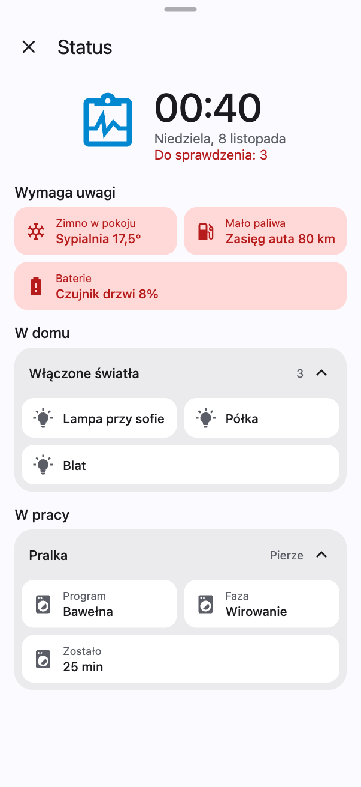

Odjazdy tramwajów i autobusów to `kind: departures`. Najbliższy odjazd jest duży, a pod nim każda linia z kolejnymi
godzinami i opóźnieniem. Encje muszą trzymać odjazdy w atrybucie `list` (`line`, `direction`, `departure`,
`time_to_departure`, `delay`). Na tablecie w poziomie odjazdy zajmują cały ekran: najbliższy duży z informacją, czy
jedzie o czasie, wszystkie odjazdy wszystkich linii w jednej kolejności, najbliższa godzina (do dwóch, gdy ostatni
odjazd jest później) jako oś czasu z wierszem na linię oraz karta każdej linii ze wszystkimi godzinami z rozkładu. Każda
linia ma swój kolor; `colors: {"8": "#ff9f0a"}` wybiera go ręcznie. Ile godzin przychodzi na linię, decyduje źródło
danych (np. serwer MPK), a nie dashboard. `news: binary_sensor.impk_news` dodaje komunikaty przewoźnika (objazdy,
utrudnienia) z atrybutu `list`: pomarańczowa karta nad odjazdami, tylko gdy są komunikaty.

```yaml
shortcuts:
  - kind: departures
    name: Tramwaje
    icon: mdi:tram
    entities: [sensor.tram_4, sensor.tram_11]
```

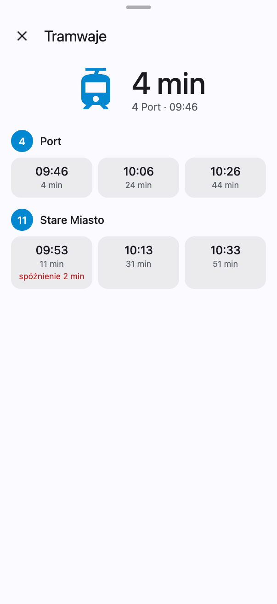

Inne skróty: `{kind: page, name: Media, icon: mdi:play, page: media}` otwiera stronę w oknie, a `kind: host`
pokazuje maszyny z `columns`. Telewizor to `kind: tv` z `entity`, `on`, `off` i `shortcuts`, a telewizor webOS sam
dostaje strzałki i klawisze.

Urządzenie z własną kartą otwiera ją zamiast okna dashboardu:

```yaml
entities:
  overrides:
    light.aquarium:
      card: {type: custom:lamp-card, entity: light.aquarium}
```

Reszta `entities`:

```yaml
entities:
  include:
    kitchen: [switch.dishwasher]     # dodaje encję do pokoju
  exclude: [light.tablet_screen]     # pomija encję
  overrides:
    cover.window_3: {area: bedroom, name: Roleta, icon: mdi:blinds}
```

### Edytor bloków

Trzy kropki na stronie głównej → <b class="ui">Odznaki podsumowania</b> (administratorzy) pokazuje wszystkie skróty i dotyczy wszystkich osób. Tu dodasz nowy blok, ustawisz ich
kolejność, a ołówek otwiera formularz. Formularz mają Status, Odjazdy, Maszyny (`kind: host`), Blok (`kind: panel`), Strona i
Rok szkolny, razem z sekcjami, wierszami i przyciskami. Encje podpowiadają się same, a kartę Home Assistant wpisujesz jako
YAML w jej polu. Blok stojący w pokoju otworzysz z edycji pokoju: kafelek → <b class="ui">Edytuj blok</b>. Skrót może mieć `label`, czyli mały tekst nad nazwą.
Opcje, których formularz nie zna, zostają w bloku bez zmian. Po zmianie nazwy reguły **Dostępu użytkowników** idą za blokiem, a kolejność i ukrycie w
czyimś **Moim układzie** trzeba ustawić od nowa.

| Odznaki podsumowania | Formularz |
|---|---|
| 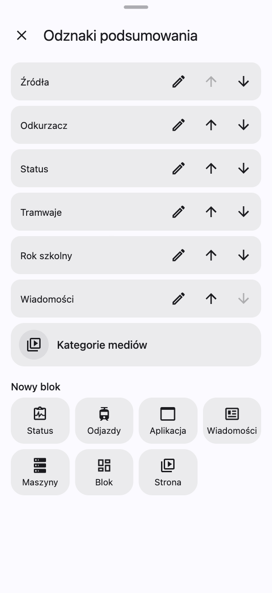 | 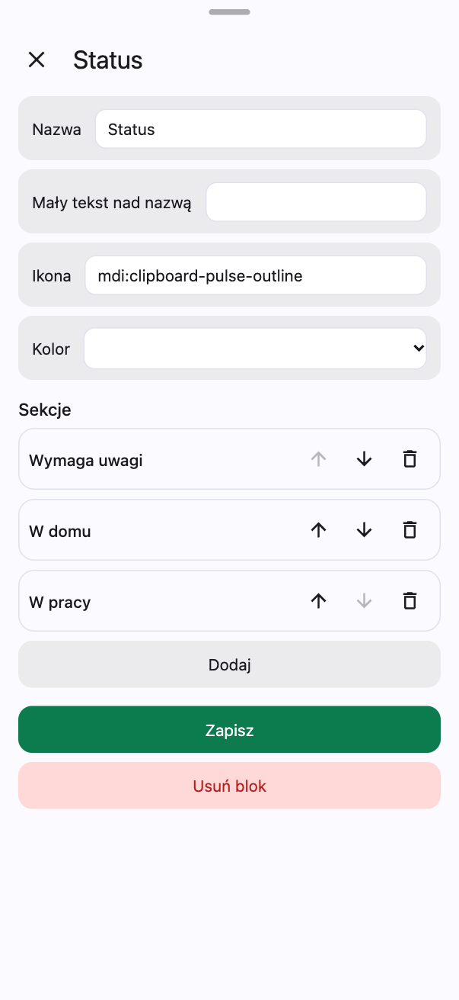 |

### Ustawienia i edycja urządzenia

Wszystko, co się włącza i wyłącza, ma w swoim oknie okrągły **przycisk zasilania**, widoczny bez przewijania: światło
pod suwakiem, a przełącznik, gniazdko, pomocnik albo automatyzacja pod dużym przełącznikiem. Jedno dotknięcie wyłącza
(albo włącza); niczego nie trzeba zsuwać w dół. Przy świetle albo przełączniku lampy świeci na żółto, gdy światło jest
włączone.

Każde okno urządzenia ma w prawym górnym rogu dwa przyciski:

- **Trybik** otwiera ustawienia urządzenia w zakładkach, zebrane z jego pozostałych encji: <b class="ui">Ustawienia</b>
  (przełączniki, listy, suwaki, np. czas przejścia lampy), <b class="ui">Stan</b> (czujniki, np. moc), <b class="ui">Akcje</b> (przyciski, np.
  Identyfikuj) i <b class="ui">Aktywność</b> (dziennik tego urządzenia z 1, 6 albo 24 godzin). Grupa, np. grupa świateł, ma
  najpierw zakładkę <b class="ui">Członkowie</b> z przełącznikami. Widać tylko zakładki z zawartością, Aktywność zawsze. Trybik w
  tym oknie otwiera pełne okno Home Assistant.
- **Ołówek** (tylko administratorzy) zmienia **nazwę**, **obszar**, **etykiety** i to, czy urządzenie jest
  <b class="ui">włączone</b>. Encja bez urządzenia zmienia się sama. Wyłączone urządzenie znika z Home Assistant i z dashboardu;
  włączysz je z powrotem w Ustawienia → Urządzenia. Przełącznik ma też <b class="ui">To jest światło</b>: przełącznik zasilający
  lampę jest wtedy żółty, gdy włączony, i liczony ze światłami. Przełącznik z ikoną lampy jest światłem sam; wybór
  zapisuje się w dashboardzie (`entities.overrides.<id>.light`).

Oba okna mają wygląd motywu z **Wygląd → Okna**, jak wszystkie okna dashboardu.

### Lewe menu

Trzy kreski otwierają menu: strony, obszary, Twoje grupy i ustawienia. Administrator układa grupy przyciskiem <b class="ui">Edytuj menu</b>
na samym dole. Grupa może mieć tytuł, a wpis to nazwa, ikona i jedno z trzech: <b class="ui">Adres</b> strony Home Assistant (podpowiada
panele, np. `/config`), **Skrót** po nazwie albo <b class="ui">Akcja</b> `notifications`, która otwiera okno powiadomień z listą na żywo i odrzucaniem. **Tylko
administratorzy** chowa wpis przed resztą, a **Kto to widzi** ogranicza wpis do zaznaczonych osób (`users`, brak zaznaczeń to wszyscy), a **Ukryj w trybie gościa** chowa go, gdy tryb gościa obowiązuje na tym koncie:
użyj tego przy kamerach, żeby wpis nie omijał blokady. Bez własnej konfiguracji menu pokazuje skróty i podstawowe linki.

Pod <b class="ui">Edytuj menu</b> jest <b class="ui">Profil</b> z imieniem zalogowanej osoby: otwiera profil Home Assistant.

Menu Home Assistant jest schowane, dopóki otwarty jest dashboard, także na szerokim telefonie w poziomie i na
tablecie, więc dashboard zajmuje cały ekran. To nie zmienia Twojego ustawienia: na innych stronach Home Assistant menu
wraca takie, jak było. Telefon w poziomie zostaje przy układzie telefonu, z trzema kafelkami w rzędzie.

W aplikacji Home Assistant przesunięcie palcem od lewej krawędzi otwiera na stronie głównej to menu zamiast menu Home
Assistant. W każdym innym miejscu ten sam gest cofa: otwarte okno się zamyka, a pokój albo inna strona wraca na stronę
główną. Na stronie głównej menu wysuwa się razem z palcem: puszczone za jedną trzecią albo szybkim ruchem
otwiera się, wcześniej wraca na miejsce. Wsuwa się i chowa z animacją.

Na komputerze **Esc** zamyka otwarte okno tak jak jego ✕ (kamera otwarta z innego okna wraca do niego, tak jak jej
strzałka). Najpierw zamyka się małe okienko w środku: pytanie, menu, lista wysunięta z boku, obrazek pokazany w dużym
rozmiarze. Jedno naciśnięcie zamyka jedną rzecz; okno Home Assistant nad dashboardem zamyka się samo.

Wpisy z adresem `/history` i `/logbook` otwierają się w oknach dashboardu. Dziennik pokazuje urządzenia z dashboardu z
ostatniej godziny, 6 lub 24 godzin, a Historia wykresy encji, które każdy wybiera dla siebie.

| Dziennik | Historia |
|---|---|
| 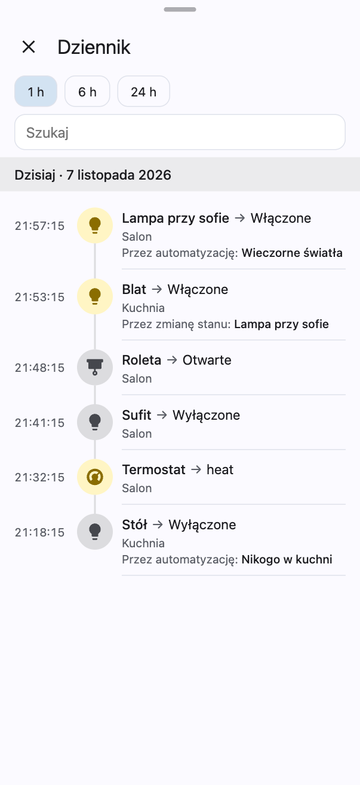 | 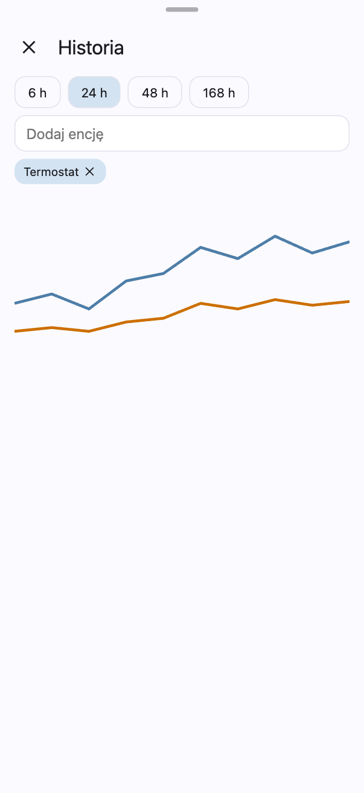 |

| Edycja menu | Powiadomienia |
|---|---|
| 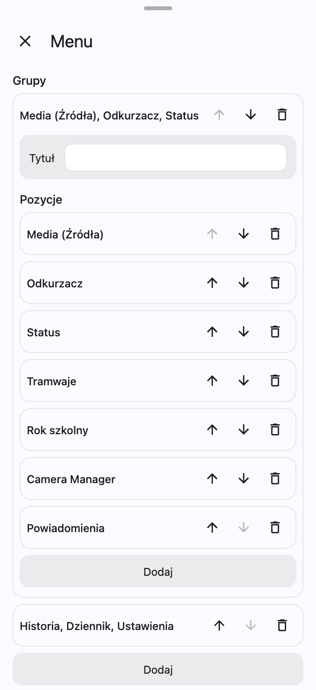 | 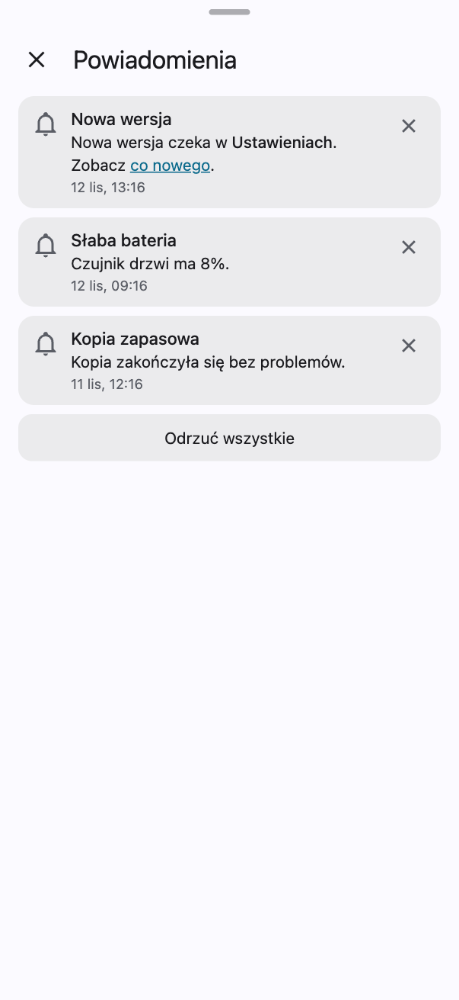 |

```yaml
menu:
  groups:
    - items:
        - {shortcut: Status}
        - {name: Kamery, icon: mdi:cctv, path: /my_camera_panel, hide_for_guests: true}
        - {name: Powiadomienia, icon: mdi:bell-outline, action: notifications}
    - title: System
      items:
        - {name: Ustawienia, icon: mdi:cog-outline, path: /config, admin: true}
```

### Wiadomości

`kind: news` to ekran do czytania. Każda sekcja to sensor z atrybutem `news`, czyli listą artykułów: `title`, `text`,
opcjonalnie `rating`, `votes`, `source`, `source_url` i `url`. Atrybuty `release` i `attribution` pokazują się u góry i na
dole. W **Blokach** to <b class="ui">Wiadomości</b>:

```yaml
shortcuts:
  - kind: news
    name: Wiadomości
    icon: mdi:newspaper-variant-outline
    sections:
      - {title: Kraj, entity: sensor.news_home}
      - {title: Świat, entity: sensor.news_world}
```

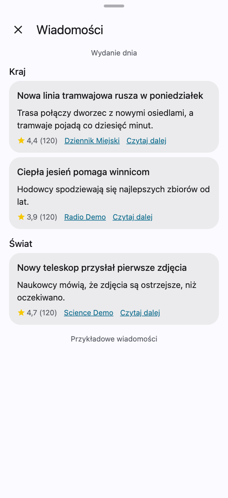

### Tekst

`kind: text` to blok do czytania: czytania mszalne na dziś, fragment książki na dziś, myśl dnia. Każda sekcja to encja:
jej stan to mała linia nad tekstem (sigla, strona), a atrybuty to tekst; wersety psalmu zachowują swoje linie, a refren
jest wyróżniony. Encja bez tekstu w atrybutach pokazuje swój stan jako tekst. Sekcja bez treści znika (drugie czytanie
w dzień powszedni), a odznaka jest widoczna, gdy istnieje któraś z encji bloku. W **Blokach** to <b class="ui">Tekst</b>:

```yaml
shortcuts:
  - kind: text
    name: Słowo Boże
    icon: mdi:book-cross
    heading: sensor.readings_day          # nazwa dnia z datą
    label_entity: sensor.readings_gospel  # mała linia odznaki
    sections:
      - {entity: sensor.readings_first, name: Pierwsze czytanie}
      - {entity: sensor.readings_psalm, name: Psalm}
      - {entity: sensor.readings_gospel, name: Ewangelia, read: true}
    # Czytanie na głos na głośniku albo przez skrypt komunikatów (HomePod potrzebuje najpierw całego pliku)
    script: script.announce
    script_field: text
    script_data: {areas: hall}
    speaker: media_player.hall_homepod    # zatrzymuje czytanie
```

Z głośnikiem albo skryptem okno ma przycisk <b class="ui">Przeczytaj wszystko</b> i przycisk dla każdej sekcji z `read: true`;
czytany jest wstęp, refren, tekst i zakończenie, bez znaków psalmu.

### Aplikacje w oknie

Dodatek z interfejsem WWW, np. Frigate, otworzy się w oknie dashboardu. W menu wpisz w polu <b class="ui">Aplikacja</b> jego identyfikator,
pole podpowiada zainstalowane dodatki. Jako skrót na stronie głównej to **Odznaki podsumowania → Aplikacja**:

```yaml
shortcuts:
  - {kind: app, name: Frigate, icon: mdi:cctv, addon: abcd1234_frigate}
menu:
  groups:
    - items:
        - {name: Frigate, icon: mdi:cctv, addon: abcd1234_frigate, hide_for_guests: true}
```

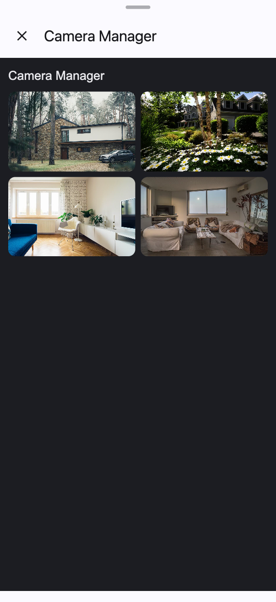

Gdy okno nie może się otworzyć, np. dodatek jest wyłączony, pojawia się informacja i przycisk otwierający go w Home
Assistant. `frame: http://...` podaje adres zastępczy na takie sytuacje.

### Rok szkolny z własnych danych

`kind: school` czyta sensory i niczego nie zakłada o tym, skąd pochodzą, więc wystarczy własny dodatek albo szablon, który
je wystawi. Nazwy encji zmienisz w `sources`. Dane leżą w atrybutach, a stan sensora nie ma znaczenia. Zakładka bez danych
pokazuje tylko informację o ich braku.

```yaml
shortcuts:
  - kind: school
    name: Rok szkolny
    icon: mdi:school-outline
    children: [Lena, Kuba]            # kolejność; pozostałe dzieci idą na koniec
    sources:
      plan: sensor.my_timetable       # domyślnie sensor.rodzinnik_plan_lekcji
      grades: sensor.my_grades        # sensor.rodzinnik_oceny
      events: sensor.my_calendar      # sensor.rodzinnik_terminarz
      meals: sensor.my_meals          # sensor.rodzinnik_obiady
      duties: sensor.my_duties        # sensor.rodzinnik_obowiazki
      jobs: sensor.my_jobs            # sensor.rodzinnik_prace
      bank: sensor.my_bank            # sensor.rodzinnik_bank
      librus: sensor.my_school_events # sensor.rodzinnik_librus
```

Dzieci i ich zakładki pochodzą z `plan`. Daty mają postać `2026-11-09`, a godziny `08:00`. Nazwy dni wyświetlają się tak,
jak je podasz, w dowolnym języku, a weekend rozpoznawany jest po dacie.

```yaml
# plan: atrybut children
children:
  - child: Lena
    days:
      - date: "2026-11-09"
        name: Monday
        is_today: true
        no_lessons: false              # true przekreśla lekcje tego dnia
        events: [...]                  # jak niżej
        lessons:
          - {number: 1, start: "08:00", end: "08:45", subject: Maths, teacher: Anna Nowak, classroom: "12",
             type: lesson, canceled: false, substitution: false, note: ""}   # type: extra to zajęcia dodatkowe

# event: wydarzenie w days[].events oraz w librus
- {date: "2026-11-09", title: School trip, start: "08:00", end: "15:00", place: Museum, description: "",
   instead_of_lessons: false, important: true}

# librus: atrybut children, ważne wydarzenia na Dzisiaj i Jutro oraz wydarzenia w terminarzu
children:
  - {child: Lena, events: [...]}

# events: atrybut children, wpisy terminarza
children:
  - child: Lena
    entries:
      - {date: "2026-11-10", kind: Test, title: Maths, description: Fractions, start: "10:10"}

# grades: atrybut children
children:
  - child: Lena
    semester: 1
    subjects:
      - subject: Maths
        averages: {semester_1: 4.5, year: 4.5}
        grades: [{grade: "5", category: test, is_new: true, proposition: false}]

# meals: atrybut variants
variants:
  - variant: school
    label: School
    available: true
    days:
      - {name: Monday, meals: [{meal: Lunch, items: [{name: Soup}, {name: Pasta}]}]}

# duties: atrybuty week_start, week_end i children, opcjonalnie previous_week i next_week o tym samym kształcie
children:
  - {child: Lena, child_color: "#f5ec00", avatar: "https://...", set: Kitchen, color: "#77bb41", tasks: [Dishes], free_week: false}

# jobs: atrybut jobs
jobs:
  - {name: Raking, description: Leaves, reward_label: "5 - 10 EUR", limit: {label: once a week}}

# bank: atrybuty currency i children
currency: EUR
children:
  - {child: Lena, balance: 65, savings: 10, debt: 0, allowance: {next_payment: "2026-11-09"}}
```

### Magazyn energii

Stacja zasilania na baterię (EcoFlow, domowy magazyn) to blok w swoim pokoju, jak każdy inny: liczby na kafelku, a w
oknie wyjścia, ładowanie i bateria. `energy.storage` pokazuje go też na stronie Energii, jako kartę z naładowaniem,
tym, co robi, mocą wejścia i wyjścia oraz czasem, na jaki wystarczy. Dotknięcie otwiera to samo okno. Pola opisuje
[README](../README.pl.md#energia).

### Waga

Waga łazienkowa z ciałem każdej osoby z [BodyMiScale](https://github.com/dckiller51/bodymiscale): `kind: scale` w
pokoju (albo w `shortcuts`). Kafelek mówi, kto ważył się ostatnio i kiedy, z jego wagą, BMI, tkanką tłuszczową i
mięśniami. Dotknięcie otwiera okno:

- osoby z BodyMiScale do wyboru, każda ze swoją wagą, na początek ta, która ważyła się ostatnio;
- co waga pokazuje teraz (`entity`);
- waga wobec idealnej, z różnicą, i tłuszcz do zrzucenia;
- BMI na przedziałach (niedowaga, prawidłowa, nadwaga, otyłość), z opisem, który podaje BodyMiScale;
- z czego składa się ciało: tkanka tłuszczowa, mięśnie, woda, kości, tłuszcz trzewny, białko, masa beztłuszczowa,
  przemiana materii, wiek metaboliczny, wynik ciała i typ sylwetki;
- waga z 30 dni, 90 dni lub roku, ze statystyk sensora wagi tej osoby, z wagą idealną jako linią przerywaną. Gdy waga
  się nie zmieniała, okno mówi, że w tym czasie nie było ważeń.

Tablet pokazuje to w dwóch kolumnach, telefon w jednej.

```yaml
- kind: scale
  name: Waga
  icon: mdi:scale-bathroom
  entity: sensor.mi_body_composition_scale_mass   # co waga pokazuje teraz
  people:                                         # opcjonalnie: bez tego wszystkie bodymiscale.*
    - bodymiscale.ola
    - {entity: bodymiscale.kuba, name: Kuba, weight: sensor.kuba_waga}
```

Sensor wagi każdej osoby znajduje się sam jako `sensor.<osoba>_weight…`; `weight` wskazuje inny.

## 8. Muzyka, Energia i Mapa

| Muzyka | Energia | Mapa | Odtwarzacz |
|---|---|---|---|
| 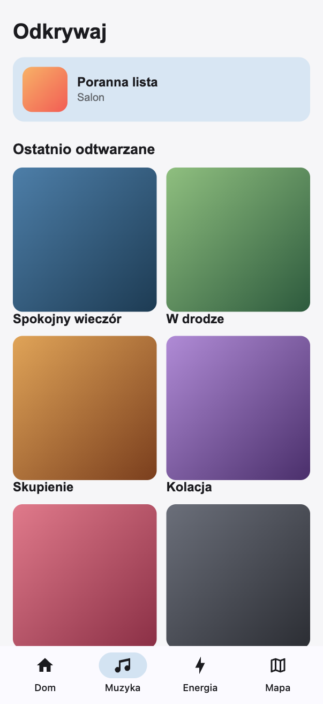 | 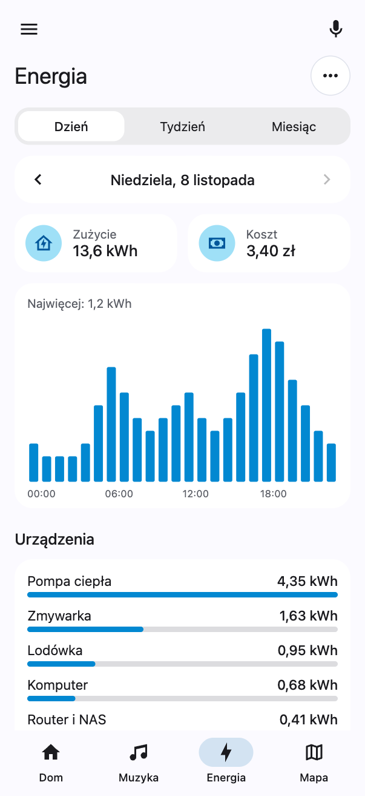 | 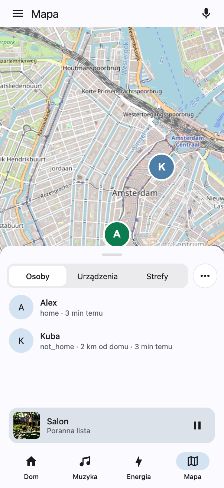 | 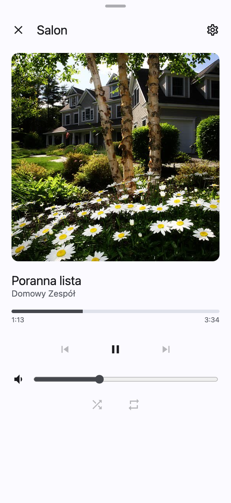 |

| Energia na tablecie | Wykres fazy |
|---|---|
| 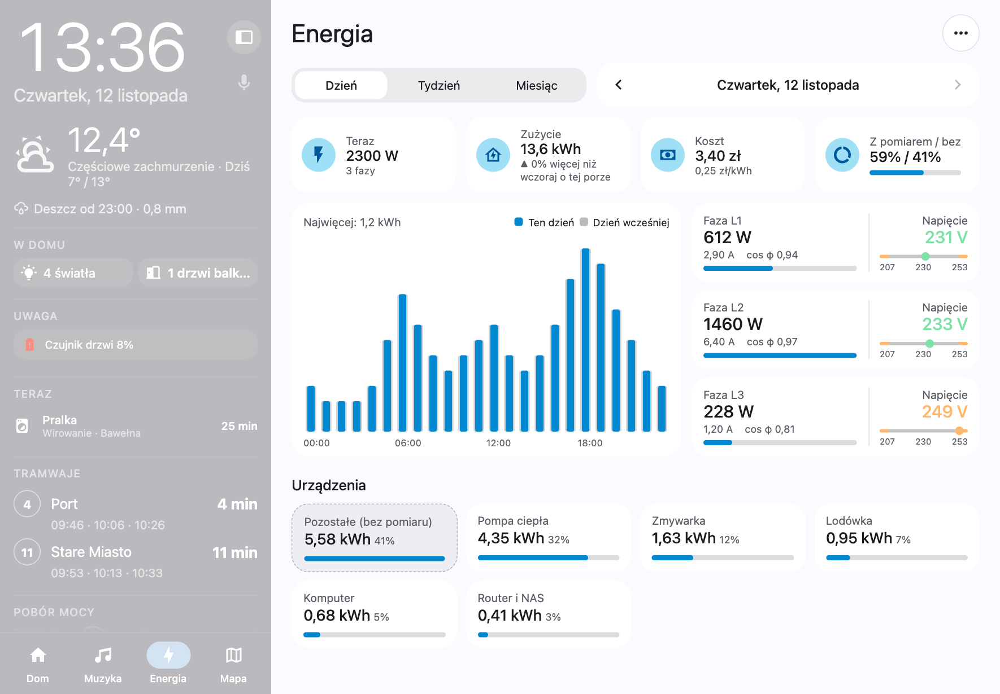 | 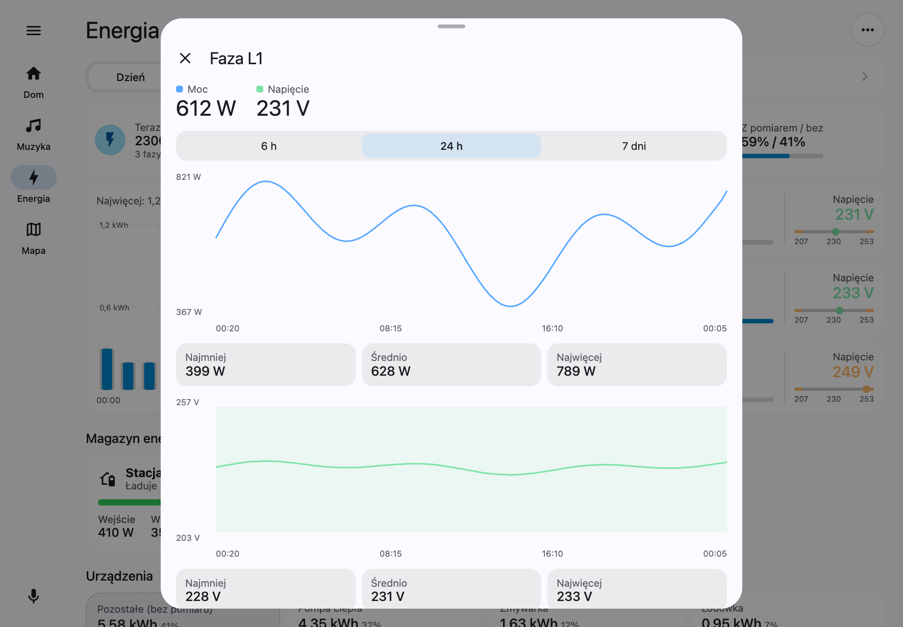 |

Obraz Muzyki zastępuje tu Twoją aplikację muzyczną, a obrazy Energii i Mapy karty Home Assistant, z wymyślonymi
liczbami.

<b class="ui">Muzyka</b> zajmuje miejsce Mediów na pasku nawigacji. Dodaj kartę albo stronę WWW:

```yaml
music:
  frame: http://homeassistant.local:8095
```

Strona po HTTP nie otworzy się w dashboardzie po HTTPS. Na telefonie dolny pasek chowa się przy pełnoekranowym
odtwarzaczu Music Assistant tylko wtedy, gdy ramka pochodzi z tego samego adresu co Home Assistant. Gdy coś gra,
na pozostałych stronach nad paskiem widać mini-odtwarzacz. Głośniki będące tym samym urządzeniem scala
`media.group_patterns`.

<b class="ui">Energia</b> to własna strona dashboardu, w jego wyglądzie: <b class="ui">Dzień</b>, <b class="ui">Tydzień</b> albo <b class="ui">Miesiąc</b> ze strzałkami do
wcześniejszych okresów, kafelki <b class="ui">Zużycie</b> i <b class="ui">Koszt</b> (oraz <b class="ui">Ze słońca</b>, <b class="ui">Do sieci</b>, <b class="ui">Gaz</b>, <b class="ui">Woda</b>, gdy je
masz), wykres godzin albo dni i lista **Urządzeń** z udziałem każdego. Dane pochodzą z ustawień Energii i statystyk
Home Assistant, tak jak w jego panelu Energia, więc liczby są te same. Karty mają wygląd przycisków z motywu. Mały
odtwarzacz nie pokazuje się na Energii ani na Mapie, żeby nie zasłaniać dołu strony. Energię ustawisz w
**Ustawienia → Dashboardy → Energia**: licznik dodaj jako źródło sieciowe, a urządzenia w sekcji
**Poszczególne urządzenia**. Jeśli urządzenie jest podłączone do innego mierzonego urządzenia, ustaw je tam jako
podrzędne, inaczej policzy się podwójnie.

Licznik z fazami (np. ZAMEL MEW-01 przez SUPLA i MQTT) daje więcej:

- <b class="ui">Teraz</b>: moc całego mieszkania, suma faz, i częstotliwość sieci.
- <b class="ui">Zużycie</b> z porównaniem do poprzedniego okresu: dla bieżącego dnia „wczoraj o tej porze”, dla tygodnia i miesiąca
  „do tej pory”. Wykres pokazuje poprzedni okres przygaszony za słupkami.
- <b class="ui">Koszt</b> z ceną za kWh, a <b class="ui">Z pomiarem / bez</b>: jaka część zużycia przypada na urządzenia z pomiarem. Reszta jest
  na liście jako <b class="ui">Pozostałe (bez pomiaru)</b>.
- **Fazy L1–L3**: moc, natężenie, cos φ i napięcie na skali 207–253 V (230 V ±10%). Napięcie jest zielone w normie,
  pomarańczowe blisko jej końców i czerwone poza nią. Dotknięcie fazy otwiera okno z wykresem jej mocy i
  napięcia (z pasem normy), a dotknięcie urządzenia, **Zużycia** albo <b class="ui">Teraz</b> wykres zużycia lub mocy faz. Zakresy:
  6 h, 24 h, 7 dni (moc) albo 24 h, 7 dni, 30 dni (energia); palec na wykresie pokazuje wartość w tej chwili, pod
  wykresem są najmniej, średnio i najwięcej.

Fazy znajdują się same na urządzeniu pierwszego licznika sieci, po numerze fazy w nazwach czujników (`faza_1`,
`phase_2`, `_l3`) i po tym, co mierzą. Inaczej wskaż je w YAML dashboardu:

```yaml
energy:
  phases:
    - power: sensor.licznik_faza_1_moc
      voltage: sensor.licznik_faza_1_napiecie
      current: sensor.licznik_faza_1_prad
      factor: sensor.licznik_faza_1_wspolczynnik
  voltage_range: [207, 253]   # domyślnie
```

Na tablecie poziomo liczby stoją w jednym rzędzie, wykres obok faz, a urządzenia są kafelkami po cztery w rzędzie.

<b class="ui">Mapa</b> rysuje trasy osób z ostatnich godzin, razem ze strefami, na mapie Home Assistant. Nad mapą są dwa rzędy
przycisków: **czyje trasy** (Wszyscy, każda osoba i wybrane urządzenia) oraz **zakres**: 6 h, 24 h, 3 dni albo 7 dni.
Każde urządzenie pamięta swój wybór. Urządzenie z trasą, np. samochód, dodajesz w konfiguracji:

```yaml
map:
  track: [device_tracker.car_location]
```

Kolory mapy (jak strona, jasna, ciemna) i zakres na start ustawia **Wygląd → Tło → Mapa**; Apple Home ma ciemną mapę.
Lista Osoby, Urządzenia i Strefy leży na mapie: na telefonie to panel, który przeciągasz palcem między wąskim paskiem, połową i całym ekranem, a na tablecie pływa z lewej. Dotknięcie pozycji pokazuje ją na mapie.

Strona Muzyka otworzy dodatek Music Assistant także na kontach bez administratora: `music: {addon: abcd1234_music_assistant}`. Z `fullscreen: true` dolny pasek znika, a przycisk **Home Assistant** w menu Music Assistant wraca na stronę główną.

Stronę Media ułożysz we własne grupy przez `media.sections` albo w formularzu **Odznaki podsumowania → Kategorie mediów** (zrzut niżej). Kafelki wpisuje się jak w pokoju, także `kind: tv` i
`kind: panel`. Te, które stoją też w układzie pokoju, pokazują się w filtrze Media na stronie głównej, w swoim pokoju:

```yaml
media:
  sections:
    - title: Głośniki
      tiles:
        - {entity: media_player.salon_homepod, name: Salon}
    - title: Telewizory
      tiles:
        - {kind: tv, entity: media_player.tv, name: Telewizor}
```

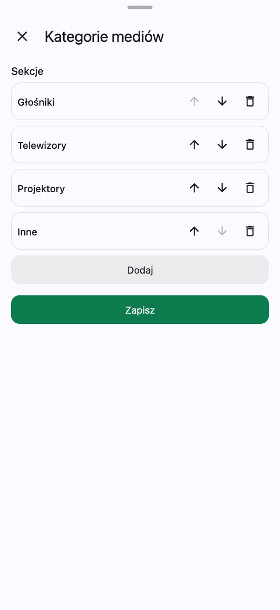

## 9. Osoby

### Trzy kropki na stronie głównej

Na dole menu trzech kropek są, po kolei: <b class="ui">Dostęp użytkowników</b>, <b class="ui">Tło tego ekranu</b>, <b class="ui">Mój układ</b> i **Odznaki
podsumowania**; w pokoju zamiast dwóch ostatnich **Mój widok** i **Edytuj ten ekran**. **Wygląd** jest w menu bocznym.
Część zmienia dashboard tylko dla Ciebie, część dla domowników:

| Pozycja | Kto ją widzi | Co ustawia | Dla kogo i gdzie się zapisuje | Gdzie widać zmianę |
|---|---|---|---|---|
| <b class="ui">Mój układ</b> | każdy | kolejność i ukrycie kamer, obszarów, plakietek i scen, własne ulubione, ukryte wpisy menu, start dashboardu | dla Ciebie, na koncie HA, czyli na wszystkich Twoich urządzeniach; administrator w Obszarach i Ulubionych może zaznaczyć <b class="ui">Dla wszystkich</b> | strona główna, pokoje, menu, Ochrona (kamery) |
| <b class="ui">Odznaki podsumowania</b> | administratorzy | lista skrótów (bloków): dodanie nowego, kolejność, edycja w formularzu, kategorie mediów | dla wszystkich, w konfiguracji dashboardu | skróty na stronie głównej, w menu i w pokojach; kategorie na stronie Muzyka |
| <b class="ui">Dostęp użytkowników</b> | administratorzy | co zabrać wybranej osobie albo wszystkim oprócz Ciebie: kamery, obszary, sekcje pokoi, plakietki, światła, media, ochronę, sceny i inne | dla tej osoby, w konfiguracji dashboardu (`access`); ona nie może tego przywrócić | wszędzie w tym dashboardzie, u tej osoby |
| <b class="ui">Wygląd</b> | każdy, w menu bocznym | wyrazistość tła, odbicie przewijania, wygląd przycisków (krycie, zaokrąglenie, kolor na całym przycisku albo tylko na ikonie, kolory dla rodzajów przycisków) i własne ikony urządzeń; administrator także motywy | dla Ciebie, na koncie HA; administrator z <b class="ui">Dla wszystkich</b> ustawia wygląd wspólny (`appearance`) | cały dashboard |
| <b class="ui">Tło tego ekranu</b> | każdy | tło strony, na której jesteś, osobno dla jasnego i ciemnego wyglądu, oraz Twój wygląd: Systemowy, Jasny, Ciemny | dla Ciebie na koncie; z <b class="ui">Dla wszystkich</b> (administratorzy) jako tło domyślne w konfiguracji | tylko ta strona: główna albo pokój, w którym jesteś |

Kolejność ważności: najpierw <b class="ui">Dostęp użytkowników</b> (czego nie ma, tego nie przywróci żaden układ), potem ustawienia
<b class="ui">Dla wszystkich</b>, na końcu <b class="ui">Mój układ</b> i własne tło danej osoby. Szczegóły każdej pozycji są niżej, a <b class="ui">Odznaki podsumowania</b>
w części [Edytor bloków](#edytor-bloków).

| Tło | Mój układ | Dostęp użytkowników |
|---|---|---|
| 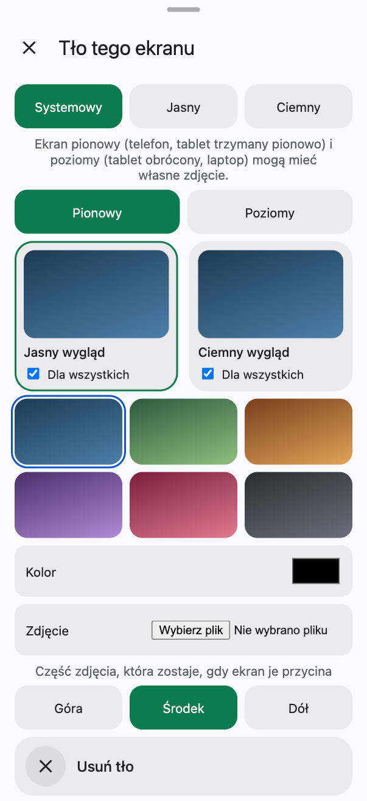 | 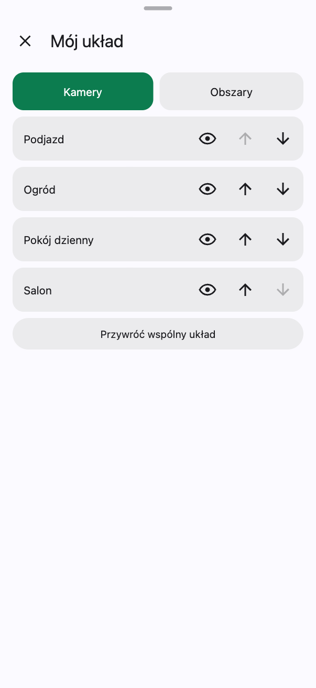 | 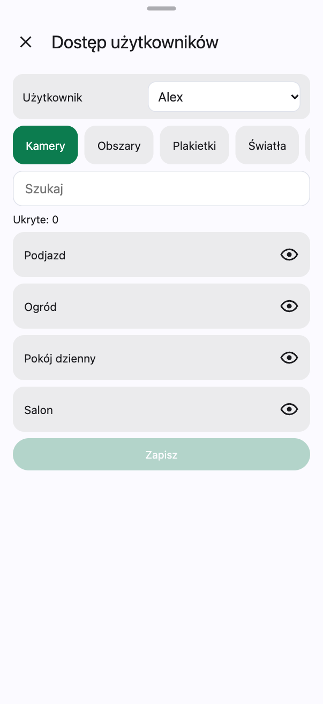 |

<b class="ui">Mój układ</b> (trzy kropki na stronie głównej, dla każdego): kolejność i ukrywanie kamer, obszarów, plakietek i scen,
własne <b class="ui">Ulubione</b> (startują od wspólnych, kolejne dodajesz wyszukiwarką) oraz ukrywanie wpisów <b class="ui">Menu</b>. Na dole jest
<b class="ui">Otwieraj ten dashboard przy starcie na moich urządzeniach</b>: wybór zapisuje się na koncie, a każde urządzenie przejmuje
go po połączeniu z Home Assistant.

Administrator w zakładkach <b class="ui">Obszary</b> i <b class="ui">Ulubione</b> zaznacza <b class="ui">Dla wszystkich</b> i ustawia wtedy wspólną kolejność
obszarów, ich ukrycie oraz wspólne ulubione, od których zaczyna każdy. Zmiany zapisuje <b class="ui">Zapisz dla wszystkich</b>. Obszar
ukryty dla wszystkich zostaje na tej liście, więc da się go przywrócić. To jedyne miejsce tych ustawień: okno
<b class="ui">Ustawienia dashboardu</b> ma na górze <b class="ui">Wczytaj aplikację od nowa</b>, a pod nim powrót po bezczynności, start na tym
urządzeniu, mówienie w oknie kamery, powiązanie kamer z rejestratora z tymi samymi kamerami w innej integracji i edytor
konfiguracji. <b class="ui">Wczytaj aplikację od nowa</b> pobiera świeże pliki dashboardu i otwiera stronę od nowa, gdy aplikacja, np. poza domem, pokazuje starą wersję.

<b class="ui">Mój widok</b> (trzy kropki w pokoju, dla każdego): ukrywa dla Ciebie całą sekcję albo pojedynczy kafelek, także grupę
<b class="ui">Sceny</b>. Ukryty kafelek znika z pokoju i z jego miejsca na stronie głównej. <b class="ui">Pokaż wszystko w tym pokoju</b> przywraca
całość. To, co zabrał administrator, nie pojawia się na liście i nie da się tego przywrócić. Zapisuje się na koncie, więc
działa na wszystkich urządzeniach tej osoby.

| Mój widok pokoju | Moje sceny |
|---|---|
| 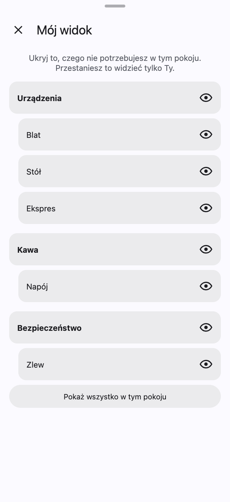 | 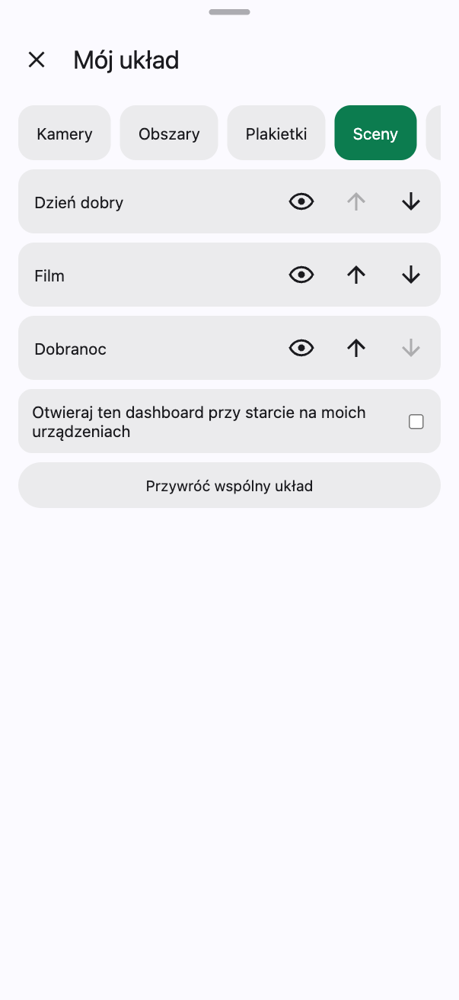 |

<b class="ui">Tło tego ekranu</b> (trzy kropki, dla każdego): gradient, kolor lub zdjęcie dla strony głównej, pokoju, strony Scen (klucz `scenes`), Mapy (`map`) albo Energii (`energy`), osobno dla
jasnego i ciemnego wyglądu; wygląd bez własnego tła pokazuje zwykłą stronę. Na górze tego okna wybierasz też dla siebie wygląd całego dashboardu: Systemowy, Jasny albo Ciemny. <b class="ui">Dla wszystkich</b> widzą administratorzy i ustawia ono tło domyślne. Bez tego tło zostaje
na koncie tej osoby. Własne tło wygrywa z domyślnym.

<b class="ui">Utwórz tło</b> w tym samym oknie otwiera kreator tła, podobny do aplikacji tworzących tapety do aplikacji Dom: wybierasz
jedno z 16 gotowych teł albo wzór i gradient (48 do wyboru albo własne dwa kolory) i jeśli chcesz, kładziesz na to
zdjęcie, przezroczyste, odbarwione albo rozmyte, mniejsze i w rogu, obrócone albo odbite, wygaszone od najwyżej trzech
krawędzi. Podgląd pokazuje na tle kilka kafelków, więc od razu widać, czy
dashboard zostaje czytelny. <b class="ui">Użyj jako tło</b> tworzy naraz obraz pionowy i szeroki i wpisuje je do jasnego wyglądu,
ciemnego albo obu. W edytorze na komputerze ten sam kreator otwiera się szeroko przyciskiem <b class="ui">Utwórz tło</b> we wpisie
<b class="ui">Tła stron</b> (Wygląd → Motywy i tła), z telefonem i tabletem obok siebie.

Każde pole takiego wpisu (jasny, ciemny i oba szerokie) pokazuje na końcu, co zawiera: próbkę koloru albo gradientu
albo lupkę, która otwiera obrazek w dużym oknie. Kliknięcie w pole otwiera okno z dwiema zakładkami. <b class="ui">Obrazki</b>
pokazuje miniatury wgranych do Home Assistanta i tych z folderu `/config/www` (kliknięcie wybiera, lupka powiększa), a
<b class="ui">Wgraj obrazek z komputera</b> dodaje nowy. <b class="ui">Kolor i gradient</b> ustawia jeden kolor z palety albo gradient: jego
kolory, ich miejsca w procentach i kierunek, z 48 gotowymi gradientami i dużym podglądem; powstały CSS zostaje pod
spodem do ręcznej zmiany. Każde inne pole edytora z adresem obrazka też ma lupkę. Obrazki z folderu `www` pokażą się po
restarcie Home Assistanta z nową wersją integracji.

Ekran pionowy i poziomy mogą mieć różne zdjęcia, bo pionowe zdjęcie na laptopie zostaje mocno przycięte:

| Kształt | Kiedy | Klucz w konfiguracji |
|---|---|---|
| <b class="ui">Pionowy</b> | telefon, tablet trzymany pionowo, każde okno wyższe niż szersze | `light`, `dark` |
| <b class="ui">Poziomy</b> | tablet obrócony, laptop, każde okno szersze niż wyższe | `light_wide`, `dark_wide` |

Przełącznik **Pionowy / Poziomy** w oknie tła wybiera, który kształt edytujesz; na starcie jest kształt Twojego ekranu.
Gdy kształt nie ma własnego zdjęcia, bierze zdjęcie drugiego kształtu tego samego wyglądu. Podgląd jest wtedy
przygaszony i podpisany <b class="ui">Jak pionowy</b> albo <b class="ui">Jak poziomy</b>, więc jedno zdjęcie dalej wystarcza na oba. Obrót tabletu
zmienia tło od razu.

**Część zdjęcia, która zostaje** (Góra, Środek, Dół) mówi, co zostaje, gdy ekran przycina zdjęcie. Przy zdjęciu z
domem u góry wybierz <b class="ui">Góra</b>. Dotyczy zdjęć, nie gradientów i kolorów. W konfiguracji to `position: top`; środek jest
domyślny i się nie zapisuje.

```yaml
backgrounds:
  home:
    light: /api/image/serve/<id>/original       # pionowy
    light_wide: /api/image/serve/<id>/original  # poziomy
    dark: "#121316"
    position: top
```

### Wygląd

<b class="ui">Wygląd</b> (menu boczne, nad **Ustawieniami dashboardu**, dla każdego) ma sześć zakładek (<b class="ui">Tło</b>, <b class="ui">Przyciski</b>, <b class="ui">Kolory</b>, <b class="ui">Pasek</b>, <b class="ui">Okna</b>, <b class="ui">Ikony</b>), a przy <b class="ui">Dla wszystkich</b> siódmą: <b class="ui">Motywy</b>. Administrator ma zaznaczone **Dla
wszystkich** i wtedy zmienia wygląd wspólny, który zapisuje **Zapisz dla wszystkich**. Bez tego znacznika, i u każdej
innej osoby, zmiany są tylko Twoje. Zapisuje się wyłącznie to, czym różnisz się od wyglądu wspólnego, więc to, czego nie
ruszasz, dalej podąża za zmianami administratora. <b class="ui">Wróć do wyglądu dla wszystkich</b> usuwa Twoje zmiany.

| Tło | Przyciski | Kolory | Ikony |
|---|---|---|---|
| 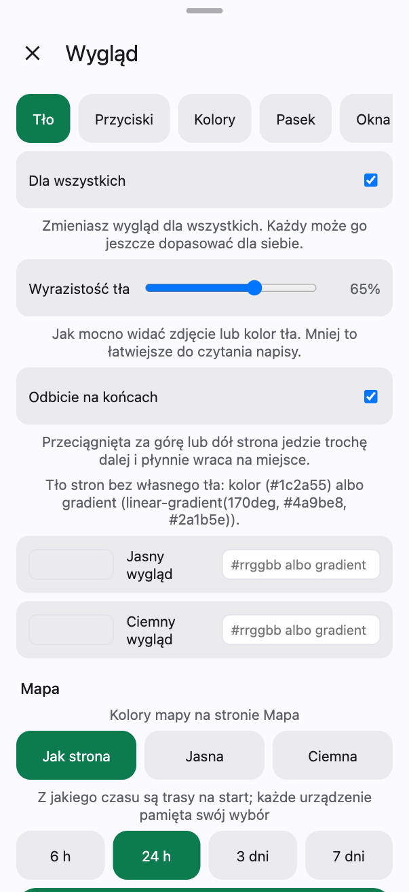 | 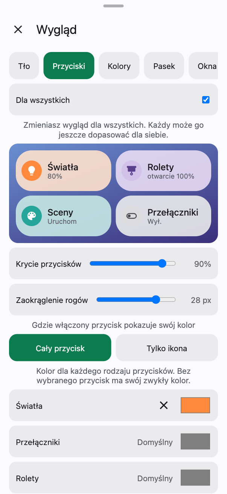 | 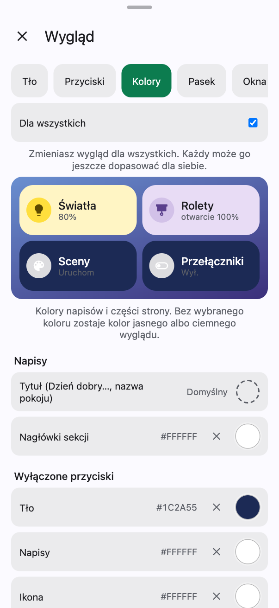 | 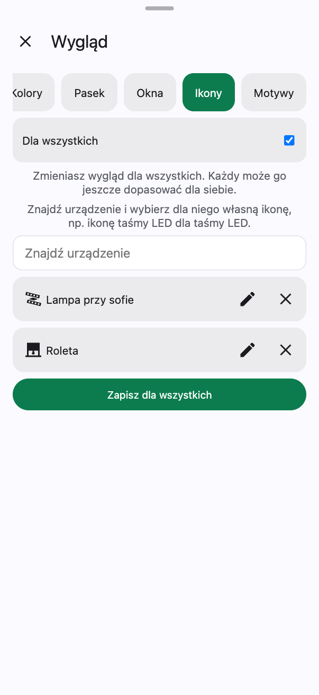 |

| Pasek | Okna |
|---|---|
| 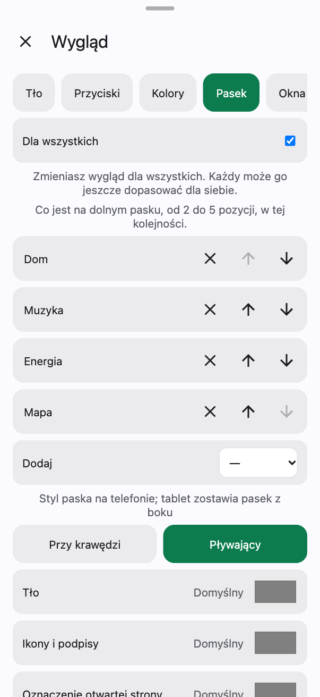 | 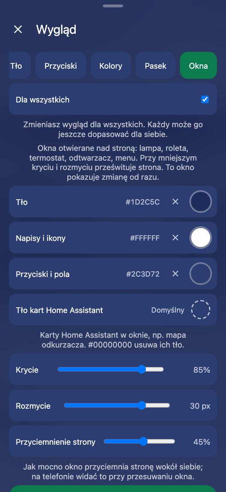 |

Kolor bez wartości (<b class="ui">Domyślny</b>) zostawia kolor jasnego albo ciemnego wyglądu, więc motyw może zmieniać tylko część
kolorów. Kolor wybrany zostaje ten sam w obu trybach. W YAML i w motywie kolor może mieć przezroczystość:
`#rrggbbaa`, np. `#ffffff26` to biel w 15%. Tak zbudowany jest Apple Home: czarne przyciski z kryciem 26% i białe
kółka w 15% biorą kolor tła, na którym leżą, więc pasują do każdego pokoju. Wybór koloru w oknie zmienia odcień, a
przezroczystość zostaje.

| Zakładka | Ustawienie | Domyślnie | Co robi |
|---|---|---|---|
| <b class="ui">Tło</b> | <b class="ui">Wyrazistość tła</b> (0-100%) | 40% | jak mocno widać zdjęcie lub kolor tła; reszta to kolor strony nałożony na tło, żeby napisy były czytelne. 100% to tło bez przygaszenia |
| <b class="ui">Tło</b> | <b class="ui">Odbicie na końcach</b> | włączone | strona przeciągnięta za górę lub dół jedzie trochę dalej i płynnie wraca, jak w aplikacjach na telefonie; tło stoi w miejscu, a odbija się tylko układ |
| <b class="ui">Tło</b> | **Jasny wygląd / Ciemny wygląd** (tło stron bez własnego tła) | brak | kolor (`#1c2a55`) albo gradient (`linear-gradient(170deg, #4a9be8, #2a1b5e)`) dla każdej strony bez własnego tła, oprócz Muzyki; na Mapie widać je nad mapą i pod nią; bez zdjęć, więc motyw pasuje do każdego domu |
| <b class="ui">Przyciski</b> | <b class="ui">Krycie przycisków</b> (20-100%) | 100% | przy mniejszym kryciu przez przyciski prześwituje tło |
| <b class="ui">Przyciski</b> | <b class="ui">Zaokrąglenie rogów</b> (0-36 px) | 20 px | 0 to prostokąt, 36 to pigułka |
| <b class="ui">Przyciski</b> | **Cały przycisk / Tylko ikona** | Cały przycisk | gdzie włączony przycisk pokazuje kolor; przy <b class="ui">Tylko ikona</b> tło przycisku zostaje neutralne |
| <b class="ui">Przyciski</b> | kolory rodzajów | brak | własny kolor dla świateł, przełączników, rolet, termostatów, nagłośnienia i TV, zamków i alarmu, wentylatorów, scen, skryptów, automatyzacji i czujników |
| <b class="ui">Kolory</b> | <b class="ui">Napisy</b>: tytuł (Dzień dobry…, nazwa pokoju) i nagłówki sekcji | kolory wyglądu | kolor napisów i ikon w górnym pasku |
| <b class="ui">Kolory</b> | <b class="ui">Wyłączone przyciski</b>: tło, napisy, ikona, kółko pod ikoną | kolory wyglądu | wygląd przycisków, które są wyłączone, oraz wszystkich przy <b class="ui">Tylko ikona</b> |
| <b class="ui">Kolory</b> | <b class="ui">Górne bloki</b>: tło, napisy, krycie, zaokrąglenie | jasne tło, 100%, 14 px | bloki Pogoda, Klimat, Światła…; z wybranym tłem bez obwódki |
| <b class="ui">Kolory</b> | <b class="ui">Okrągłe przyciski</b>: tło, ikona, krycie | jasne tło, 100% | interkom i trzy kropki |
| <b class="ui">Kolory</b> | <b class="ui">Plakietki w pokojach</b>: napisy, ikona i obwódka; <b class="ui">Wypełnione kółka stanu pokoju</b> (wyłączone: kółka puste w środku, z obwódką i ikoną w kolorze rodzaju, jak w Apple Home); <b class="ui">Kolory rodzajów w kółkach stanu pokoju</b> (wyłączone: każde kółko w kolorze ikony) | kolory wyglądu, rodzaje włączone | plakietki pod nazwą pokoju (Temperatura, Wilgotność, Klimat, Światła…) |
| <b class="ui">Pasek</b> | pozycje: od 2 do 5 z listy Dom, Media albo Muzyka, Energia, Mapa, Sceny, Menu i pokoje; kolejność strzałkami | Dom, Media/Muzyka, Energia, Mapa | pokój i Sceny są podświetlone, gdy są otwarte; w innym pokoju podświetlony jest Dom |
| <b class="ui">Pasek</b> | **Przy krawędzi / Pływający** | Przy krawędzi | pływający pasek to zaokrąglona pigułka nad dolną krawędzią, jak w Apple Home; tablet zawsze ma pasek z boku |
| <b class="ui">Pasek</b> | tło, ikony i podpisy, oznaczenie otwartej strony, krycie, rozmycie | kolory wyglądu, 100%, 0 px | przy mniejszym kryciu i rozmyciu strona pod paskiem prześwituje jak przez matowe szkło |
| <b class="ui">Pasek</b> | <b class="ui">Pasek statusu</b>: włączony, części i ich kolejność, kolorowe ikony, tło, tekst, krycie, rozmycie | wyłączony; pogoda, w domu, uwaga, teraz, odjazdy, pobór mocy; białe ikony na szkle | tylko tablet poziomo; opis w rozdziale 10 |
| <b class="ui">Pasek</b> | <b class="ui">Odtwarzacz</b>: wstrzymany zostaje (0-120 min), tło, napisy i ikony, krycie, rozmycie, zaokrąglenie | 10 min, kolory wyglądu, 100%, 0 px, 16 px | mały odtwarzacz nad paskiem; pokazuje tylko to, co gra albo zostało wstrzymane niedawno; 0 chowa wstrzymane od razu, a × zamyka go do czasu, aż coś zacznie grać |
| <b class="ui">Okna</b> | tło, napisy i ikony, przyciski i pola, tło kart Home Assistant, krycie, rozmycie (0-40 px), przyciemnienie strony (0-80%) | kolory wyglądu, 100%, 0 px, 45% | wszystkie okna otwierane nad stroną: lampa, roleta, termostat, odtwarzacz, menu trzech kropek, Pogoda, Status, Host, Rok szkolny, odjazdy, Wiadomości, Media, odkurzacz; tło kart Home Assistant `#00000000` usuwa np. szare tło mapy odkurzacza; wybrane zakładki i wyróżnione wydarzenia dostają jaśniejsze i żółte szkło; przy mniejszym kryciu strona prześwituje rozmyta; arkusz Wygląd pokazuje zmianę od razu, przed zapisem |
| <b class="ui">Ikony</b> | ikona urządzenia | ikona z HA | wyszukaj urządzenie, potem ikonę (np. `led strip`) i wybierz ją; lista pod wyszukiwarką pokazuje Twoje ikony |

Kolor rodzaju widać, gdy przycisk jest włączony. Sceny, skrypty i czujniki nie mają stanu „wyłączone”, więc ich kolor
widać zawsze. Wybrany kolor zastępuje też kolor żarówki na kafelku światła. Napis na ikonie sam zmienia się na ciemny
albo biały, zależnie od jasności koloru. Na górze zakładki <b class="ui">Przyciski</b> jest podgląd z kilkoma przyciskami.

Własna ikona wygrywa z ikoną ustawioną w edytorze pokoju i z ikoną z Home Assistant.

```yaml
appearance:
  background_strength: 70   # 0-100, domyślnie 40
  bounce: false             # domyślnie true
  tiles:
    opacity: 85             # 20-100, domyślnie 100
    radius: 28              # 0-36, domyślnie 20
    fill: icon              # tile albo icon
    colours:
      light: "#ffb300"
      cover: "#7e57c2"
      scene: "#26a69a"
    background: "#1c2a55"   # wyłączone przyciski
    text: "#ffffff"
    icon: "#ffffff"
    icon_background: "#2b3a6b"
  text:
    title: "#ffffff"
    headings: "#ffffff"
  chips:                    # górne bloki
    background: "#1c2a55"
    text: "#ffffff"
    opacity: 60             # 20-100, domyślnie 100
    radius: 24              # 0-30, domyślnie 14
  buttons:                  # interkom i trzy kropki
    background: "#1c2a55"
    icon: "#ffffff"
    opacity: 50
  badges:                   # plakietki w pokojach
    fill: false             # kółka puste w środku, kolorowa obwódka i ikona (motyw Apple Home)
    kinds: false            # kółka bez kolorów klimatu, świateł, rolet
    text: "#ffffff"
    icon: "#ffffff"
  nav:                      # dolny pasek
    items: [home, scenes, "room:salon", menu]   # od 2 do 5: home, media, music, energy, map, scenes, menu, room:<id>
    style: floating         # docked albo floating
    background: "#2a2f6a"
    icon: "#ffffff"
    active: "#4a4f9a"
    opacity: 55             # 20-100, domyślnie 100
    blur: 20                # 0-30 px, domyślnie 0
  status:                   # pasek statusu na tablecie poziomo
    shown: true             # domyślnie false
    widgets: [weather, home, alerts, now, departures, power]   # części i ich kolejność
    colourful: false        # true = kolorowe ikony, linie tramwajów i wykresy
    background: "#17181c"   # bez koloru: szkło jak kafelki (czarne 26%)
    text: "#ffffff"
    opacity: 95             # 20-100, domyślnie 100; dotyczy wybranego koloru
    blur: 30                # 0-30 px, domyślnie 30
  sheets:                   # okna nad stroną
    background: "#1d2c5c"
    text: "#ffffff"
    controls: "#2c3d72"     # przyciski i pola w oknie
    cards: "#00000000"      # tło kart Home Assistant, np. mapy odkurzacza
    opacity: 70             # 20-100, domyślnie 100
    blur: 30                # 0-40 px, domyślnie 0
    scrim: 25               # przyciemnienie strony 0-80, domyślnie 45
  player:                   # mały odtwarzacz
    background: "#2a2f6a"
    text: "#ffffff"
    opacity: 60             # 20-100, domyślnie 100
    blur: 20                # 0-30 px, domyślnie 0
    radius: 22              # 0-32 px, domyślnie 16
    paused_minutes: 0       # 0-120, domyślnie 10
  icons:
    light.led_strip: mdi:led-strip-variant
```

Klucze kolorów: `light`, `switch`, `cover`, `climate`, `media_player`, `lock`, `fan`, `scene`, `script`, `automation`,
`binary_sensor`, `sensor`. Pomocnik `input_boolean` liczy się jako `switch`, `alarm_control_panel` jako `lock`, a
`button` jako `script`.

#### Motywy

Zakładka <b class="ui">Motywy</b> jest widoczna przy zaznaczonym <b class="ui">Dla wszystkich</b>. Motyw to wygląd dla wszystkich (tło, odbicie,
przyciski, kolory, własne ikony) razem ze wspólnymi tłami stron. Ustawienia osobiste, np. dzieci, nie należą do motywu.
Motywy tworzą bibliotekę w konfiguracji dashboardu (`themes`), a `theme` mówi, od którego zaczął się obecny wygląd.

Z Home Dashboard przychodzą dwa motywy, które są bazą do własnych:

| Motyw | Wygląd |
|---|---|
| **Home Dashboard** | jasne przyciski, zasłona tła 40%, bez odbicia: wygląd jak dotąd |
| **Apple Home** | ciemne, półprzezroczyste przyciski z białym tekstem, białe nagłówki, górne bloki jak pigułki, pływający szklany pasek, pełne tło i niebieski gradient dla stron bez własnego tła |

Motyw wbudowany ma podpis <b class="ui">Wbudowany w Home Dashboard</b>. Nie da się go usunąć, ale można go zmieniać: zmień wygląd
i wybierz **Zapisz zmiany w motywie …**, a Twój dom zachowa własną wersję (podpis **Twoja wersja**). Przycisk z
okrągłą strzałką przy takim motywie przywraca wersję wbudowaną. Motywy wbudowane nie mają zdjęć, najwyżej gradienty (Apple Home ma ciemne tło Mapy pod ciemną mapę); Twoja wersja
zapamiętuje także tła Twoich stron.

| Pozycja | Co robi |
|---|---|
| **W użyciu: …** | motyw, od którego zaczął się obecny wygląd; dopisek **zmieniony od wybrania**, gdy go potem zmieniłeś |
| **Zapisz zmiany w motywie …** | zapisuje obecny wygląd i tła stron w motywie, którego używasz; od tej chwili to jego wersja |
| **Wróć do motywu …** | przywraca wygląd i tła stron zapisane w motywie |
| wiersz motywu | <b class="ui">Użyj</b> (zastępuje wygląd tym z motywu, a tła tylko na stronach, które motyw ma; reszta Twoich teł zostaje), <b class="ui">Eksportuj do pliku</b>, <b class="ui">Usuń</b> z biblioteki albo, przy motywie wbudowanym, przywróć wersję wbudowaną (obecny wygląd zostaje) |
| <b class="ui">Zwykły wygląd</b> | wygląd bez ustawień motywu; tła stron zostają |
| <b class="ui">Nazwa motywu</b> + <b class="ui">Zachowaj obecny wygląd jako motyw</b> | dodaje Twoją wersję do biblioteki i oznacza ją jako używaną |
| <b class="ui">Eksportuj obecny wygląd do pliku</b> | plik `<nazwa>.home-dashboard-theme.json` z wyglądem i zdjęciami teł |
| <b class="ui">Importuj motyw</b> | wczytuje plik, pozwala wybrać nazwę i miejsce każdego tła, dodaje motyw do biblioteki i od razu go używa |

| Biblioteka motywów | Import motywu |
|---|---|
| 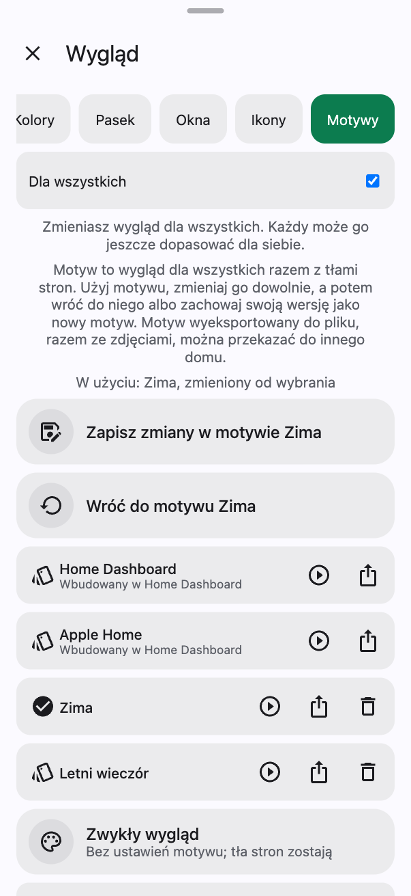 | 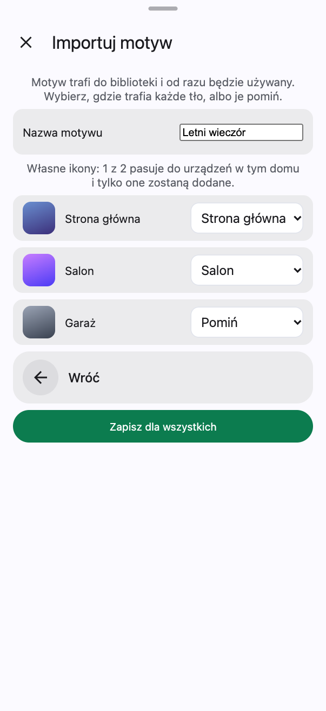 |

Jak tego używać:

1. **Wybierz bazę.** Menu → <b class="ui">Wygląd</b> → <b class="ui">Motywy</b> i <b class="ui">Użyj</b> przy **Home Dashboard** albo **Apple Home**.
   Możesz też zacząć od obecnego wyglądu: wpisz nazwę, np. „Nasz dom”, i wybierz **Zachowaj obecny wygląd jako
   motyw**.
2. **Dostosuj.** W zakładkach <b class="ui">Tło</b>, <b class="ui">Przyciski</b> i <b class="ui">Ikony</b> zmień, co chcesz, i zapisz <b class="ui">Zapisz dla wszystkich</b>;
   tła stron zmieniasz w <b class="ui">Tło tego ekranu</b>. Motyw pokaże się jako **zmieniony od wybrania**.
3. **Zapisz, cofnij albo zachowaj osobno.** **Zapisz zmiany w motywie …** zapisuje je w motywie, którego używasz.
   **Wróć do motywu …** cofa zmiany. Wpisz nową nazwę i <b class="ui">Zachowaj obecny wygląd jako motyw</b>, a nowa wersja stanie
   obok dotychczasowej; przełączasz je przyciskiem <b class="ui">Użyj</b>.
4. **Podziel się.** Przycisk eksportu przy motywie (albo <b class="ui">Eksportuj obecny wygląd do pliku</b>) zapisuje plik, który
   wyślesz np. bratu.
5. **Wczytaj cudzy motyw.** <b class="ui">Importuj motyw</b>, wybierz plik, popraw nazwę, przypisz każde tło do swojej strony albo
   wybierz <b class="ui">Pomiń</b>, a potem <b class="ui">Zapisz dla wszystkich</b>.

Przełączenie motywu nie gubi Twojej pracy: wygląd, którego nie ma jeszcze w bibliotece, zapisuje się w niej sam jako
**Mój wygląd <data>**.

Import pokazuje każde tło z miniaturą i listą: <b class="ui">Pomiń</b>, <b class="ui">Strona główna</b>, <b class="ui">Sceny</b> albo pokój. Na starcie wybrana
jest ta sama strona, jeśli istnieje, albo pokój o tej samej nazwie; reszta czeka na wybór. Zdjęcia trafiają do Home
Assistant (jak przy wyborze zdjęcia w oknie tła), a biblioteka trzyma tylko ich adresy. Własne ikony przychodzą tylko
dla urządzeń o tym samym `entity_id`; okno mówi, ile z nich pasuje.

Plik może mieć kilka MB, bo zawiera zdjęcia. Zdjęcia z internetu (adresy `https://`) nie są przenoszone, tylko obrazy z
pliku i kolory.

#### Apple Home krok po kroku

Szczegółowy poradnik, od instalacji po przygotowanie teł i palety kolorów, jest w [osobnym dokumencie](apple-home.pl.md).

| Strona główna | Tryb ciemny | Pokój | Lampa | Energia |
|---|---|---|---|---|
| 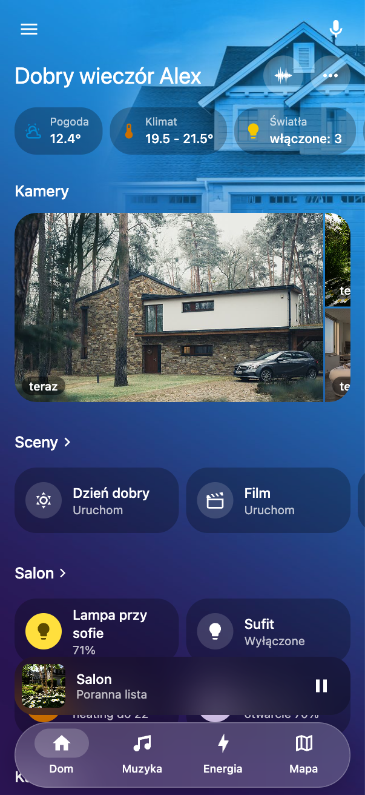 |  |  |  |  |


1. **Włącz motyw.** Menu → <b class="ui">Wygląd</b>, zaznacz <b class="ui">Dla wszystkich</b>, zakładka <b class="ui">Motywy</b> → <b class="ui">Użyj</b> przy
   **Apple Home**. Przyciski, górne bloki, pasek i okna stają się szkłem, napisy białe, a strony bez własnego tła
   dostają niebieski gradient.
2. **Dodaj tła.** Na stronie głównej i w każdym pokoju: trzy kropki → <b class="ui">Tło tego ekranu</b>, zdjęcie dla **Jasnego**
   i dla **Ciemnego** wyglądu, **Część zdjęcia: Góra**, <b class="ui">Dla wszystkich</b>. Najlepiej działa pionowe zdjęcie
   (np. 1284 × 2778) ze sprzętem pokoju u góry, które w dół przechodzi w jeden kolor; wersja ciemna to to samo
   zdjęcie przyciemnione. Przykłady są w `dev/demo-pictures/backgrounds`.
3. **Nie zmieniaj koloru przycisków.** W Apple Home są neutralne (czarne z kryciem 26%), więc w każdym pokoju biorą
   kolor jego tła. Okno urządzenia pokazuje rozmyte tło pokoju, z którego je otwarto.
4. **Mapa i Energia** mają własne tło w <b class="ui">Tło tego ekranu</b>; Apple Home daje Mapie ciemne tło pod ciemną mapę.
5. **Ikony.** **Wygląd → Ikony**: własne ikony urządzeń, np. taśma LED dla taśmy LED.
6. **Zapisz.** **Wygląd → Motywy → Zapisz zmiany w motywie Apple Home**. Eksport zapisze motyw razem ze zdjęciami
   teł do pliku, który wczytasz w innym domu.

<b class="ui">Dostęp użytkowników</b> (trzy kropki, administratorzy): wybierz osobę i ukryj jej obszary, kamery, światła, media,
ochronę, sceny, skrypty, inne encje i bloki, a w zakładce <b class="ui">Sekcje</b> także całe sekcje pokoi. Zakładka <b class="ui">Plakietki</b> zawiera pogodę, chipy i skróty, a ukryty skrót znika
też z menu i z **Mojego układu** tej osoby. Opcja <b class="ui">Wszyscy oprócz mnie</b> ukrywa coś od razu wszystkim innym kontom, na
przykład bloki administracyjne. Dotyczy kont istniejących w chwili zapisu, więc nowemu użytkownikowi ustaw to osobno.

<b class="ui">Kto to widzi</b> (kafelek w edycji): Wszyscy, Tylko wybrani albo Wszyscy oprócz. Dotyczy encji wszędzie, także Twojego
konta. W edycji administrator i tak widzi wszystko: kafelek zielony widzą tylko wybrane osoby, a czerwony jest przed
kimś ukryty.

To wszystko ukrywa rzeczy w dashboardzie, ale nie jest uprawnieniem: Home Assistant nie ma uprawnień do pojedynczych
encji, więc ta sama osoba dojdzie do nich w innym dashboardzie. Jeśli to ważne, ukryj jej też inne dashboardy.

## 10. Telefony i tablety

- Poniżej 900 px szerokości nawigacja jest na dole, a od 900 px z boku.
- Tablet zostawiony sam wraca na stronę główną po 3 minutach: `idle: {return_after: 300}` w sekundach, `0` wyłącza.
- Zamek na tablecie można tylko zamknąć, bo do ściany ma dostęp każdy: zmienia to `security.unlock_on_tablet: true`.
- **Ustawienia dashboardu → otwieraj przy starcie** sprawia, że to urządzenie startuje na dashboardzie, niezależnie
  od domyślnego ustawienia konta.
- Po aktualizacji zamknij i otwórz aplikację Companion. Gdy zostaje stary wygląd, użyj
  **Ustawienia → Aplikacja Companion → Debugowanie → Resetuj pamięć podręczną interfejsu**.
- Gdy strona powiększa się palcami, wyłącz powiększanie gestem w ustawieniach aplikacji Companion.

### Pasek statusu na tablecie

| Pasek statusu | Pogoda z paska statusu |
|---|---|
|  |  |

Tablet poziomo może zamiast wąskiego paska pokazać kolumnę 320 px (szerokość menu) z godziną, datą, pogodą i tym, co się dzieje, na
szybkie spojrzenie z drugiego końca pokoju. Strony (Dom, Muzyka, Energia, Mapa) zostają w rzędzie na dole kolumny.

- **Włączenie:** menu → <b class="ui">Wygląd</b> → zakładka <b class="ui">Pasek</b> → <b class="ui">Pasek statusu</b> → <b class="ui">Pokaż pasek statusu</b>. Jak cały
  wygląd: dla wszystkich (administrator) albo tylko dla siebie. Telefon i tablet pionowo zostają bez zmian.
- **Części i kolejność:** w tym samym miejscu, strzałkami, × usuwa część, lista dodaje ją z powrotem. Do tego tło,
  tekst, krycie i rozmycie. Domyślnie pasek jest szkłem jak kafelki, z białymi ikonami; kolor ma tylko ikona
  ostrzeżenia. <b class="ui">Kolorowe ikony, linie i wykresy</b> przywraca kolory. Część, która nie ma nic do pokazania, sama znika: <b class="ui">Uwaga</b> bez ostrzeżeń, <b class="ui">Teraz</b> gdy
  nic nie pracuje, w <b class="ui">W domu</b> zamknięte drzwi i okna oraz zero świateł.
- **Przycisk u góry po prawej** zwija kolumnę do zwykłego wąskiego paska; tablet to zapamiętuje. Zwinięty pasek ma ten
  przycisk na górze, a menu i asystenta na dole.
- **Dotknięcie części** otwiera jej okno: pogoda okno pogody, w <b class="ui">W domu</b> liczba świateł albo urządzeń listę tego,
  co jest włączone (z pokojem i godziną włączenia; dotknięcie otwiera okno tego urządzenia), a otwarte drzwi ekran
  Status (pierwszy blok Statusu; bez niego szczegóły drzwi), tramwaje okno rozkładu, pobór mocy stronę Energia,
  a <b class="ui">Uwaga</b> i <b class="ui">Teraz</b> szczegóły urządzenia.
- Światło albo urządzenie poza licznikiem, np. lampę, która działa według własnego harmonogramu, ustawia się w
  konfiguracji: w edytorze na komputerze **Pasek statusu → Nieliczone w W domu**
  ([`status_panel.ignore`](configuration.pl.md#11-pasek-statusu-tabletu)). Lista pokazuje je osobno, jako
  <b class="ui">Włączone, ale nieliczone</b>; na tablecie nie ma przycisku, który to zmienia.
- Drzwi i okna w <b class="ui">W domu</b> to listy **Pasek statusu → Drzwi (W domu)** i <b class="ui">Okna (W domu)</b> (`status_panel.doors`,
  `windows`): każda ma swoją plakietkę z otwartymi z tej listy, a nie wszystkimi czujnikami domu (drzwi pokoi zwykle
  są otwarte). Dotknięcie pokazuje listę otwartych z godziną otwarcia, jak przy światłach.
- <b class="ui">Znaczniki (W domu)</b> (`status_panel.flags`): plakietka, dopóki pomocnik jest włączony, np. **Poczta**, gdy ktoś
  otworzył skrzynkę na listy. Dotknięcie otwiera pomocnika; kto odebrał listy, wyłącza go.
- Pozycja ekranu Status z jedną encją w danym stanie (np. alarm wywołany, UPS na baterii) z `notify` jest też
  czerwonym paskiem na stronie głównej, jak słaba bateria; z `alarm: true` zostaje, dopóki stan trwa.
- **Bateria samego tabletu:** jedna cienka linia na dole paska, nad stronami: poziom w procentach i cienki pasek.
  Ikona i pasek są zielone z piorunem, gdy tablet jest podłączony (ładuje się albo jest pełny), pomarańczowe przy
  20% i mniej, czerwone przy 10% i mniej, a poza tym w kolorze tekstu; liczba ma kolor tekstu, czytelny na każdym
  tle. Przeglądarka na iOS nie podaje stronie stanu baterii, więc
  bierze się on z aplikacji Home Assistant na tablecie: w edytorze **Ustawienia → Urządzenia** →
  <b class="ui">Bateria</b> tego tabletu, spośród czujników baterii aplikacji (`sensor.<urządzenie>_battery_level`).
  To, czy się ładuje, odczytuje z czujnika stanu baterii aplikacji na tym samym urządzeniu. Bez wybranego czujnika
  linii nie ma.
- <b class="ui">Moje kalendarze</b> (telefon): okno wyboru obszaru ma pod pokojami <b class="ui">Moje kalendarze</b> z dzisiejszymi tytułami i ich
  liczbą; dotknięcie otwiera dziś i kolejne 14 dni, w których coś jest, każde wydarzenie z godziną, miejscem i opisem.
  Trybik wybiera własne kalendarze osoby i to, czy widzi kalendarze domu; zapisuje się w jej ustawieniach, więc idzie
  za nią na każde urządzenie. Tablet zalogowany jako osobny użytkownik widzi kalendarze domu.
- **Przytrzymanie tego przycisku** otwiera menu: pierścień wokół przycisku wypełnia się przez pół sekundy. Pierwsze
  trzy razy podpowiada to dymek. Strzałka w menu wraca do paska. Pod przyciskiem jest mikrofon asystenta.

Części:

| Część | Co pokazuje | Skąd |
|---|---|---|
| <b class="ui">Pogoda</b> | temperatura, opis, dziś min/maks, najbliższy deszcz lub śnieg w 12 h | encja pogody z rozdziału 4 |
| <b class="ui">Dziś</b> | dzisiejsze wydarzenia kalendarzy: całodniowe miękko w kolorze kalendarza na górze, pozostałe z godziną i „za 3 h”, w trakcie „teraz” z paskiem; wydarzenie znika po końcu. Najwyżej 3, potem „+N więcej”; dotknięcie otwiera kalendarz (na tablecie miesiąc z wydarzeniami wybranego dnia obok) | `status_panel.calendars` (Pasek statusu → Kalendarz w edytorze) i własne kalendarze osoby |
| <b class="ui">W domu</b> | włączone światła i urządzenia, otwarte drzwi i okna | pokoje dashboardu, `status_panel.doors` |
| <b class="ui">Uwaga</b> | te same ostrzeżenia co karty na stronie głównej | pozycje Statusu z `notify: true` |
| <b class="ui">Teraz</b> | to, co pracuje albo się dzieje (pralka, msza w niedzielę, odkurzacz) | `status_panel.now` |
| <b class="ui">Odjazdy</b> | każda linia z minutami (powyżej godziny: godzina odjazdu) i trzema godzinami | pierwszy blok odjazdów albo `status_panel.departures` |
| <b class="ui">Pobór mocy</b> | moc teraz i wykres z 6 godzin; pozycja z <b class="ui">Tylko gdy włączony</b> jest widoczna tylko, gdy jej przełącznik jest włączony | `status_panel.power` |

Dane ustawia się w YAML dashboardu (**Ustawienia → Dashboardy → Home Dashboard → ⋮ → Edytuj dashboard → ⋮ → Edytor
surowej konfiguracji**, w bloku `strategy:`):

```yaml
status_panel:
  doors:                          # tylko te drzwi i okna; pokój dziecka się nie liczy
    - binary_sensor.drzwi_wejsciowe
    - entity: binary_sensor.balkon_contact
      name: Balkon
  now:                            # pozycja pokazuje się, gdy encja nie spoczywa
    - entity: sensor.msza_najblizsza # "—" = nic; inaczej najbliższa godzina
      name: Msza
      icon: mdi:church
    - entity: sensor.pralka_faza
      name: Pralka
      icon: mdi:washing-machine
      detail: sensor.pralka_program     # dopisane po stanie
      remaining: sensor.pralka_pozostalo # po prawej
    - vacuum.odkurzacz
  power:
    - entity: sensor.serwer_moc
      name: Serwer
      color: "#76b900"
    - sensor.nuc_moc
  departures: null                # null = pierwszy blok odjazdów
```

Pozycja <b class="ui">Teraz</b> spoczywa przy stanach `off`, `idle`, `docked`, `standby`, `unavailable`, `unknown`, `—`, `none`,
`nie` (wielkość liter bez znaczenia). Własną listę daje `resting: [Off, Ready]`.

## 11. Intercom


Gdy masz skrypt, który mówi w wybranych obszarach, dashboard doda przyciski na stronie głównej, w pokojach i na ekranie
kamery:

```yaml
intercom:
  script: script.announce
  areas_field: areas
  text_field: text
  areas: [living_room, bedroom]
```

Skrypt dostaje obszary i tekst w tych polach. Nagrywanie wiadomości głosowej wymaga HTTPS.

Z integracją <b class="ui">Intercom</b> (domena `intercom`) nagranie idzie prosto do niej, a ona sama je odtwarza:

```yaml
intercom:
  script: intercom.announce     # tekst
  areas_field: areas
  text_field: message
  played_field: played          # pusta lista = brak głośnika, dashboard to zgłasza
  upload: /api/intercom/message # nagranie: POST z WAV, obszary w adresie (?areas=a,b)
```

Z `upload` nagrywać może każdy zalogowany, także konto tabletu na ścianie. Bez tej opcji nagranie trafia do
`media_folder`, do którego pliki może wgrać tylko administrator.

## 12. Edytor na komputerze

Przewodnik krok po kroku ze zrzutami, od pustego Home Assistanta do gotowego dashboardu, jest w
**[Edytor dashboardu](editor.pl.md)**. Ten rozdział go podsumowuje.

<b class="ui">Edytor dashboardu</b> w bocznym menu Home Assistant (tylko dla administratorów) edytuje dashboard na dużym ekranie,
z telefonem i tabletem obok siebie. Na urządzeniach w domu nic się nie zmienia, dopóki nie opublikujesz. Opcja
integracji *Pokazuj edytor w pasku bocznym* (Ustawienia → Urządzenia i usługi → Home Dashboard → Konfiguruj) chowa go z
paska; wtedy otwiera się pod adresem `/home-dashboard-editor`. Sam edytor ma jasny i ciemny wygląd: domyślnie taki
jak Home Assistant, a przycisk w górnym pasku przełącza Auto, Jasny i Ciemny (przeglądarka to pamięta). Podgląd ma
własny wybór jasnego i ciemnego dashboardu.

To, co jest wybrane w drzewie, ma w podglądzie czerwoną przerywaną ramkę, więc widać, który element edytuje formularz:
kafelek, sekcja, pokój, okno bloku albo liczba, przycisk, grupa czy wiersz w tym oknie. Ustawienia jej nie mają.

<b class="ui">Ustawienia edytora</b> (trybik na górnym pasku) zawierają telefony i tablety, które może pokazać podgląd. Każdy
wbudowany model (Apple) można ukryć z wyboru, zmienić mu nazwę albo rozmiar i przywrócić strzałką; pod każdą listą
dodajesz własne urządzenie dowolnej marki: nazwa, szerokość i wysokość w punktach (pikselach CSS: rozdzielczość ekranu
podzielona przez gęstość pikseli, np. 1280 × 800 dla Galaxy Tab S9). Telefon zawsze stoi pionowo, a tablet poziomo,
niezależnie od kolejności wpisanych wymiarów. Lista jest zapisywana w tej przeglądarce; jeden model każdego rodzaju
zawsze zostaje widoczny.

**Trzy kolumny.** Po lewej drzewo dashboardu: strona główna (ulubione, sceny), każdy pokój z listą „Na stronie
głównej”, scenami i sekcjami, bloki i pozostałe ustawienia. *Zwiń wszystko* i *Rozwiń wszystko* składają drzewo
(grupy zostają otwarte), strzałka przy nazwie grupy zwija samą grupę, a ikona po jej prawej zwija albo rozwija
wszystko w środku tej grupy,
wyszukiwarka znajduje pokój, kafelek albo encję, a kafelek z nieistniejącą encją jest oznaczony. W środku podgląd,
po prawej właściwości zaznaczonego elementu. Paski między kolumnami przeciągasz, żeby je poszerzyć; dwuklik
przywraca pierwszą szerokość. Przycisk ☰ w lewym górnym rogu otwiera menu Home Assistant.

**Podgląd** to prawdziwy dashboard w ramkach iPhone'a i iPada, pokazujący szkic od razu, jeszcze przed zapisem.
Wybierz *iPhone*, *iPad* albo *Oba*, jasny lub ciemny oraz *Jako* osobę, żeby zobaczyć jej widok. Listy telefonu i
tabletu mają każdy rozmiar ekranu Apple raz, z modelami tego rozmiaru: od iPhone'a SE 1 (320 × 568) i SE 2–3, 6, 7, 8
(375 × 667) po iPhone'a 16 Pro Max i 17 Pro Max (440 × 956), od iPada 1–6 (1024 × 768) i iPada mini 6–7 po iPada Pro
13″ M4+ (1376 × 1032). Przeglądarka pamięta wybór. Ustaw
**powiększenie** aplikacji Home Assistant każdego urządzenia (Ustawienia → Aplikacja Companion → Ogólne →
Powiększenie): iPad Air z 85 % pokazuje stronę jako 1388 × 965 i podgląd robi to samo. Dotknięcie w podglądzie
zaznacza ten kafelek w drzewie; ramki niczego nie przełączają i nie wywołują żadnej usługi. Wybór pokoju przenosi
ramki do niego.

**Właściwości.** Każdy kafelek, sekcja i pokój ma formularz ze wszystkimi kluczami, które przyjmuje, z nazwą klucza
YAML przy każdym polu; zakładka *YAML* pokazuje i zmienia to samo jako tekst. Klucze, których formularz nie zna,
zostają. Kafelek listy dostaje *Zaznacz, potem uruchom* i nazwy opcji.

**Szybki start.** Zaraz po instalacji edytor proponuje utworzenie dashboardu i jego pokoi z obszarów Home
Assistant: jeden pokój na obszar, jego urządzenia w sekcjach według rodzaju (oświetlenie, klimat i rolety,
multimedia, urządzenia, bezpieczeństwo, automatyzacje po zaznaczeniu), kilka kafelków każdego na stronie głównej.
Encje ukryte i techniczne są pomijane, a z urządzenia widocznego z dwóch integracji (Netatmo i HomeKit) powstaje
jeden kafelek. To samo jest potem pod ✨ przy *Pokoje* dla obszarów bez pokoju. Zaznaczone pokoje widać najpierw w
podglądzie.

**Budowanie.** *+* przy *Pokoje* dodaje pokój; pokój dostaje sekcje, a sekcja, lista „Na stronie głównej” pokoju,
ulubione i sceny dostają kafelki po encji albo przez *Wybierz z listy…*: wszystkie encje domu z obszarem i baterią,
filtrowane po pokoju, rodzaju, z ukryciem już pokazanych; okno ostrzega, gdy roleta, termostat albo zamek może być
jednym urządzeniem z dwóch integracji, i podpowiada ustawienia. Zaznaczone encje widać w podglądzie przed dodaniem.
Kafelki, sekcje i pokoje duplikujesz, przesuwasz w górę i w dół, usuwasz albo przeciągasz w drzewie. **Cofnij** i
**Ponów** (⌘Z, ⇧⌘Z) cofają każdy krok.

**Bloki.** Blok kilku encji rozwija się w drzewie na liczby, przyciski i grupy z wierszami, każde z formularzem.
Opcje listy (np. profile ekspresu) ustawiasz w kolejności, nazywasz i ukrywasz okiem. *Z urządzenia, jeszcze nie w
bloku* pokazuje encje urządzeń bloku, których jego okno nie ma: kliknięcie dodaje je jako wiersz. Wybór bloku
otwiera jego okno w podglądzie i mówi, czy mieści się na tablecie bez przewijania.
Pozostałe bloki (Status, odjazdy, wiadomości, host, rok szkolny, dodatek, strona, telewizor, waga) mają formularz z tymi
samymi polami co formularz bloku na tablecie: listy (sekcje Statusu z pozycjami, kolumny hosta, encje odjazdów)
rozwijasz, przesuwasz strzałkami i usuwasz, a to, co nie ma pola, wpisujesz jako YAML w samym polu. Kolumna hosta ma
paski (z jednostką, maksimum oraz progiem żółtym i czerwonym), szczegóły z typem do wybrania, maszyny w środku (nazwa,
status, procesor, pamięć) i zasilanie (moc, gniazdko, napięcie, natężenie, energia); tylko wykres jest kartą w YAML.
Rok szkolny ma osobne pole na każdy sensor, a gdy pole jest puste, wyszarzony podpowiada sensor Rodzinnika. Odjazdy
dostają kolor każdej linii, a wpis Statusu może być alarmem. Własne słowa stanów (wpis Statusu, magazyn energii) to
pary stan → słowo, własne włączanie i wyłączanie telewizora albo kafelka mediów to usługa i encja, wzorce głośników
wpisujesz w wierszach, a tła stron mają pole na każdy wygląd. YAML zostaje tylko dla kart Home Assistant i biblioteki
motywów. Zmiana nazwy bloku
zmienia ją też w kafelkach, menu, pasku statusu i regułach dostępu oraz widoczności.

**Ustawienia.** Węzły pod *Ustawienia* mają formularze podzielone na części, a każda część pokazuje klucz, który
zapisuje. <b class="ui">Pasek statusu</b> ustawia wygląd paska (`appearance.status`: czy się pokazuje, części i ich kolejność,
kolory, krycie, rozmycie) i to, co pokazuje (`status_panel`: drzwi i okna, nieliczone światła i urządzenia, Teraz,
pobór mocy, odjazdy). Podgląd iPada od razu pokazuje pasek ze szkicu. Część, którą wyczyścisz, znika z konfiguracji.
<b class="ui">Wygląd i motywy</b> ma część dla każdej grupy wyglądu (cały dashboard, tło stron, kafelki z kolorami według rodzaju,
napisy, górne bloki, okrągłe przyciski, plakietki, okna, mapa, odtwarzacz), z tymi samymi polami co okno Wygląd na
tablecie, oraz motywy i tła stron. Długi formularz zaczyna zwinięty; części rozwijasz kliknięciem nagłówka.
<b class="ui">Menu</b> to grupy lewego menu i ich pozycje (skrót, dodatek, adres, akcja, tylko dla administratorów, kto widzi,
ukryj w trybie gościa); wybór węzła otwiera menu w podglądzie. <b class="ui">Pasek stron</b> to miejsca na pasku (od 2 do 5: strony,
sceny, menu albo pokój) w kolejności oraz jego wygląd. Wybór bloku dowolnego rodzaju otwiera w podglądzie jego okno.
<b class="ui">Kamery</b> mają trzy części: które kamery i w jakiej kolejności, prywatność i tryb gościa (reguły z przełącznikiem,
ukrywanymi kamerami i osobami) oraz pojedyncze kamery (kamera na żywo dla obrazu, ta sama kamera w innej integracji,
mówienie, okrągłe przyciski, obracanie i encje pod trybikiem każdej kamery). <b class="ui">Interkom</b> to skrypt wiadomości,
pokoje do zaznaczenia i pola wywołania, a <b class="ui">Energia</b> to fazy licznika, zakres napięcia i magazyny energii.
<b class="ui">Dostęp osób</b> to najpierw osoba, potem to, czego nie widzi, w tych samych grupach co okno na tablecie (kamery, pokoje,
sekcje, górne bloki, światła, media, ochrona, sceny i skrypty, reszta), z okiem przy każdej pozycji. Niżej reguły
widoczności: encja, `block:<nazwa>` albo `shortcut:<nazwa>` i osoby, które to widzą (*only*) albo nie widzą (*except*).
Pozostałe węzły to <b class="ui">Pokoje: kolejność i ukryte</b>, <b class="ui">Encje</b> (dodane do pokoju, nigdy niepokazywane same, własna nazwa,
ikona, obszar albo karta encji), <b class="ui">Światła</b> (grupa zamiast lamp), <b class="ui">Strona główna i tablet</b> (pogoda, ochrona, powrót
zostawionego tabletu, układ scen) oraz strony <b class="ui">Muzyka</b>, <b class="ui">Media</b> i <b class="ui">Mapa</b>. Każde ustawienie dashboardu ma więc
formularz; zakładka YAML zostaje obok dla tego, co wolisz wpisać ręcznie.

**Publikacja.** Szkic zapisuje się na serwerze chwilę po każdej zmianie, więc czeka też na innym komputerze;
*Wyrzuć* go usuwa. *Opublikuj* pokazuje, co się zmieni, zwykłymi słowami i w YAML, brakujące encje i pole na
notatkę. Potem:

- <b class="ui">Opublikuj do sprawdzenia</b> jednej osobie: jej dashboard pokazuje tę wersję z paskiem *Wersja do sprawdzenia* i
  przyciskiem powrotu do zwykłej; nikt inny jej nie widzi. Góra edytora mówi, kto sprawdza; *Zakończ* to kończy.
- **Opublikuj dla wszystkich**: dashboard każdego urządzenia wczytuje nową wersję, a zastąpiona trafia do
  **Historii**. Jeśli od początku szkicu ktoś zmienił dashboard gdzie indziej (na telefonie), edytor to mówi zamiast
  nadpisać tamtą zmianę; *Opublikuj mimo to* ją nadpisuje.

<b class="ui">Historia</b> trzyma 30 ostatnich opublikowanych wersji z autorem i notatką. Wybierz jedną, żeby zobaczyć, czym różni
się od obecnej; *Przywróć jako szkic* robi z niej szkic do obejrzenia i opublikowania jak każdy inny.

## 13. Gdy coś nie działa

| Objaw | Sprawdź |
|---|---|
| Brakuje urządzenia | Jego obszar, czy nie jest ukryte i czy jego domena pokazuje się domyślnie. |
| Brakuje światła | Może należeć do grupy świateł. |
| Brakuje kamery | Jej obszar i zasady z [Kamery](#5-kamery). |
| Brakuje pokoju | Obszar musi mieć przynajmniej jedną rzecz do pokazania. |
| Nie mogę edytować | Edycja wymaga konta administratora. |
| Nowe urządzenie nie pojawia się w pokoju | Pokój jest w `layout`: dodaj je przez <b class="ui">Dodaj kafelek</b>. |
| Mówienie przez kamerę nic nie robi, mikrofon jest przekreślony | Mówienie wymaga HTTPS: otwórz Home Assistant przez `https://` (w aplikacji: Ustawienia → Aplikacja towarzysząca → Serwery → adres wewnętrzny), potem włącz podgląd na żywo. |
| Tablet przestał pokazywać swój wariant | Ponowne zalogowanie zostawia urządzenie; wyczyszczenie danych aplikacji (albo jej przeinstalowanie) robi z niego nowe: w edytorze *Warianty* → *Kto widzi* wybierz mu wariant jeszcze raz (pojawi się, gdy otworzy dashboard), a stary wpis *Zapomnij* w *Urządzeniach*. |
| Po restarcie Home Assistant z paska stanu znikają dzisiejsze wydarzenia | Naprawione: dashboard czyta je ponownie, gdy Home Assistant wróci, i co 15 s, dopóki kalendarz się uruchamia. Jeśli nadal ich brak, sprawdź, czy kalendarz działa w Home Assistant (Kalendarz w panelu bocznym). |
| Edytor pokazuje `not a valid option at 'shared'` (albo inne pole) | Dashboard został zaktualizowany, ale Home Assistant nadal działa na starym kodzie, który tego pola nie zna. Uruchom ponownie Home Assistant, potem wczytaj edytor od nowa. |
| Po restarcie Home Assistant lewy panel stanu na tablecie zasłania stronę, a jej prawa część jest ucięta albo chowa się pod panelem | Aplikacja wczytała stronę w tle (przy zgaszonym ekranie albo innym rozmiarze okna) i iOS nie powiadomił dashboardu, że kształt ekranu się zmienił: panel był narysowany dla tabletu w poziomie, a strona obok niego dla węższego ekranu. Od wersji 1.3.0 dashboard sprawdza to ponownie przy każdej zmianie rozmiaru, obrocie i powrocie ekranu i sam przywraca stronie miejsce (i znów chowa menu Home Assistant, gdy wróci); zapisuje wtedy w logu Home Assistant ostrzeżenie `Layout of a page put right` z tym, co zobaczył. W starszej wersji wczytaj aplikację od nowa. |

Więcej, z dokładnymi komunikatami, jest w [FAQ w README](../README.pl.md#faq).
