# Przewodnik po Home Dashboard

Od świeżej instalacji do gotowego dashboardu. Nie potrzeba żadnych skryptów: wszystko robisz w ustawieniach
Home Assistant, w samym dashboardzie albo w jego edytorze YAML.

[English](guide.md) · [README](../README.pl.md)

| Strona główna | Pokój | Menu | Wybór obszaru |
|---|---|---|---|
| 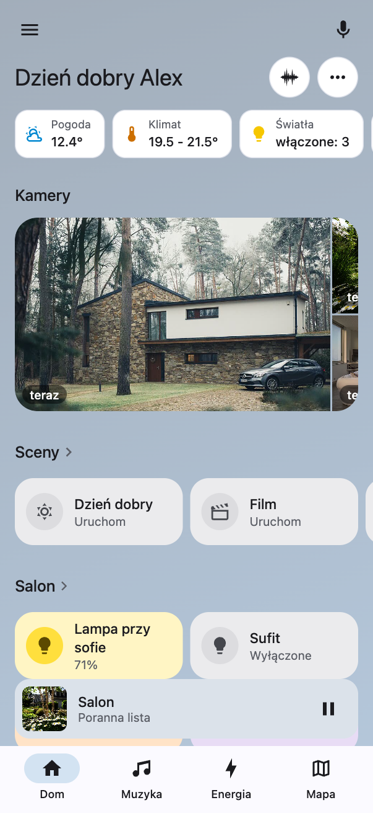 | 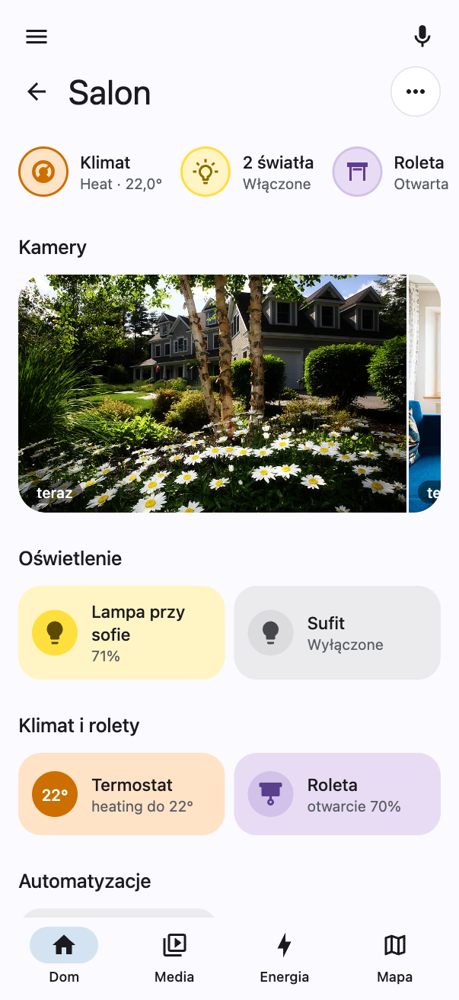 | 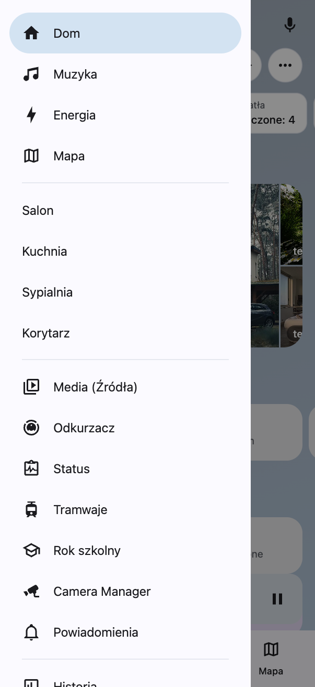 | 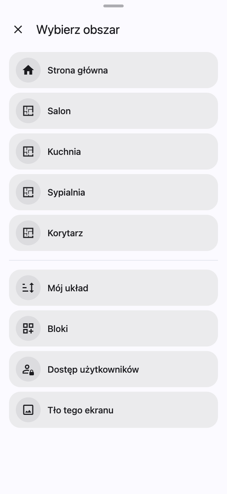 |

## 1. Instalacja

Potrzebujesz Home Assistant 2026.10 lub nowszego. Na telefonie i tablecie użyj aplikacji Companion.

1. W HACS (od Home Assistant 2026.11 to Marketplace) otwórz trzy kropki → **Niestandardowe repozytoria**, dodaj
   `https://github.com/witold-gren/home-assistant-dashboard` jako **Integrację**, pobierz **Home Dashboard**
   i uruchom ponownie Home Assistant. Bez HACS skopiuj `custom_components/home_dashboard` do folderu
   `custom_components` w konfiguracji i uruchom ponownie.
2. Wejdź w **Ustawienia → Urządzenia oraz usługi → Dodaj integrację** i dodaj **Home Dashboard**.
3. Wejdź w **Ustawienia → Dashboardy → Dodaj dashboard → Nowy dashboard od zera** i nadaj mu nazwę.
4. Otwórz go, wybierz **Edytuj**, potem trzy kropki → **Edytor konfiguracji**, zastąp wszystko poniższymi
   wierszami i zapisz:

```yaml
strategy:
  type: custom:home-dashboard
```

Dashboard pojawi się od razu, zbudowany z Twoich obszarów. Ukrywa on nagłówek Home Assistant, więc od teraz
konfiguracja jest w **Menu → Ustawienia dashboardu → Edytuj konfigurację**.

**Kolory:** Ustawienia → Urządzenia oraz usługi → Home Dashboard → **Konfiguruj** daje wybór: automatyczny,
jasny lub ciemny.

## 2. Co decyduje w Home Assistant

Dashboard nie ma własnej listy urządzeń. Większość tego, co pokazuje, wynika z poniższych ustawień, więc gdy
czegoś brakuje, zacznij od nich.

| W Home Assistant | Wpływ na dashboard |
|---|---|
| **Obszary** (Ustawienia → Obszary) | Każdy obszar, który ma coś do pokazania, staje się pokojem o tej nazwie. Encja bez obszaru się nie pokazuje. |
| **Obszar urządzenia** | Encje dziedziczą go po urządzeniu. Encja może mieć własny obszar i wtedy to on się liczy. |
| **Nazwa encji** | Nazwa kafelka. Nazwa obszaru jest z niej usuwana, więc „Kuchnia Lampa” w Kuchni to „Lampa”. |
| **Encje ukryte, konfiguracyjne i diagnostyczne** | Same się nie pokazują. |
| **Grupy świateł** | Grupa zastępuje swoje lampy, więc jeden kafelek steruje wszystkimi. `lights.prefer_groups: false` pokazuje każdą lampę. |
| **Użytkownicy** | Administratorzy mogą edytować. Pozostali tylko korzystają i układają dashboard dla siebie. |
| **Osoby i strefy** | Strona Mapa pokazuje osoby i ich odległość od domu. |
| **Panel energii** (Ustawienia → Dashboardy → Energia) | Decyduje, co pokazuje strona Energia. |
| **Dashboard o adresie `map`** | Jego karta mapy trafia na stronę Mapa. Bez niego mapa pokazuje wszystko. |
| **Język użytkownika** | Język interfejsu. W zestawie są angielski i polski. |

Domyślnie kafelki dostają tylko światła, klimat, rolety i zamki. Resztę dodajesz sam, patrz [Pokoje](#3-pokoje).

## 3. Pokoje

### Dodanie pokoju

Utwórz obszar w Home Assistant i przypisz do niego urządzenia. Pokój pojawi się sam.

### Wybór tego, co pokazuje pokój

Otwórz pokój, potem trzy kropki → **Edytuj ten ekran**.

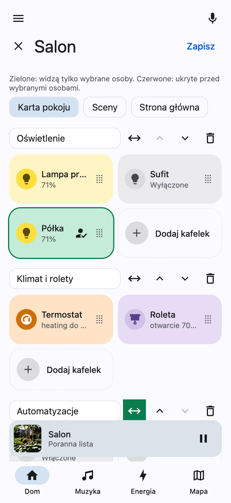

- **Karta pokoju** ustawia sekcje na stronie pokoju. **Strona główna** ustawia kafelki tego pokoju na stronie głównej.
- **Dodaj kafelek** przeszukuje cały Home Assistant, więc dodasz też przełącznik, czujnik, scenę czy automatyzację.
- Kafelek przeciągasz za uchwyt, także do innej sekcji. Dotknięcie kafelka pozwala zmienić nazwę, usunąć go
  albo wybrać, kto go widzi.
- Sekcja ma nazwę, strzałki do przesuwania i przycisk ze strzałkami, który układa ją w jeden rząd przewijany
  w bok. Pasuje to do scen i automatyzacji.
- Nic nie trafia na serwer przed **Zapisz**.

Pierwsza edycja zapisuje pokój w `layout`. Od tej chwili pokój pokazuje to, co jest na liście, a nowe urządzenie
w obszarze trzeba dodać ręcznie.

### Pokoje z kilku obszarów i ich kolejność

Menu → Ustawienia dashboardu → **Edytuj konfigurację** otwiera całą konfigurację jako YAML:

```yaml
layout:
  - id: kitchen
    name: Kuchnia i jadalnia
    areas: [kitchen, dining_room]
    home:
      - {entity: light.kitchen, name: Główne}
    sections:
      - title: Oświetlenie
        tiles:
          - {entity: light.kitchen, name: Główne}
```

Pokoje idą w kolejności `layout`, a obszary spoza niego po nich. `rooms.order` i `rooms.hidden` zmieniają
kolejność i ukrywają pokój bez jego opisywania.

### Opcje kafelka

| Opcja | Co robi |
|---|---|
| `name`, `icon` | Własna nazwa i ikona. |
| `tap_toggle: true` | Jedno dotknięcie całego kafelka przełącza. Dobre dla automatyzacji, które inaczej otwierają okno. |
| `calm: true` | Bez koloru, gdy włączone, i przygaszone, gdy wyłączone. Dla rzeczy prawie zawsze włączonych. |
| `action: script.x` | Uruchamia skrypt zamiast przełączać. |
| `active_only: true` | Widoczne tylko, gdy urządzenie gra. |
| `turn_on_only: true` | Można tylko włączyć. Z `off_pin: {service: script.x, field: pin}` wyłącza klawiatura, a PIN sprawdza skrypt. |

## 4. Strona główna

Od góry: powitanie, pogoda, chipy, Twoje skróty, kamery, sceny, ulubione i pokoje.

- **Chipy** liczą to, co włączone, i filtrują stronę: klimat, światła, ochrona i media.
- **Pokoje** pokazują kafelki z zakładki Strona główna każdego pokoju. Ustaw tam krótką listę, a resztę zostaw
  na stronie pokoju.
- **Ulubione** są nad pokojami: `favorites: [climate.living_room, lock.front_door]` albo Mój układ → Ulubione → **Dla wszystkich**.
- **Skróty** są w rzędzie chipów, patrz [Skróty i bloki](#7-skróty-i-bloki).

### Pogoda

Pierwszy chip pokazuje temperaturę i otwiera ekran z bieżącymi odczytami oraz prognozą na najbliższe godziny
i dni. Pojawia się sam, gdy Home Assistant ma encję `weather`. Jeśli jej nie ma, dodaj usługę, np. **Met.no**, w
**Ustawienia → Urządzenia oraz usługi**.

Domyślnie chip używa pierwszej encji pogody, a prognoza pochodzi z pierwszej, która ją ma. Stacja domowa zwykle
nie ma prognozy, więc mogą to być dwie różne encje. Brakujące odczyty, np. wiatr, też pochodzą z encji prognozy.

```yaml
weather:
  entity: weather.home_station
  forecast: weather.forecast_home
```

`weather: false` usuwa chip. **Dostęp użytkowników** ukrywa go przed jedną osobą, w zakładce **Plakietki**.

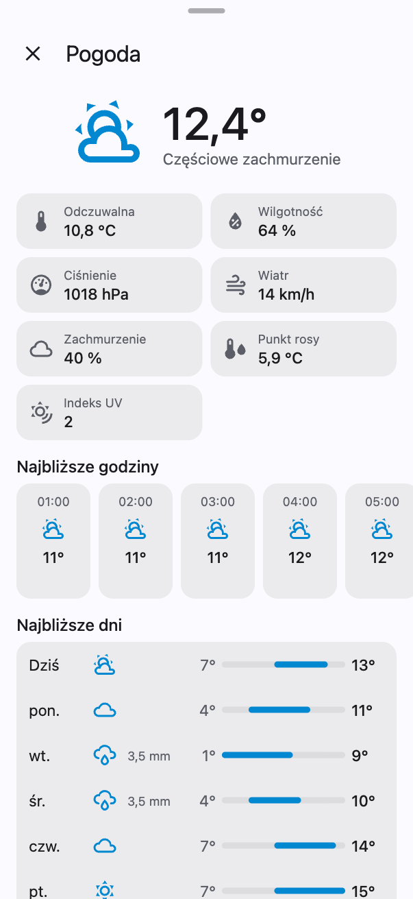

## 5. Kamery

### Które kamery się pokazują

Pasek celowo nie pokazuje każdej kamery: miniatura pobrana z kamery na baterię budzi ją i rozładowuje. Pokazuje:

- **Zapisane obrazy:** encje `image.*` kończące się na `_last_screen` lub `_last_snapshot`.
- **Kamery z bezpiecznych platform:** `camera.*` z `cameras.snapshot_platforms`, domyślnie `frigate`.

Kamera musi też mieć obszar. Inną platformę, która trzyma własną klatkę, dodasz tak:

```yaml
cameras:
  snapshot_platforms: [frigate, generic]
  battery_platforms: [eufy_sdk]
```

Platforma z `battery_platforms` nigdy się nie pokaże, nawet gdy jest na obu listach.

### Kolejność i ukrywanie

| Cel | Jak |
|---|---|
| Własna kolejność albo ukrycie dla siebie | Trzy kropki → **Mój układ** |
| Ta sama kolejność dla wszystkich | `cameras.order: [camera.a, camera.b]` |
| Ukrycie przed wszystkimi | `cameras.hide: [image.garage_last_screen]` |
| Ukrycie przed jedną osobą | Trzy kropki → **Dostęp użytkowników** |
| Dokładnie ta lista i nic więcej | `cameras.hero` i `cameras.tiles` |

W pasku duży obraz przeplata się z dwoma mniejszymi. Kamera, która przestała działać, zostaje widoczna w małym
okienku, rozmyta i oznaczona jako niedostępna. Chip Ochrona pokazuje wszystkie kamery jedna pod drugą.

### Podgląd na żywo

Dotknięcie obrazu otwiera go bez strumienia. **Oglądaj na żywo** uruchamia strumień z kamery tego samego urządzenia
albo z `cameras.live: {image.door_last_screen: camera.door}`.

Przycisk obok mówi do obszaru kamery. Pojawia się, gdy [intercom](#11-intercom) jest skonfigurowany, a ten obszar
należy do jego obszarów.

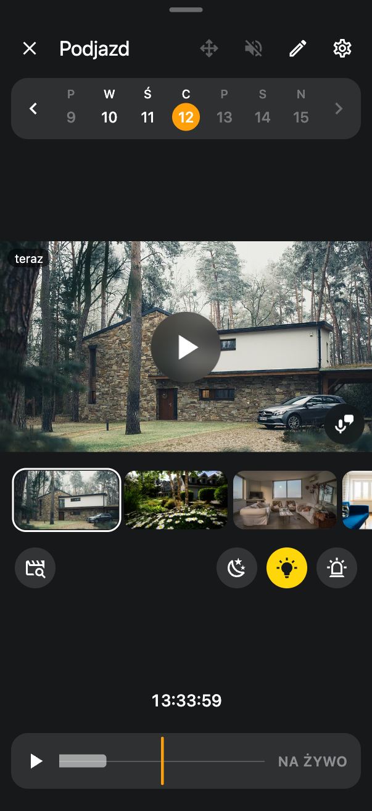

### Tryb gościa i prywatność

```yaml
cameras:
  guest:
    entity: input_boolean.guest
    hide: [camera.living_room, camera.bedroom]
  private:
    - {entity: switch.bedroom_privacy, hide: [camera.bedroom]}
```

Dodaj `users: [Tablet]` do `guest`, żeby działał tylko na tych kontach, po nazwie lub identyfikatorze. Pozostali
dalej widzą kamery.

Gdy `guest` jest włączony, te kamery znikają ze strony głównej i Ochrony, a na stronie pokoju zostają rozmyte.
Gdy włączony jest przełącznik z `private`, kamera znika ze wszystkich stron.

## 6. Sceny

`scenes` to sekcja pod kamerami. Dotknij jej nagłówka, potem trzy kropki → **Edytuj ten ekran**: lista oferuje
sceny i skrypty. Przycisk ze strzałkami układa je w jeden rząd przewijany w bok. Pokój pokazuje pod kamerami swoje sceny i skrypty w takim samym układzie. Wybierasz je w edycji pokoju, w zakładce **Sceny** (`scenes` pokoju). Dopóki ich nie zapiszesz, pokój pokazuje sceny i skrypty przypisane w Home Assistant do jego obszaru.

## 7. Skróty i bloki

Blok to kilka encji na jednym ekranie. To zwykłe dane, więc nie wymaga kodu.

| Odkurzacz | Media | Roleta | Przełącznik |
|---|---|---|---|
| 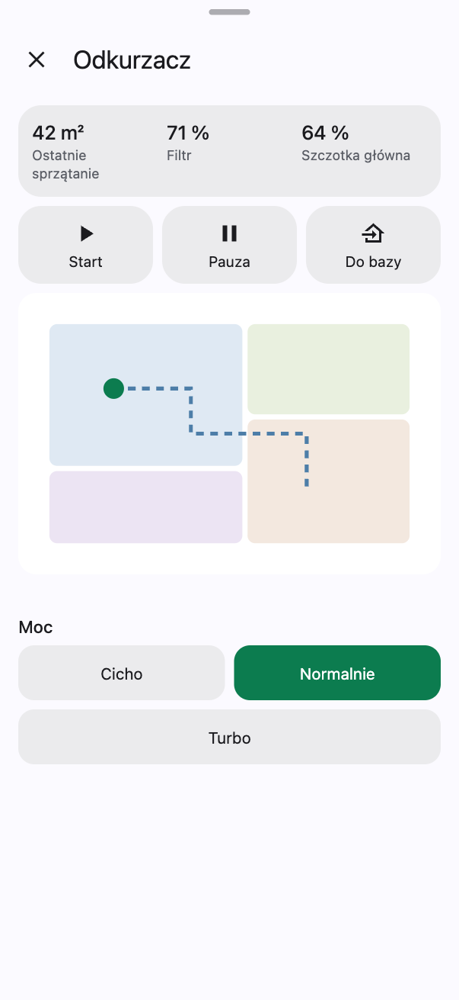 | 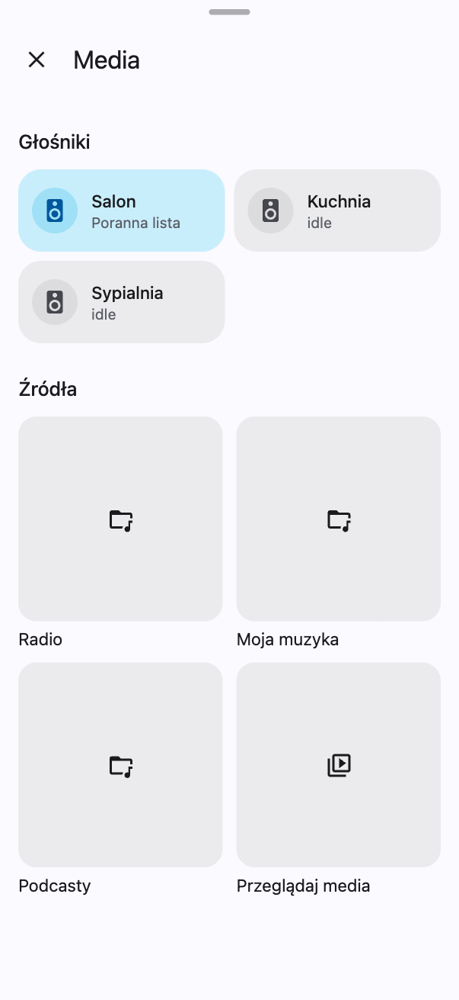 | 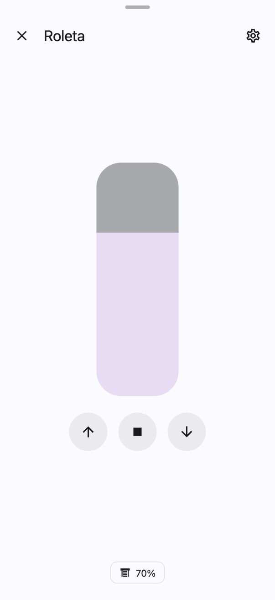 | 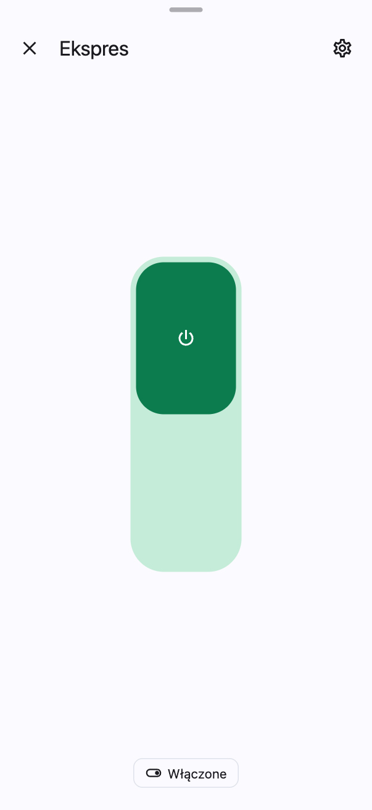 |

Odkurzacz jako skrót:

```yaml
shortcuts:
  - kind: panel
    name: Odkurzacz
    icon: mdi:robot-vacuum
    entity: vacuum.robot
    stats:
      - {name: Filtr, entity: sensor.vacuum_filter, unit: "%", digits: 0}
    actions:
      - {name: Start, icon: mdi:play, entity: vacuum.robot, service: vacuum.start}
      - {name: Do bazy, icon: mdi:home-import-outline, entity: vacuum.robot, service: vacuum.return_to_base}
    card: {type: custom:xiaomi-vacuum-map-card, entity: vacuum.robot}
    card_open: true
    groups:
      - layout: controls
        rows:
          - {entity: select.vacuum_power, name: Moc, labels: {quiet: Cicho, turbo: Turbo}}
```

Ten sam blok może stać w pokoju: wstaw go między kafelki w `layout`.

| Element | Co robi |
|---|---|
| `stats` | Liczby u góry. |
| `actions` | Przyciski. `confirm: Tekst` najpierw pyta, `service` wywołuje usługę encji. |
| `groups` | Wiersze encji. `select` staje się listą, `switch` przełącznikiem, `number` suwakiem. |
| `groups[].layout: controls` | Duże przyciski, wybór, szeroki suwak i małe karty zamiast wierszy. |
| `groups[].layout: summary` | Jedna linia, która rozwija się na dotknięcie i sama, gdy włączy się czujnik drzwi, okna lub problemu. |
| `card`, `card_open`, `card_last` | Karta Home Assistant w bloku: na przycisk, od razu albo pod grupami. |
| `frame` | Strona WWW na cały ekran. |
| `tone` | Kolor ikony skrótu: green, purple, teal lub pink. |

Ekran stanu domu to `kind: overview`: zegar, data i tylko to, co teraz warto zobaczyć. Pozycja bez niczego do pokazania znika, a razem
z ostatnią pozycją znika cała sekcja. Sekcja z `alert: true` liczy się do podsumowania przy zegarze, a `bottom: true` stoi zawsze na samym dole. `title` można pominąć. Dotknięcie encji
otwiera jej szczegóły.

```yaml
shortcuts:
  - kind: overview
    name: Status
    icon: mdi:clipboard-pulse-outline
    sections:
      - title: Wymaga uwagi
        alert: true
        items:
          - name: Zimno w pokoju
            icon: mdi:snowflake
            attribute: current_temperature
            unit: "°"
            below: 19
            entities: [{entity: climate.bedroom, name: Sypialnia}]
          - {name: Baterie, icon: mdi:battery-alert, auto: battery, below: 11}
      - title: W domu
        items:
          - {name: Otwarte okna, icon: mdi:window-open-variant, entities: [binary_sensor.window]}
      - title: W pracy
        items:
          - name: Pralka
            icon: mdi:washing-machine
            entity: sensor.washer_state
            state: [Running]
            labels: {Running: Pierze}
            facts: [{name: Program, entity: sensor.washer_program}]
      - title: Niedziela
        items:
          - {name: Msza, icon: mdi:church, text: "8.00, 10.00", weekdays: [7]}
```

| Pozycja | Kiedy się pokazuje |
|---|---|
| `entities` | Gdy encja ma stan `state` (domyślnie `on`). Encja to identyfikator albo `{entity, name}`. |
| `entities` z `below` | Gdy wartość jest mniejsza niż `below`. `attribute` czyta ją z atrybutu, a `unit` podaje jednostkę. |
| `auto: battery` z `below` | Same wyszukuje baterie: procenty w encjach z `battery` w nazwie lub klasą `battery`. |
| `list` | Gdy lista w atrybucie nie jest pusta: `{entity, attribute, name, detail, since}` to nazwy pól. |
| `entity` ze `state` | Gdy urządzenie jest w jednym ze stanów. `labels` opisuje stan, a `facts` pokazuje wartości. |
| `text` | Zawsze, a z `weekdays` (1 to poniedziałek, 7 to niedziela) i `months` tylko w te dni i miesiące. |

`weekdays` i `months` działają w każdej pozycji.

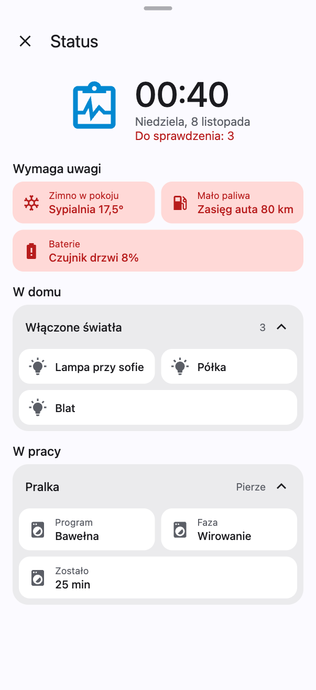

Odjazdy tramwajów i autobusów to `kind: departures`. Najbliższy odjazd jest duży, a pod nim każda linia z kolejnymi
godzinami i opóźnieniem. Encje muszą trzymać odjazdy w atrybucie `list` (`line`, `direction`, `departure`,
`time_to_departure`, `delay`):

```yaml
shortcuts:
  - kind: departures
    name: Tramwaje
    icon: mdi:tram
    entities: [sensor.tram_4, sensor.tram_11]
```

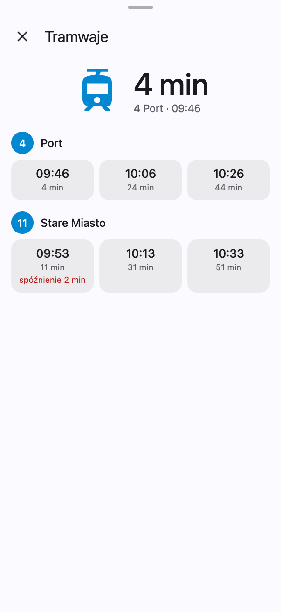

Inne skróty: `{kind: page, name: Media, icon: mdi:play, page: media}` otwiera stronę w oknie, a `kind: host`
pokazuje maszyny z `columns`. Telewizor to `kind: tv` z `entity`, `on`, `off` i `shortcuts`, a telewizor webOS sam
dostaje strzałki i klawisze.

Urządzenie z własną kartą otwiera ją zamiast okna dashboardu:

```yaml
entities:
  overrides:
    light.aquarium:
      card: {type: custom:lamp-card, entity: light.aquarium}
```

Reszta `entities`:

```yaml
entities:
  include:
    kitchen: [switch.dishwasher]     # dodaje encję do pokoju
  exclude: [light.tablet_screen]     # pomija encję
  overrides:
    cover.window_3: {area: bedroom, name: Roleta, icon: mdi:blinds}
```

### Edytor bloków

Trzy kropki na stronie głównej → **Bloki** (administratorzy) pokazuje wszystkie skróty i dotyczy wszystkich osób. Tu dodasz nowy blok, ustawisz ich
kolejność, a ołówek otwiera formularz. Formularz mają Status, Odjazdy, Maszyny (`kind: host`), Blok (`kind: panel`), Strona i
Rok szkolny, razem z sekcjami, wierszami i przyciskami. Encje podpowiadają się same, a kartę Home Assistant wpisujesz jako
YAML w jej polu. Blok stojący w pokoju otworzysz z edycji pokoju: kafelek → **Edytuj blok**. Skrót może mieć `label`, czyli mały tekst nad nazwą.
Opcje, których formularz nie zna, zostają w bloku bez zmian. Po zmianie nazwy reguły **Dostępu użytkowników** idą za blokiem, a kolejność i ukrycie w
czyimś **Moim układzie** trzeba ustawić od nowa.

| Bloki | Formularz |
|---|---|
| 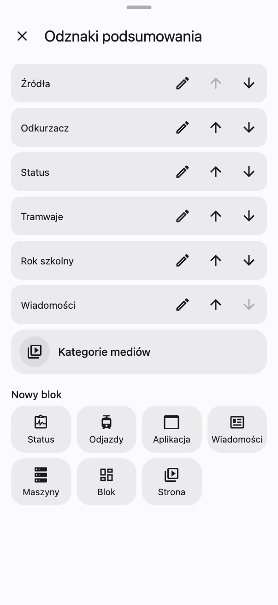 | 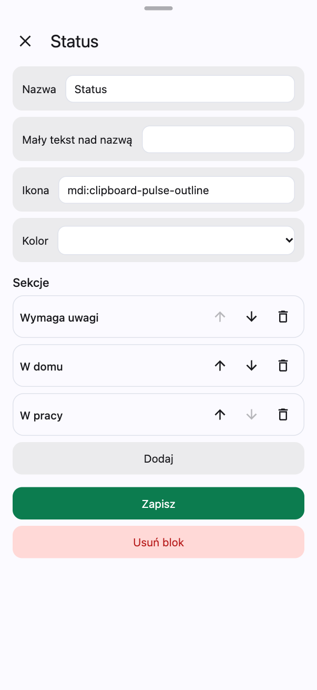 |

### Lewe menu

Trzy kreski otwierają menu: strony, Twoje grupy, ustawienia i obszary. Administrator układa grupy przyciskiem **Edytuj menu**
na samym dole. Grupa może mieć tytuł, a wpis to nazwa, ikona i jedno z trzech: **Adres** strony Home Assistant (podpowiada
panele, np. `/config`), **Skrót** po nazwie albo **Akcja** `notifications`, która otwiera okno powiadomień z listą na żywo i odrzucaniem. **Tylko
administratorzy** chowa wpis przed resztą, a **Kto to widzi** ogranicza wpis do zaznaczonych osób (`users`, brak zaznaczeń to wszyscy), a **Ukryj w trybie gościa** chowa go, gdy tryb gościa obowiązuje na tym koncie:
użyj tego przy kamerach, żeby wpis nie omijał blokady. Bez własnej konfiguracji menu pokazuje skróty i podstawowe linki.

Wpisy z adresem `/history` i `/logbook` otwierają się w oknach dashboardu. Dziennik pokazuje urządzenia z dashboardu z
ostatniej godziny, 6 lub 24 godzin, a Historia wykresy encji, które każdy wybiera dla siebie.

| Dziennik | Historia |
|---|---|
| 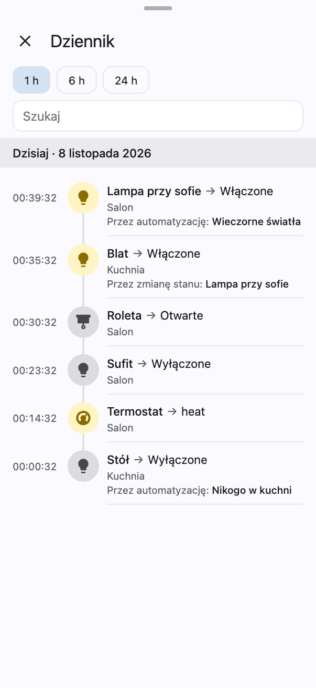 | 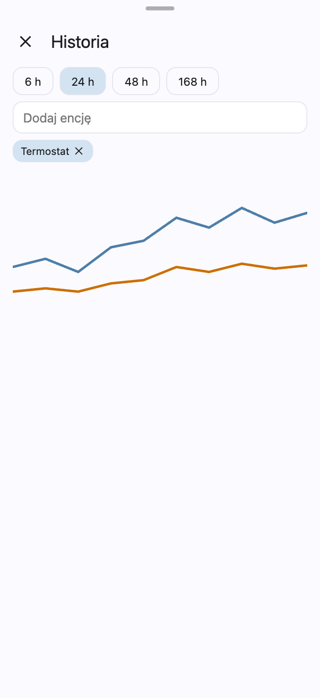 |

| Edycja menu | Powiadomienia |
|---|---|
| 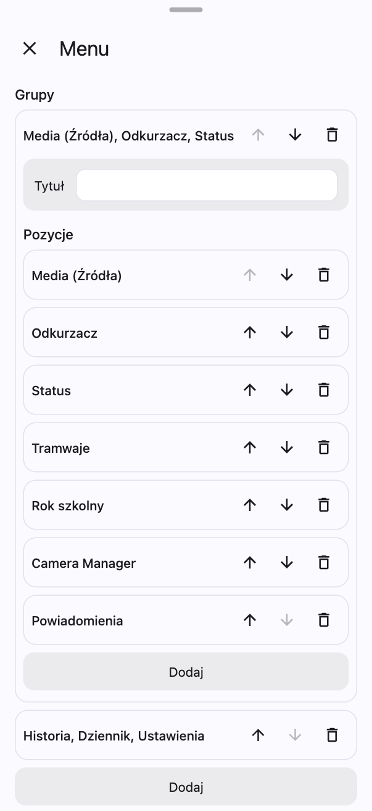 | 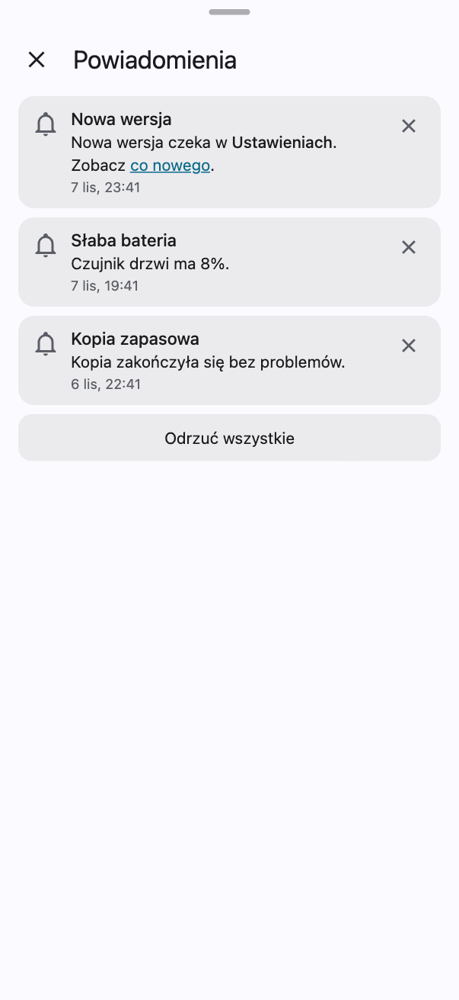 |

```yaml
menu:
  groups:
    - items:
        - {shortcut: Status}
        - {name: Kamery, icon: mdi:cctv, path: /my_camera_panel, hide_for_guests: true}
        - {name: Powiadomienia, icon: mdi:bell-outline, action: notifications}
    - title: System
      items:
        - {name: Ustawienia, icon: mdi:cog-outline, path: /config, admin: true}
```

### Wiadomości

`kind: news` to ekran do czytania. Każda sekcja to sensor z atrybutem `news`, czyli listą artykułów: `title`, `text`,
opcjonalnie `rating`, `votes`, `source`, `source_url` i `url`. Atrybuty `release` i `attribution` pokazują się u góry i na
dole. W **Blokach** to **Wiadomości**:

```yaml
shortcuts:
  - kind: news
    name: Wiadomości
    icon: mdi:newspaper-variant-outline
    sections:
      - {title: Kraj, entity: sensor.news_home}
      - {title: Świat, entity: sensor.news_world}
```

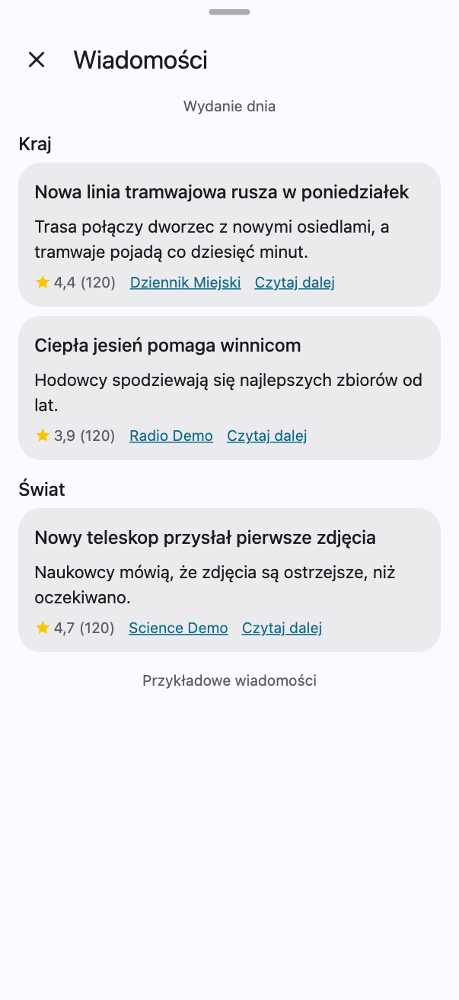

### Aplikacje w oknie

Dodatek z interfejsem WWW, np. Frigate, otworzy się w oknie dashboardu. W menu wpisz w polu **Aplikacja** jego identyfikator,
pole podpowiada zainstalowane dodatki. Jako skrót na stronie głównej to **Bloki → Aplikacja**:

```yaml
shortcuts:
  - {kind: app, name: Frigate, icon: mdi:cctv, addon: abcd1234_frigate}
menu:
  groups:
    - items:
        - {name: Frigate, icon: mdi:cctv, addon: abcd1234_frigate, hide_for_guests: true}
```

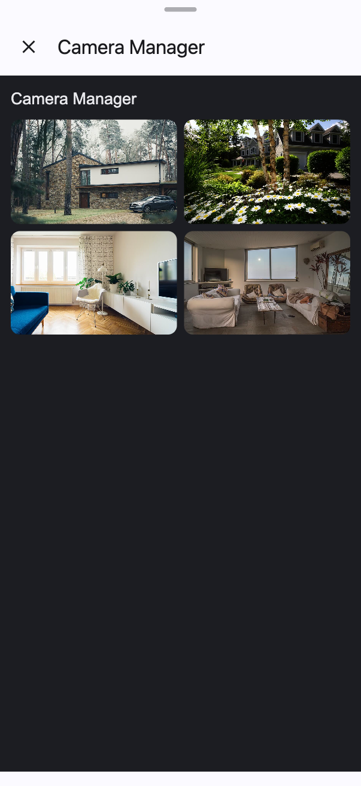

Gdy okno nie może się otworzyć, np. dodatek jest wyłączony, pojawia się informacja i przycisk otwierający go w Home
Assistant. `frame: http://...` podaje adres zastępczy na takie sytuacje.

### Rok szkolny z własnych danych

`kind: school` czyta sensory i niczego nie zakłada o tym, skąd pochodzą, więc wystarczy własny dodatek albo szablon, który
je wystawi. Nazwy encji zmienisz w `sources`. Dane leżą w atrybutach, a stan sensora nie ma znaczenia. Zakładka bez danych
pokazuje tylko informację o ich braku.

```yaml
shortcuts:
  - kind: school
    name: Rok szkolny
    icon: mdi:school-outline
    children: [Lena, Kuba]            # kolejność; pozostałe dzieci idą na koniec
    sources:
      plan: sensor.my_timetable       # domyślnie sensor.rodzinnik_plan_lekcji
      grades: sensor.my_grades        # sensor.rodzinnik_oceny
      events: sensor.my_calendar      # sensor.rodzinnik_terminarz
      meals: sensor.my_meals          # sensor.rodzinnik_obiady
      duties: sensor.my_duties        # sensor.rodzinnik_obowiazki
      jobs: sensor.my_jobs            # sensor.rodzinnik_prace
      bank: sensor.my_bank            # sensor.rodzinnik_bank
      librus: sensor.my_school_events # sensor.rodzinnik_librus
```

Dzieci i ich zakładki pochodzą z `plan`. Daty mają postać `2026-11-09`, a godziny `08:00`. Nazwy dni wyświetlają się tak,
jak je podasz, w dowolnym języku, a weekend rozpoznawany jest po dacie.

```yaml
# plan: atrybut children
children:
  - child: Lena
    days:
      - date: "2026-11-09"
        name: Monday
        is_today: true
        no_lessons: false              # true przekreśla lekcje tego dnia
        events: [...]                  # jak niżej
        lessons:
          - {number: 1, start: "08:00", end: "08:45", subject: Maths, teacher: Anna Nowak, classroom: "12",
             type: lesson, canceled: false, substitution: false, note: ""}   # type: extra to zajęcia dodatkowe

# event: wydarzenie w days[].events oraz w librus
- {date: "2026-11-09", title: School trip, start: "08:00", end: "15:00", place: Museum, description: "",
   instead_of_lessons: false, important: true}

# librus: atrybut children, ważne wydarzenia na Dzisiaj i Jutro oraz wydarzenia w terminarzu
children:
  - {child: Lena, events: [...]}

# events: atrybut children, wpisy terminarza
children:
  - child: Lena
    entries:
      - {date: "2026-11-10", kind: Test, title: Maths, description: Fractions, start: "10:10"}

# grades: atrybut children
children:
  - child: Lena
    semester: 1
    subjects:
      - subject: Maths
        averages: {semester_1: 4.5, year: 4.5}
        grades: [{grade: "5", category: test, is_new: true, proposition: false}]

# meals: atrybut variants
variants:
  - variant: school
    label: School
    available: true
    days:
      - {name: Monday, meals: [{meal: Lunch, items: [{name: Soup}, {name: Pasta}]}]}

# duties: atrybuty week_start, week_end i children, opcjonalnie previous_week i next_week o tym samym kształcie
children:
  - {child: Lena, child_color: "#f5ec00", avatar: "https://...", set: Kitchen, color: "#77bb41", tasks: [Dishes], free_week: false}

# jobs: atrybut jobs
jobs:
  - {name: Raking, description: Leaves, reward_label: "5 - 10 EUR", limit: {label: once a week}}

# bank: atrybuty currency i children
currency: EUR
children:
  - {child: Lena, balance: 65, savings: 10, debt: 0, allowance: {next_payment: "2026-11-09"}}
```

## 8. Muzyka, Energia i Mapa

| Muzyka | Energia | Mapa | Odtwarzacz |
|---|---|---|---|
| 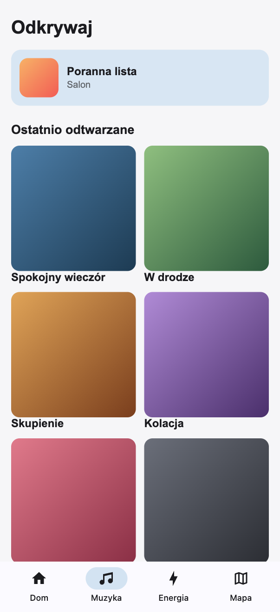 | 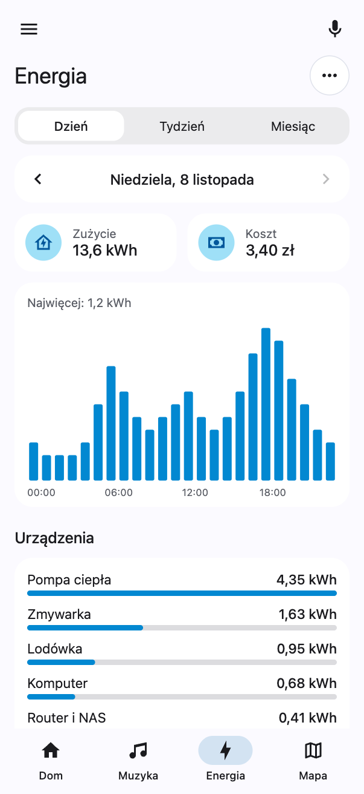 | 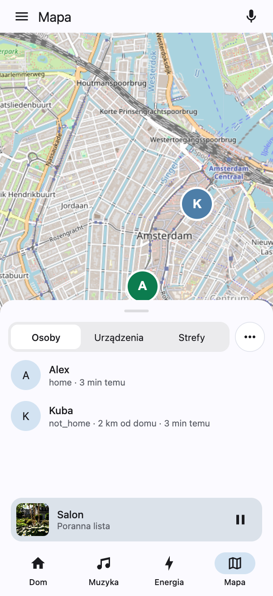 | 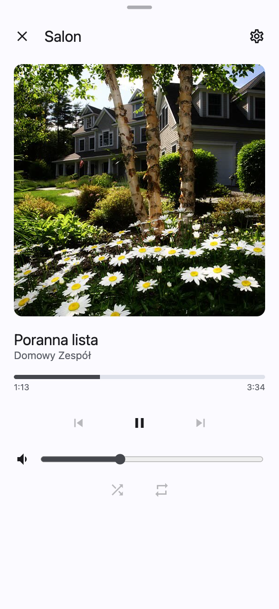 |

Obraz Muzyki zastępuje tu Twoją aplikację muzyczną, a obrazy Energii i Mapy karty Home Assistant, z wymyślonymi
liczbami.

**Muzyka** zajmuje miejsce Mediów na pasku nawigacji. Dodaj kartę albo stronę WWW:

```yaml
music:
  frame: http://homeassistant.local:8095
```

Strona po HTTP nie otworzy się w dashboardzie po HTTPS. Na telefonie dolny pasek chowa się przy pełnoekranowym
odtwarzaczu Music Assistant tylko wtedy, gdy ramka pochodzi z tego samego adresu co Home Assistant. Gdy coś gra,
na pozostałych stronach nad paskiem widać mini-odtwarzacz. Głośniki będące tym samym urządzeniem scala
`media.group_patterns`.

**Energia** pokazuje karty panelu energii Home Assistant, na tyle, na ile są dane. Ustawisz je w
**Ustawienia → Dashboardy → Energia**: licznik dodaj jako źródło sieciowe, a urządzenia w sekcji
**Poszczególne urządzenia**. Jeśli urządzenie jest podłączone do innego mierzonego urządzenia, ustaw je tam jako
podrzędne, inaczej policzy się podwójnie.

**Mapa** używa karty mapy z dashboardu o adresie `map`. Lista Osoby, Urządzenia i Strefy leży na mapie: na telefonie to panel, który przeciągasz palcem między wąskim paskiem, połową i całym ekranem, a na tablecie pływa z lewej. Dotknięcie pozycji pokazuje ją na mapie.

Strona Muzyka otworzy dodatek Music Assistant także na kontach bez administratora: `music: {addon: abcd1234_music_assistant}`. Z `fullscreen: true` dolny pasek znika, a przycisk **Home Assistant** w menu Music Assistant wraca na stronę główną.

Stronę Media ułożysz we własne grupy przez `media.sections` albo w formularzu **Bloki → Kategorie mediów** (zrzut niżej). Kafelki wpisuje się jak w pokoju, także `kind: tv` i
`kind: panel`. Te, które stoją też w układzie pokoju, pokazują się w filtrze Media na stronie głównej, w swoim pokoju:

```yaml
media:
  sections:
    - title: Głośniki
      tiles:
        - {entity: media_player.salon_homepod, name: Salon}
    - title: Telewizory
      tiles:
        - {kind: tv, entity: media_player.tv, name: Telewizor}
```

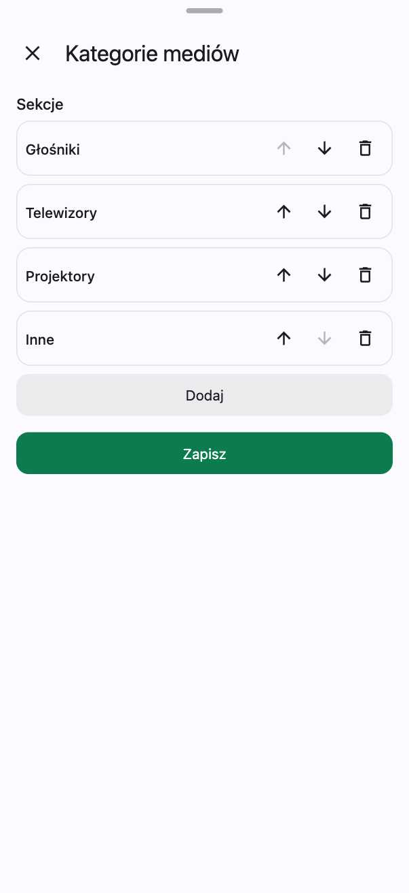

## 9. Osoby

### Trzy kropki na stronie głównej

Na dole menu trzech kropek są cztery pozycje. Dwie zmieniają dashboard tylko dla Ciebie, dwie dla domowników:

| Pozycja | Kto ją widzi | Co ustawia | Dla kogo i gdzie się zapisuje | Gdzie widać zmianę |
|---|---|---|---|---|
| **Mój układ** | każdy | kolejność i ukrycie kamer, obszarów, plakietek i scen, własne ulubione, ukryte wpisy menu, start dashboardu | dla Ciebie, na koncie HA, czyli na wszystkich Twoich urządzeniach; administrator w Obszarach i Ulubionych może zaznaczyć **Dla wszystkich** | strona główna, pokoje, menu, Ochrona (kamery) |
| **Bloki** | administratorzy | lista skrótów (bloków): dodanie nowego, kolejność, edycja w formularzu, kategorie mediów | dla wszystkich, w konfiguracji dashboardu | skróty na stronie głównej, w menu i w pokojach; kategorie na stronie Muzyka |
| **Dostęp użytkowników** | administratorzy | co zabrać wybranej osobie albo wszystkim oprócz Ciebie: kamery, obszary, sekcje pokoi, plakietki, światła, media, ochronę, sceny i inne | dla tej osoby, w konfiguracji dashboardu (`access`); ona nie może tego przywrócić | wszędzie w tym dashboardzie, u tej osoby |
| **Tło tego ekranu** | każdy | tło strony, na której jesteś, osobno dla jasnego i ciemnego wyglądu, oraz Twój wygląd: Systemowy, Jasny, Ciemny | dla Ciebie na koncie; z **Dla wszystkich** (administratorzy) jako tło domyślne w konfiguracji | tylko ta strona: główna albo pokój, w którym jesteś |

Kolejność ważności: najpierw **Dostęp użytkowników** (czego nie ma, tego nie przywróci żaden układ), potem ustawienia
**Dla wszystkich**, na końcu **Mój układ** i własne tło danej osoby. Szczegóły każdej pozycji są niżej, a **Bloki**
w części [Edytor bloków](#edytor-bloków).

| Tło | Mój układ | Dostęp użytkowników |
|---|---|---|
| 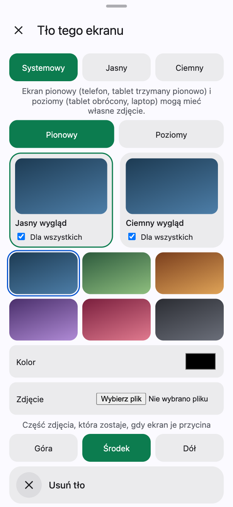 | 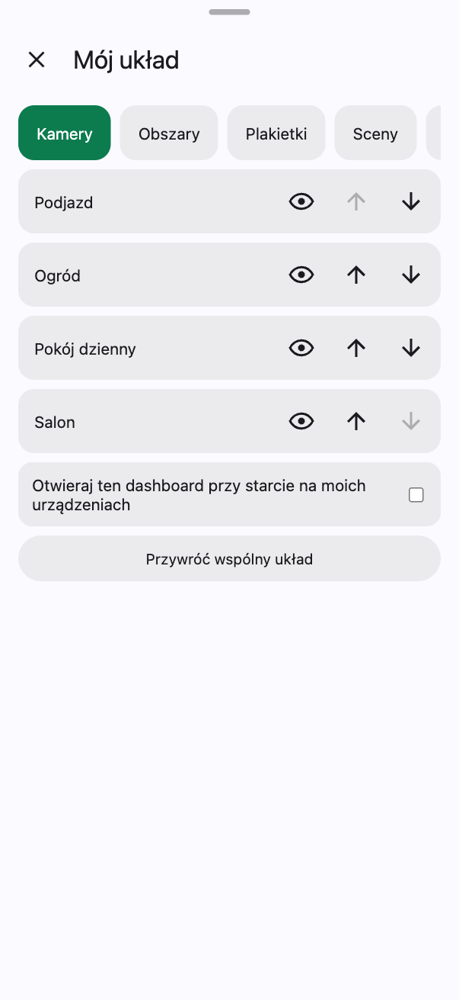 | 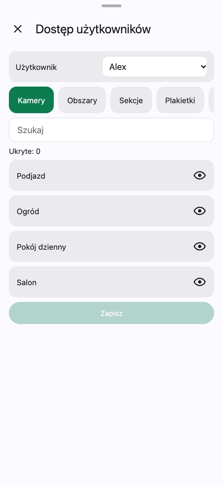 |

**Mój układ** (trzy kropki na stronie głównej, dla każdego): kolejność i ukrywanie kamer, obszarów, plakietek i scen,
własne **Ulubione** (startują od wspólnych, kolejne dodajesz wyszukiwarką) oraz ukrywanie wpisów **Menu**. Na dole jest
**Otwieraj ten dashboard przy starcie na moich urządzeniach**: wybór zapisuje się na koncie, a każde urządzenie przejmuje
go po połączeniu z Home Assistant.

Administrator w zakładkach **Obszary** i **Ulubione** zaznacza **Dla wszystkich** i ustawia wtedy wspólną kolejność
obszarów, ich ukrycie oraz wspólne ulubione, od których zaczyna każdy. Zmiany zapisuje **Zapisz dla wszystkich**. Obszar
ukryty dla wszystkich zostaje na tej liście, więc da się go przywrócić. To jedyne miejsce tych ustawień: okno
**Ustawienia dashboardu** ma już tylko powrót po bezczynności, start na tym urządzeniu i edytor konfiguracji.

**Mój widok** (trzy kropki w pokoju, dla każdego): ukrywa dla Ciebie całą sekcję albo pojedynczy kafelek, także grupę
**Sceny**. Ukryty kafelek znika z pokoju i z jego miejsca na stronie głównej. **Pokaż wszystko w tym pokoju** przywraca
całość. To, co zabrał administrator, nie pojawia się na liście i nie da się tego przywrócić. Zapisuje się na koncie, więc
działa na wszystkich urządzeniach tej osoby.

| Mój widok pokoju | Moje sceny |
|---|---|
| 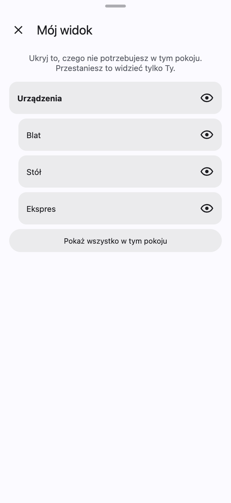 | 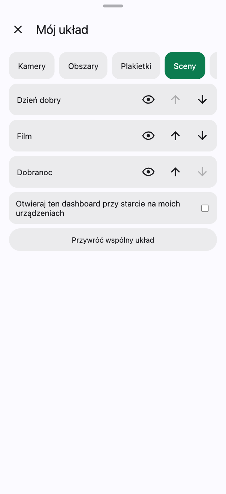 |

**Tło tego ekranu** (trzy kropki, dla każdego): gradient, kolor lub zdjęcie dla strony głównej albo pokoju, osobno dla
jasnego i ciemnego wyglądu; wygląd bez własnego tła pokazuje zwykłą stronę. Na górze tego okna wybierasz też dla siebie wygląd całego dashboardu: Systemowy, Jasny albo Ciemny. **Dla wszystkich** widzą administratorzy i ustawia ono tło domyślne. Bez tego tło zostaje
na koncie tej osoby. Własne tło wygrywa z domyślnym.

Ekran pionowy i poziomy mogą mieć różne zdjęcia, bo pionowe zdjęcie na laptopie zostaje mocno przycięte:

| Kształt | Kiedy | Klucz w konfiguracji |
|---|---|---|
| **Pionowy** | telefon, tablet trzymany pionowo, każde okno wyższe niż szersze | `light`, `dark` |
| **Poziomy** | tablet obrócony, laptop, każde okno szersze niż wyższe | `light_wide`, `dark_wide` |

Przełącznik **Pionowy / Poziomy** w oknie tła wybiera, który kształt edytujesz; na starcie jest kształt Twojego ekranu.
Gdy kształt nie ma własnego zdjęcia, bierze zdjęcie drugiego kształtu tego samego wyglądu. Podgląd jest wtedy
przygaszony i podpisany **Jak pionowy** albo **Jak poziomy**, więc jedno zdjęcie dalej wystarcza na oba. Obrót tabletu
zmienia tło od razu.

**Część zdjęcia, która zostaje** (Góra, Środek, Dół) mówi, co zostaje, gdy ekran przycina zdjęcie. Przy zdjęciu z
domem u góry wybierz **Góra**. Dotyczy zdjęć, nie gradientów i kolorów. W konfiguracji to `position: top`; środek jest
domyślny i się nie zapisuje.

```yaml
backgrounds:
  home:
    light: /api/image/serve/<id>/original       # pionowy
    light_wide: /api/image/serve/<id>/original  # poziomy
    dark: "#121316"
    position: top
```

**Dostęp użytkowników** (trzy kropki, administratorzy): wybierz osobę i ukryj jej obszary, kamery, światła, media,
ochronę, sceny, skrypty, inne encje i bloki, a w zakładce **Sekcje** także całe sekcje pokoi. Zakładka **Plakietki** zawiera pogodę, chipy i skróty, a ukryty skrót znika
też z menu i z **Mojego układu** tej osoby. Opcja **Wszyscy oprócz mnie** ukrywa coś od razu wszystkim innym kontom, na
przykład bloki administracyjne. Dotyczy kont istniejących w chwili zapisu, więc nowemu użytkownikowi ustaw to osobno.

**Kto to widzi** (kafelek w edycji): Wszyscy, Tylko wybrani albo Wszyscy oprócz. Dotyczy encji wszędzie, także Twojego
konta. W edycji administrator i tak widzi wszystko: kafelek zielony widzą tylko wybrane osoby, a czerwony jest przed
kimś ukryty.

To wszystko ukrywa rzeczy w dashboardzie, ale nie jest uprawnieniem: Home Assistant nie ma uprawnień do pojedynczych
encji, więc ta sama osoba dojdzie do nich w innym dashboardzie. Jeśli to ważne, ukryj jej też inne dashboardy.

## 10. Telefony i tablety

- Poniżej 900 px szerokości nawigacja jest na dole, a od 900 px z boku.
- Tablet zostawiony sam wraca na stronę główną po 3 minutach: `idle: {return_after: 300}` w sekundach, `0` wyłącza.
- Zamek na tablecie można tylko zamknąć, bo do ściany ma dostęp każdy: zmienia to `security.unlock_on_tablet: true`.
- **Ustawienia dashboardu → otwieraj przy starcie** sprawia, że to urządzenie startuje na dashboardzie, niezależnie
  od domyślnego ustawienia konta.
- Po aktualizacji zamknij i otwórz aplikację Companion. Gdy zostaje stary wygląd, użyj
  **Ustawienia → Aplikacja Companion → Debugowanie → Resetuj pamięć podręczną interfejsu**.
- Gdy strona powiększa się palcami, wyłącz powiększanie gestem w ustawieniach aplikacji Companion.

## 11. Intercom

Gdy masz skrypt, który mówi w wybranych obszarach, dashboard doda przyciski na stronie głównej, w pokojach i na ekranie
kamery:

```yaml
intercom:
  script: script.announce
  areas_field: areas
  text_field: text
  areas: [living_room, bedroom]
```

Skrypt dostaje obszary i tekst w tych polach. Nagrywanie wiadomości głosowej wymaga HTTPS.

## 12. Gdy coś nie działa

| Objaw | Sprawdź |
|---|---|
| Brakuje urządzenia | Jego obszar, czy nie jest ukryte i czy jego domena pokazuje się domyślnie. |
| Brakuje światła | Może należeć do grupy świateł. |
| Brakuje kamery | Jej obszar i zasady z [Kamery](#5-kamery). |
| Brakuje pokoju | Obszar musi mieć przynajmniej jedną rzecz do pokazania. |
| Nie mogę edytować | Edycja wymaga konta administratora. |
| Nowe urządzenie nie pojawia się w pokoju | Pokój jest w `layout`: dodaj je przez **Dodaj kafelek**. |

Więcej, z dokładnymi komunikatami, jest w [FAQ w README](../README.pl.md#faq).
