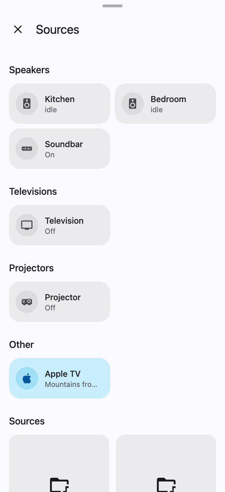
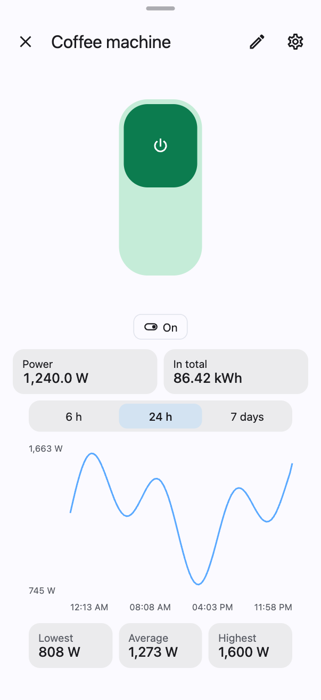
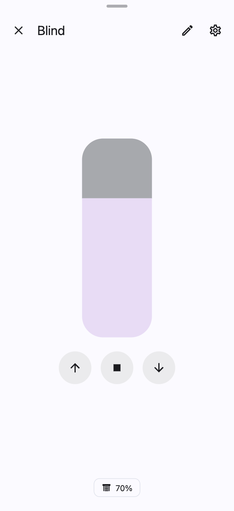

# Windows for your own devices

[Polski](own-devices.pl.md) · [Guide](guide.md)

Every home has different devices: a washing machine, an air purifier, a lawn mower, a 3D printer, a heat pump. Home
Dashboard does not need to know them in advance. There are four ways to give a device its button and its window, from
the simplest to the richest. None needs programming, and the windows take the look of the theme on their own.

| Vacuum as a block | Switch | Blind |
|---|---|---|
|  |  |  |

## 1. Which way to choose

| Device | Way | Result |
|---|---|---|
| Light, blind, thermostat, lock, alarm, speaker, switch | [tile in a room](#2-tile-in-a-room) | the ready control window of the dashboard |
| Something simple: a sensor, a plug, a helper, a script | [tile in a room](#2-tile-in-a-room) | its state on the tile, the window of Home Assistant or a toggle with one tap |
| A device with a good card in Home Assistant or HACS | [own card of a device](#3-own-card-of-a-device) | that card in a window of the dashboard |
| A device with many values and buttons | [block with its own window](#4-block-with-its-own-window) | a window made of numbers, buttons, rows and a card |

## 2. Tile in a room

A room is an area of Home Assistant. Lights, climate, blinds and locks of the area show in the room by themselves.
Any other device is added by hand:

1. Open the room, three dots → **Edit this screen**.
2. **Add a tile** in a section, search for the entity and save.

A tap on the tile opens:

| Domain | What opens |
|---|---|
| `light` | the lamp window: brightness, colour, white temperature |
| `cover` | the blind window with a position slider |
| `climate` | the thermostat window with a dial |
| `lock`, `alarm_control_panel` | the lock or the alarm window |
| `media_player` | the player window |
| `switch`, `input_boolean` | the switch window with a big button |
| `scene`, `script`, `button` | runs it, and the tile confirms with a tick |
| any other (`sensor`, `fan`, `vacuum`…) | the details window of Home Assistant |

A tile can be adjusted in the editor or in the configuration:

```yaml
layout:
  - id: laundry
    name: Laundry
    sections:
      - title: Devices
        tiles:
          - {entity: switch.dryer, name: Dryer, icon: mdi:tumble-dryer}
          - {entity: automation.laundry_reminder, name: Reminder, tap_toggle: true}
          - {entity: sensor.washer_state, name: Washer, icon: mdi:washing-machine}
```

| Option | What it does |
|---|---|
| `name`, `icon` | own name and icon (the icon also changes in **Look → Icons**) |
| `tap_toggle: true` | one tap toggles instead of opening a window |
| `calm: true` | no colour while on; for things that are on nearly all the time |
| `action: script.x` | a tap runs a script |
| `active_only: true` | the tile shows only while the device is doing something |
| `turn_on_only: true` | can only be turned on; turning off with a PIN through `off_pin` |

## 3. Own card of a device

Many devices have great cards in Home Assistant or HACS: a vacuum map, a lawn mower card, a lamp card. Such a card can
be put behind the tile of the device. A tap on the tile and on its icon then opens that card in a window of the
dashboard, on every page and in every filter.

In **Dashboard settings → Edit configuration**:

```yaml
entities:
  overrides:
    lawn_mower.garden:
      card: {type: custom:lawn-mower-card, entity: lawn_mower.garden}
    light.aquarium:
      card: {type: custom:lamp-card, entity: light.aquarium, title: false}
```

The card comes from Home Assistant, so it has colours of its own. **Look → Windows → Background of Home Assistant
cards** sets its background; `#00000000` takes it away completely, as in the Apple Home theme.

## 4. Block with its own window

A block is a window built from several entities: numbers at the top, action buttons, rows with switches, lists and
sliders, and at the end, if you like, a card of Home Assistant. The Vacuum in the picture is built that way. A block
shows as a shortcut on Home, in the menu, or as a tile in a room.

### Step by step in the editor

1. Three dots on Home → **Blocks** (administrator account) → **Add** → **Block**.
2. **Name**, **Icon** and **Entity**: the main entity of the device, which gives the block its state.
3. **Numbers at the top**: values seen at once, e.g. the time left of a wash, air quality, the life of a filter. Each
   is an entity, a name, a unit and the number of decimals.
4. **Buttons**: actions of the device, e.g. Start, Pause, Back to base. Each is a name, an icon, an entity and a
   service (`vacuum.start`, `button.press`…). A button with a confirmation asks first.
5. **Groups** and **Rows**: the entities of the device in groups. Each row gets the right control by itself (table
   below). The **Look** of a group turns its rows into big buttons and sliders, or into one folding line.
6. **Card (YAML)**: optionally a card of Home Assistant, behind a button in the window, at once, or under the groups.
7. **Save**. The shortcut shows on Home. How to place the block in a room is in [block in a room](#block-in-a-room).

| Entity in a row | Control |
|---|---|
| `switch`, `input_boolean` | switch |
| `select`, `input_select` | list |
| `number`, `input_number` | slider |
| `button`, `input_button`, `script` | button |
| any other | the state alone, e.g. a `sensor` with its value |

### Example: air purifier

```yaml
shortcuts:
  - kind: panel
    name: Air purifier
    icon: mdi:air-purifier
    entity: fan.air_purifier
    stats:
      - {name: PM2.5, entity: sensor.air_purifier_pm25, unit: "µg/m³", digits: 0}
      - {name: Filter, entity: sensor.air_purifier_filter_life, unit: "%", digits: 0}
    actions:
      - {name: On, icon: mdi:power, entity: fan.air_purifier, service: fan.turn_on}
      - {name: Off, icon: mdi:power-off, entity: fan.air_purifier, service: fan.turn_off}
    groups:
      - title: Settings
        layout: controls
        rows:
          - {entity: select.air_purifier_mode, name: Mode, labels: {auto: Auto, sleep: Night, favorite: Favourite}}
          - {entity: number.air_purifier_favorite_level, name: Power}
          - {entity: switch.air_purifier_child_lock, name: Child lock}
      - title: Details
        layout: summary
        rows:
          - {entity: sensor.air_purifier_temperature, name: Temperature}
          - {entity: sensor.air_purifier_humidity, name: Humidity}
```

### Example: washing machine with a card at the end

```yaml
shortcuts:
  - kind: panel
    name: Washer
    icon: mdi:washing-machine
    entity: sensor.washer_state
    stats:
      - {name: Left, entity: sensor.washer_remaining, unit: min, digits: 0}
      - {name: Used, entity: sensor.washer_energy, unit: kWh, digits: 2}
    actions:
      - {name: Pause, icon: mdi:pause, entity: button.washer_pause, service: button.press, confirm: Pause the wash?}
    groups:
      - rows:
          - {entity: sensor.washer_program, name: Programme}
          - {entity: sensor.washer_spin, name: Spin}
    card: {type: history-graph, entities: [sensor.washer_power], hours_to_show: 3}
    card_open: true
    card_last: true
```

| Option | What it does |
|---|---|
| `stats` | numbers at the top |
| `actions` | buttons; `confirm: Text` asks first |
| `groups[].rows` | rows; `labels` puts the states of a list in your own words |
| `groups[].layout: controls` | big buttons, a choice, a wide slider |
| `groups[].layout: summary` | one line, unfolded with a tap |
| `card`, `card_open`, `card_last` | a card of Home Assistant: behind a button, at once, under the groups |
| `tone` | colour of the shortcut icon: green, purple, teal or pink |
| `label` | small text above the name of the shortcut |

### Block in a room

A block can stand in a room like a tile. In **Dashboard settings → Edit configuration** put the whole definition of
the block (with `kind: panel`) in the `tiles` list of a section of the room, between ordinary tiles:

```yaml
layout:
  - id: living
    name: Living room
    sections:
      - title: Air
        tiles:
          - {entity: sensor.living_co2, name: CO₂}
          - kind: panel
            name: Air purifier
            icon: mdi:air-purifier
            entity: fan.air_purifier
            stats: [{name: PM2.5, entity: sensor.air_purifier_pm25, unit: "µg/m³", digits: 0}]
```

A tap opens the window of the block. From then on you change it in the form: editing the room, the tile of the block
→ **Edit the block**.

## 5. Other ready windows

Besides the block, the editor has ready kinds of windows for common things. All are described in the
[guide](guide.md#7-shortcuts-and-blocks).

| Kind | For |
|---|---|
| **Status** (`overview`) | a screen of the state of the home: only what matters now, e.g. open windows, weak batteries, a running washer |
| **Departures** (`departures`) | the next trams and buses from entities with a list of departures |
| **Machines** (`host`) | servers and computers: processor, memory, disks, versions |
| **Page** (`page`) | another page of the dashboard in a window |
| **App** | an add-on of Home Assistant or a web page on the whole screen |
| **School** | timetable, grades, planner and meals from your own data |
| TV (`tv`) | a remote: power, sources, arrows and keys |

## 6. Who sees a window

- **Look**: every window takes its colours, see-through and blur from **Look → Windows**, the windows of blocks too.
- **Access**: three dots → **User access** hides a block from chosen people, and **Administrators only** in the block
  editor hides it from the rest of the household.
- **Order**: everyone arranges and hides shortcuts for themselves in **My layout**.

## 7. When no way is enough

Some devices need a window of their own, as a lamp with its slider or a thermostat with its dial. Such a window needs
a change in the code of Home Dashboard. Describe the device, its entities and what you want to control in an issue on
[GitHub](https://github.com/witold-gren/home-assistant-dashboard/issues).
