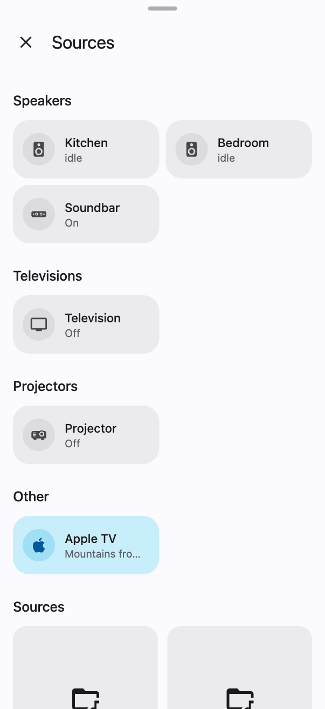
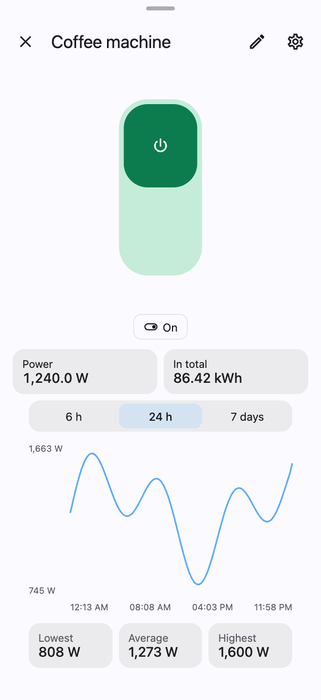
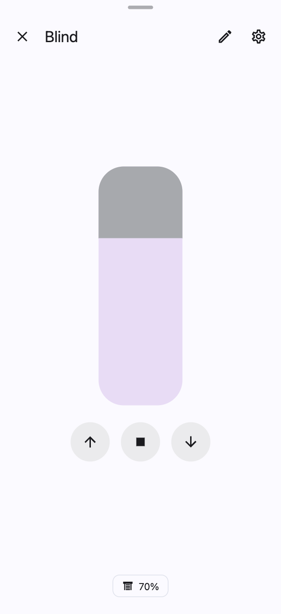

# Windows for your own devices

[Polski](own-devices.pl.md) · [Guide](guide.md)

Every home has different devices: a washing machine, an air purifier, a lawn mower, a 3D printer, a heat pump. Home
Dashboard does not need to know them in advance. There are four ways to give a device its button and its window, from
the simplest to the richest. None needs programming, and the windows take the look of the theme on their own.

Each way can be taken in the [dashboard editor](editor.md) on a computer, without YAML, and most of them right on
the tablet too. The YAML examples below are for those who prefer to type.

| Vacuum as a block | Switch | Blind |
|---|---|---|
|  |  |  |

## 1. Which way to choose

| Device | Way | Result |
|---|---|---|
| Light, blind, thermostat, lock, alarm, speaker, switch | [tile in a room](#2-tile-in-a-room) | the ready control window of the dashboard |
| Something simple: a sensor, a plug, a helper, a script | [tile in a room](#2-tile-in-a-room) | its state on the tile, the window of Home Assistant or a toggle with one tap |
| A device with a good card in Home Assistant or HACS | [own card of a device](#3-own-card-of-a-device) | that card in a window of the dashboard |
| A device with many values and buttons | [block with its own window](#4-block-with-its-own-window) | a window made of numbers, buttons, rows and a card |

Where each way is done:

| Way | Editor on a computer | On the tablet or phone |
|---|---|---|
| Tile in a room | room → section → <b class="ui">Entity…</b> → <b class="ui">Add</b>, or <b class="ui">Choose from the list…</b> | three dots → <b class="ui">Edit this screen</b> → <b class="ui">Add a tile</b> |
| Own card of a device | the tile → <b class="ui">Window of the device</b> → <b class="ui">Own card (YAML)</b> | YAML only (<b class="ui">Edit configuration</b>) |
| Block on Home | <b class="ui">Blocks</b> → **+** → **Block** | **Summary badges** → **Add** → **Block** |
| Block in a room | the tile → <b class="ui">Make a block of this tile</b>, or the tile's <b class="ui">Block</b> field | YAML only; then edited in its form |

## 2. Tile in a room

A room is an area of Home Assistant. Lights, climate, blinds and locks of the area show in the room by themselves.
Any other device is added by hand.

**In the editor on a computer:**

1. In the tree, unfold the room under <b class="ui">Rooms</b> and choose a section (or add one).
2. Type the entity in <b class="ui">Entity…</b> under the properties and press <b class="ui">Add</b>, or open <b class="ui">Choose from the list…</b> to pick
   several at once, filtered by room and kind.
3. The new tile is chosen at once: name, icon, size and the other options are fields of its form.
4. <b class="ui">Publish</b> when the draft is ready.

**On the tablet:**

1. Open the room, three dots → <b class="ui">Edit this screen</b>.
2. <b class="ui">Add a tile</b> in a section, search for the entity and save.

A tap on the tile opens:

| Domain | What opens |
|---|---|
| `light` | the lamp window: brightness, colour, white temperature |
| `cover` | the blind window with a position slider |
| `climate` | the thermostat window with a dial |
| `lock`, `alarm_control_panel` | the lock or the alarm window |
| `media_player` | the player window |
| `switch`, `input_boolean`, `automation` | the switch window with a big button; a plug that measures its power adds the power and its chart, an automation when it last ran |
| `binary_sensor` | its state, when it changed, the battery of its device and when it was on in the last day or week |
| `select`, `input_select` | every option as a button (`confirm: true` on the tile: mark first, then run) |
| `sensor` with a number | its value and its chart |
| `scene`, `script`, `button` | runs it, and the tile confirms with a tick |
| any other (a sensor with text, `fan`, `vacuum`…) | the details window of Home Assistant |

A tile can be adjusted in the editor or in the configuration:

```yaml
layout:
  - id: laundry
    name: Laundry
    sections:
      - title: Devices
        tiles:
          - {entity: switch.dryer, name: Dryer, icon: mdi:tumble-dryer}
          - {entity: automation.laundry_reminder, name: Reminder, tap_toggle: true}
          - {entity: sensor.washer_state, name: Washer, icon: mdi:washing-machine}
```

| Option | What it does |
|---|---|
| `name`, `icon` | own name and icon (the icon also changes in **Look → Icons**) |
| `tap_toggle: true` | one tap toggles instead of opening a window |
| `calm: true` | no colour while on; for things that are on nearly all the time |
| `size: tall` | a tall tile over two rows, the icon at the top, the name and state at the bottom; in the editor: tile → <b class="ui">Size</b> |
| `action: script.x` | a tap runs a script |
| `active_only: true` | the tile shows only while the device is doing something |
| `turn_on_only: true` | can only be turned on; turning off with a PIN through `off_pin` |

## 3. Own card of a device

Many devices have great cards in Home Assistant or HACS: a vacuum map, a lawn mower card, a lamp card. Such a card can
be put behind the tile of the device. A tap on the tile and on its icon then opens that card in a window of the
dashboard, on every page and in every filter.

**In the editor on a computer:**

1. Choose the tile of the device in its room.
2. Under its properties, <b class="ui">Window of the device</b> has the field <b class="ui">Own card (YAML)</b>. Type the card there, as in the
   card editor of Home Assistant, starting with its `type`:

   ```yaml
   type: custom:lawn-mower-card
   entity: lawn_mower.garden
   ```

3. The preview opens the card on a tap at once. Emptying the field brings the dashboard's window back.

The card belongs to the entity, not to one tile: it opens wherever the entity is shown. The same field is under
**Settings → Entities: added, left out, own → Own settings of an entity**, where you also see every entity that has
a card.

**On the tablet** the card is typed in YAML, in **Dashboard settings → Edit configuration**:

```yaml
entities:
  overrides:
    lawn_mower.garden:
      card: {type: custom:lawn-mower-card, entity: lawn_mower.garden}
    light.aquarium:
      card: {type: custom:lamp-card, entity: light.aquarium, title: false}
```

The card comes from Home Assistant, so it has colours of its own. **Look → Windows → Background of Home Assistant
cards** sets its background; `#00000000` takes it away completely, as in the Apple Home theme.

## 4. Block with its own window

A block is a window built from several entities: numbers at the top, action buttons, rows with switches, lists and
sliders, and at the end, if you like, a card of Home Assistant. The Vacuum in the picture is built that way. A block
shows as a shortcut on Home, in the menu, or as a tile in a room.

### Step by step in the editor on a computer

1. In the tree, **+** beside **Blocks** → **Block**. A new block "Block" is added and chosen (a block of another kind,
   such as <b class="ui">Status</b>, <b class="ui">Departures</b> or <b class="ui">Machines</b>, is chosen in the same list).
2. Fill in <b class="ui">Name</b>, <b class="ui">Icon</b> and <b class="ui">Entity</b>, the main entity of the device.
3. Unfold the block in the tree: <b class="ui">Numbers at the top</b>, <b class="ui">Buttons</b> and <b class="ui">Groups</b> each have a field to add an
   entity, and a group has its rows. Each part chosen in the tree has its own form.
4. **From the device, not in the block yet** lists the other entities of the device: one click adds each as a row.
5. The preview opens the block's window while you work on it, and outlines in red what is chosen.
6. <b class="ui">Publish</b>. The block shows among the badges of Home.

### Step by step on the tablet

1. Three dots on Home → <b class="ui">Summary badges</b> (administrator account) → <b class="ui">Add</b> → <b class="ui">Block</b>.
2. <b class="ui">Name</b>, <b class="ui">Icon</b> and <b class="ui">Entity</b>: the main entity of the device, which gives the block its state.
3. <b class="ui">Numbers at the top</b>: values seen at once, e.g. the time left of a wash, air quality, the life of a filter. Each
   is an entity, a name, a unit and the number of decimals.
4. <b class="ui">Buttons</b>: actions of the device, e.g. Start, Pause, Back to base. Each is a name, an icon, an entity and a
   service (`vacuum.start`, `button.press`…). A button with a confirmation asks first.
5. <b class="ui">Groups</b> and <b class="ui">Rows</b>: the entities of the device in groups. Each row gets the right control by itself (table
   below). The <b class="ui">Look</b> of a group turns its rows into big buttons and sliders, or into one folding line.
6. <b class="ui">Card (YAML)</b>: optionally a card of Home Assistant, behind a button in the window, at once, or under the groups.
7. <b class="ui">Save</b>. The shortcut shows on Home. How to place the block in a room is in [block in a room](#block-in-a-room).

| Entity in a row | Control |
|---|---|
| `switch`, `input_boolean` | switch |
| `select`, `input_select` | list |
| `number`, `input_number` | slider |
| `button`, `input_button`, `script` | button |
| any other | the state alone, e.g. a `sensor` with its value |

### Example: air purifier

```yaml
shortcuts:
  - kind: panel
    name: Air purifier
    icon: mdi:air-purifier
    entity: fan.air_purifier
    stats:
      - {name: PM2.5, entity: sensor.air_purifier_pm25, unit: "µg/m³", digits: 0}
      - {name: Filter, entity: sensor.air_purifier_filter_life, unit: "%", digits: 0}
    actions:
      - {name: On, icon: mdi:power, entity: fan.air_purifier, service: fan.turn_on}
      - {name: Off, icon: mdi:power-off, entity: fan.air_purifier, service: fan.turn_off}
    groups:
      - title: Settings
        layout: controls
        rows:
          - {entity: select.air_purifier_mode, name: Mode, labels: {auto: Auto, sleep: Night, favorite: Favourite}}
          - {entity: number.air_purifier_favorite_level, name: Power}
          - {entity: switch.air_purifier_child_lock, name: Child lock}
      - title: Details
        layout: summary
        rows:
          - {entity: sensor.air_purifier_temperature, name: Temperature}
          - {entity: sensor.air_purifier_humidity, name: Humidity}
```

### Example: washing machine with a card at the end

```yaml
shortcuts:
  - kind: panel
    name: Washer
    icon: mdi:washing-machine
    entity: sensor.washer_state
    stats:
      - {name: Left, entity: sensor.washer_remaining, unit: min, digits: 0}
      - {name: Used, entity: sensor.washer_energy, unit: kWh, digits: 2}
    actions:
      - {name: Pause, icon: mdi:pause, entity: button.washer_pause, service: button.press, confirm: Pause the wash?}
    groups:
      - rows:
          - {entity: sensor.washer_program, name: Programme}
          - {entity: sensor.washer_spin, name: Spin}
    card: {type: history-graph, entities: [sensor.washer_power], hours_to_show: 3}
    card_open: true
    card_last: true
```

| Option | What it does |
|---|---|
| `stats` | numbers at the top |
| `actions` | buttons; `confirm: Text` asks first |
| `groups[].rows` | rows; `labels` puts the states of a list in your own words |
| `groups[].layout: controls` | big buttons, a choice, a wide slider |
| `groups[].layout: summary` | one line, unfolded with a tap |
| `card`, `card_open`, `card_last` | a card of Home Assistant: behind a button, at once, under the groups |
| `tone` | colour of the shortcut icon: green, purple, teal or pink |
| `label` | small text above the name of the shortcut |

### Block in a room

A block can stand in a room like a tile. In the editor on a computer there are two ways:

- **Make a block of this tile:** choose the device's tile in its room; under <b class="ui">Window of the device</b> the button
  turns the tile into a block in its place, with its name, icon and size. The tile unfolds in the tree into
  <b class="ui">Numbers at the top</b>, <b class="ui">Buttons</b> and <b class="ui">Groups</b>, and the device's other entities are offered one click each.
  The block belongs to the room only and does not show on Home.
- **The Block field of a tile:** a tile chooses a block from <b class="ui">Blocks</b> in its <b class="ui">Block</b> field (`shortcut`). The tile
  then opens that block; one block can stand in several rooms and on Home at once.

On the tablet, in **Dashboard settings → Edit configuration**, put the whole definition of the block (with
`kind: panel`) in the `tiles` list of a section of the room, between ordinary tiles:

```yaml
layout:
  - id: living
    name: Living room
    sections:
      - title: Air
        tiles:
          - {entity: sensor.living_co2, name: CO₂}
          - kind: panel
            name: Air purifier
            icon: mdi:air-purifier
            entity: fan.air_purifier
            stats: [{name: PM2.5, entity: sensor.air_purifier_pm25, unit: "µg/m³", digits: 0}]
```

A tap opens the window of the block. From then on you change it in the form: editing the room, the tile of the block
→ <b class="ui">Edit the block</b>.

## 5. Other ready windows

Besides the block, the editor has ready kinds of windows for common things. All are described in the
[guide](guide.md#7-shortcuts-and-blocks).

| Kind | For |
|---|---|
| <b class="ui">Status</b> (`overview`) | a screen of the state of the home: only what matters now, e.g. open windows, weak batteries, a running washer |
| <b class="ui">Departures</b> (`departures`) | the next trams and buses from entities with a list of departures |
| <b class="ui">Machines</b> (`host`) | servers and computers: processor, memory, disks, versions |
| <b class="ui">Page</b> (`page`) | another page of the dashboard in a window |
| <b class="ui">App</b> | an add-on of Home Assistant or a web page on the whole screen |
| <b class="ui">School</b> | timetable, grades, planner and meals from your own data |
| TV (`tv`) | a remote: power, sources, arrows and keys |

## 6. Who sees a window

- <b class="ui">Look</b>: every window takes its colours, see-through and blur from **Look → Windows**, the windows of blocks too.
- **Access**: three dots → <b class="ui">User access</b> hides a block from chosen people, and <b class="ui">Administrators only</b> in the block
  editor hides it from the rest of the household.
- **Order**: everyone arranges and hides shortcuts for themselves in <b class="ui">My layout</b>.

## 7. When no way is enough

Some devices need a window of their own, as a lamp with its slider or a thermostat with its dial. Such a window needs
a change in the code of Home Dashboard. Describe the device, its entities and what you want to control in an issue on
[GitHub](https://github.com/witold-gren/home-assistant-dashboard/issues).
