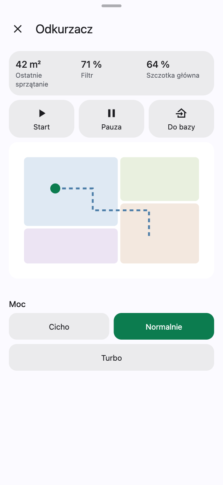
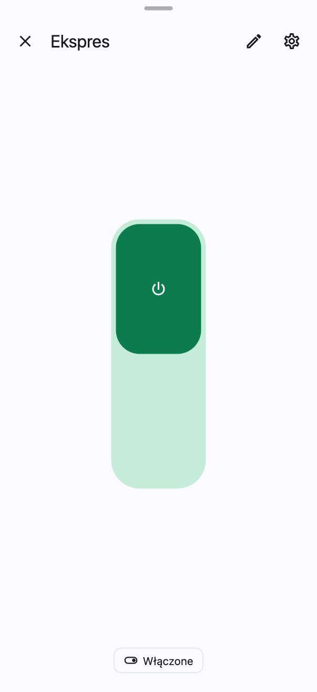
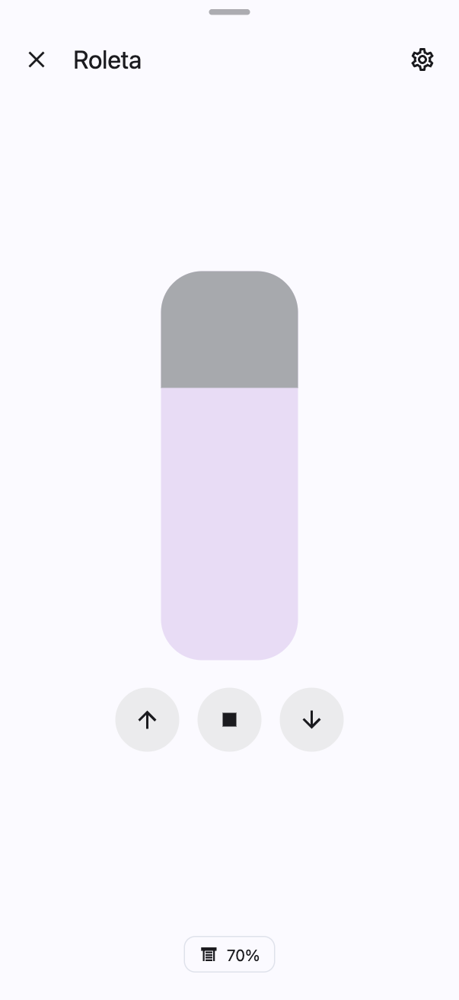

# Okna dla własnych urządzeń

[English](own-devices.md) · [Przewodnik](guide.pl.md)

Każdy dom ma inne urządzenia: pralkę, oczyszczacz powietrza, kosiarkę, drukarkę 3D, pompę ciepła. Home Dashboard nie
musi znać ich z góry. Masz cztery drogi, żeby urządzenie dostało swój przycisk i swoje okno, od najprostszej do
najbardziej rozbudowanej. Żadna nie wymaga programowania, a okna same biorą wygląd motywu.

Każdą drogę przejdziesz w [edytorze dashboardu](editor.pl.md) na komputerze, bez YAML, a większość także na samym
tablecie. Przykłady YAML niżej są dla tych, którzy wolą wpisać konfigurację.

| Odkurzacz jako blok | Przełącznik | Roleta |
|---|---|---|
|  |  |  |

## 1. Którą drogę wybrać

| Urządzenie | Droga | Efekt |
|---|---|---|
| Światło, roleta, termostat, zamek, alarm, głośnik, przełącznik | [kafelek w pokoju](#2-kafelek-w-pokoju) | gotowe okno sterowania dashboardu |
| Coś prostego: czujnik, gniazdko, pomocnik, skrypt | [kafelek w pokoju](#2-kafelek-w-pokoju) | stan na kafelku, okno Home Assistant albo przełączanie jednym dotknięciem |
| Urządzenie, które ma dobrą kartę Home Assistant albo z HACS | [własna karta urządzenia](#3-własna-karta-urządzenia) | ta karta w oknie dashboardu |
| Urządzenie z wieloma wartościami i przyciskami | [blok z własnym oknem](#4-blok-z-własnym-oknem) | okno złożone z liczb, przycisków, wierszy i karty |

Gdzie przejdziesz każdą drogę:

| Droga | Edytor na komputerze | Na tablecie lub telefonie |
|---|---|---|
| Kafelek w pokoju | pokój → sekcja → <b class="ui">Encja…</b> → <b class="ui">Dodaj</b> albo <b class="ui">Wybierz z listy…</b> | trzy kropki → <b class="ui">Edytuj ten ekran</b> → <b class="ui">Dodaj kafelek</b> |
| Własna karta urządzenia | kafelek → <b class="ui">Okno urządzenia</b> → <b class="ui">Własna karta (YAML)</b> | tylko YAML (<b class="ui">Edytuj konfigurację</b>) |
| Blok na stronie głównej | <b class="ui">Bloki</b> → **+** → **Blok** | **Odznaki podsumowania** → **Dodaj** → **Blok** |
| Blok w pokoju | kafelek → <b class="ui">Zrób blok z tego kafelka</b> albo pole <b class="ui">Blok</b> kafelka | tylko YAML; potem edycja w formularzu |

## 2. Kafelek w pokoju

Pokój to obszar Home Assistant. Światła, klimat, rolety i zamki z obszaru pojawiają się w pokoju same. Każde inne
urządzenie dodasz ręcznie.

**W edytorze na komputerze:**

1. W drzewie rozwiń pokój w <b class="ui">Pokoje</b> i wybierz sekcję (albo dodaj nową).
2. Wpisz encję w polu <b class="ui">Encja…</b> pod właściwościami i kliknij <b class="ui">Dodaj</b> albo otwórz <b class="ui">Wybierz z listy…</b>, żeby
   zaznaczyć kilka naraz, z filtrem pokoju i rodzaju.
3. Nowy kafelek od razu jest wybrany: nazwa, ikona, rozmiar i pozostałe opcje to pola jego formularza.
4. <b class="ui">Opublikuj</b>, gdy szkic jest gotowy.

**Na tablecie:**

1. Otwórz pokój, trzy kropki → <b class="ui">Edytuj ten ekran</b>.
2. <b class="ui">Dodaj kafelek</b> w wybranej sekcji, wyszukaj encję i zapisz.

Po dotknięciu kafelka:

| Domena | Co się otwiera |
|---|---|
| `light` | okno lampy: jasność, kolor, barwa bieli |
| `cover` | okno rolety z suwakiem pozycji |
| `climate` | okno termostatu z pokrętłem |
| `lock`, `alarm_control_panel` | okno zamka albo alarmu |
| `media_player` | okno odtwarzacza |
| `switch`, `input_boolean`, `automation` | okno przełącznika z dużym przyciskiem; gniazdko mierzące moc dodaje moc z wykresem, a automatyzacja czas ostatniego uruchomienia |
| `binary_sensor` | stan, czas zmiany, bateria urządzenia i zdarzenia z ostatniej doby albo tygodnia |
| `select`, `input_select` | każda opcja jako przycisk (`confirm: true` na kafelku: najpierw zaznacz, potem uruchom) |
| `sensor` z liczbą | wartość i wykres |
| `scene`, `script`, `button` | uruchomienie, a kafelek potwierdza je znaczkiem |
| każda inna (czujnik z tekstem, `fan`, `vacuum`…) | okno szczegółów Home Assistant |

Kafelek możesz dopasować w edytorze albo w konfiguracji:

```yaml
layout:
  - id: laundry
    name: Pralnia
    sections:
      - title: Urządzenia
        tiles:
          - {entity: switch.dryer, name: Suszarka, icon: mdi:tumble-dryer}
          - {entity: automation.laundry_reminder, name: Przypomnienie, tap_toggle: true}
          - {entity: sensor.washer_state, name: Pralka, icon: mdi:washing-machine}
```

| Opcja | Co robi |
|---|---|
| `name`, `icon` | własna nazwa i ikona (ikonę zmienisz też w **Wygląd → Ikony**) |
| `tap_toggle: true` | jedno dotknięcie przełącza zamiast otwierać okno |
| `calm: true` | bez koloru, gdy włączone; dla rzeczy prawie zawsze włączonych |
| `size: tall` | wysoki kafelek na dwa wiersze, ikona u góry, nazwa i stan na dole; w edytorze: kafelek → <b class="ui">Rozmiar</b> |
| `action: script.x` | dotknięcie uruchamia skrypt |
| `active_only: true` | kafelek widać tylko, gdy urządzenie coś robi |
| `turn_on_only: true` | można tylko włączyć; wyłączenie przez PIN z `off_pin` |

## 3. Własna karta urządzenia

Wiele urządzeń ma świetne karty w Home Assistant albo w HACS: mapa odkurzacza, karta kosiarki, karta lampy. Możesz
podpiąć taką kartę pod kafelek urządzenia. Dotknięcie kafelka i jego ikony otworzy wtedy tę kartę w oknie
dashboardu, na każdej stronie i w każdym filtrze.

**W edytorze na komputerze:**

1. Wybierz kafelek urządzenia w jego pokoju.
2. Pod właściwościami, w <b class="ui">Okno urządzenia</b>, jest pole <b class="ui">Własna karta (YAML)</b>. Wpisz tam kartę tak jak w edytorze
   kart Home Assistant, zaczynając od `type`:

   ```yaml
   type: custom:lawn-mower-card
   entity: lawn_mower.garden
   ```

3. Podgląd od razu otwiera kartę po dotknięciu. Wyczyszczenie pola przywraca okno dashboardu.

Karta należy do encji, a nie do jednego kafelka: otwiera się wszędzie, gdzie ta encja jest. To samo pole jest w
**Ustawienia → Encje: dodane, pominięte, własne → Własne ustawienia encji**, gdzie widać też wszystkie encje z kartą.

**Na tablecie** kartę wpisujesz w YAML, w **Ustawienia dashboardu → Edytuj konfigurację**:

```yaml
entities:
  overrides:
    lawn_mower.garden:
      card: {type: custom:lawn-mower-card, entity: lawn_mower.garden}
    light.aquarium:
      card: {type: custom:lamp-card, entity: light.aquarium, title: false}
```

Karta pochodzi z Home Assistant, więc ma własne kolory. **Wygląd → Okna → Tło kart Home Assistant** ustawia jej tło;
`#00000000` usuwa je całkiem, jak w motywie Apple Home.

## 4. Blok z własnym oknem

Blok to okno zbudowane z kilku encji: liczby na górze, przyciski akcji, wiersze z przełącznikami, listami i
suwakami, a na końcu, jeśli chcesz, karta Home Assistant. Tak zbudowany jest Odkurzacz na zrzucie. Blok pokazuje się
jako skrót na stronie głównej, w menu albo jako kafelek w pokoju.

### Krok po kroku w edytorze na komputerze

1. W drzewie **+** obok **Bloki** → **Blok**. Nowy blok „Blok” zostaje dodany i wybrany (blok innego rodzaju, np.
   <b class="ui">Status</b>, <b class="ui">Odjazdy</b> albo <b class="ui">Maszyny</b>, wybierasz z tej samej listy).
2. Uzupełnij **Nazwę**, **Ikonę** i **Encję**, czyli główną encję urządzenia.
3. Rozwiń blok w drzewie: <b class="ui">Liczby na górze</b>, <b class="ui">Przyciski</b> i <b class="ui">Grupy</b> mają pole do dodania encji, a grupa swoje
   wiersze. Każda część wybrana w drzewie ma własny formularz.
4. **Z urządzenia, jeszcze nie w bloku** wypisuje pozostałe encje urządzenia: jedno kliknięcie dodaje każdą jako
   wiersz.
5. Podgląd otwiera okno bloku w trakcie pracy i obrysowuje na czerwono to, co jest wybrane.
6. <b class="ui">Opublikuj</b>. Blok pojawia się wśród odznak strony głównej.

### Krok po kroku na tablecie

1. Trzy kropki na stronie głównej → <b class="ui">Odznaki podsumowania</b> (konto administratora) → <b class="ui">Dodaj</b> → <b class="ui">Blok</b>.
2. <b class="ui">Nazwa</b>, <b class="ui">Ikona</b> i <b class="ui">Encja</b>: główna encja urządzenia, od której blok bierze stan.
3. <b class="ui">Liczby u góry</b>: wartości, które widać od razu, np. pozostały czas prania, jakość powietrza, stan filtra. Każda
   to encja, nazwa, jednostka i liczba miejsc po przecinku.
4. <b class="ui">Przyciski</b>: akcje urządzenia, np. Start, Pauza, Do bazy. Każdy to nazwa, ikona, encja i usługa
   (`vacuum.start`, `button.press`…). Przycisk z potwierdzeniem najpierw pyta.
5. <b class="ui">Grupy</b> i <b class="ui">Wiersze</b>: encje urządzenia ułożone w grupy. Każdy wiersz sam dostaje właściwą kontrolkę (tabela
   niżej). <b class="ui">Wygląd</b> grupy zmienia wiersze na duże przyciski i suwaki albo na jedną zwijaną linię.
6. <b class="ui">Karta (YAML)</b>: opcjonalnie karta Home Assistant na przycisk w oknie, od razu albo pod grupami.
7. <b class="ui">Zapisz</b>. Skrót pojawi się na stronie głównej. Jak postawić blok w pokoju, opisuje [blok w pokoju](#blok-w-pokoju).

| Encja w wierszu | Kontrolka |
|---|---|
| `switch`, `input_boolean` | przełącznik |
| `select`, `input_select` | lista wyboru |
| `number`, `input_number` | suwak |
| `button`, `input_button`, `script` | przycisk |
| każda inna | sam stan, np. `sensor` z wartością |

### Przykład: oczyszczacz powietrza

```yaml
shortcuts:
  - kind: panel
    name: Oczyszczacz
    icon: mdi:air-purifier
    entity: fan.air_purifier
    stats:
      - {name: PM2.5, entity: sensor.air_purifier_pm25, unit: "µg/m³", digits: 0}
      - {name: Filtr, entity: sensor.air_purifier_filter_life, unit: "%", digits: 0}
    actions:
      - {name: Włącz, icon: mdi:power, entity: fan.air_purifier, service: fan.turn_on}
      - {name: Wyłącz, icon: mdi:power-off, entity: fan.air_purifier, service: fan.turn_off}
    groups:
      - title: Ustawienia
        layout: controls
        rows:
          - {entity: select.air_purifier_mode, name: Tryb, labels: {auto: Auto, sleep: Noc, favorite: Ulubiony}}
          - {entity: number.air_purifier_favorite_level, name: Moc}
          - {entity: switch.air_purifier_child_lock, name: Blokada}
      - title: Szczegóły
        layout: summary
        rows:
          - {entity: sensor.air_purifier_temperature, name: Temperatura}
          - {entity: sensor.air_purifier_humidity, name: Wilgotność}
```

### Przykład: pralka z kartą na końcu

```yaml
shortcuts:
  - kind: panel
    name: Pralka
    icon: mdi:washing-machine
    entity: sensor.washer_state
    stats:
      - {name: Zostało, entity: sensor.washer_remaining, unit: min, digits: 0}
      - {name: Zużycie, entity: sensor.washer_energy, unit: kWh, digits: 2}
    actions:
      - {name: Pauza, icon: mdi:pause, entity: button.washer_pause, service: button.press, confirm: Wstrzymać pranie?}
    groups:
      - rows:
          - {entity: sensor.washer_program, name: Program}
          - {entity: sensor.washer_spin, name: Wirowanie}
    card: {type: history-graph, entities: [sensor.washer_power], hours_to_show: 3}
    card_open: true
    card_last: true
```

| Opcja | Co robi |
|---|---|
| `stats` | liczby u góry |
| `actions` | przyciski; `confirm: Tekst` najpierw pyta |
| `groups[].rows` | wiersze; `labels` tłumaczy stany listy na własne słowa |
| `groups[].layout: controls` | duże przyciski, wybór, szeroki suwak |
| `groups[].layout: summary` | jedna linia, rozwijana dotknięciem |
| `card`, `card_open`, `card_last` | karta Home Assistant: na przycisk, od razu, pod grupami |
| `tone` | kolor ikony skrótu: green, purple, teal albo pink |
| `label` | mały tekst nad nazwą skrótu |

### Blok w pokoju

Blok może stać w pokoju jak zwykły kafelek. W edytorze na komputerze są dwie drogi:

- **Zrób blok z tego kafelka:** wybierz kafelek urządzenia w jego pokoju; przycisk w <b class="ui">Okno urządzenia</b> zamienia
  kafelek na miejscu w blok, z jego nazwą, ikoną i rozmiarem. Kafelek rozwija się w drzewie w <b class="ui">Liczby na górze</b>,
  <b class="ui">Przyciski</b> i <b class="ui">Grupy</b>, a pozostałe encje urządzenia dodasz jednym kliknięciem. Taki blok należy tylko do
  pokoju i nie pokazuje się na stronie głównej.
- **Pole Blok kafelka:** kafelek wybiera blok z <b class="ui">Bloki</b> w polu <b class="ui">Blok</b> (`shortcut`). Kafelek otwiera wtedy ten
  blok; jeden blok może stać w kilku pokojach i na stronie głównej naraz.

Na tablecie, w **Ustawienia dashboardu → Edytuj konfigurację**, wstaw całą definicję bloku (z `kind: panel`) do
listy `tiles` sekcji pokoju, między zwykłe kafelki:

```yaml
layout:
  - id: living
    name: Salon
    sections:
      - title: Powietrze
        tiles:
          - {entity: sensor.living_co2, name: CO₂}
          - kind: panel
            name: Oczyszczacz
            icon: mdi:air-purifier
            entity: fan.air_purifier
            stats: [{name: PM2.5, entity: sensor.air_purifier_pm25, unit: "µg/m³", digits: 0}]
```

Dotknięcie otwiera okno bloku. Dalej zmieniasz go już w formularzu: edycja pokoju, kafelek bloku → <b class="ui">Edytuj blok</b>.

## 5. Inne gotowe okna

Poza blokiem edytor ma gotowe rodzaje okien na często spotykane rzeczy. Wszystkie są opisane w
[przewodniku](guide.pl.md#7-skróty-i-bloki).

| Rodzaj | Do czego |
|---|---|
| <b class="ui">Status</b> (`overview`) | ekran stanu domu: tylko to, co teraz ważne, np. otwarte okna, słabe baterie, pracująca pralka |
| <b class="ui">Odjazdy</b> (`departures`) | najbliższe odjazdy tramwajów i autobusów z encji z listą odjazdów |
| <b class="ui">Maszyny</b> (`host`) | serwery i komputery: procesor, pamięć, dyski, wersje |
| <b class="ui">Strona</b> (`page`) | inna strona dashboardu w oknie |
| <b class="ui">Aplikacja</b> | dodatek Home Assistant albo strona WWW na cały ekran |
| <b class="ui">Szkoła</b> | plan lekcji, oceny, terminarz i obiady z własnych danych |
| telewizor (`tv`) | pilot: włączanie, źródła, strzałki i klawisze |

## 6. Kto widzi okno

- <b class="ui">Wygląd</b>: każde okno bierze kolory, przezroczystość i rozmycie z **Wygląd → Okna**, także okna bloków.
- **Dostęp**: trzy kropki → <b class="ui">Dostęp użytkowników</b> ukrywa blok wybranym osobom, a pole <b class="ui">Tylko administratorzy</b> w
  edytorze bloku chowa go przed resztą domowników.
- **Kolejność**: każdy ułoży i ukryje skróty dla siebie w <b class="ui">Mój układ</b>.

## 7. Gdy żadna droga nie wystarcza

Niektóre urządzenia potrzebują zupełnie nowego okna, jak lampa ze swoim suwakiem czy termostat z pokrętłem. Takie okno
wymaga zmiany w kodzie Home Dashboard. Opisz urządzenie, jego encje i to, czym chcesz sterować, w zgłoszeniu na
[GitHubie](https://github.com/witold-gren/home-assistant-dashboard/issues).
